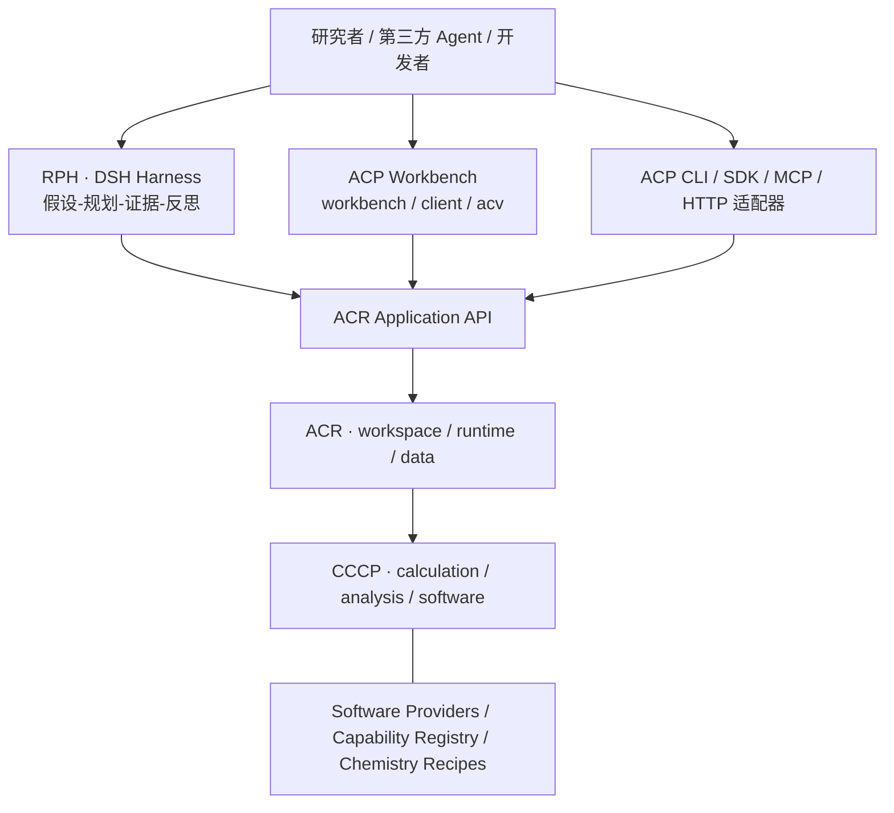

# ACP 2.0 四组分协同升级方案

**版本**：架构提案 v2.0（2026-10-20）  
**基线**：《ACP 三层高内聚模块设计》《ACP 模块边界与统一接口》《ACP 完整架构调整方案》（2026-10-16）  
**性质**：研发与架构目标，不代表迁移、插件及 Agent 已经实现。

**实施前提（2026-10-20 补充）**：按 `.omo/plans/acp-architecture-acceptance-remediation.md` 本批 debug 已完成并形成冻结候选来规划后续工作；实际验收仍记录其交付 revision 和证据。该批明确延期的 MCP 默认入口、身份/配额生产接线等，纳入 2.0 对应阶段交付，不能由“debug 完成”推定为已实现。本文的 ACR/ACV 为产品职责名称，沿用现有 `acp_services` / `frontend/js/visualization` 实现路径，不以本提案触发目录重命名。

**2026-10-21 更新**：用户已确认 debug 完成；正式代码候选为 `bb309134c7b2bb21d8a8bfcb5589516a5b0cf798`，含 Harness/报告的交付 revision 为 `3670790363c7a1959ad1dbe4b4297adec518952a`。后续三 Agent 计划以此交付为默认开工基线，具体范围与未验证项见[正式报告](../reports/architecture_remediation_20261020/REPORT.md)及[并行执行总索引](reference/next-change/ACP_2.0_Parallel_Execution_Index_20261020.md)。

> **Chemistry First. Complexity Last.**  
> Draw a reaction. Ask a question. Explore the mechanism.

## 0. 执行摘要与不可变原则

ACP 2.0 是四组分、九个继承业务模块的产品生态，而非四个必须串行的运行层：

1. **CCCP**：开放、可独立运行的计算化学科学协议与能力底座，负责科学计算、数据标准、能力适用性、科学验证和 Chemistry Workflow Recipes。
2. **ACP CLI / ACR**：独立 Headless 科研执行平台，负责身份、授权、项目、配额、任务、队列、集群、数据资源、API、MCP 与恢复。ACP CLI 是发行产品与用户入口，ACR 是内部应用运行内核。
3. **ACP Workbench**：人类科研交互入口，负责编辑结构/反应、操作、任务观察、科学可视化及报告呈现，独立于 Agent。
4. **RPH**：基于 DSH 的科研 Agent，负责化学问题理解、假设、科学计划、证据反馈和研究记忆；与 Workbench 并列调用 ACR。

**四个不变量**：
- CCCP 不依赖 ACR、账户、集群、浏览器、DSH 或付费机制；可以本地独立运行。
- ACR 对平台任务生命周期、资源准入、持久状态、数据资源拥有唯一权威；RPH/Workbench 不建立第二任务执行系统。
- 任何插件须通过受限协议接入；科学计算是否成功、科学命题是否有证据支持分开判断。
- 用户以化学问题和结构为起点；专业计算参数默认化但不隐瞒科学不确定性，明确可选高级控制。

## 1. 总体协同架构



RPH 和 Workbench 是**并列客户端**，不是前者通过后者，也不要求 Workbench 启动 Agent。CCCP 可独立被 Python/科学 CLI 使用，不经过 ACR 执行平台生命周期。三层九模块是**模块职责**；四组分是**产品与开放接口边界**，两者不矛盾。

## 2. 原九模块与新增 RPH 的精确职责

| 产品 | 保留模块 | 唯一责任 / 本次扩展 |
|---|---|---|
| CCCP | `software` | 原生量化输入输出、Engine Adapter、Parser、底层进程执行、软件版本适配；算法 Provider 可由 `analysis` 提供 |
| CCCP | `analysis` | 规范化科学对象、科学分析算法、数据处理、科学验证器及 EvidenceReport |
| CCCP | `calculation` | 唯一科学 Task 根、Scientific Capability Registry、Recipe 语义、TaskRequest/TaskContext/TaskResult |
| ACP CLI / ACR | `workspace` | Principal、项目、权限、API Key、角色、资源授权、账户/账本、审计 |
| ACP CLI / ACR | `runtime` | 准入、持久任务、控制器、plan_runner、调度后端、CAS/attempt、撤销、恢复与用量证据 |
| ACP CLI / ACR | `data` | 输入、工件、传输、存储绑定、来源、可用性、缓存、manifest、发布、回收 |
| Workbench | `workbench` | 页面/Feature、结构编辑、科学问题向导、用户审批、科研过程与结果交互 |
| Workbench | `client` | 请求去重、ResourceStore 唯一写入口、批量查询、SSE、事件合并与失联续订 |
| Workbench | `acv` | 2D/3D/能量剖面/IRC/振动呈现与局部显示状态，不直接调用 API |
| RPH | Agent 内部组件（不计入九模块） | DSH Bundle、Research Supervisor、Scientific Planner、Hypothesis Graph、Evidence Reviewer、Research Memory、ACP Tool Bridge |

**依赖纪律**：Runtime → Data → Workspace；Runtime 可直接调用 Workspace；Runtime 通过 CCCP 公共科学 API 派发科研计算；CCCP 分为 calculation 调用 analysis/software、analysis 不启动程序。Workbench → client 与 Workbench → acv，client/acv 相互独立。

## 3. CCCP 内部采用三层科学能力架构

**A. 软件/算法支持层（Software & Algorithm Providers）**：Gaussian、ORCA、xTB、CREST、RDKit、ASE、autodE、pysisyphus 等适配器候选。插件只有在对应版本、科学功能及许可证通过适配验证后才能声明提供能力。纯科学分析插件可以不依赖量化引擎。

**B. 科学能力注册层（Scientific Capability Registry）**：科学操作 ID、类型化 I/O、前置条件、算法/Provider 选项、证据/完成条件、版本、许可及能力覆盖。按能力查找实现，不以软件名推断能力。

**C. 化学工作流归簇层（Chemistry Workflow Clusters）**：按科研问题组织 Recipe；Recipe 包含科学步骤的依赖、适用范围、备选策略及证据需求；不能包含平台任务状态机、HPC 队列或账户逻辑。

### 3.1 建议的科学能力家族

| 家族 | 示例标准能力 | 典型数据产物 |
|---|---|---|
| 结构与身份 | `structure.parse`, `reaction.atom_map`, `structure.embed_3d` | `MolecularStructure`, `ReactionSpec` |
| 构象与采样 | `conformer.search`, `.refine`, `.cluster` | `ConformerEnsemble` |
| 电子结构 | `electronic.energy`, `.gradient`, `.hessian`, `.property` | `ElectronicResult` |
| 几何/PES | `geometry.optimize`, `.constrained_optimize`, `surface.scan`, `reaction.path.search` | `OptimizedStructure`, `SurfaceProduct` |
| TS/路径 | `reaction.ts.guess`, `.optimize`, `reaction.path.irc`, `.connectivity` | `StationaryPointResult`, `ReactionPath` |
| 振动/热化学 | `vibration.analyze`, `thermo.correction`, `.ensemble` | `VibrationalResult`, `ThermochemicalResult` |
| 光谱/性质 | `nmr.shielding`, `spectrum.simulate`, `.compare` | `SpectrumResult` |
| 科学验证 | `validate.stationary_point`, `.endpoint_mapping`, `.energy_comparability` | `EvidenceReport` |

该目录是**协议候选**，不是必须立刻实现的全部功能。激发态、动力学、多自旋态、材料、分子动力学等扩展要保留科学 Schema 版本演进通道。

### 3.2 建议的化学问题归簇

`structure.conformation`、`reaction.energetics`、`reaction.mechanism`、`reaction.selectivity`、`reaction.conditions`、`spectrum.structure_elucidation`、`molecular.properties`、`reaction.network_kinetics`。每个归簇容纳多个面向反应类型或研究策略的 Recipe。不要为每一种命名反应编写独立执行引擎。

### 3.3 一项科学能力的契约

```yaml
schema: cccp.capability.v0
id: reaction.ts.optimize
purpose: Optimize candidate first-order saddle points
inputs:
  structure: MolecularStructure
  method: ElectronicStructureMethod
outputs:
  result: StationaryPointResult
preconditions:
  gradient: required
  electronic_state: declared_by_provider
checks:
  - validate.stationary_point
limitations:
  - IRC_connectivity_not_guaranteed
implementations:
  resolution: compatible_verified_providers_only
```

能力与实现分离：`Capability` 指科学操作；`Implementation` 指算法和引擎；`Recipe` 指解决某类化学问题的组合逻辑。插件不应仅凭类型相容就自动替换。科学适用条件必须检查电荷、自旋、立体化学、原子映射、溶剂模型、方法、标准态、参考态及版本。

## 4. 跨组分公共契约

| 契约 | Owner | 作用 |
|---|---|---|
| `ReactionSpec` | CCCP | 原子映射、结构/电荷/自旋/立体、物种、候选基元步骤、条件及输入不确定性 |
| `QuestionSpec` | CCCP | 科学问题类型、待比较假设、预期证据及科学条件 |
| `CapabilityDescriptor` | CCCP | 能力 ID、I/O、支持条件、Provider、验证器 |
| `TaskRequest/TaskContext/TaskResult` | CCCP | 现有科学任务公共接口；只增量扩展，不新增第二任务根 |
| `ScientificRecipe` | CCCP | 可组合科学步骤的类型、前置条件及验证目标 |
| `EvidenceReport` | CCCP | 每项命题的 supported/refuted/inconclusive/not_evaluated、来源及缺失验证 |
| `ScientificProvenance` | CCCP | 模型、参数、方法、软件/插件版本及结果派生来源 |
| `ExecutionEnvelope/Receipt` | ACR.Runtime | 权限/资源冻结后的平台执行计划及受控 Worker 回执 |
| `ArtifactManifest` | ACR.Data | 输入输出工件、摘要、大小、generation、相对引用及可用性 |
| `ResearchRecord/Proposal` | RPH | 目标、假设、推理决策、轮次及对 ACR 任务的引用 |
| `Workbench ViewModel` | Frontend.Client | 经权限校验的只读界面数据快照；不是第二份科学结果权威 |

**两阶段科学验证**：提交前静态 Schema/化学前置条件检查；执行后根据原始输出、构象覆盖、频率/IRC 与可比性实际检查。`Task Completed` ≠ `Scientific Claim Supported`。不能把模型的自然语言推断写回成 CCCP 验证通过的事实。

## 5. ACP CLI / ACR：完整无头运行时

### 5.1 业务职责

- `workspace`：账户与组织、访问控制、项目身份映射、API Key、Quota/Entitlement、Credit 预留与结算（如启用）。项目权限与付费等级必须独立。
- `runtime`：受理/幂等/科学预检委托、资源与预算准入、冻结版本、持久执行意图、队列、controller、plan_runner、Local/LSF/Slurm 后端、取消、对账、重试、恢复、可信用量。
- `data`：输入暂存、ArtifactStore、SSH/SFTP/共享 FS/对象存储适配、缓存与传输、完整性/generation、发布和授权下载。GET 只读，不因查询触发计算或远程传输。

### 5.2 平台执行链

`submit → authenticate/authorize → scientific validate → quote/admit → freeze plan → persist intention → dispatch → worker CCCP → receipt → collect/check → publish → finalize`。

Controller 是平台任务/attempt/CAS 唯一权威；worker 在批准的环境运行 CCCP、写原始产物、返回 Receipt，不直接改中央任务状态。外部提交结果未知时先对账，不盲目重复提交；取消需确认停止；远程计算成功但工件发布失败时只重试发布。

### 5.3 多协议入口

CLI、Python SDK、HTTP REST、MCP、SSE 只是入口/适配器，全部复用相同的 `Workspace / Runtime / Data` 公开应用命令和查询。MCP 只暴露受控科研 API，不为 Agent 提供任意 shell 和 SSH；长任务返回任务引用，Agent 不维持长连接等待量化计算结束。

### 5.4 部署

- **Standalone**：SQLite、本地文件系统、Local Backend、固定受限本地身份、可按需启动服务；无 Redis、K8s、外部 IAM 等强制依赖。
- **Lab Server**：共享持久 Controller、项目权限、服务数据库、已有 LSF/Local；按需求增加 Slurm 和远程传输。
- **Hosted**：加强租户隔离、资源/存储硬限制、版本化计量账本与审计；收费政策不进入 CCCP 科学输入。

## 6. ACP Workbench：Schema-Driven + Chemistry-First

保留 `workbench / client / acv`。

**Workbench** 提供两种入口：Manual Research（不需要 LLM）和 Agent-Assisted（与 RPH 共用项目）。ChemDraw/CDXML、反应物/产物/候选机理输入、Atom Mapping 检查、科学关键歧义确认、任务与证据时间线。对于常规 Capability，根据公开 Schema 自动生成基础表单；对于 Mechanism/NMR/TD 保留定制交互 Feature。

**Client** 对 HTTP/SSE 封装共享的 ResourceStore、批量查询、版本式缓存和增量事件/补全。避免页面和面板各自轮询；不得持有第二任务数据库。

**ACV** 只接收可视化所需的标准化数据块，完成 2D/3D、频率动画、IRC、势能/自由能剖面；大规模科学解析、降维、统计及归一化由 CCCP.Analysis 处理。

## 7. RPH：DSH 研究循环与工具桥接

复用 DSH/Cordis 的 Model、Agent Loop、Session、Tools、Skills、Profiles/Bundles 与审批机制；创建隔离于 DSH 内部易变 API 的 `rph-acp-bridge`。DSH 对外接口在持续迭代，需锁定验证过的版本。不要首期 Fork 核心，也不要用多个 LLM 角色代替科学验证器。

### 7.1 双循环

**Research Loop（RPH）**：Understand → Hypothesize → Critique → Plan → Approve → Wait → Evaluate Evidence → Revise/Stop。

**Execution Loop（ACR）**：Authorize/Admit → Queue → Dispatch → Execute CCCP → Publish → Return task/artifact/evidence references。

科研轮次持久化 `ResearchRecord`（目标、假设、提案、决策、证据链接）；聊天 `Session` 不等于科研项目；RPH 不复制 ACR task/attempt 权威。长任务提交后挂起推理，依持久事件/状态恢复；重复事件须幂等。

### 7.2 初版研究角色

1 个始终存在的 `Research Supervisor` + `Chemistry Interpreter`、`Scientific Planner`、`Evidence Reviewer`、`Research Synthesizer` 等 Skills/工具，必要时再加 Hypothesis Explorer/Critic 子 Agent。优先单 Agent 完成真实闭环，避免过早多 Agent 化。

### 7.3 建议的工具表面

`chemistry_interpret`、`science_discover`、`science_validate_plan`、`science_submit`、`science_status`、`science_evidence`、`research_update_hypothesis`、`research_request_approval`、`research_summarize`。大量 CCCP capabilities 通过动态发现与类型化 Schema 调用，不直接全部暴露成 LLM 顶层工具。

### 7.4 科学与安全约束

输入科学论文/日志/第三方插件描述视为不可信资料，不得提升为授权指令；资源预算与队列约束由 ACR 服务端强制执行。对电荷/自旋/立体/催化剂与基元步骤不明确的情况明确请求确认或标注近似。Agent 的实验建议与 CCCP 的确定性验证结果严格区分。

## 8. 插件生态：Three registries, one research experience

1. **CCCP Scientific Plugins**：软件 Provider、纯算法、Validator、Data Converter、Capability Implementation、Recipe；Python entry_points 可用于候选发现，但发现不等于信任或动态执行。
2. **ACR Infrastructure Adapters**：Local/LSF/Slurm、SSH/SFTP、ArtifactStore、身份 Provider、存储 Backend。不得包含科学结果解析逻辑。
3. **RPH/DSH Plugins & Skills**：Research Supervisor 策略、模型、Skills、科研工具桥接、上下文与评估。不得篡改科学或平台权威状态。

插件信任等级：Generic Tool → Typed Scientific Plugin → Validated Scientific Plugin。Manifest 需记录能力 ID、输入输出、适用限制、科学软件版本、API/Schema 兼容范围、许可、资源需求、来源签名/摘要、验证 Fixture。安装/启用与元数据发现隔离，Trusted Hosted 不运行任意第三方插件；运行中任务冻结插件与计算环境版本。

## 9. 端到端纵向切片：Diels–Alder 机理

`ChemDraw/CDXML` → `ReactionSpec`（身份、立体与 Atom Mapping 审核） → `QuestionSpec`（TS/活化能/endo–exo） → RPH Hypothesis & Proposal → CCCP Recipe（低成本构象/PES/TS 候选/优化/频率/IRC/热化学/验证） → ACR 受权、队列和集群执行 → CCCP EvidenceReport → ACR.Data 发布 → RPH 判断证据和下一步 → Workbench 显示可追溯剖面、结构、IRC、限制。

**第一阶段只承诺限定且经过验证的简单基元反应**。总体反应可能包含多个基元步骤；不能默认净反应对应一个 TS。验证不充分时报告 inconclusive，不伪造“正确机制”。

## 10. 并行研发与集成里程碑

| Phase | CCCP | ACP CLI / ACR | RPH | Workbench | 共同验收 |
|---|---|---|---|---|---|
| **P0 规格冻结** | 现有 Task/数据兼容基线；最小 Capability Schema | 执行契约、权限/错误/事件定义；可执行 MCP 入口及隔离测试启动契约 | 锁定 DSH/Node/MCP 依赖；本服务器真实握手及工具发现 | Client/ACV 数据 Fixture | 旧 15 active workflows 与历史结果兼容；服务器验收环境和证据目录就绪 |
| **P1 基础闭环** | 能量/优化/频率已有能力注册 | CLI Submit/Status/Artifact、Local/LSF 正确；MCP 接真实应用用例 | 真实 DSH Tool Bridge 发现、预检、提交、查询和读取 | 同一任务的只读视图 | 本服务器完成 MCP→DSH→真实计算闭环；CLI/RPH/Web 相同 Task ID、完成状态、attempt 和工件摘要 |
| **P2 科学闭环** | ReactionSpec、TS/IRC 与 EvidenceReport | 持久审批/预算、worker 收据、发布恢复 | QuestionSpec→ResearchProposal→Evidence Feedback | 化学问题向导、证据视图 | Diels–Alder 端到端验证与失败注入 |
| **P3 扩展性** | 第三方科学插件及 Recipe | 后端插件/集群兼容 | Plugin/Skill 自动发现（受权） | Schema 自动表单 | 不修改核心源码加入并使用新科学能力 |
| **P4 跨领域与可靠性** | NMR/热化学共用能力 | 多用户安全/恢复、迁移 | 选择性多假设与预算策略 | Mechanism/NMR 独立模块 | 多项目多用户、跨领域数据一致性与可复现 |
| **P5 生态发布** | SDK/规范/科学测试 | Lab Standalone/Server 包装 | RPH CLI/科研 Skills | 完整 Web 发行 | 第三方独立安装、用户文档、社区贡献路径 |

### 三个并行研发轨道、一个集成主干

- **Agent A / 科学轨道**：CCCP 类型/能力/验证/Recipe；任何新功能先能被 CCCP 测试工具调用。[逐步执行计划](reference/next-change/ACP_2.0_Parallel_Plan_A_CCCP_20261020.md)。
- **Agent B / 执行轨道**：ACR/ACP CLI 的稳定性、队列、Data、身份和服务；任何新科学工作流必须走同一 Task Lifecycle；负责共享文件和最终集成。[逐步执行计划](reference/next-change/ACP_2.0_Parallel_Plan_B_Runtime_20261020.md)。
- **Agent C / 体验与智能轨道**：RPH 与 Workbench 独立消费契约；先用固定数据 Fixtures 开发，再联调真实计算。[逐步执行计划](reference/next-change/ACP_2.0_Parallel_Plan_C_RPH_Workbench_20261020.md)。

实际开工顺序、文件单写者、H0～H7 交接、本机环境分工及阶段验收，统一见[三 Agent 并行执行总索引](reference/next-change/ACP_2.0_Parallel_Execution_Index_20261020.md)。三轨使用同一实际 debug 候选作为基线；开发可并行，真实集成使用 B 管理的单 Controller 和冻结候选。

## 11. 验收门与失败注入

1. **模块独立**：CCCP 无 ACR/DSH/浏览器依赖；无 GUI 也可用 ACP CLI；Workbench 无 Agent 也可使用。
2. **三入口等价**：在固定科学计划及环境下 CLI/Workbench/RPH 使用同一应用用例；没有三套 Submit/Cancel/Result 逻辑。
3. **科学契约**：跨 Provider 输入输出、单位/原子映射/温度/参考态经过检查；TS 单虚频不自动等于反应连通性证据。
4. **执行完整性**：断网、worker 崩溃、未知提交、重复事件、Late Receipt、取消、传输失败和 controller 重启下不重复昂贵计算或错判终态。
5. **数据与授权**：新旧数据迁移、generation/CAS、摘要、项目隔离、授权撤销、API Key scopes、Agent 预算超限均有负向测试。
6. **插件生态**：错误插件版本、不可信代码、缺少依赖、未知 License、能力冲突、升级导致的历史工件缺失均能安全失败；旧项目可只读查看。
7. **新手体验**：合法准备的软件与模型环境下，非计算化学专家无需手写量化输入即可完成支持的简单反应研究；科学歧义必须有解释/确认环节。
8. **科学可复现性**：原生文件、标准化产品、理论方法、软件/插件版本、参考态、证据、Agent 决策与人工修改可追溯。

### 11.1 本服务器实测是交付门

操作依据：[ACP 2.0 MCP / DSH 本服务器联调与验收手册](reference/next-change/ACP_2.0_MCP_DSH_Server_Acceptance_Runbook_20261020.md)。测试服务、DSH、MCP 子进程运行在本服务器；LSF 计算按真实部署运行在远端节点。隔离数据目录、数据库、端口及 DSH profile，使用冻结代码，不干扰现有 debug 和生产 `acp.service`。

**P0 包含本机环境配置实施**：按手册 §3 的 ENV-01～09 完成系统/目录预检、Python venv、独立 Node/pnpm/DSH、ACP 配置与端口隔离、模型接入、科学软件/LSF、浏览器及环境复用。执行轨道负责本机环境，RPH/体验轨道分别验证模型与浏览器；提交版本清单、实际命令和就绪结果。科学/浏览器专属环境最迟在对应场景前完成，缺项不记 PASS。

| 层次 | 真实执行对象 | 必需证据 | 进入阶段 |
|---|---|---|---|
| T0 环境/版本 | 本机 Python、Node、DSH、模型路由、科学软件及 LSF 连接 | revision、依赖锁、配置摘要、前置缺口 | P0 |
| T1 MCP 进程 | 正式 stdio 启动入口；真实进程间 JSON-RPC；DSH 官方客户端握手 | 协商版本、8 工具 Schema、stdout/stderr 分流、启动/退出无提交副作用 | P0 |
| T2 平台用例 | MCP 调用真实 Workspace/Runtime/Data | 预检无提交、提交引用、三入口一致、工件 prepare/read、错误语义 | P1 |
| T3 DSH | 锁定官方 Harness + MCP 插件 + 真实模型 | 工具调用记录、结果/错误投影、断线重连、会话恢复；不能用模型自然语言代替回执 | P1 |
| T4 科学/集群 | 小型真实 Local singlepoint；真实 LSF 提交/观测/控制/拉取 | 原生输出、release/attempt/receipt、manifest 与摘要；分开判断执行和科学证据 | P1；TS/IRC 扩至 P2 |
| T5 故障/边界 | 独立 MCP 进程重启、重复提交、取消竞争、发布失败 | 无重复计算；持久幂等；确认停止；发布重试；服务端预算/授权负向证据 | P1 基础项；P2 完整审批/预算 |

现有 `tests/test_services_mcp.py` 是协议/模块测试，不能替代 T1–T5。所有场景使用 `PASS / FAIL / NOT_VERIFIED`，另记 `IN_SCOPE / DEFERRED / NOT_APPLICABLE`；必需行未执行则阶段门保持未通过。CLI 重新提交相同输入会产生另一任务，不能用它证明“三入口查看同一任务”；一致性测试必须复用第一次提交返回的引用。

### 11.2 首批集成任务与难度

先交付 MCP 进程入口、单 Controller 接线、协议协商和本服务器测试 Harness，再扩展 RPH 研究循环。DSH 复用官方 `@deepseek-ai/dsh-mcp-client`，`rph-acp-bridge` 只负责科研语义，不重写传输协议。

| 工作 | 难度 | 完成条件 |
|---|---|---|
| Node/DSH 隔离安装、固定 profile、工具发现 | 中 | 锁定版本在本服务器启动并发现真实 ACP 工具 |
| MCP 默认入口和协议协商 | 中 | 真实 DSH/独立协议探针均通过；探测进程不启动第二 Controller |
| MCP→现有应用命令、三入口同任务 | 中高 | 真实任务、真实数据读写、幂等/错误与 CLI/HTTP 一致 |
| 重连、持久幂等、权限/预算、发布恢复 | 高 | 跨进程失败注入通过；不能用共享内存对象模拟重启 |
| 真实模型研究循环、TS/IRC 科学验证 | 高 | 限定 Fixture 重复实测，EvidenceReport 与模型结论可分辨 |

P0 先做真实客户端兼容性试验：当前 MCP 模块锁定 `2025-06-18`，默认预算/幂等登记在进程内；这些是需要验证/补齐的入口条件。协议协商如需修改，应同步 ADR-006、协议矩阵和对应测试，保留显式不兼容拒绝测试，不以绕过握手或降低断言换取通过。首次兼容结论出来后再估算后续实施工时，不能把 debug 的约 5 小时视为 2.0 联调交付时间。

## 12. 开源、产品化及技术债处理

- CCCP 科学核心、协议和 SDK 应开放、免费、允许第三方插件与独立运行。
- RPH 希望真正独立开源，应确保有可合法获取、无需闭源帐号的最小本地 ACR 执行底座；可选「开放 Local Runtime」或「免费但闭源的可独立安装 Runtime」，二者不可混称完全开源。推荐先做开源 Local Runtime 的范围/许可/归属评审，不要求当前立即开放所有 Lab/Hosted 部件。
- Workbench 可以作为免费专有产品，Hosted 可采用明确、可信的计算资源计量和费用政策；支付、余额及商业等级不能改变 CCCP 科学算法、精度和结果读取语义。
- DSH/Cordis 原生 Plugin/Bundle/Profile 优先；开发者预览 API 应锁版本、走适配层、保留替换 Harness 的可能。
- 保留现有 `frontend/`、`src/acp/`、`src/cccp/` 兼容路径、历史 Task 和 15 active workflows。重构以纵向切片迁移，先添加 Adapter/Tests，再关闭旧路径，不能先删旧流程。

## 13. 需要形成 ADR 的架构决策

- ADR-001：产品四组分及九模块职责边界（**建议冻结**）。
- ADR-002：CCCP Scientific CapabilityDescriptor v0.1 与科学 Schema。
- ADR-003：QuestionSpec、ReactionSpec、EvidenceReport 科学与 Agent 的边界。
- ADR-004：ACR ExecutionEnvelope/Receipt、平台阶段、幂等与任务恢复。
- ADR-005：Local Runtime 开源或免费闭源发行政策，以及 RPH 独立运行边界。
- ADR-006：DSH 版本锁定、Profile/Bundle 接口及适配层。
- ADR-007：Plugin Trust Levels、Manifest、插件兼容/回滚策略。
- ADR-008：首个 Diels–Alder 真实研究 Fixture 与科学完成验收标准。

**核心架构总结**：CCCP 负责科学；ACP CLI 负责执行与基础设施；RPH 负责研究规划与证据反馈；Workbench 负责人类理解和交互。平台不应让用户学习四个组分才能完成化学研究。最终用户面对的仍然只有：**反应是什么、问题是什么、证据是否充分**。

## 14. R4 / B25b 同步（2026-10-23）

本节是主方案对 R4 评审与 B25b 交付的单一同步点；分轨计划、索引和手册引用同一口径。

### 14.1 本期输入范围与 CDXML

第 9 节把 `ChemDraw/CDXML → ReactionSpec` 写成远期主链示意，**不是本期 H4 的必选输入**。
本期支持结构文件/文本与既有 Workbench/CLI 输入；CDXML 为 `DEFERRED`。回补条件（三者同时
满足才可恢复主链）：A 提供 CDXML parser producer 与 `ReactionSpec`/Atom Mapping 映射；
B 提供格式门、未知格式负向 fixture 与 typed unavailable；C 提供表单/错误投影与用户提示。
回补前，不支持的格式必须安全拒绝，不得创建空结构任务，也不得把“能上传文件”写成 CDXML
已可用。

### 14.2 基线、源码变量与契约版本

- `final_debug_candidate = sha256:bb45a46c93d241d03ffae2952a78a2736a637a3f2c8d69b72d2bd0c4fafc3e12`
  是 overlay 摘要而非 commit；B00/B02 必须应用
  `docs/reference/next-change/acp2-contracts/runtime/final-debug-patch/`，并由 B02 在
  `runtime/baseline-lock.json` 记录落成后的完整 commit。`3670790…` 与 `bb30913…` 仅为历史参考。
- 角色源码变量：`ACP2_A_SOURCE`（A 科学）、`ACP2_B_SOURCE`（B 平台）、`ACP2_C_SOURCE`
  （C 体验）、`ACP2_INTEGRATION_SOURCE`（集成候选）；`ACP2_SOURCE` 只作当前单轨目录的兼容
  别名，不得同时赋两种含义。`ACP2_EVIDENCE` 是证据根。
- P2 MCP 契约仍锁定 `2025-06-18`（扩展 `acp.research.v1`，八工具 allowlist）；wire
  `contract_version` 保持 `1.0.0`。B25b 已在安装后的 wheel 上复验协议协商与八工具。
- 三轨公共枚举：`phase` = `main|approval|budget|da-preflight|da-submit|da-evidence|fixture|
  live|aggregate`（`preflight→da-preflight`）；`readiness` = `contract_ready|
  implementation_ready|integration_ready|verified`（只读别名 `deployed→integration_ready`）；
  `delivery_status` = `planned|blocked`；`result` = `PASS|FAIL|NOT_VERIFIED`；
  `scope` = `IN_SCOPE|DEFERRED|NOT_APPLICABLE`；`evidence_kind` = `fixture|live|aggregate`。
- **ADR-006 备注（DSH 锁定与适配层）**: DSH/Node 版本仍由 C 锁定在专用 profile；ACP 侧只暴露
  `acp mcp serve` 的 stdio 契约与 `acp.research.v1` 扩展，不把 DSH 或浏览器依赖带入
  `cccp`/`acp-worker`。协议变更必须同时更新 ADR-006、MCP 客户端矩阵和显式不兼容拒绝测试；
  B25b 只复验本机 stdio 入口，不改变 DSH 版本或声称官方 DSH 已联调。

### 14.3 P4 子交付顺序与 H4/H6 required 行

P4 不采用整项互等。执行顺序：
A 静态科学输入/DAG/判据 → B18 执行绑定 → C24a 批准并提交 → B20a 执行/发布回执 →
A-17～19 科学校验 → C24b 证据反馈 → A-20/C25 签收 → B20b 汇总 H4。
P5 顺序：A-27a 打包规格 + C32 静态资产 → B25a 构建 → A-27b/A-28 + C33/C34 安装复跑 →
B25b 包验证汇总 → A-29/C35 签收 → B26 汇总 H7。

H4 required 行：DA Recipe、TS/频率/IRC、EvidenceReport、持久审批/预算、会话恢复与失败注入
各有真实运行证据；H6 required 行：NMR/热化学复用、多项目/多用户隔离、升级/恢复、跨领域
一致性各有真实证据。缺任一 required 行时 H4/H6 保持 OPEN，不能用包安装/文档声明替代。

### 14.4 B25b 安装事实与未解决行

四个干净 venv（`cccp`、`acp-worker`、`acp-web`、根 `acp`，均 0.3.0）从
`reports/acp2_implementation/bb45a46/B/B25/release/` 安装；CCCP 受控单点在无 Controller、
无 `acp` import 下完成；Lab 在隔离 loopback 端口/run root 返回 `status=ok`；stdio MCP
协商 `2025-06-18` 并列出八个 P1 工具；`acp` 命令与兼容 import 保留；资产/notice/license/
model assets/样例配置/schema/SDK/docs 在场；四处版本位置一致；`package-install` exit 0。
未重启生产 `acp.service`，未触碰 `/var/lib/acp/runs`。

未发布项保持 `NOT_VERIFIED`，不代签：

| 行 | 期望路径/状态 | 处理 |
|---|---|---|
| A-27b/A-28 | `/opt/acp2-evidence/a-science-20261022/A/A-27/a27b-20261023T042054Z`、`…/A/A-28/20261023T044051Z` | 原始回执已汇总，B25b 不重签科学结论 |
| C33 | `/opt/acp2-dev/evidence/C/clean-install-live` | 未发布 → `NOT_VERIFIED` |
| C34 | `/opt/acp2-dev/evidence/C/operator-runbook-live` | 未发布 → `NOT_VERIFIED` |
| C static assets | `docs/reference/next-change/acp2-contracts/experience/static-assets.manifest.json` | 未发布 → `NOT_VERIFIED(c_static_assets_absent)`；不伪造挂载 |
| C35 | 非 B25b 前置 | 不签，等待 C 自签 |
