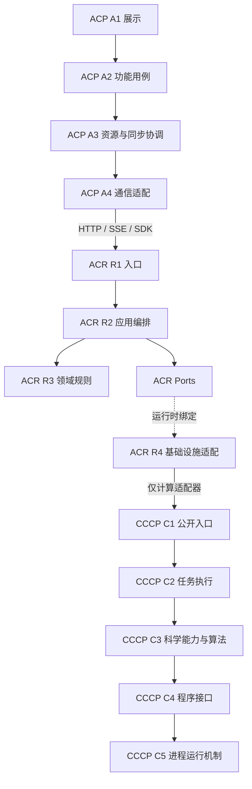
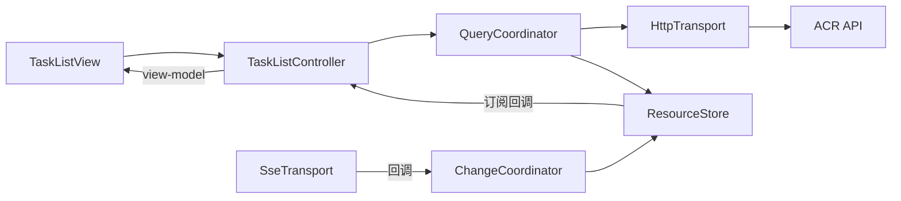
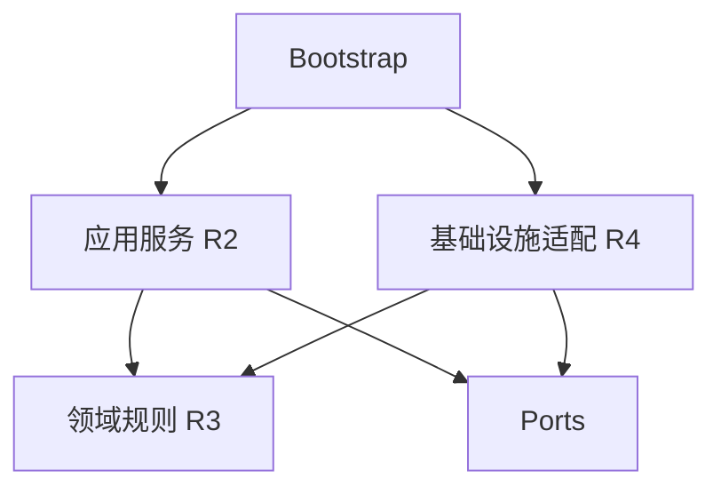
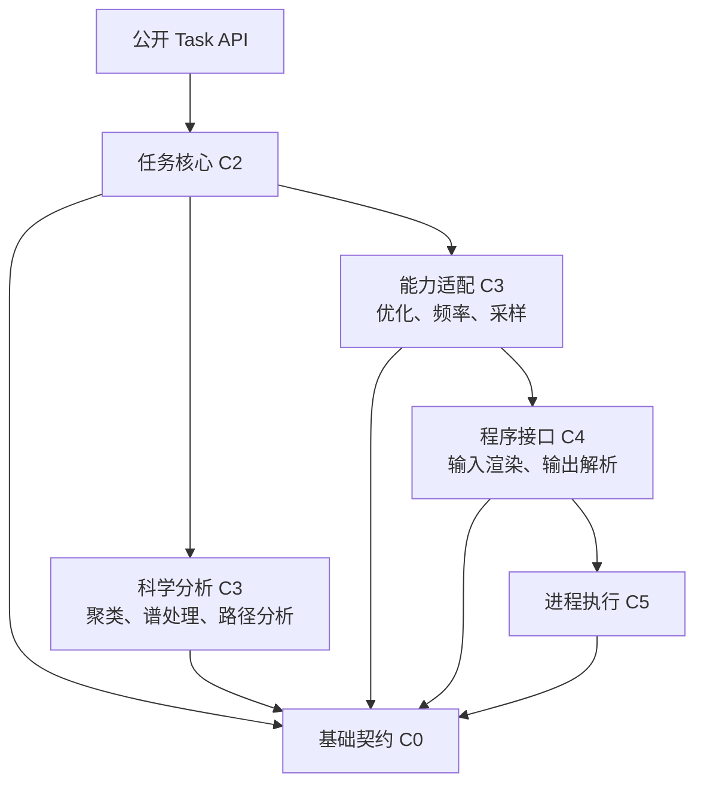

# ACP / ACR / CCCP 内部子层、调用规则与残余代码清理设计

日期：2026-10-15。状态：目标架构提案，未修改运行代码。承接 `ACP_Three_Module_Boundaries_ADR_20261015.md`；本文件是其内部依赖细化版，目录冲突处以本提案的分层结构作为待审目标，不宣称现有代码已满足。

## 1. 规范原则

三个边界：ACP 产品交互、ACR 控制与数据服务、CCCP 科学计算。每个模块内部再按“入口/编排/规则/外部能力”划分。子层用于隔离变化，不为每个函数强制增加包装。

必须区分：

- **运行时调用**：例如应用服务调用 Repository Protocol，实际运行 SQLite adapter。
- **静态依赖**：应用服务只导入 Protocol，SQLite adapter 也导入该 Protocol；应用服务不导入 SQLite 实现。
- **返回数据/事件**：下层报告结果不是下层导入上层；通过下层声明的 callback/Protocol 或可序列化回执实现。

契约层是每个模块自己的无副作用基础，不单独建立装满三层业务的第四个 shared 大包。跨模块 DTO 由提供服务的一方定义，消费方生成客户端或通过适配器转换。

业务域之间不得任意调用内部实现：跨域流程放上一级 use case/coordinator，域内子步骤可调用私有函数；共同且有明确语义的算法放下一级纯模块。代码中出现一次合法函数调用不意味着必须建一个新目录。

## 2. 全局调用及依赖规则



图中 Ports→adapter 是运行时分派，不是静态 import。ACR R4 静态依赖 Ports/R3/contracts，R2 不依赖 R4；bootstrap 单独装配。三层之间只有 ACP client→ACR public API、ACR scientific adapter→CCCP public API 两组生产调用边。

兼容 CLI 的嵌入式模式允许 ACP 的一个 embedding adapter 导入 ACR public API；不允许其他 ACP 模块导入 ACR 内部实现。浏览器不导入 Python 包。

## 3. ACP 的内部子层

### 3.1 层级与目录

| 层 | 建议目录 | 主要职责 | 可调用 |
|---|---|---|---|
| A1 展示 | `ui/pages`、`ui/components`、`ui/viewers` | DOM、图表、3D 相机、键盘/鼠标交互 | A2 view-model/actions，纯展示函数 |
| A2 功能用例 | `features/tasks`、`submission`、`structures`、`results`、`projects` | 用户动作、面板状态、表单到请求的转换 | A3 公开接口、客户端 contracts |
| A3 资源协调 | `data/queries`、`entities`、`subscriptions`、`refresh`、`commands` | 共享缓存、实体合并、请求去重、订阅、失效和降级 | A4 transport 接口、纯策略 |
| A4 通信适配 | `transport/http`、`sse`、`generated` | HTTP/SSE、序列化、底层超时/取消、错误分类 | 浏览器网络 API、生成契约 |
| 基础契约 | `contracts` | schema 生成类型、query key、typed errors | 无业务层依赖 |
| 装配 | `app/bootstrap` | 配置、实例创建、注入、应用启停 | 各层的公开构造入口 |

### 3.2 内部调用链



此图描述运行时交互，view 和 store 不双向导入。A3 coordinator 是该层内部较高子层，ResourceStore 是较低子层；store 不发 HTTP、不知道面板类型。A2 feature 将回调注册到 A3，A3 无需导入 A2。

### 3.3 A3 再细分，避免新的全局状态中心

- **资源标识/纯策略**：query key、版本比较、失效映射；不做 I/O。
- **ResourceStore**：唯一缓存写入口，保存规范化实体和查询页引用；更新与删除有版本守卫。
- **QueryCoordinator**：合并在途查询、读取缓存、通过 transport 取数并提交 store。
- **ChangeCoordinator**：消费事件，判断直接 patch 还是失效；不自行复制一份 job 状态。
- **SubscriptionRegistry/RefreshPolicy**：引用计数、面板可见性、SSE 降级、终态停止进度轮询。
- **CommandClient**：发送 mutation、保存幂等键和操作回执；操作完成后失效相关资源。

coordinator 可以调用底层 store/策略；各 coordinator 不能相互循环调用，通过 bootstrap 提供的窄回调或统一上层 session coordinator 协调。资源共享请求取消采用引用计数，单个面板退出不得取消其他面板需要的请求。

### 3.4 ACP 禁止边与失败语义

禁止 A1/A2 直接 fetch/EventSource；禁止 feature 导入另一个 feature 的私有 store；禁止 viewer 创建任务或直接解析 QC 日志判成功。跨功能流程放 `features/workspace` 用例组合，通过公开 actions 连接，不让任务列表操控结构查看器内部变量。

DOM 更新只发生在 A1；A3/A4 不弹 toast。A4 返回结构化错误，A2 决定面板提示，A1 渲染。取消请求与超时区别对待；错误不转换为空数组；旧快照显示 stale。job attempt、job revision、name revision、artifact revision 独立比较。

## 4. ACR 的内部子层

### 4.1 分层结构

```text
src/acp_runtime/
  entrypoints/                 # R1：api、controller_main、worker_main、embedded
  application/                 # R2：commands、queries、workflow、execution、publication、sync、transfer
  domain/                      # R3：jobs、plans、artifacts、projects、operations、policies
  ports/                       # R2/R3 所需的 Protocol
  adapters/                    # R4：sqlite、filesystem、ssh、lsf、local_process、cccp
  contracts/                   # 平台 DTO/schema，无应用/基础设施依赖
  bootstrap/                   # 显式装配和配置域
  compatibility/               # 历史只读与旧协议转换，受限入口
```

此前讨论的 controller、worker 是运行角色，不各自再复制 domain、repository 或 execution engine。两者使用同一 application/domain 库，通过不同 bootstrap 注入能力。

### 4.2 各子层职责

| 层 | 负责 | 明确禁止 |
|---|---|---|
| R1 入口 | HTTP/CLI/envelope 解码、认证上下文提取、调用应用服务、响应编码 | SQL、SSH、科学解析、任务状态推断 |
| R2 应用 | 用例、权限检查编排、事务边界、资源预算、操作执行、投影与事件协调 | 直接 sqlite/Paramiko/subprocess、导入 CCCP 私有模块 |
| R3 领域 | 状态转换规则、身份、依赖、恢复资格、资源与权限策略 | 文件访问、网络、线程、数据库连接、FastAPI |
| Ports | 仓储、事务、工件存储、执行后端、计算引擎、事件日志等接口 | 创建 adapter、持有全局实例 |
| R4 适配 | SQLite、原子文件写、SSH/SFTP/LSF、本地进程、CCCP调用 | 产品策略、直接将观测写成 job 终态、调用 route |
| bootstrap | 构造、注入、启停、单实例 owner 绑定 | 业务分支、恢复算法、数据转换 |

认证身份不等于授权：R1 获得可信 principal；R2 对每个项目/任务/文件/事件订阅执行权限检查，R3 提供纯策略。嵌入式入口也必须显式提供运行身份/策略，不能靠未经过 HTTP 自动绕过控制约束。

### 4.3 R2 按用例族拆分

| 用例族 | 输入与职责 | 主要 Ports |
|---|---|---|
| `commands/submission` | 接受提交、幂等判定、冻结意图、创建操作 | UnitOfWork、JobRepository、OperationRepository、ScienceValidation |
| `commands/control` | 接受暂停/取消/重跑意图，检查 revision/attempt | UnitOfWork、JobRepository、OperationRepository |
| `workflow/planning` | 展开 profile、构建 plan、校验依赖 | WorkflowCatalog、ScienceValidation |
| `execution/controller` | 准入、派发、lease、外部观测对账、CAS | ExecutionBackend、UnitOfWork、Clock |
| `execution/plan_runner` | 在 worker 执行步骤、校验前置条件、恢复与回执 | ScientificEngine、StepReceiptStore、ArtifactStore |
| `publication` | 验证回执、构造投影、幂等发布 manifest | ArtifactStore、PublicationStore、UnitOfWork |
| `transfers` | 准备文件、去重、优先级、租约、重试 | TransferRepository、RemoteFileStore、ArtifactCache |
| `queries` | 授权后读取分页/摘要/产物可用性 | ReadModelRepository、ArtifactCatalog |
| `sync` | 投影更新、事件批量读取、共享分发、重放 | UnitOfWork、ChangeLog、ReadModelRepository |
| `organization` | 名称、标签、草稿、候选人工记录 | UnitOfWork、组织仓储 |

### 4.4 R2 跨用例调用的规范

同层用例不能随意相互调用形成 commands→queries→transfers→commands 链。确实跨域的流程放 `application/processes/` 上级流程协调器：

```text
processes/submit_calculation
  → submission 接受意图
  → planning 生成计划
  → operation 入队

processes/finalize_execution
  → execution 验证科学回执与 attempt
  → publication 幂等发布
  → jobs 提交最终状态（依据既定成功/发布策略）
  → sync 更新投影与发出持久事件
```

此为逻辑职责分工，不表示每一步必须是独立事务或直接嵌套服务调用。同步原子操作由一个外层 UnitOfWork 协调，子服务不偷偷 commit；跨文件/DB/远程操作使用持久阶段与幂等重试，不能假设一个数据库事务能覆盖 SFTP 和 bsub。

科学回执持久化与结果发布阶段保留现有 `result_publication` 语义；任务终态副作用仍必须在终态 CAS 成功后执行。先迁移原语义，再按明确 ADR 调整，不在拆层过程中改变“何时 completed”。投影事件只能描述已经提交的事实。

### 4.5 Ports 与适配器边界

最小接口族：`JobRepository`、`UnitOfWork`、`OperationRepository`、`ExecutionBackend`、`ScientificEngine`、`ArtifactStore`、`RemoteFileStore`、`ReadModelRepository`、`ChangeLog`、`Clock`。不为每个单函数先造 Protocol；仅在测试替身、资源隔离或多个实现有实际价值时抽取。



这是静态依赖图。运行时 APP 调用的是 BOOT 注入的 adapter 对象。适配器内部也分层：`lsf` 可调用 transport 的 `ssh_session`，`sftp` 可调用同一低层连接接口；SSH 底层不能导入 LSF 或任务服务。低层返回输出/观测，由 application/domain 决定其业务意义。

### 4.6 写入者与进程角色

- API 接受操作和明确的控制意图，使用规定的 CAS/事务 API；不得直接执行远端控制。
- controller 是 job 生命周期的执行所有者，按现有规则推进状态、确认远端停止。
- worker 只执行已授权 envelope，输出 step/scientific 回执，不直接改 jobs DB。
- transfer worker 只改自己的操作、缓存与可用性投影，不改 job 科学状态。
- 查询路由只读取；cache miss 通过明确 prepare 命令或后台流程排队，不隐藏执行在 getter 中。

## 5. CCCP 的内部子层

### 5.1 层级与职责

| 层 | 主要驻点 | 职责 | 允许调用 |
|---|---|---|---|
| C1 公开边界 | 现有 calculation 公开导出、requests/results/context；未来明确 analysis API | 请求/结果契约、公开验证与稳定入口 | C2、基础契约 |
| C2 任务执行 | `calculation/tasks`、受限 batch runner | 科学任务步骤、完成验证、取消检查、科学回执 | C3、基础契约 |
| C3 科学能力 | `backends`、纯 `analysis`、科学参数规则 | 能力适配、数值算法、科学后处理 | C4（仅 backends 等适配分支）、纯基础 |
| C4 程序接口 | `qc/interfaces` 与对应解析/输入渲染 | 程序输入、输出解析、调用执行机制 | C5、科学基础 |
| C5 运行机制 | `qc/runners` 中纯进程执行部分 | 启动/等待/超时/日志句柄/退出码 | 标准库、通用基础 |
| C0 基础契约 | 显式公共 errors/types/units/spec，按需从现驻点抽取 | 无状态类型、常量、单位和纯校验 | 不依赖任务/backend/程序接口 |

不增加第二个 tasks 根。C1 可由现有公开导出组成，`__init__.py` 仍不放实现。不是每个计算都必须经过 C4/C5：纯科学分析在 C3 完成即可。

### 5.2 科学算法和程序适配两条分支



纯 analysis 不导入 backends/qc，不隐式发起额外计算。需要分析后再算一次，由 C2 科学任务或 ACR plan runner 编排，依据它是单个科学任务内部步骤还是跨平台步骤来决定。

### 5.3 现有交叉依赖的修正方式

源码中 `backends/base.py` 从 `calculation.errors` 重导出 BackendUnavailableError，并从 `qc.interfaces.base` 重导出 QCResult。这不等同 backend 导入任务实现，但说明公共类型驻点会使物理依赖图难以分层。

目标：将真正跨层且无执行依赖的错误、结果基础类型逐项提升到 C0；旧路径重导出同一个类，保持异常捕获、isinstance 和序列化兼容。不复制定义、不批量移动所有 requests/contracts；平台 profile 不应因此进入 C0。

`cccp.calculation.batch` 已通过注入单任务函数避免导入 tasks，保留此设计。ACR 分配总预算，batch 在预算内执行同类任务；多步骤 opt/freq/SP 依赖调度仍在 ACR。禁止两层同时自动放大并发。

`qc` 当前同时包含共享科学规则与进程接口，因此新层级不直接等同整个旧目录。逐个模块分类：纯 resolved_spec/单位/方法元数据可作为 C0/C3；程序特定渲染归 C4；平台 LSF/SSH 归 ACR。通过显式 allowlist 过渡，不能一刀切禁掉所有现有 qc 导入。

### 5.4 进度与取消

CCCP 自己定义 TaskProgressSink 与取消回调契约；ACR 的计算适配器注入实现。CCCP 不导入 ACR，不知道 SSE。现有 TaskContext 已有 progress/cancelled/timeout 机制，直接复用。

进度发送失败记录诊断，不改变科学成功/失败；跨进程时事件从 worker 输出，由 controller 处理。取消 signal 只做科学任务协作收尾，平台进程组/LSF 停止确认仍由 ACR 完成。

## 6. 四条必须走通的调用链

### 6.1 提交并执行

```text
ACP A1 SubmitView
→ A2 SubmitFeature（收集意图）
→ A3 CommandClient（幂等键）
→ A4 HTTP
→ ACR R1 SubmitRoute（认证上下文）
→ R2 SubmitProcess（授权/校验/冻结计划）
→ R3 规则 + UnitOfWork（创建记录/持久操作）
→ controller R2（资源准入、lease、派发）
→ R4 Local/LSF ExecutionBackend
→ ACR worker R1（验证 envelope）
→ worker R2 PlanRunner
→ R4 CCCPAdapter
→ CCCP C1→C2→C3→C4→C5
```

控制器与 worker 间使用 ExecutionEnvelope；网络传递不传 Python TaskContext 对象，worker 本地构造 context。CCCP 的请求仅含科学选项，外层平台 ID/attempt 不进入科学身份。

### 6.2 进度回到界面

```text
CCCP ProgressSink
→ worker adapter / 结构化进度回执
→ ACR controller（验证 attempt 与观测资格）
→ CAS + 持久事件/投影
→ ACR EventDispatcher（每 API 进程共享读取）
→ ACP A4 SSE 回调
→ A3 ChangeCoordinator/ResourceStore
→ A2 view-model
→ A1 局部渲染
```

投影异步时，job 事件与 projection-ready 事件分开表达；快照携带同事务 event cursor，客户端重放其后的变化。不能在投影仍旧时宣称刷新已完成。

### 6.3 查看未缓存结构

```text
ACP 查询 catalog → ACR QueryService → cache-only 快照
→ 返回 missing/pending（不是空结果）
→ ACP prepare 命令 → ACR TransferUseCase
→ 原子去重/租约 → SFTP adapter → 现有缓存栅栏
→ 验证当前 attempt/generation → 原子发布
→ catalog.ready 事件 → ACP 补齐可见面板
```

查询多个相同资源共享有效传输；传输失败只改变 availability/operation，不把 job 改为 FAILED。底层文件路径由授权 artifact 引用解析，不接受浏览器任意路径。

### 6.4 取消与重跑

```text
ACP ControlAction → ACR 接受控制意图并持久化
→ controller 领取操作并重读 revision/attempt
→ Local/LSF adapter 执行并返回观测
→ 领域规则验证 → CAS 确认状态
→ 事务事件 → ACP 展示实际结果
```

取消必须确认停止；PAUSED 保留现有语义。重跑原地 attempt+1、归档旧回执；旧 worker 结果、旧 SSE、旧下载全部受 attempt/generation 守卫。外部副作用仍使用 submission_id/release/lease，不能用普通“自动重试三次”替代恢复协议。

## 7. 维护边界与测试归属

| 改动类型 | 主维护位置 | 必须连带检查 |
|---|---|---|
| 新科学参数/算法 | CCCP C0/C2/C3 | request/result兼容、科学验证、schema导出 |
| 新工作流/profile | ACR workflow | active catalog、edit coverage、remote allowlist、计划身份 |
| 新界面/图表 | ACP A1/A2 | 资源订阅释放、前端契约、科学数据不被展示采样改写 |
| 新存储/节点类型 | ACR R4 adapter | Ports契约、恢复/超时/权限、状态观测 |
| 新结果类型 | CCCP结果 + ACR发布/视图契约 | result_manifest、VIEW_REGISTRY、前端消费兼容 |
| 状态转换修改 | ACR R3 + controller | CAS、计数、所有消费者和旧状态兼容 |
| API schema 修改 | ACR contracts/R1 | 生成客户端、旧版本兼容、权限和缓存键 |

每个实质模块应有简短 AGENTS/README：责任、公开入口、允许依赖、禁止依赖、数据写入权、生命周期、错误契约、对应测试。保持清晰的 domain ownership，不靠文件行数决定拆分。

测试层次：ACP纯状态/版本单测、面板契约与浏览器流程；ACR领域规则单测、Ports adapter契约、事务/回执/恢复集成；CCCP科学输入输出与程序fixture。最终跨模块样板测试覆盖真实 envelope→worker→result→publication→query，不用全部 mock 的端到端测试证明集成成功。

## 8. 残余代码分类与清理台账

每项残余代码登记：旧路径/符号、当前调用方（静态和动态）、目标层、唯一实现驻点、持久格式依赖、兼容级别、替代入口、验证测试、删除条件。维护独立的三模块迁移台账，不恢复已经结束的旧迁移台账流程。

| 类别 | 处理方式 | 删除条件 |
|---|---|---|
| 重复科学实现 | 选唯一 CCCP 驻点，差异验证后切调用 | 所有入口一致、科学回归通过、无动态调用 |
| 混合职责大文件 | 按规则/编排/I/O拆出，旧 facade 暂时委托 | 调用方全部迁入公开入口，文件不再有独有逻辑 |
| 旧公开导入 shim | 仅重导出同一类型/函数，零业务逻辑 | 有明确兼容策略允许移除；否则保留 |
| 历史数据读取器 | 放 ACR compatibility，只读 | 历史数据支持正式结束且迁移/归档已验证 |
| retired CLI | 保留拦截与历史展示 | 不能因清理重新激活；删除另按兼容政策 |
| retired 名称但仍用作协议引擎 | 先迁真实算法并切 Confsearch调用 | 懒加载和动态 registry 已审计、结果等价 |
| 旧定时器/直接 fetch | 对应资源切换统一客户端时移除 | 唯一刷新所有者、断线降级和页面释放通过 |
| 未调用工具函数/废配置 | 审计反射/字符串/脚本/持久引用后删除 | 不仅 rg 零引用，还完成入口与兼容验证 |

特别保留：现行 `acp.calculations.primitives`、`acp.backends` 被规定为长期兼容面，不能因“清理残余”自动删除。可迁为纯新入口转发，但移除须有新的兼容决策。`compat` 有历史读取价值，也不是默认死代码。

## 9. 自动架构门与允许依赖矩阵

| 模块 | 允许直接依赖 | 禁止 |
|---|---|---|
| ACP A1 | A2、展示工具 | 网络、数据库、ACR内部、CCCP |
| ACP A2 | A3、contracts | A4实现、其他feature私有模块 |
| ACP A3 | transport接口、store/纯策略、contracts | DOM、业务feature、服务端包 |
| ACP A4 | 浏览器API、生成contracts | feature/store的具体实现 |
| ACR R1 | R2公开入口、contracts | adapter直接调用、SQL、科学执行 |
| ACR R2 | R3、Ports、contracts | adapter实现、Web框架、CCCP私有实现 |
| ACR R3 | 本域/明确基础contracts | R1/R2/R4、I/O库 |
| ACR R4 | Ports、R3/contracts、外部SDK | ACP、route、上层应用服务 |
| CCCP C2 | C3、C0 | ACP、ACR、直接程序进程调用 |
| CCCP C3 | C4（适配分支）、C0 | tasks、平台模块 |
| CCCP C4 | C5、C0/纯解析规则 | tasks/backends、平台控制 |
| CCCP C5 | C0、底层库 | 上层科学/平台策略 |

Bootstrap 是唯一显式装配例外；公开 facade 的向实现导出、旧 shim 的单向重导出需独立规则，不误报为业务反向调用。所有例外按精确文件/符号登记，说明原因、替代方案与退出条件，禁止整目录通配放行。

检查分为 import AST/ESLint边界、强连通分量（循环依赖）、直接 I/O 使用、动态入口清单、科学实现唯一性、公开API契约与独立安装。回调不因运行时返回上层而误判依赖；但 subprocess 中字符串引用旧 acp.cli 必须纳入检查。

迁移期先固定现有违规基线，只允许数量下降且禁止新增；目标模块一旦迁入即启用严格规则，不把旧违规一并复制进去。原 grep gates/architecture tests 的约束语义保留，迁址时更新权威路径和证据，不关闭测试。

## 10. 实施切片与完成判据

1. 先建立符号/调用/写入台账与依赖门；把“现存结构”和“目标结构”分别记录。
2. 建立最小 ACR R1/R2/R3/Ports/R4 纵向样板：单步任务提交、worker执行、回执、查询。
3. 从样板抽真正共用的基础类型，避免先创建大量空文件。
4. 接入本地与一个已支持远程工作流，验证 submission/release/attempt、暂停/取消、重启恢复。
5. 迁移运行态投影/传输与 ACP 统一客户端；逐资源关闭旧轮询，测重复采集下降。
6. 扩展 BatchOptimize/Confsearch，再拆 PES/NMR 混合算法；每迁一个能力清理一个旧实现。
7. 保留必要兼容 facade，归档迁移例外；在最小依赖环境验证三个模块可独立使用。

一个模块迁移完成需同时满足：唯一实现驻点、无禁用依赖、公开入口稳定、数据权威唯一、生命周期和资源释放清晰、旧数据可读、恢复测试通过、旧调用已切换。不能用“目录已移动”作为完成标志。

本次仅交付设计与维护规则；未新增包、未修改 AGENTS 或架构测试、未重启服务，也未声称执行了以上验收测试。
