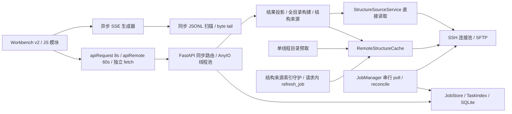

# ACP 平台 · API 通讯与网页响应缺陷复测 issue

审计日期：2026-10-12。代码基线：`0e3c97839ea6ee20c5ca89d5d11f8fbf90075932`。

**结论：清单中的主要风险属实，但不能将原清单直接作为已确认缺陷发布。** 当前版本已有列表重试提示、分页、行复用、摘要变更检测、PES 历史失败提示和草稿保存失败提示。原文的“帧加载最坏 92 秒”“普通重命名失败零反馈”“本地下载不支持 Range”等说法需要撤回；“34 秒”“90 秒”不能作为耗时上界。下面保留真实问题，逐条标注证据与修正口径。

本次交付为可拆分的汇总 issue，包含问题描述、复现、代码与架构归属、修复验收建议及原清单逐项对照。未修改平台运行代码，未提交计算、操作生产任务或连接真实 LSF/SFTP 节点。

## 1. 验证范围与证据

| 验证 | 结果 | 说明 |
| --- | --- | --- |
| 既有 API、SSE、结构目录、结构来源、预取、前端契约、SSH 测试 | **707 passed** | 8 个既有测试文件，`pytest -m 'not slow'` |
| 终态副作用顺序、远端失联保留状态 | **3 passed** | 明确验证失联不伪造作业失败、终态 CAS 被拒绝时不发布终态副作用 |
| 新增后端复现 | **17 passed** | 实际 API/读盘路径，临时日志、200 项批量结构、模拟 SSH/SFTP；含 Range 反证 |
| 新增浏览器复现 | **20 passed** | 实际 HTML/JS，Chromium，拦截 HTTP 与故障注入；其中 1 项是浏览器环境对照 |
| 既有首屏浏览器套件 | **1 passed / 4 failed** | 失败均停在点击的可见性/稳定性等待；空白按钮页面也复现该环境异常，不能据此判定 ACP 卡死 |

运行环境：Python 3.11.13、FastAPI 0.141.1、Starlette 1.6.0、AnyIO 4.15.1、HTTPX 0.28.1、Paramiko 5.0.0、Playwright 1.63.0、Chromium 153.0.8010.12。

另只读核对本机 unit 指定的 `/opt/acp2/venv/bin/python`：Python、FastAPI、Starlette、AnyIO、Paramiko 版本与测试环境一致。没有连接生产HTTP端点，反向代理及真实负载差异仍不在上述验证范围内。

证据文件：

- [后端复现脚本](../evidence/reports/ACP_API_Response_Audit_20261012/verify_backend.py)与[后端实测记录](../evidence/reports/ACP_API_Response_Audit_20261012/backend_evidence.json)。
- [浏览器复现脚本](../evidence/reports/ACP_API_Response_Audit_20261012/verify_frontend.py)与[浏览器实测记录](../evidence/reports/ACP_API_Response_Audit_20261012/frontend_evidence.json)。
- [测试结果与复跑说明](../evidence/reports/ACP_API_Response_Audit_20261012/README.md)。

证据分级：**R**＝隔离运行时复现；**C**＝代码链路确认；**P**＝原说法部分成立，需要收窄或修正；**N**＝当前版本反证；**V**＝生产影响/精确数字尚未实测。通过“复现探针”表示断言观察到预期行为，既包括缺陷复现，也包括反证，并不表示对应功能没有缺陷。

浏览器限制：当前 headless 环境的普通按钮 `Locator.click()` 也会在空白页面等待稳定性超时；另一次空白页面对照中 `requestAnimationFrame` 未在 100 ms 内触发。故浏览器证据验证 DOM、HTTP 失败处理及事件处理器，必要时直接派发点击事件；**不据此给出帧率、滚轮流畅度、绘制耗时或生产首屏耗时结论**。真实节点延迟、网络断连恢复时间、并发吞吐与大体系渲染性能仍需生产或专用压测环境验证。

## 2. 八项速览的复测结论

| 原速览 | 复测后的准确表述 |
| --- | --- |
| 状态最坏约 34 秒、完成事件先于 DB 最多 30 秒 | 轮询架构会滞后；30+4 秒只是轻载、成功请求、未计串行扫描等条件下的估算。正常本地任务的终态事件由终态持久化后发布，不能称为“≤1 秒 SSE 完成事件先到”。 |
| 静默失败遍地 | 多条链路真实存在；普通重命名有反馈，未缓存的结构来源任务重命名仍会调用不存在的 `showToast`。 |
| SSE 重连导致全应用冻结 | 单 worker 事件循环同步扫描已复现；初始只解码/发送最近 200 条，不再是全量 JSON 回放。不能声称每 3 秒必定冻结，3 秒是发生断线后的重连延迟。 |
| 8 秒/60 秒错配，暂停最长 90 秒 | 默认预算与远端链路错配成立；3 次、每次传入 30 秒是代码事实，连接池等待、建连、等待退出状态等使 90 秒不能作为总上界。 |
| 冷启动重、13–14 轮往返 | 资源体积实测成立；6 个初始 API 请求可并发，不能把请求数量当串行网络轮次。首个任务链路仍有条件性串行依赖。 |
| 每 4 秒/2.5 秒无条件双份重建 | 已有队列整体变更检测、行复用和摘要变更检测。组容器更新、变化行更新、变化摘要双份重建仍存在；持续闪烁频率未实测。 |
| 大任务越用越慢 | 单项 API 重建目录、详情全读 XYZ 后丢弃、日志扫描等路径已复现；具体交互耗时与规模曲线仍待压测。 |
| 远端失联不告知 | RUNNING 保留语义合理；`remote.poll_unreachable` 未被 Workbench v2 监听。节点管理另有离线提示，缺的是任务级监控新鲜度/连接异常提示。 |

## 3. 涉及的架构

故障横跨展示、通信、结果读取与调度观察链路，主要不在 `cccp/calculation/tasks` 的科学计算任务核心。整改应保留四层架构、结果帧契约、attempt 缓存隔离与状态 CAS：节点失联提示应增加独立监控字段，不能通过随意修改作业生命周期状态来代替。

代码索引：

| 编号 | 文件与关键驻点 |
| --- | --- |
| F1 | [Workbench v2](../../../../frontend/ACP_Workbench_v2.html)：`apiRequest`/`apiRemote`（10117–10219）、`fetchJobDetail`（19097）、`refreshSelectedJobSummary`（19184）、`startPolling`（33554） |
| F2 | 同文件：`submitTaskRenameNow`（17392）、`_handleRowMenuAction`（26700）、`fetchAndExpand`（18700 附近）、`pollLogTail`（20274）、`fetchNmrReportFromPath`（23621） |
| F3 | 同文件：`energyGraphLoadFrameGeometry`（9916）、`energyGraphBuildSvg`（12069）、`renderEnergyGraphWorkspace`（15304）、`renderQueueList`（18367）、`buildQueueRow`（18138）、`updateInfoPanel`（19658） |
| F4 | [structure_viewer.js](../../../../frontend/js/structure_viewer.js)：`loadStructureViewer`、`refreshIfChanged`、`loadSelectedGeometry`、`_openSwitcherDropdown`；[vibration_viewer.js](../../../../frontend/js/vibration_viewer.js)：`FRAME_MIN_MS`、`_renderAnimationFrame`、`tick` |
| F5 | [structure_source_picker.js](../../../../frontend/js/structure_source_picker.js)：`_apiV1`/`_apiV2`、`_fetchPage`、`_fetchV2`、`_renderIndexing`；[job_editor.js](../../../../frontend/js/job_editor.js)：打开/预览/提交使用 `apiRemote` |
| A1 | [routes.py](../../../../src/acp/api/routes.py)：`stream_job_events`（376）、`_replay`、`_read_tail`、`event_generator` |
| A2 | [v1_routes.py](../../../../src/acp/api/v1_routes.py)：`_job_read_root`（365）、`_count_lines`（543）、`get_job_detail`（4899）、`_structure_result_summary`（4929）、`get_job_logs`（5756） |
| A3 | 同文件：`get_structure_viewer_catalog`（3651）、`get_structure_viewer_geometry`（3758）、`get_structure_viewer_vibrations`（3967）、`_try_historical_mode_projection`（3882）、overlay 路由 |
| A4 | 同文件：`_remote_review_setup`（3195）、`_remote_review_write_back`（3249）、`_notify_structure_sources_updated`（3320）、`download_job_file`（5862）、远端列表/预览/校验和/下载（6017–6290） |
| A5 | [server.py](../../../../src/acp/api/server.py)：`create_app`、静态挂载、`index`、默认 5 秒与异常响应；[v2_routes.py](../../../../src/acp/api/v2_routes.py)：`list_projects`（360）、`_resolve_downstream`（1452） |
| S1 | [manager.py](../../../../src/acp/scheduler/manager.py)：`pause_job`/`unpause_job`、`_catalog_prefetch_loop`（4733）、`_poll_job`（4799）、`_persist_terminal`、`_emit_local_terminal_event`（5197）、`_reconcile_once`（5284）、`_poll_loop`（5323） |
| S2 | [runner.py](../../../../src/acp/scheduler/runner.py)：`_prepare_and_launch`、`poll`；[events.py](../../../../src/acp/scheduler/events.py)：`count`/`read_recent`；[logs.py](../../../../src/acp/scheduler/logs.py)：`read_log_range` |
| S3 | [files.py](../../../../src/acp/scheduler/files.py)：`_MAX_FILE_BYTES`/`build_manifest`/`_collect_pinned`；[task_views.py](../../../../src/acp/scheduler/task_views.py)：`query_project_tasks`（215）；[job_edit.py](../../../../src/acp/scheduler/job_edit.py)：`resolve_previous_outputs`（530） |
| S4 | [structure_sources.py](../../../../src/acp/scheduler/structure_sources.py)：`get`（519）/`_fetch_remote_xyz`；[structure_source_indexer.py](../../../../src/acp/scheduler/structure_source_indexer.py)：`_refresh_job_if_stale`、`_index_job`、`refresh_job` |
| R1 | [ssh.py](../../../../src/acp/scheduler/remote/ssh.py)：`_DEFAULT_TIMEOUT=30`、`_NodePool.borrow`、`execute`、`sftp_session`；[config.py](../../../../src/acp/scheduler/remote/config.py)：`connect_timeout`/`read_timeout`/`poll_interval` |
| R2 | [remote/runner.py](../../../../src/acp/scheduler/remote/runner.py)：`poll_remote`（461）、`_tail_and_emit`（1952）、兼容 `run`/`_monitor_loop`；[monitor.py](../../../../src/acp/scheduler/remote/monitor.py)：`bstop_job`/`bresume_job`/`get_lsf_status` |
| R3 | [remote_structure_cache.py](../../../../src/acp/results/remote_structure_cache.py)：`fetch`（369）、`fetch_catalog`（658）、`fetch_reusable_geometries`（674）、`push_paths`；[remote/fetcher.py](../../../../src/acp/scheduler/remote/fetcher.py)：`read_file`/`stream_file` |
| P1 | [structure_viewer.py](../../../../src/acp/results/structure_viewer.py)：`build_structure_viewer_payload`、各 workflow resolver；[energy_graph.py](../../../../src/acp/results/energy_graph.py)、[sampling_graph.py](../../../../src/acp/results/sampling_graph.py)、[irc_projection.py](../../../../src/acp/results/irc_projection.py) |
| D1 | [cli.py](../../../../src/acp/cli.py)：serve parser 默认 30 秒、`_handle_serve` 写环境变量；[start_acp.sh](../../../../scripts/start_acp.sh)、[install_systemd.sh](../../../../scripts/install_systemd.sh) |

行号固定于审计基线，后续以函数名查找为准。

## 4. 可直接拆分的缺陷 issue

### ACP-UX-01 · SSE 回放在事件循环同步扫描历史日志（P1，R+C）

**影响：** 单 worker 下，连接/重连一个大日志任务会延迟同 worker 的其他 API；任务日志随时间增长，扫描成本增加。

**复现：** 写入 50,000 条事件、14,600,000 字节日志。初始 `history=200` 仅发送 200 条，但读入 **29,455,008 字节**；`after_seq=49999` 只发送 1 条，仍扫描 **14,600,000 字节 / 50,002 次 readline 调用**。最终热缓存单次记录分别约 20 ms、126 ms，仅代表该机器/样本，复跑时间会变化。为每次 `count()` 注入 40 ms，两个 count 在同一事件循环线程执行，10 ms 到期的定时回调被推迟至约 **80 ms**。

**代码/架构：** A1 → S2。`_replay` 调用一次 `count()`，`read_recent` 再 count；恢复连接从开头跳过行，整个跳过过程没有异步让出。初始回放已限制最近 200 条；正常 tail 按 byte offset 增量读取。R2 每轮最多保留每个日志流最近 1000 行为事件，但总事件文件没有轮转上限。

**验收建议：** 将磁盘扫描移出事件循环；维护可恢复的序号与 byte offset 索引，避免重连线性扫描；对大日志连接同时请求轻量 API，验证响应延迟与日志大小不呈线性增加。保留 SSE 序号、终态有限关闭与 attempt 隔离。

### ACP-UX-02 · 详情失败无提示降级为简版数据（P1，R+C）

**影响：** 阶段、产物、恢复能力等消失，用户无法区分“数据没有”与“读取失败”。

**复现：** `/jobs/audit/detail` 注入 503，基础 `/jobs/audit` 成功。实际浏览器返回 `legacy=true`，`stages/recovery` 为 null，加载错误区为空。超时会进入同一 catch，默认预算为 8 秒。

**代码/架构：** F1 `fetchJobDetail` → A2 `get_job_detail` → `_structure_result_summary` → `_job_read_root`；终态远程读取可能在请求中执行 SFTP 目录补取。catch 没有按“旧服务器不存在接口”与其他错误分类。

**验收建议：** 仅对明确的 404/405 做兼容降级；超时/5xx 保留已加载详情并显示“详情读取失败/数据可能过期”，提供重试。降级状态随响应保存，不能只存 `legacy=true` 而隐藏原因。

### ACP-UX-03 · 后台摘要、日志、文件目录与能量刷新缺少新鲜度提示（P1，R+C）

**影响：** 旧进度/日志/曲线继续显示，磁盘指示器消失，用户无法判断观察链路是否正常。

**复现：** 摘要和日志返回 503，信息面板 DOM、0.2 的进度保持，日志未新增错误提示；磁盘 503 后 pill 隐藏。`fetchAndExpand` 请求失败写入 `folderCache[folder]=[]`、`folderState=true`，失败被解释为已展开的空目录。

**代码/架构：** F1/F2/F3。`refreshLoadedFolders` 保留旧缓存；`renderEnergyGraphWorkspace(...,{silent:true})` 出错保留旧图，没有陈旧标记。F4 后台结构刷新同样存在静默保留分支。**队列和服务健康失败已有提示/重试，不能合称“四通道都只写控制台”。**

**验收建议：** 区分 empty/error/loading/stale；展示最近成功时间，连续失败时提示；保留旧数据时明确标识陈旧。目录失败不缓存为成功空列表。

### ACP-UX-04 · NMR 探测把服务故障当报告不存在（P2，R+C）

**复现/影响：** 三个候选报告路径全部返回 503，浏览器显示“暂无 nmr_report.json（任务未完成或已过期）”，掩盖服务器错误。

**代码/架构：** F2 `fetchNmrReportFromPath` catch 任意错误返回 null；`fetchNmrReportJson` 串行探测三个路径。远程已使用 60 秒预算，但三次预算是三个请求，不能把整体等待写成 60 秒上界。

**验收建议：** 仅对明确的文件不存在继续探测；网络/5xx/解析失败保留原因并显示读取失败。减少无谓路径探测，优先消费结果清单。

### ACP-UX-05 · 结构来源任务重命名的失败提示调用未定义函数（P2，R+C）

**复现：** 在结构来源行菜单选择“重命名来源任务”，来源任务不在 `jobsCache`，基础 job 读取返回 503。页面抛出 **`showToast is not defined`**，重命名弹窗未打开。

**代码/架构：** F2 `_handleRowMenuAction` 的未缓存 job 分支。普通队列重命名走 `submitTaskRenameNow`，已显示“重命名失败: …”，不能扩写为所有重命名均无反馈。

**验收建议：** 使用现有统一提示设施，并覆盖“来源任务未缓存且读取失败”；普通重命名的 revision conflict 提示继续保留。

### ACP-UX-06 · 远端接口预算未贯通，部分 fetch 没有截止时间（P1，R+C）

**代码/架构：** F1 中本地 8000 ms、远端 60000 ms；F2/F3 的详情、能量图、远端文本/几何预览、pause/unpause、部分向导结构恢复仍调用 `api`。F4 使用绑定的原生 fetch：AbortController 用于切换取消，没有定时器；F5 自有封装在传入 signal 时不建超时，结构来源列表读取就是此情况；`candidateApi` 完全使用原生 fetch。

**复现：** 浏览器捕获结构目录 fetch 有 signal、无定时器，candidate 请求无 signal、无定时器，两条 Promise 维持 pending。公共 `apiRequest` 的自身超时已转换为本地化 Error，未泄漏原始 AbortError。

**预算反证：** 帧几何按视图分支。注入每次源读取失败时：IRC 1×8 秒；optimization 最多 2×8 秒；sampling 最多 2×8 秒；scan/scan_trajectory 最多 8+60 秒；conformer 1×8 秒。不存在 IRC→优化→文件→采样→S2 五级全部串联的 92 秒路径。这里只计算配置预算相加，未测到相应等待时长，也未计浏览器调度延迟。

**验收建议：** 通信封装统一、正确保留 caller cancellation、为整个操作设置 deadline；远程读和任务控制采用适当预算与进行中反馈。浏览器取消请求不代表远端操作撤销，超时后需核查操作结果，不能提示确定的“执行失败”。

### ACP-UX-07 · SSH/SFTP 缺少完整 deadline 与失败抑制（P1，R+C）

**复现：** 模拟命令超时观察到 3 次 execute、每次参数 timeout=30；`sftp_session` 没有对底层 channel 调用 `settimeout`。对不存在的同一路径连续 `cache.fetch`，两次都调用远端 read，没有缺失负缓存。

**代码/架构：** R1/R3。`RemoteExecutionConfig.connect_timeout/read_timeout` 不能视为已贯通的读截止时间；`_NodePool.borrow` 创建客户端使用默认 30 秒，池耗尽另外可能等待 60 秒。`execute` 在 try 外借连接；借连接失败不按“三次命令重试”处理。命令退出等待和 SFTP 读没有统一整体 deadline。

**影响：** 页面已超时，后端线程/连接仍被占用；失联节点与缺失路径被重复探测。**90 秒只是三个命令预算相加，不是 pause/unpause 完成的最坏上界。**

**验收建议：** 将连接/命令/传输/池等待纳入剩余预算；连接失败按节点退避；缺失文件做短 TTL、attempt 感知的负缓存，写回、rerun、continue 及时失效。负缓存不能永久掩盖新产物。

### ACP-UX-08 · 任务级远端失联与观察新鲜度未暴露（P1，R+C）

**复现：** 既有状态测试注入 3 次传输失败：DB 保持 RUNNING、error=None，记录 3 条 `remote.poll_unreachable`；恢复后正常完成。浏览器 EventSource 注册事件中没有 `remote.poll_unreachable`。

**代码/架构：** S1 `_poll_job` → R2 → F2 `openSSE`。部分底层读取还会把异常降为 unknown/None，因此不能保证每一次失联都会产生上述专用事件。系统资源/节点管理页有节点状态；任务队列与信息面板缺乏最后成功观察时间、连续监控失败次数等投影。

**验收建议：** 保持科学作业生命周期状态，单独显示 monitoring unavailable/stale；暴露观测时间与失败计数，SSE、摘要、列表皆可恢复该提示。连接恢复后清除提示。

**原 10 天说法修正：** `_MONITOR_TIMEOUT_FALLBACK=10*24*3600` 位于兼容阻塞 `run` 的 `_monitor_loop`。当前 manager 走 `submit_remote` + `poll_remote`，不能据此保证当前作业失联 10 天一定自动失败。

### ACP-UX-09 · 调度观察串行，默认轮询间隔不能当响应上界（P1，C）

**代码/架构：** S1 `_poll_loop` 等待 poll_interval 后逐项 `_poll_job`；R2 正常远端活跃轮次至少探测 exit receipt、state.json、LSF、stdout、stderr。当前 `_STATE_READ_INTERVAL=1`，每轮读取 state.json；终态、重试、兼容路径操作数更多。长连接等待会推迟同轮后续作业，扫描完成后才重新等待一个 interval。

**影响：** 多任务、慢节点和失败重试扩大观察延迟；`30+4≈34 秒` 只描述无积压、轻载前台列表的估算。前端 setTimeout 也在请求完成后设置，周期实际等于“处理/网络耗时＋间隔”。SSE tail 本身每 5 秒检查，`done` 另依赖 DB 终态。

**部署：** D1 CLI parser 默认 30 秒并写 `ACP_POLL_INTERVAL`；A5 直连 uvicorn 回退为 5 秒。仓库的 install_systemd 生成 start_acp.sh→uvicorn，即 5 秒回退路径；本机 `/etc/systemd/system/acp.service` 文件则配置 `acp run serve`，未带 poll 参数，按 CLI 默认属于 30 秒口径。本文核对的是配置文件，未读取运行进程的实际轮询时序。

**验收建议：** 统一部署默认/覆盖口径；按节点或有界并发观察，避免单慢节点阻塞其他节点；终态退出通知与持久化协同，保持 CAS 控制意图优先。

### ACP-UX-10 · 日志游标接口仍按全文件统计/跳过（P1，R+C）

**复现：** 100,000 行、900,000 字节 stdout，游标已经到末尾，新返回 0 行，但 `_count_lines` 仍遍历 100,000 行。`read_log_range` 使用行序号游标，从文件开头跳过旧行；不会全文件装入内存，但读量仍随历史增长。

**代码/架构：** F2 每轮 log 请求 → A2 `get_job_logs` → S2 `read_log_range` + `_count_lines`。初始 tail 已有 64 KiB 反向读取优化，不能把所有日志读取都称为全量读入内存。

**验收建议：** 使用 byte offset 或维护行索引/累计行数，正确处理截断与 attempt 换代；无新增行时读量接近常数，并保持多字节字符与半行边界正确。

### ACP-UX-11 · 单结构请求重复构建完整目录（P1，R+C）

**复现：** 创建 200 个 BatchOptimize 产物；两次请求同一个 `batch_0000` 几何，加一次其振动数据。`build_structure_viewer_payload` 共被调用 3 次，每次生成 200 个 entry。overlay 路由也先完整建目录再找两个条目。

**代码/架构：** A3 → P1。几何缓存不能消除前面的目录构建。frame entry 读取还可能先 `read_text` 全读 XYZ，再调用逐帧读取函数。

**验收建议：** 目录按 job/attempt/status/产物 revision 缓存，单条目按 ID 定位；IRC/scan 帧建立几何偏移索引。保留结果帧契约和失败任务可读产物语义。

### ACP-UX-12 · 详情结构摘要读取全部坐标后丢弃（P1，R+C）

**复现：** 200 项 BatchOptimize，调用实际 `_structure_result_summary`，读取 200 个 XYZ 共 5400 字节，再返回 200 项无 `xyz_text` 的摘要。这一小样本证明调用数量，未用于外推大任务耗时。

**代码/架构：** A2 `_structure_result_summary` → S3 `resolve_previous_outputs`：全读、验证 single_geometry、计算 checksum → 删去文本。优化后的单帧路径通常不需要每次详情都再解析所有坐标；singlepoint/frequency 等没有可复用产物时不受同样影响。

**验收建议：** 发布时保存/索引必要的结构事实，详情消费摘要；几何按需读取，内容变化时重验。不能为性能削弱结构有效性或重算身份校验。

### ACP-UX-13 · 结构来源详情绕开共享远端几何缓存（P2，R+C）

**复现：** 对同一已完成远端 optimize 结构连续 `StructureSourceService.get` 两次，观察到两次 `fetcher.read_file`。该路径的列表 probe cache 与详情几何缓存是两件事。

**代码/架构：** F1 向导/Load 调用 → A4 `/structure-sources/{source_id}` → S4 `get`/`_fetch_remote_xyz`。同路径还有 8 秒、60 秒和原生 fetch 三种调用方式；`.structure_history/` 本地不可变快照走独立路径。

**验收建议：** 详情读取进入共享 cache，带 attempt/version/content checksum 约束；统一 deadline。重复加载已缓存同版本结构不访问远端。

### ACP-UX-14 · 预取与索引缺少优先级、退避，写请求内同步索引（P1，R+C）

**复现：** 预取队列放入 old-1、old-2、new-completion；old-1 注入失败后不会重入队，执行顺序仍为两项旧任务再新任务。远端 record 即使 indexed_at 已设为未来时间，两次 freshness 检查也都调用 `_index_job`。

**代码/架构：** S1 单线程 FIFO，启动按三种终态各查最多 100 条，合计最多 300 个候选；实际入队受 remote/缓存就绪条件限制。S4 每 60 秒 sweep，远端绕过 indexed_at 判断，串行 `fetch_catalog` + `fetch_reusable_geometries`；**已缓存的文件会复用，不能说每条路径每轮都重下载**。缺失可选文件/异常无有效失败抑制，可能重复远端请求。

**写链路：** A4 `_notify_structure_sources_updated` 在保存请求内调用 `indexer.refresh_job`。因此保存已写回后仍可能等同步索引；F5 索引面板重试主要重新请求列表，不能当作重新索引操作。

**验收建议：** 新完成任务优先，预取去重与有界退避，按节点失败抑制；索引变化驱动并有可观测状态；写成功后异步更新索引或返回可查询操作进度。失败不把现有索引当作权威空数据删除。

### ACP-UX-15 · PES 远程审阅写链路把多次传输与索引放在一个请求（P1，C）

**代码/架构：** A4 `_remote_review_setup` 强制补取可变 review/manifest，逐个补取所选帧；其中**帧几何未 force，已有缓存会复用**。随后保存、`push_paths` 串行上传、通知索引同步刷新。备份恢复也有相似串行链路。

**影响：** 选择数量与可用缓存决定请求量，单次 60 秒前端预算没有覆盖整个事务时长的保证；请求超时不代表写回未发生。原文“所有帧每次强制重下”“大概率超时”缺乏依据。

**验收建议：** 在保持远端权威与 revision 校验的前提下减少往返，显示拉取/校验/上传/索引阶段；操作幂等且可查询最终结果。索引与浏览器请求生命周期解耦。

### ACP-UX-16 · 大图与动画仍做全量模型/图形构建（P2，C+V）

**代码/架构：** F3 能量图全量 JSON 读取、revision 比较发生在下载/解析之后；泛用 SVG 图在交互后重构标记，优化图有 rAF 合并，但仍全量构建视图。F4 主结构列表已有 >100 条窗口化、轨迹 >500 条采样到目标 200 条、>200 原子默认降为线框；switcher dropdown 则按过滤后的全量列表重建，未沿用主列表窗口化。

**动画：** F1 旧帧播放 900 ms 调 `setFrame`，重建 3D 模型并更新双份信息面板；F4 振动 `FRAME_MIN_MS=33`，每帧 removeAllModels→addModel→style。33 ms 是节流阈值，并不保证实际 30 fps。原文“1000 帧约4000 SVG节点”“大体系直接饱和”本轮未实测。

**验收建议：** 大图降采样或分层绘制，缓存数据投影，模型坐标原位更新；量测大任务缩放/筛选/播放的主线程耗时与帧率，再设性能阈值。保留正式能量/帧身份，降采样不能影响候选选择准确性。

### ACP-UX-17 · 条件更新仍重建组容器与双份信息面板（P2，R+C）

**反证与保留问题：** 实际浏览器验证同值队列行复用；一行 progress 改变时该行更换，而桌面与移动另一行节点均复用。`renderQueueListContents` 仍清空列表并重建组容器、再插回缓存行；不是“400 行全部创建”。摘要同值不重建，updated_at 改变后桌面/移动信息面板各清空重建。

**代码/架构：** F1/F3。每次轮询仍序列化分组响应/行签名，重建 chips，并遍历 queue rows 进行高亮。定时信息中的 elapsed 依赖重绘，优化时需保持时间显示。

**验收建议：** 保留节点与交互状态，对变化字段做局部更新；按可见区域更新面板；通过焦点、展开、滚动保持测试评估容器重建影响。不能声称当前每 tick 都必定闪烁。

### ACP-UX-18 · 首屏资源未压缩，同步脚本负担大（P2，R+C+V）

**实测字节数：** HTML **1,699,019 B**；内联 JS **1,384,244 B**；内联 CSS **218,747 B**；10 个同步外部 JS 共 **615,559 B**；内联加同步 JS **1,999,803 B（约1.91 MiB）**；异步 3Dmol **537,792 B**。实际 ASGI GET 携带 `Accept-Encoding: gzip, br`，无 Content-Encoding。反向代理是否压缩须单独检查。

**代码/架构：** A5 `index` 每次读取整份 HTML，没有应用层压缩；F1 正文同步脚本。DOM ready 前要解析脚本，但首屏交互已在远端请求前绑定；初始 6 个 API（status/projects/workflow-catalog/method-catalog/task-view/disk）并发启动。first job 的 detail→files 等依赖仍串行，SSE/日志/结构模块等存在并发和条件分支。

**修正：** 不能把“13–14 个请求”写成“13–14 轮串行往返”。本轮没有首次作业完整渲染的网络实测；原“1300+ 本地化元素”不能从字典条目数量推导。HTML 源有275个 `data-i18n`、20个 title、8个 ph、15个 opt 属性；初始化后 DOM 的 `data-i18n` 元素实测为209。字典声明为175,567 B。3Dmol 加载失败有文字提示，但没有自动重新下载脚本。

**验收建议：** 压缩 HTML/JS/CSS、拆出可缓存的脚本与字典、按功能懒加载；同时测量低带宽/低 CPU 首屏与首个作业可用时间，并让可用的管理操作不等待详情/3D 库。

### ACP-UX-19 · 本地大文件被列表静默隐藏，远端下载不支持 Range（P2，R+C）

**复现：** 稀疏文件 **209,715,201 B（200 MiB+1）**存在，`build_manifest` 返回 files=[]、truncated=false。该阈值属于本地文件清单，不能扩展为远端清单限制。

**Range 反证：** 实际 ACP 本地下载路由发送 `Range: bytes=2-5` 得到 **206、`Content-Range: bytes 2-5/10`、内容2345**。相同 Range 对远端下载实际路由返回 **200、完整10字节、无 Content-Range**；ZIP 自然也是全流式结果。

**代码/架构：** S3 `build_manifest` 与 `_collect_pinned`；A4 本地 FileResponse、远端 StreamingResponse；R3 `stream_file`。下载经浏览器 `<a>`，无 ACP 内进度，不等于浏览器下载管理器没有进度。

**验收建议：** 文件元数据不因大小隐藏；明确省略数量/原因。远端按需 byte range 与可恢复下载另行设计，显示连接/打包/传输状态；本地已有 Range 支持应保留。

### ACP-UX-20 · 共用执行资源与历史查询增加后台/写入开销（P2，C，部分 R）

**线程池：** 本环境 AnyIO 默认 limiter 为 **40 tokens**。同步路由共享额度，远端传输读取、全文件 checksum、最长配置 600 秒 bootstrap 等可长期占用。**流式下载不是整个传输一直独占线程**：实测两个 chunk 之间 limiter.borrowed_tokens=0；阻塞的单次 next/read 期间才借用额度，慢传输仍会造成资源竞争。未做并发超时风暴压测。

**DB：** S3 `query_project_tasks` 的多条查询/投影持同一个 TaskIndex RLock；S1 reconcile 每轮对 completed/failed/cancelled 各 `limit=10000` 全部构建 JobRecord，后续才筛需修复副作用的行。A5 v2 project 为计数 `len(list_by_project(...,limit=1_000_000))`。lineage 已先 SQL `spec_json LIKE '%id%'` 扫描，再只加载候选记录；不能写成“所有记录逐条完整读取”。

**验收建议：** 分离长操作资源额度并设置 deadline；对状态/新鲜度提供一致缓存或条件请求；短化读锁与分页投影；以 SQL count、待 reconcile 索引/过滤查询及来源引用索引代替反复物化。测量后台历史规模与并发写入等待后设上限。

## 5. 原清单逐项核对

编号按原文每节的项目顺序。重复问题沿用同一 issue；“C”说明机制已定位，不代表原文的用户感知程度或时间数字已实测。

### 5.1 原第1节：静默失败

| 原项 | 判定 | 修正与代码/issue |
| --- | --- | --- |
| 1.1 任务重命名零反馈 | P/R | 普通提交有提示；仅未缓存来源菜单 fetch 失败有未定义 toast。UX-05，F2。 |
| 1.2 远端详情8秒无声缺块 | R+C | 503 已复现 fallback；8秒为默认预算，是否触发SFTP取决于缓存/终态。UX-02/06。 |
| 1.3 PES历史永久加载中 | N/R | `loadReviewHistory` 已 catch，实际显示“历史备份加载失败”。F3。 |
| 1.4 四后台轮询都仅控制台 | P/R+C | 队列/health 已有提示；摘要/日志/磁盘/部分结果刷新仍缺提示。UX-03。 |
| 1.5 摘要错误无限旧数据 | R+C | 静默 return，无最后成功时间；持续失败时可陈旧。UX-03。 |
| 1.6 日志静默停更 | R+C | `pollLogTail` 所有失败直接 return。UX-03/10。 |
| 1.7 磁盘指示器消失 | R+C | 503后隐藏已复现。UX-03。 |
| 1.8 结构/能量静默陈旧 | C | silent刷新保留旧结果，无陈旧提示。UX-03。 |
| 1.9 远端文件夹错误显示空 | R+C | 首次展开错误置空缓存；刷新错误则保留旧数据。UX-03。 |
| 1.10 NMR错误当无数据 | R+C | 三个报告路径503后仍显示暂无报告。UX-04。 |
| 1.11 草稿保存/丢弃仅控制台 | P/C | `_saveWizardDraft` 已显示保存失败；提交成功后 `_discardSavedWizardDraft` 删除旧草稿失败仍仅warn。F1。 |
| 1.12 AbortError泄漏、约60处原始弹窗 | P/C+V | 公共api已转换自身超时；picker独立封装仍可能透传AbortError/原始HTTP detail，后端500也包含类型与异常文本。未将“约60处”作为验证过的数量。F1/F5/A5。 |

### 5.2 原第2节：等待与超时

| 原项 | 判定 | 修正与代码/issue |
| --- | --- | --- |
| 2.1 8秒/60秒混用 | R+C | 多个远端调用点预算错配成立，“慢节点必然超时”须改为条件风险。UX-06/07。 |
| 2.2 60秒等待均无进度 | P/C+V | 多处有loading/按钮disabled，缺少阶段和整体deadline；NMR可三次串行，整体不止一个60秒预算。UX-04/06/15。 |
| 2.3 原生请求无限挂起/浏览器默认5分钟 | R+C/V | candidate、structure viewer无应用deadline；远端预览几何实际api8秒，不是所有几何均无限。浏览器“5分钟”不是本项目契约。UX-06。 |
| 2.4 点帧最多92秒五级回退 | N/R | 路径按view分支，配置预算最大分支是scan的8+60；不等于实测68秒。UX-06。 |
| 2.5 pause/unpause报错后变化、最多90秒 | P/R+C | 预算与异步结果语义问题成立；三次30秒不是整体上界。pause与unpause有该远端控制路径，checkpoint continue不能混同。UX-06/07。 |
| 2.6 下载无应用进度 | C/V | 原生浏览器下载成立；无限loading未实测，浏览器自身可展示下载进度。UX-19。 |
| 2.7 节点失联、10天兜底 | P/R+C | 作业监控提示缺失成立；10天常量不属于当前manager poll主路径。UX-08/09。 |
| 2.8 结构Load重下、预算不一 | R+C | 同结构两次get→两次远端read；8秒/60秒/原生fetch皆有调用点。UX-13。 |

### 5.3 原第3节：状态滞后

| 原项 | 判定 | 修正与代码/issue |
| --- | --- | --- |
| 3.1 生产最坏34秒 | P/C+V | 30+4是条件性估算，不含扫描/网络/重试/过滤/隐藏；非上界。UX-09。 |
| 3.2 ≤1秒SSE完成、DB后30秒 | N/C | 正常本地进程stdout直接落盘；job.completed在终态持久化后发布。工作流完成日志可能先出现，但不等同调度终态事件且≤1秒无依据。S1/S2。 |
| 3.3 本地进度新、徽章旧 | C | 摘要磁盘快照与DB状态分源，确有不同刷新时钟。UX-09。 |
| 3.4 远端进度32.5秒、日志35秒起 | P/C+V | state当前每轮读取；远端进度/日志取决于poll相位、扫描、DB、前端/SSE5秒tail与链路成功，不是固定等待或下界。UX-09。 |
| 3.5 筛选掉活动状态后15秒 | C | task-view counts基于过滤后base_sql；前端优先用它决定hasActive。F1/S3。 |
| 3.6 SSE done受DB门控 | C | done确实依赖terminal；延迟包括SSE5秒检查，不能定为最长30秒。A1/UX-09。 |
| 3.7 隐藏页60秒/30秒冻结 | P/C | 列表/摘要隐藏延时确为60/30秒，切回重启；是节电策略，需避免回前台旧屏。UX-09。 |
| 3.8 4秒读对30秒写约7次、无ETag | P/C+V | 重复读取/缺少状态条件请求成立；写还有控制操作与其他观察，次数不是固定7。method-catalog和静态资源有缓存/ETag，不能概括全站无变更检测。UX-20。 |

### 5.4 原第4节：首屏

| 原项 | 判定 | 修正与代码/issue |
| --- | --- | --- |
| 4.1 页面1.66MB无gzip | R+C | 准确字节与MiB见UX-18；应用层无压缩已验证，代理层待核查。 |
| 4.2 首交互约1.9MB JS、低配阻塞秒级 | P/R+C+V | 同步相关JS=1,999,803 B，库537,792 B异步。解析/主线程秒级未实测。UX-18。 |
| 4.3 首任务13–14轮往返 | P/C+V | 首批6请求并发已观察；job detail/files等仍有串行链路。固定轮数未证实。UX-18。 |
| 4.4 3D库占位/失败不重试 | C | 有loading与load_failed提示，load触发重绘，缺少重新加载脚本。F1。 |
| 4.5 本地化1300+与重建 | P/R+C | 四类属性query与重建存在；HTML源275个data-i18n，初始化后DOM为209，另有title/ph/opt属性；不能称1300+已证实。UX-18。 |

### 5.5 原第5节：轮询抖动与负载

| 原项 | 判定 | 修正与代码/issue |
| --- | --- | --- |
| 5.1 4秒全重建400行，上限200 | P/R+C | 分页200；有行缓存，仅变化行新建。组容器仍整体更新。UX-17。 |
| 5.2 2.5秒双面板每tick重置 | P/R+C | 同值摘要不重建；有变化则双份重建。UX-17。 |
| 5.3 chips/高亮遍历400行 | C/V | 确有额外DOM查询/重建，规模取决于页与分组重复；耗时未测。UX-17。 |
| 5.4 900ms播放全模型与面板 | C/V | 旧多帧播放路径成立；实际帧率未测。UX-16。 |
| 5.5 振动30fps全原子模型 | C/V | 33ms阈值与全模型重建成立，30fps/饱和是待测表现。UX-16。 |
| 5.6 图无降采样、1000帧4000节点 | C/V | 泛用图全量构建且无统一图点位上限；实际节点数与卡顿程度未验证。UX-16。 |
| 5.7 switcher按键全量重建 | C | 主列表有阈值降级；dropdown未窗口化/防抖。UX-16。 |
| 5.8 80–110/min、空闲35–40/min、无限流 | P/C+V | app未见显式限流；精确请求量依赖选中状态、tab、drawer、项目等，未作一分钟真实采样，不能作为实测值。UX-20。 |

### 5.6 原第6节：服务端卡顿

| 原项 | 判定 | 修正与代码/issue |
| --- | --- | --- |
| 6.1 SSE同步整读/3秒循环冻结 | P/R+C | 全扫描阻塞属实；解码回放已限200，正常tail增量；3秒是断线后重连延迟，非周期必冻。UX-01。 |
| 6.2 40线程、流下载全程占用 | P/R+C+V | 默认40 limiter tokens已验证；chunk之间额度归还，阻塞读才占用。高并发“全站风暴”未压测。UX-20。 |
| 6.3 task-view持全局锁 | C | TaskIndex实例锁覆盖完整查询，写共享锁会等；偶发卡顿程度未测。UX-20。 |
| 6.4 logs每5秒全统计 | R+C | 每个成功日志请求扫计数；完成请求后再等5秒，非绝对5秒周期。UX-10。 |
| 6.5 调度单线程每job约5操作 | C | 正常轮次exit/state/LSF/stdout/stderr，其他路径更复杂；跨job串行成立。UX-09。 |
| 6.6 每轮3×10000终态反序列化 | C/V | reconcile三种终态各查最多10000成立；性能随库龄影响未实测。UX-20。 |

### 5.7 原第7节：大数据任务

| 原项 | 判定 | 修正与代码/issue |
| --- | --- | --- |
| 7.1 结构目录全量返回 | C | 后端全量目录，前端部分列表已窗口化；首开转圈时长未测。UX-11。 |
| 7.2 几何/振动/overlay重建目录 | R+C | 200项同一几何两次、振动一次均建200项。UX-11。 |
| 7.3 历史振动整读ORCA输出 | C/V | 无normal_modes时read_text→parse_text，无该投影跨请求缓存；几十/几百MB延迟未测。UX-11/16。 |
| 7.4 详情全读结构后丢弃 | R+C | 200个XYZ读取，返回不带xyz_text；仅适用可复用结构路径。UX-12。 |
| 7.5 能量无分页、采样上限1500、IRC现场解析 | P/C | 全量投影成立；1500是采样盆聚类默认阈值，不是投影API硬上限；IRC有snapshot优先、无snapshot解析回退。P1。 |
| 7.6 5秒全传JSON | C/V | silent刷新下载/解析后才revision比较；真实间隔含上次请求耗时。UX-16。 |
| 7.7 NMR整文件传/解析 | C/V | 按预览模式整报告读取/解析，远端受fetcher读限制；大集合耗时未测。UX-04。 |
| 7.8 大于200MB隐藏/truncated=false、summary扫树 | R+C | 阈值实际200MiB，只限本地清单；summary的pinned发现rglob。UX-19。 |
| 7.9 所有下载无Range | N/P/R | 本地206已证实；远端200全流、ZIP无应用断点属实。UX-19。 |
| 7.10 lineage全库逐条读取/project百万计数 | P/C | LIKE前导通配符会扫描，但只反序列化候选记录；v2 project百万上限物化计数成立。UX-20。 |
| 7.11 来源详情重下/每页50重建 | R+C | get绕缓存复现，picker每页50且render重建。UX-13/F5。 |

### 5.8 原第8节：远端特有

| 原项 | 判定 | 修正与代码/issue |
| --- | --- | --- |
| 8.1 超时预算错配 | R+C | 同2.1，UX-06/07。 |
| 8.2 目录失败空目录 | R+C | 同1.9，UX-03。 |
| 8.3 预取FIFO无重试、启动300、新任务排后 | R+C/P | worker行为成立；300为三状态各100的候选上限，其他消费者/后续索引/浏览器可补取，不能称失败后永久不恢复。UX-14。 |
| 8.4 索引每60秒远端重扫/重试无效 | C+R/V | remote确每sweep重索引；已有缓存不全重下，失败/缺失仍串行重复；重试是查询按钮，数小时停滞未实测。UX-14。 |
| 8.5 PES每次强制所有帧、大概率60秒超时 | P/C+V | review/manifest force，帧只缺失时拉取；串行上传＋同步索引存在。“大概率”未验证。UX-15。 |
| 8.6 写操作同步远端索引 | C | PES/帧保存等notify触发refresh_job；不是每个rename/tag等写请求都必定走该链路。UX-14/15。 |
| 8.7 15秒5+操作、日志15–30秒起 | P/C+V | cluster config/兼容runner有15秒默认；当前manager poll用serve配置，常为30或5。操作数/日志延迟条件性。UX-09。 |
| 8.8 无负缓存/SFTP读timeout未生效 | R+C | 缺失文件二次fetch均远端read；SFTP无settimeout，未统一deadline。局部probe/节点状态已有TTL，不能说系统完全无缓存。UX-07。 |

### 5.9 原第9节：口径与不确定性

| 原项 | 判定 | 修正与代码/issue |
| --- | --- | --- |
| 9.1 systemd30/uvicorn5两种默认 | P/C | 入口差异属实，但仓库systemd生成器实际上走uvicorn；本机unit文件走serve。按真实部署分别核准，勿称所有systemd必30。UX-09。 |
| 9.2 所有数字未运行时实测 | 已更新 | 本次加入资源字节、读取次数/字节、故障UI、Range、线程额度等实测；生产耗时与绘制性能仍未实测。 |
| 9.3 v1/极简页未纳入 | 保持 | 本轮只审计Workbench v2及其后端链路；历史兼容读取被引用用于校正口径，不做遗留页面整改。 |

## 6. 建议处理顺序与关闭条件

第一批建议处理 UX-01/02/03/06/07/08：消除事件循环同步扫描，明确请求预算和取消语义，显示失败/陈旧数据/失联观察。第二批处理 UX-09/10/11/12/14/15：降低线性扫描和串行远端往返，缩短写请求。第三批处理 UI、首屏、大图与历史 DB 查询。

关闭汇总 issue 前，除各项功能验收外，还需一次可复现的生产同配置性能验证：不同日志/结构规模、慢SFTP与失联恢复、多并发浏览器和远端作业、前后台标签切换、低CPU首屏。记录 p50/p95、最大等待、请求量、主线程长任务、事件循环延迟和连接池占用。目标数值应由实际部署基线确定；本文不把静态预算或故障注入的等待当作生产 SLA。
