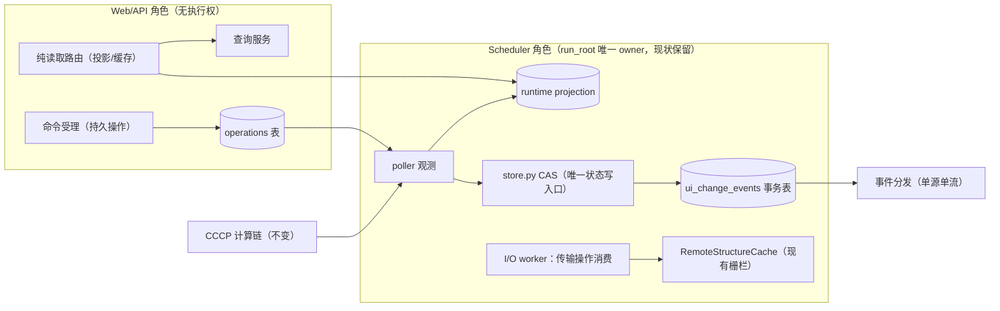

# ACP 架构评审与执行方案（第四份：代码级核验、排序修正与落地门）

日期：2026-10-15（晚）。状态：评审 + 执行提案；**未修改运行代码、未重跑探针、未重启服务**。
方法：对前三份文档做代码级核验 = 三条并行代码审计（前端刷新/API 读路径/调度与远程）+ 关键路径人工复核 + 既有审计材料（`docs/archive/2026-10-16/evidence/reports/ACP_API_Response_Audit_20261012/`）+ 一次独立架构评审。
与前三份文档的关系：①《ACP 产品架构优化方案》= 事实与目标主参考（保留）；②《三模块边界 ADR》= 目标边界参考，**其 §13“首批做 ACR 边界”被本文排序替代**；③《子层设计》= 目标分层参考，**其 §10 实施切片按本文排序执行**。实现时应同步修订 ②③ 中与本排序冲突的段落，避免两条优先级指令并存。

---

## 0. 决策摘要（TL;DR）

方向全部采纳：请求内 I/O 清零、共享运行态投影、事务化变更事件、后台传输队列、前端统一客户端。**顺序重排为“先需求侧止血，再供给侧建设”**：

1. **S0（0–1 周）止血**：request-id/计时/结构化错误 + 前端去掉重复请求（SSE 激活时停日志轮询、终态停摘要、去掉 /status 与 task-view 双重计数）+ 请求路径 rglob 结果缓存 + SSE 同步读有界卸载 + gzip/ETag + **备份脚本与恢复演练**（理由见 §2.4）。预计砍掉当前请求量 35–50% 且零新子系统。
2. **S1（2–4 周）投影与合同**：`scheduler/projections.py` 运行态投影（复用 poller 每 tick 已读数据，零新增 I/O）+ 计数短 TTL + 事件契约冻结 + 新鲜度合同成为验收判据。
3. **S2（4–10 周）传输 / 事件流 / 前端客户端**：持久传输操作（与 `_job_read_root` cache-only **同一包交付**）、项目级 SSE（单源单流）、前端统一客户端逐资源迁移。
4. **Track B（边界工程）**：ACR 物理拆包**不启动**，转为“设计就位 + 编码规约 + 护栏 + 触发条件”（§7）。Track A 的 S0–S2 **就是** readmodels/sync/transfers 的原地建设——将来拆分是打包迁移，不是重新设计。

---

## 1. 代码级核验结果

### 1.1 证实的关键事实（比前三份文档更精确的证据）

| # | 事实 | 证据（文件:行） |
|---|---|---|
| 1 | 可见活跃页面约 **70–80 次元数据 GET/分钟**（文档 1 的 54 为保守下限）：jobs 车道 2 req/4s=30 + summary 2.5s=24 + log 5s=12 + slow 30s≈2–4；能量图打开再 +12（5s） | `ACP_Workbench_v2.html:33556-33667`（四车道）、`33567`、`33588`、`33629`、`33644` |
| 2 | task-view 每请求 = 项目检查 + 2 个基础 COUNT + 约 5 个 facet COUNT（默认 `include_facets=True`）+ 行查询 + **每个活跃行一次无缓存 rglob 磁盘遍历 + 2 次 stat**（上限 200 行） | `v2_routes.py:395-462`、`146-184`；`task_views.py:274-283,619-702`；`runner.py:179-194` |
| 3 | summary/detail 同样做 rglob + stat + mtime 键缓存；detail 另有 2000 项目录扫描、二次 state.json 读、metrics.json、stderr、逐 artifact stat | `v1_routes.py:452-523`、`4898+`；`runner.py:179-194` |
| 4 | 单 job SSE 与**全部轮询并行**：无任何通道因 SSE 停止；日志双投递（SSE `log.*` + 5s logPoll） | `23253-23348`、`33629-33643` |
| 5 | SSE 每连接：每 5s 一次 DB `manager.get`、同步文件读取直接跑在 async generator（阻塞事件循环）、重放有全文件扫描回退、无连接上限 | `routes.py:552`、`:522`、`:438-494`、`:375-580` |
| 6 | 远端终态任务：`_job_read_root`（v1 与 v2 镜像两处）在 GET 请求内**同步 SFTP `fetch_catalog`** | `v1_routes.py:366-380`；`v2_routes.py:220-233` |
| 7 | 远程观测：每 remote job 每 5s tick = 1 次 `bjobs` SSH + SFTP 读 exit_code/state.json/日志尾；串行无批量；`acp run serve` 实际间隔为 5s（非 15s 默认） | `remote/monitor.py:90`；`remote/runner.py:113,546,622-628`；`manager.py:5323-5370`；`server.py:183-184` |
| 8 | 传输无持久队列：内存 `queue.Queue` + 启动重扫（≤300）；重启不恢复在途拉取 | `manager.py:426,4709-4797` |
| 9 | API 零中间件：无 request-id、无计时、无 CORS；错误 envelope 不统一；`/` 每请求读 1.7MB HTML（无 ETag/压缩） | `server.py`（全文无 middleware）；`server.py:257-264` |
| 10 | 前端 139 处 fetch 调用点、无构建系统、classic scripts；`structure_source_picker.js` 独立 8s abort 且裸 AbortError 可逃逸 | `10116-10221`；`js/structure_source_picker.js:73-126` |

### 1.2 需要修正的文档表述（源码与原文不符）

| 原文 | 核验结果 |
|---|---|
| ADR §2：“**远端脚本**还导入 `acp.catalog` 的参数转换函数” | 生成的 LSF 脚本**无任何 import**；导入发生在**服务器侧生成器** `remote/script_gen.py:26`（`from acp.catalog import method_levels_to_cli_flags`）。远端节点仍因 `python -m acp.cli run` 传递依赖 `acp.catalog`（源码经 PYTHONPATH 同步）——**独立性结论不变，表述需修正** |
| 产品方案 §2：“部分嵌套 AGENTS.md 描述已落后” | 补充一条现存实例：`api/AGENTS.md` 称 server.py “92 行、行 90 触发 JobManager 初始化”，实际 lifespan 化后语义已变；`v2_routes.py:201-205` 注释自述 “v1_routes.py is a user-dirty file, so the mirror lives here” —— **v1/v2 读路径镜像实现本身就是“没有护栏的缝隙”证据**，应纳入 S1 收敛项 |
| 产品方案 §2：每页约 54 GET/分钟 | 见 §1.1#1，应按逐通道相加修正为 70–80 |

### 1.3 既有审计缺陷（ACP-UX-01…20）与本方案门的映射

| 缺陷 | 归属门 |
|---|---|
| UX-01 SSE 同步扫描、UX-06/07 超时预算、UX-18 首屏未压缩 | **S0**（0.4/0.8/0.3） |
| UX-03 新鲜度提示、UX-08 远端失联可见、UX-09 观察串行、UX-12 详情全量读坐标 | **S1**（投影 stale 字段、远程按状态分级节流、详情按需读） |
| UX-04 NMR 探测、UX-05 rename toast 未定义、UX-10 日志游标、UX-11/13/14/15 目录/缓存/预取/PES 写链、UX-16/17 前端全量构建 | **S2**（0.11 顺带修复 UX-05 一行级 bug） |
| UX-02 详情静默降级、UX-19 Range、UX-20 资源开销 | S2–S3 |

---

## 2. 对前三份文档的排序修正

### 2.1 需求侧优先
原 P0 把“可观测性 + 止血”混在一起。修正为：**S0 先做请求量削减**（前端守卫 + rglob 缓存 + 双计数去除 + gzip），再谈新子系统。按代码推算，仅 S0.5–S0.7、S0.9 即砍 35–50% 请求量与大部分列表路径磁盘 I/O。

### 2.2 合并“cache-only read_root”与“持久传输队列”
文档 1 的 P2（cache-only）与 P6（持久队列）必须**同一交付包**：先改 cache-only 会制造“远端结果不可见”的降级窗口。正确顺序：操作表 + 单飞租约 + `availability/retry_after` 语义（S2）落地后，才把 `_job_read_root` 切成 cache-only。

### 2.3 事件先于前端统一客户端；试点仅任务列表
API 的 revision/seq/ETag 契约冻结先于前端迁移；前端统一客户端第一个试点只接“任务列表”一个资源，配套“旧定时器删除”验收，不做大爆炸迁移。

### 2.4 备份恢复前移（P5 → 4 周内）
当前 = 单 SQLite + 单 run_root + 无任何备份工具（`scripts/` 无 backup/restore）= **最大的产品级风险是不可逆数据丢失**，其优先级高于一切性能优化。S0 交付 `scripts/backup_acp.sh`（SQLite `.backup` API 一致性快照 + run_root 增量同步）+ 恢复演练清单；S1 完成一次恢复演练。

### 2.5 现在定死、否则后期拆包变贵的两个决策
1. **`job.status` 恒为 jobs 行权威**；投影只承载昂贵富化（stage/progress/catalog_revision/observed_at），不得成为第二状态源。
2. **“无投影行”语义 = unknown → 可见页懒回填（有界）**；列表即使零投影行也必须完整可渲染（状态来自 jobs 行），禁止同步 rglob 回退，禁止渲染为空白历史。

### 2.6 补齐三处缺失（前三份文档均未写）
1. **数据新鲜度合同**（§3.3）——它是 S0–S2 的验收判据，也是 Track B 触发条件的度量基础。
2. **单写者写预算**（§3.4）——投影/事件/操作都加在 SQLite 单写者上，须先定合并与保留策略。
3. **浏览器 SSE 连接上限约束**（§8）——HTTP/1.1 每源 6 连接；项目级变更流落地时必须“一源一条流”，同版本关闭 per-job SSE。

---

## 3. 目标运行时结构（融合两轨）

### 3.1 三个运行角色（先行模块+队列，进程后置）

差异于文档 1 §3：首期**不拆进程**；Web/API 与 Scheduler 仍是同一进程内的独立模块 + 有界队列，直到 §7 触发条件成立。

### 3.2 数据权威（不变部分从略，仅列新增）

| 数据 | 权威 | 规则 |
|---|---|---|
| job.status/attempt | jobs 表（现有 CAS） | 投影/事件/前端不得改写 |
| 运行态富化 | runtime projection | 可重建；仅 poller/observer 在 CAS 提交后写；带 observed_at |
| 变更事件 | ui_change_events | 与状态 CAS **同事务**；payload 只含 ID；至少一次、按 seq 去重 |
| 传输操作 | operations 表 | 身份键去重；完成只改 availability，不改 job 状态 |

### 3.3 新鲜度合同（新增，产品可见不变量）

| 数据类 | 目标新鲜度 | 降级展示 |
|---|---|---|
| 任务状态/进度 | 活跃 ≤5s（= poll tick）；终态=事件驱动 | 超 3× 周期标“更新延迟”+ 最后成功时间 |
| 列表/计数 | ≤10s | 保留旧快照 + stale 标记 |
| 结果目录 catalog | 事件驱动（终态 prefetch / prepare 完成） | availability=missing/pending + retry_after |
| 组织字段（名称等） | 事件驱动 | 版本冲突 409 带当前投影 |
| 传输 | 不承诺时长，承诺可见性 | “计算已完成 · 结果同步中 · 数据 15 秒前”三轴并存 |

### 3.4 单写者写预算（新增）

- 投影：仅变化时写；同 tick 每 job ≤1 次；进度可按 ~1s 合并；终态/控制意图/结果就绪**不可被合并丢失**。
- 事件：离散事件只记 状态/版本/目录/名称 类；进度类 LWW 合并；一律与 CAS 同事务。
- 保留与清理：事件保留窗口默认 90 天（可配）；删除走 cascade 规则（ANTI #13），不得裸 DELETE。
- 监控：`busy_timeout` 触发计数、WAL 文件大小、每 tick 写次数进 `/api/health`（随 S0 的 request-id 一并对齐）。

---

## 4. S0 止血包（0–1 周，可直接执行）

> 前置：先处置未提交的 XtbConstrainedOpt 工作（合入或 stash）——S0 会触碰 `manager.py`/`task_views.py`/前端，避免特性与性能修改混在一个 bisect 区间。

| # | 目标 | 文件 / 符号 | 动作 | 验证 |
|---|---|---|---|---|
| 0.1 | 保 bisect 干净 | git 工作区 | XtbConstrainedOpt 先合入或 stash | `git status` 干净基线 |
| 0.2 | 可观测性 | `api/server.py` | request-id + 分段计时访问日志（含 DB/文件/序列化分段时间）+ 500 结构化输出（含 request_id、错误码前缀） | 新探针：响应头 `X-Request-Id`；500 含码 |
| 0.3 | 首屏与静态 | `api/server.py:257-264` | `/` 增加 ETag/Last-Modified（304）；挂 GZipMiddleware（除 SSE） | curl 304；HTML 传输字节对比 |
| 0.4 | 前端请求纪律 | `ACP_Workbench_v2.html:10116-10221`；`js/structure_source_picker.js:73-126` | 非轮询 GET 启用 in-flight 合并（同 URL 并发去重，不缓存结果）；picker/tsmode 统一走主 `api()` 错误映射（消灭裸 AbortError；修“0 秒”文案取整） | 浏览器瀑布计数；故障注入探针 |
| 0.5 | 停日志双投递 | `33629-33643` | `activeSSE` 为 connected 且指向选中任务时跳过 logPoll 请求体 | 请求计数 −12/min/页 |
| 0.6 | 停终态轮询 | `33588-33627` | 选中任务终态后停 summary/energy 常规轮询（保留终态事件触发的最后一次强制刷新） | 终态页面请求计数 |
| 0.7 | 去双重计数 | jobs 车道 | `/status`（counts）移入 slow 车道；jobs 车道计数取自 task-view 响应（先核对两者语义一致性再删） | 请求计数 −15/min/页 |
| 0.8 | SSE 事件循环解阻 | `routes.py:438-494,522` | 同步文件读取移入 `anyio.to_thread`（有界卸载，先止血；共享 dispatcher 归 S2） | 探针：并发 SSE 下事件循环延迟 |
| 0.9 | 列表路径磁盘遍历缓存 | `runner.py:179-194`；`v1_routes.py:453` | `find_workflow_state` 结果按 (job_id, attempt) 进程内缓存 + `exists()` 校验失效（attempt 变化或路径消失才重扫） | 探针：task-view 请求 rglob 次数 = 0（热态） |
| 0.10 | 备份/恢复 | `scripts/backup_acp.sh`（新）+ `docs/` 恢复演练清单 | SQLite `.backup` + run_root rsync（排除缓存）；恢复演练文档 | 演练：恢复后任务列表/结果可读 |
| 0.11 | 顺带一行级修复 | 前端 rename 路径 | 修复 UX-05 `showToast is not defined` | 探针复现转通过 |
| 0.12 | 基线与复测 | `docs/archive/2026-10-16/evidence/reports/ACP_API_Response_Audit_20261012/verify_backend.py` | 在 S0 前后各跑一次（当前 HEAD 基线 + 修改后） | 前后对比报告 |

**S0 验收**：可见不变页面请求量较基线下降 ≥35%；列表/摘要路径热态 rglob=0；SSE 并发探针无 80ms 级阻塞；`/` 返回 304；备份恢复演练通过；非 slow 回归全绿。

---

## 5. S1 投影与合同（2–4 周）

1. **运行态投影**（`scheduler/projections.py` 新模块 + `migrations.py` 新表 `task_runtime_projection`）：
   - 写入点：`manager._poll_job` 观测成功且 CAS 提交**之后**（复用已读 state.json 数据，零新增 I/O）；终态副作用收尾时写最后一行。
   - 字段：task_id、attempt、status_source_revision、progress/stage、catalog_revision、result_revision、observed_at、last_success_at、stale_reason。
   - 读取切换：`_enrich_job_snapshot`/`_enrich_active_rows` 投影优先（feature flag），无行→懒回填（有界队列，可见页优先），**禁止同步 rglob 回退**。
   - 测试：投影滞后不超过 CAS 一次 tick；attempt+1 后旧投影不得复活；无投影行可完整渲染列表。
2. **计数与 facets**：短 TTL（≤5s）进程内缓存 + 写路径 epoch bump 失效；验证 `task_views` 查询计划与现有索引。
3. **事件契约冻结**（写入 S2 用，先落 schema 与 store.py 事务入口）：seq、project_id、entity、attempt、entity_revision、type、payload（ids-only）；快照返回同事务 snapshot_event_seq。
4. **远程观测分级节流**：PENDING 15–30s / RUNNING 5–10s（`manager.py` 扫描配置化）；UX-09 的批量 bjobs 留 S2。
5. **详情按需读**：`_structure_result_summary` 不再读取全部坐标后丢弃（UX-12）。
6. **产品收口**：恢复演练执行一次；新鲜度合同接入前端显示（stale 标记）。

---

## 6. S2+（4–10 周，摘要）

- **传输操作**（合并原 P2+P6）：`scheduler/operations.py` + 表 + 单飞租约；`_job_read_root` 切 cache-only 与 prepare 端点**同包**；availability/retry_after；“结果同步中”独立状态。去重键 = 任务+attempt+artifact身份+generation（绝不按用户/请求）。
- **项目级变更流**：单源单流（**一源一条 SSE**，同版本关闭 per-job SSE；多标签页 BroadcastChannel 后置）；慢客户端有界队列超限断开→游标恢复；游标过期→reset。ETag 覆盖 name_revision+attempt+projection_revision。
- **前端统一客户端**：`core/`（api-client / resource-store / refresh-policy / events）逐资源迁移，顺序：任务列表 → 摘要/详情 → 日志 → 结果面板；每个资源迁移的完成标志 = **旧定时器已删除** +“不变可见页面 ≤2 GET/min”门达成。
- **运维/产品**：诊断包（request-id 串联）、错误码扩展、SSE 相关部署验证（代理缓冲/心跳/连接预算）、（认证仍后置：首发定位可信私网部署）。

---

## 7. Track B（ACR 边界）：四个条件 + 触发表

**不启动物理拆包**。ADR §13“首批做 ACR 边界+样板”被本文替代。四个前提条件（满足才允许启动）：

1. **编码规约（day-1 护栏）**：所有新服务模块（`projections/operations/events` 等）不得导入 `fastapi`/`Request`/scheduler 内部实现；只经 CAS/仓储面写；扩展 `tests/test_architecture_invariants.py` 加 import 方向检查（含字符串入口）。
2. **单一状态权威**：`job.status` 恒在 jobs 行（§2.5#1）。
3. **可测触发 + 固定复查日**：触发 = ①“API 重启/扩容必须独立于 scheduler”成为部署需求（现为一个 systemd 单元）；②远端节点需在无 acp 产品包环境执行（合作方/发行）；③独立发布列车需求；④并行开发冲突数超阈值。**首次复查日：2026-12-15**；未触发不拆。
4. **不建骨架**：模块仅在有 ≥2 真实消费者或护栏需要时创建；禁止先铺 R1–R4 空包。

**Watchlist（先冻结契约，不实现）**：worker envelope 入口与节点依赖清单（`acp-worker` console script 提案）——冻结为接口文档，发生⑤时按 ADR §11 执行。

---

## 8. 风险与回滚

| 风险 | 缓解 | 回滚 |
|---|---|---|
| 投影与 CAS 漂移 / 旧 attempt 复活 | 仅 CAS 后写；幂等；(attempt, source_revision) 单调守卫；observed_at + 生产者心跳 | flag 切回读路径（旧实现保留一版） |
| 无投影行被渲染为空 | unknown→懒回填（有界）；列表状态来自 jobs 行；禁止同步回退 | —（设计约束） |
| 事件缺口/乱序/重放过期 | 同事务写；snapshot_event_seq；seq+attempt 双去重；过期 reset；cascade 清理 | 关闭事件流回退低频轮询（不恢复多定时器） |
| SSE 背压 / 浏览器 6 连接上限 | 一源一条流；有界队列；慢客户端断开+游标恢复；抖动重连 | 保留 per-job SSE 期间不得同时上线项目流 |
| 传输重复/风暴 | 身份键+唯一约束+租约 CAS；失败只标 availability；控制>目录>大文件分道 | 关闭 prepare 端点回退同步低并发 |
| SQLite 写放大 | 写预算+合并+保留策略；busy_timeout 指标 | 回退到仅投影、暂缓事件表 |
| 特性+性能混改污染 bisect | S0 前置 0.1 | — |

---

## 9. 验收与测量

继承文档 1 §10 全部指标，新增/收紧：

| 指标 | 目标 | 口径 |
|---|---|---|
| 每页元数据 GET | 不变可见页面 ≤2/分钟（S2 末）；S0 后较基线 −35% | 浏览器瀑布逐通道 |
| 列表/摘要路径 rglob | 热态 0 次 | 探针计数 |
| SSE 并发下事件循环 | 无 80ms 级阻塞 | 延迟探针 |
| `/` 静态 | 304 命中；传输启用 gzip | curl |
| 备份恢复 | 演练通过：任务/结果/续跑可用 | 演练清单 |
| 多人同任务 | 远端采集不随页面数放大 | 现有审计探针扩展 |
| 投影新鲜度 | ≥95% 探针点 ≤2×tick | 新探针 |

---

## 10. 待拍板决策（8 项）

1. 接受“两轨 + 条件化拆分”（否决点 = 坚持立即物理拆 ACR）。
2. S0 范围确认（先止血，先备份）。
3. SSE 长期策略：一源一条流 + 多标签复用（影响 S2 设计冻结）。
4. 备份介质与保留策略（本机第二盘 / NAS / 网络盘；run_root 体量）。
5. 部署形态：维持单 systemd 单元直到触发条件，或提前安排 API/scheduler 单元拆分（含 systemd 脚本改造）。
6. 认证范围：首发可信私网（无登录）是否成立。
7. XtbConstrainedOpt 处置：先合入还是 stash（决定 S0 开始时间）。
8. 新鲜度合同数值确认（状态 ≤5s、列表 ≤10s、事件 90 天保留）。

---

## 附：证据索引

- 前端：`frontend/ACP_Workbench_v2.html:33556-33667`（四车道）、`10116-10221`（api 层）、`23253-23348`（SSE）、`35007`（visibility）。
- API：`api/server.py`（无中间件；`:257-264` 静态 HTML）、`api/routes.py:375-580`（SSE）、`api/v2_routes.py:146-184,395-462`、`api/v1_routes.py:416-523,366-380`。
- 调度/远程：`scheduler/manager.py:426,4709-4797,5323-5370,4799-4898`；`scheduler/runner.py:179-194`；`remote/monitor.py:90`；`remote/runner.py:113,546,622-628`；`results/remote_structure_cache.py:372-460,661-675`。
- 既有材料：`docs/archive/2026-10-16/history/ACP_API_Web_Response_Issue_Audit_20261012.md`（20 项缺陷）、`docs/archive/2026-10-16/evidence/reports/ACP_API_Response_Audit_20261012/`（探针可复跑）。
- 本文以三类独立核验交叉验证；结论中仍标注“建议/推算”的数值均未做生产压力测试，S0 首步即以探针刷新基线。
