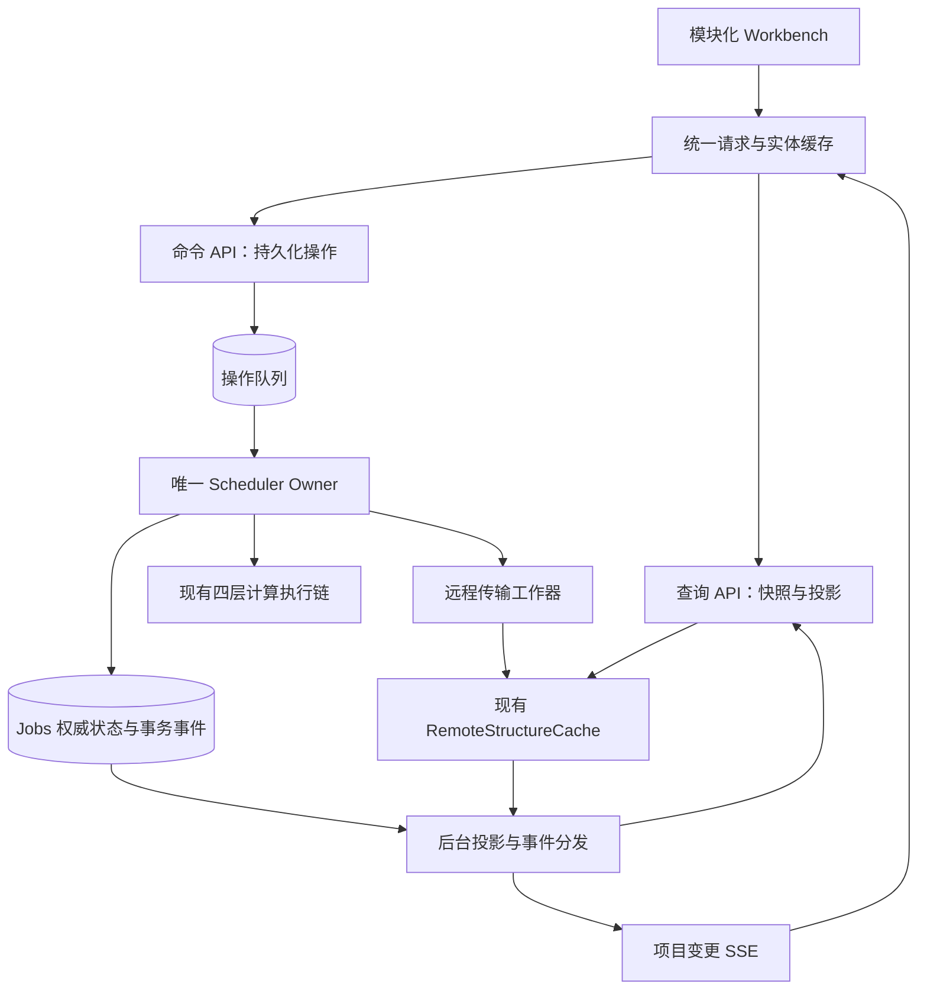

# ACP 产品架构优化方案

日期：2026-10-15。状态：设计提案，尚未实施。依据：当前工作区源码静态检查，包含现有未提交修改；未进行生产流量采样、浏览器性能录制或压力测试。所有容量、延迟、时间安排均为建议目标，不是实测结论。

## 1. 决策摘要

保留 cccp/qc → cccp/backends → cccp/calculation → acp 四层科学计算架构。下一阶段主要投资 ACP 产品服务层：减少重复取数，把读取与远程操作分离，建立可恢复的变更通知，让前端仅更新发生变化的可见内容。

建议先交付面向科研小团队的私有部署产品：项目、任务、结果、结构来源、协作权限、诊断和备份。公开多租户 SaaS 是后续决策，不作为这轮性能整改的默认范围。

首期采用模块化单体，保留 SQLite 和现有部署方式；先建立边界，再按故障隔离需求将 API 与调度器分为进程。Redis、分布式消息系统、微服务、全面前端框架重写不作为首期依赖。

## 2. 当前事实与瓶颈假设

以下为源码事实；对其性能影响需要用第 10 节的基线验证。

| 证据位置（仓库相对路径，函数为稳定定位） | 已有能力与剩余问题 | 直接修改方向 |
|---|---|---|
| `frontend/ACP_Workbench_v2.html::startPolling` | 已有隐藏页面降频和请求重入控制；列表活跃时 4 秒、空闲 15 秒，摘要 2.5 秒，部分图表 5 秒，日志 5 秒，慢通道 30 秒 | 统一刷新协调器；事件正常时停止重复状态轮询 |
| 同文件 `refreshJobs` | 已有每页 200 条、筛选缓存、取消请求、响应序号保护、渲染键；仍每轮取完整当前页并序列化 groups/counts 判变 | 资源 revision、条件请求、实体级更新；保留现有正确性保护 |
| 同文件 `refreshSelectedJobSummary` | 已从 full detail 改为 summary，但选中终态任务仍可进入摘要轮询 | 终态停止常规进度轮询，结果到齐独立订阅 |
| 同文件 `connect`（EventSource）和 `api/routes.py::stream_job_events` | 已有单任务 SSE、历史窗口、断点续传、心跳；未替代列表/摘要轮询；服务端每连接仍读日志尾和 job | 项目范围变更流；服务端共享事件分发，避免每客户端重复采集 |
| `api/v2_routes.py::_enrich_active_rows` | 已批量 get_many 且限制 enrichment 数量，但仍逐任务调用读取 state 的补充逻辑 | 后台生成运行态读模型，列表不在请求中读取 state.json |
| `api/v1_routes.py::get_job_summary / _enrich_job_snapshot` | 摘要仍需补充文件运行态和事件信息 | summary 读预生成快照；携带更新时间与陈旧状态 |
| `scheduler/task_views.py::query_project_tasks` | 已在 SQLite LIMIT/OFFSET；重复执行 count/counts，facets 可关闭；JSON1 不可用的 tag 分支仍先取全量 | 缓存统计、验证索引与查询计划；逐步迁移标签关系表 |
| `api/v1_routes.py::_job_read_root` | 远程终态读取同步调用 fetch_catalog | 返回本地缓存状态，缺失时排入后台拉取操作 |
| `results/remote_structure_cache.py` 和 `scheduler/manager.py` | 已有 attempt/generation fencing、锁、共享缓存和后台预取 | 在现有实现上补持久队列、重试与优先级，不另建第二缓存 |
| `api/routes.py::stream_job_events` | async 流生成器直接调用同步文件/DB 操作 | 快速止血先有界卸载；最终共享 tailer/事件分发 |
| `api/server.py::create_app/lifespan` | JobManager 已改为 lifespan 创建；同 run_root 独占 | API 多进程前必须先拆 scheduler ownership |
| `scheduler/store.py` | 已开启 WAL；状态写有 revision/status/attempt CAS | 保留并扩展事务一致性，不能再建议“首次启用 WAL” |

主 HTML 约 1.70 MB、约 3.5 万行，包含大量业务逻辑。体积是维护与首次解析风险信号，并不单独证明卡顿根因。

假设快速请求耗时可忽略，仅列表与状态每 4 秒两次、摘要每 2.5 秒一次，就约为 54 次 GET/分钟/活跃页面；尚未计日志、图表、文件树、结构刷新。真实频率因等待请求完成及页面状态而更低或不同。20 个这样的页面仅基础通道就约 18 GET/秒，应以浏览器记录验证，不能据此推断服务器容量。

部分嵌套 AGENTS.md 的行数、API extras、import 时启动调度器等描述已落后于源码，后续实施时应同步校正。引用聊天可读取用户问题，但旧助手回复只返回引用占位符，因此不将旧回复当作已核验设计。

交叉参考仓库已有 [2026-10-12 API/网页响应审计](ACP_API_Web_Response_Issue_Audit_20261012.md)：其记录了隔离环境下 SSE 重放同步扫描、详情错误静默降级、远端超时预算错配等复现，也明确反证了“没有分页/行复用”“所有重命名都无提示”等旧说法。本方案承接该审计，不重复宣称旧缺陷全部仍在；历史复现结果不是本轮运行结果，实施前应在届时代码基线上重跑对应探针。P0 同时纳入详情只对明确的接口不兼容降级、目录读取失败不缓存为空、统一 fetch 截止时间和 task 级监控新鲜度提示。

## 3. 目标结构与权威边界



三个运行角色可以先同进程、独立模块和有界队列，再拆进程：

1. Web/API：鉴权、校验、读取、提交操作、推送通知，不拥有计算执行和长时间远程传输。
2. Scheduler：持有 run_root 唯一 owner；负责任务控制、提交、恢复、状态 CAS。
3. I/O 工作器：远端目录/文件拉取、解析和索引。首期仍由 Scheduler 托管，与现有缓存共享生命周期；独立进程前须补跨进程去重与 fencing。

权威关系必须明确：jobs 为任务状态与 attempt 权威；任务名称/组织字段由现有 tasks/organization 存储权威管理；result_manifest v2 和 frame_candidates 为科学结果/候选权威；新增 projection 只用于读取且可重建；SSE 只通知已提交的变化，不直接决定任务终态。取消状态保持现有 cancel_state 语义，不擅自新增 JobStatus。

## 4. 前端：一个请求入口，一个实体状态源

建议增量目录，先迁出当前代码再逐步收紧类型：

```text
frontend/src/
  app/                 # 启动、路由、布局、模块挂载
  core/api-client/     # 超时、取消、去重、优先级、错误映射
  core/query-cache/    # query key、订阅、revision、失效
  core/events/         # SSE、重连、补齐、降级轮询
  core/entity-store/   # jobs/tasks/operations，不存第二份任务状态
  features/tasks/     # 队列、筛选、分页、任务操作
  features/projects/
  features/submission/
  features/structures/
  features/results/   # 能量、轨迹、频率、NMR
  features/diagnostics/
  viewers/            # 对接现有 3Dmol 与 viewer 模块
```

模块统一 mount/update/unmount；卸载必须取消订阅、计时器、观察器、请求并释放 viewer。不要仅把大 HTML 拆成多个仍互相访问全局变量的文件。

请求规则：同一用户/项目/参数的 GET 共享在途请求；一个消费者退出不取消其他消费者需要的共享请求；切换项目或任务用 generation 丢弃旧响应。mutation 不盲目去重或重试，使用服务端幂等键。并发初始建议：交互查询 4、结果文件 2、后台预取 1，控制操作留独立名额，后续实测调整。

页面数据源统一：列表和详情引用同一 task 实体；实体包含 attempt/job_revision、name_revision、projection_revision，分别比较，不能用 job revision 覆盖组织字段。重跑时清除旧 attempt 的结果展示；旧内容如保留，必须显示“上一轮结果”，不得冒充当前计算结果。

刷新规则：

| 数据 | 正常模式 | 降级模式 |
|---|---|---|
| 项目任务列表/计数 | 首次快照 + 变更通知；250–500ms 合并失效 | 可见活跃页面 10–15 秒条件请求，退避带随机抖动 |
| 选中任务摘要 | 实体变更直接更新 | 活跃任务 5–10 秒；终态不持续轮询 |
| 结果目录 | catalog_revision 变化才拉取 | pending 操作查询有界退避，并展示失败重试入口 |
| 能量/轨迹 | 仅可见面板且 result_revision 改变时更新 | 活跃计算允许低频校验；终态完成最后一次读取 |
| 日志 | 仅打开日志面板时读取增量 | 带 attempt/file generation/byte offset 游标补齐 |
| 文件树 | 展开节点加载；目录 revision 变化才失效 | 用户刷新或低频可见节点检查 |
| 节点能力/catalog | 发布版本或配置版本缓存 | 手动刷新和低频后台采集 |

浏览器隐藏后暂停视觉渲染和昂贵查询；恢复时仅一次一致性补齐，避免同时立即启动所有旧通道。SSE 正常时取消同一资源的轮询；降级和恢复由统一状态机负责。

列表保留已有行复用，在其基础上把更新粒度收紧到稳定 task ID 和具体变化字段，减少组容器与摘要重建，保留焦点、勾选、展开和滚动位置。先测量 200 行页面，再决定虚拟滚动的阈值。曲线下采样仅用于展示，原始科学数据和候选选择保持完整；解析大轨迹可迁入 Web Worker。能量查看器继续只保存候选、不提交任务；3D framing 继续使用现有统一入口。

构建产物采用内容哈希 JS/CSS，HTML 重新验证；有哈希的资源才允许长期 immutable 缓存。旧无哈希 `/js`、`/css` 保持 no-cache。API 返回 build/schema version，发现版本不兼容时先保存草稿再提示刷新。

## 5. 查询、变更事件与一致性

### 5.1 先完善现有 API，再增补必要端点

| 接口提案 | 行为与契约 |
|---|---|
| 现有 `GET /api/v2/task-view` | 保持兼容；仅 DB/投影读取，提供 view_revision、ETag，暂保留 offset 分页 |
| 现有 summary/detail | summary 从快照返回；detail 按 plan/recovery/artifacts 等分区按需加载，旧完整响应保留适配 |
| 新 `GET /api/v2/events?project_id=...` | 一个页面一个项目变更流，支持事件游标、重放和 reset；不推完整轨迹 |
| 新 `POST /api/v2/tasks/{id}/actions` | 对长操作返回 202 + operation_id；操作受权限、attempt、revision 与幂等键保护 |
| 新 `GET /api/v2/operations/{id}` | 返回 queued/running/succeeded/failed 和业务结果；这些是操作状态，不是 JobStatus |
| 新 `POST /api/v2/tasks/{id}/artifacts/prepare` | 验证 artifact 与 attempt 后创建或复用拉取操作；从结果 manifest 白名单解析路径 |
| 结果 catalog 查询 | 已就绪返回 manifest 摘要；未就绪明确 availability、operation_id、retry_after，不能以空列表伪装无结果 |

工作台初始加载可用小型 bootstrap 聚合目录版本、权限、项目和默认查询配置；不能合并进所有节点探测、任务详情、3D 坐标。

ETag 必须覆盖响应所有变化源，包括名称、组织字段、当前 attempt、进度投影和权限范围。缓存键至少包括授权范围、项目、规范化查询、分页、投影版本。尽可能先检查版本再构造响应，避免先做昂贵计算再返回 304。用户私有响应不进入公共缓存。

当前分页已存在，先优化查询计划、复用 counts/facets；后续规模需要时引入稳定排序键 + task ID 的 cursor。分组总数与当前页组内条数明确区分。变更导致排序/过滤/分组成员变化时，合并刷新该查询页，不只改当前可见行；删除、归档、标签变化也必须使相关页失效。

### 5.2 后台投影

新增 `task_runtime_projection`（或与现有 task index 合并，实施时避免重复字段），保存：task_id、attempt、source_job_revision、projection_revision、进度/阶段、catalog_revision、result_revision、observed_at、last_success_at、stale_reason。

现有 runner/observer/remote monitor 采集一次，经 CAS 验证后更新投影。读取接口不再逐用户读取 state.json。只在内容改变时写入；高频进度可合并约 1 秒一次；终态、控制意图和结果就绪不能被合并丢失。上游暂不可达显示最后成功快照与“更新延迟”，不能显示空任务或把远程网络故障等同计算失败。

### 5.3 可靠事件，避免“加 SSE 仍重复扫描”

新增事务事件表 `ui_change_events`：event_seq、project_id、entity_type、entity_id、attempt、entity_revision、event_type、payload、created_at。任务 CAS 与对应事件在同一 DB 事务提交；任务组织写入也在其事务内记录事件。若投影异步生成，先持久状态变更，再在投影落库事务生成 projection.changed；前端不得把尚未刷新投影的旧值当最新值。

事件只保证至少一次送达，客户端按 event_seq 去重、按 attempt/revision 拒绝倒退。JSONL 继续承担执行审计，不让每个浏览器重复扫描它，也不要求此次把全部审计迁入 DB。

快照必须返回在同一读事务观察到的 snapshot_event_seq，客户端从其后重放；首次快照与订阅之间的变化不能漏掉。事件清理以保留窗口为界；游标过期、权限范围改变或投影重建发送 reset，客户端重新取快照。客户端对不连续的可见序号不能简单判丢失，因为授权过滤会跳过其他项目事件。

每 API 进程建立共享 dispatcher，批量读取事件并向连接分发，不为每条 SSE 建独立 DB/文件轮询。慢客户端队列必须有界；积压超限断开并要求从持久游标恢复，过期则 reset。日志正文采用独立增量读取，避免淹没任务事件队列。多标签页复用连接作为后续优化；先保证每页面只有一个主流。

## 6. 远程通信与慢任务隔离

1. 保留 manager-owned RemoteStructureCache 和现有 attempt/generation 栅栏。将 `_job_read_root` 的常规查询路径改为 cache-only + ensure queued；兼容入口如暂保留同步拉取，必须低并发且有明确超时，之后退役该行为。
2. 将内存 catalog 预取扩展为可恢复 operation 队列：唯一键包含任务、attempt、artifact/catalog、generation；有租约、重试次数、下次重试时间、错误码。重启回收过期租约，重新校验 attempt；旧拉取完成不能发布到新 attempt。
3. 复用现有 SSH pool；为控制、状态观测、小目录与大文件传输配置独立预算。取消/暂停不能被大文件下载占满连接。慢节点独立退避；熔断只标记不可达，不推断计算已失败。
4. `remote/monitor.py` 当前提供单 job 的 bjobs 查询。新增按节点批量观测接口，先测实际调用数；兼容 LSF/OpenLAVA 输出差异与命令长度限制，不能假设所有节点支持同一 JSON 输出。批量查询失败或部分记录缺失保持 unknown，由现有 reconciliation 取证。
5. 远程采集频率取决于任务状态和节点负载，不随浏览器人数增长。活跃任务可先采用 5–10 秒、排队任务 15–30 秒的配置建议；控制确认另设优先通道。PAUSED 继续遵守现有 poller 跳过规则。
6. 日志按偏移增量拉取并缓存；识别截断、轮转、重跑。先小 catalog 后按需坐标/大型文件，不在 terminal transition 下载所有结果。
7. 文件解析、全量目录索引和报告生成进入有界后台操作。短请求线程池与慢 I/O 池隔离，CPU 密集解析按证据使用独立进程；所有队列暴露深度、最老等待时间、拒绝数。

Starlette 同步端点使用线程池；单纯给路由改成 async 并不会让同步 SFTP/文件解析变为非阻塞。不能仅增加默认线程数来掩盖排队，应先移出慢工作并设置预算。[官方线程池说明](https://starlette.dev/threadpool/)

## 7. API 与调度器进程拆分

当前 lifespan 会构造 JobManager，后者独占 run_root。直接以多个 Web worker 启动会竞争 owner，不能当作扩容方案。

拆分顺序：

1. 引入 ReadService、CommandService、ProjectionService，将 route 对 manager 的直接依赖逐步替换，先保持单进程兼容部署。
2. 所有可能触发执行的命令先写持久 operations，命令记录与必要的控制意图由同一短事务落库。HTTP 超时后客户端用幂等键查询已有操作；相同键不同请求返回冲突，不能再次提交计算。
3. Scheduler 唯一 owner 消费 operations。执行期间复核权限策略、expected_attempt/revision，失效操作明确失败；外部副作用继续使用现有 submission_id、lease 和回执 reconciliation。不能仅靠 operation 的“已领取”保证 bsub 恰好一次。
4. Web reader 模式不创建 JobManager，也不启动 indexer、预取或 cleanup；通过仓储接口读快照、写命令。先单 API 进程验证 API 重启不影响计算，再验证多 API worker。
5. Scheduler 心跳失联时 API 可继续展示最后快照，但需明确控制服务不可用；不能无限接受排队控制操作而让用户误以为已执行。关闭接收还是允许排队由操作类型定义。

SQLite 首期继续保留，数据库必须在原生本地文件系统；短事务、明确 busy timeout、连接生命周期、统一迁移入口和 WAL checkpoint 监测。WAL 允许读写并行但仍只有一个 writer，增加连接不等同提高写吞吐。[SQLite 官方 WAL 说明](https://www.sqlite.org/wal.html)

出现持续写锁等待、单机高可用要求或跨主机 API 部署需求时，再评估 PostgreSQL。迁移需重测 CAS、幂等键唯一约束、事务事件、purge cascade 和历史数据兼容。不得把 SQLite 放到共享网络盘实现跨主机共享。

## 8. 初创产品的完整闭环

| 产品面 | 首版应交付 | 发布验收 |
|---|---|---|
| 项目协作 | 登录、项目成员、owner/editor/viewer 权限 | 列表、文件、SSE、操作和结构来源全部按项目鉴权；用户不能通过猜 ID 读其他项目 |
| 任务提交与控制 | 草稿、校验预览、重复提交防护、提交回执、取消/暂停状态说明 | 断网重试不会重复创建计算；控制接受与真正生效区分显示 |
| 结果可信度 | 科学状态、传输状态、解析状态分别展示，参数/版本/来源可追溯 | completed + syncing 可以并存；下载失败不改计算终态 |
| 工作台体验 | 数据更新时间、离线/陈旧提示、局部加载失败、保留草稿与选择 | 单一面板失败不会清空整页或触发全站重载 |
| 运维与支持 | request_id、结构化错误码、服务健康、磁盘/队列监控、脱敏诊断包 | 合作者可提交一个诊断编号定位问题；响应不暴露原始异常堆栈与路径 |
| 部署与恢复 | 可复现发行包、迁移/回滚指引、DB 与产物备份、恢复演练 | 从备份重建项目与产物引用；升级失败可回滚到兼容版本 |

认证优先支持私有部署的同源会话或组织身份接入。Cookie 会话的写操作做 CSRF 防护；SSE 使用同源认证，不在 URL 放长期 token。权限撤销必须使正在运行的订阅失效。按组织/项目隔离缓存和操作幂等键。

若保留 Mechanism 作为产品导航，它应是现役 Confsearch/PESsearch/BatchOptimize/irc 的组合工作区；不恢复 retired mechanism 工作流，不重建历史 CLI。所有业务工作区共享同一任务/结果基础服务。

## 9. 具体改动包与依赖顺序

| 阶段 | 主要文件/新增模块提案 | 交付内容 | 前置条件 |
|---|---|---|---|
| P0 可观测性与快速止血 | `api/server.py`、主 HTML 请求入口、`routes.py` | request_id/分段耗时；请求数与长任务采样；终态/不可见面板停止刷新；SSE 同步 I/O 有界卸载；统一错误提示 | 无 |
| P1 前端公共底座 | `frontend/src/core/*`、`app/*` | api client、query cache、entity store、生命周期；迁移 tasks 页面；其他模块逐步接入 | P0 基线 |
| P2 纯读取与后台传输 | `api/v1_routes.py`、`v2_routes.py`、`scheduler/task_views.py`、`results/remote_structure_cache.py`；新增 `acp/services/task_reads.py`、`scheduler/projections.py`、`scheduler/operations.py` | summary/list 无文件探测；持久拉取队列；快照 revision、统计缓存和查询计划优化 | P0；可与 P1 按接口契约推进 |
| P3 可靠变更流 | `scheduler/store.py`、组织字段事务入口、`scheduler/migrations.py`；新增 `acp/services/change_events.py`、`api/event_routes.py` | 事务事件、快照游标、共享 dispatcher、前端统一降级轮询 | P1/P2 |
| P4 进程隔离与远程采集 | `api/server.py`、`scheduler/manager.py`、`remote/monitor.py`、`scripts/install_systemd.sh` | API reader 模式、scheduler 独立服务、命令消费、节点批量采集 | operations 与一致性测试通过 |
| P5 产品发布收口 | 权限服务、项目路由、诊断页面、部署文档、测试 | 项目隔离、备份恢复、灰度升级、支持流程 | 上述关键链路稳定 |

目录名是提案，不要求所有抽象一次建齐。先抽取被两个实际调用方使用的边界，避免再造大量无逻辑转发层。新增模块实现不放 `__init__.py`，保持新代码 PEP 604。

估算：2 名熟悉仓库的全栈工程师、具备测试环境时，P0 约 2–4 个工作日，P1/P2 约 2–3 周，P3 约 1–2 周，P4/P5 约 2–3 周；总体约 6–9 周，需按性能基线和协作权限现状重估。单人实施按顺序推进，不以同时重写前后端压缩计划。

## 10. 验收指标与测量方案

建议首个验证档：单机 4 vCPU/8 GB、本地 SSD、10,000 历史任务、50 个活跃任务、20 个同时打开的浏览器页面、2 个模拟远程节点。记录准确硬件/依赖/数据规模；慢节点用故障注入模拟，与真实 LSF 环境做最终联调。

| 指标 | 建议目标 | 测量口径 |
|---|---|---|
| 元数据 GET 数 | 相同场景较基线降低至少 80% | 排除下载与 SSE 心跳；记录所有页面接口，不只 task-view |
| 无变化可见页面 | 常态最多 2 次元数据校验/分钟 | SSE 正常、无操作、无结果传输，首次加载另计 |
| 列表/摘要 p95 | 服务端 <200ms | 暖缓存目标，冷启动和重建另报；包含排队耗时 |
| 控制命令接受 p95 | <300ms | 仅持久化接受回执；远端实际完成时间单列 |
| 状态提交到页面可见 p95 | <2s | 从本地 CAS 提交计时；远程观测延迟另报 |
| 前端交互 p95 | <200ms | 固定设备上切换任务、筛选、展开；首次大模型渲染另报 |
| API 非预期错误率 | <0.5% | 30 分钟负载，排除预期权限/参数/CAS 冲突 |
| 远程放大 | 同一负载下页面从 1 增至 20，采集量基本不变 | 只统计状态采集与同一 catalog，用户新请求不同产物单列 |

浏览器记录请求瀑布、字节数、重复 query key、主线程长任务、DOM 数与 WebGL 内存。服务端记录路由模板、队列等待、DB 时间、文件读取时间、SSH/SFTP 时间、解析与序列化时间、缓存命中率、event-loop lag。监控指标不以 job_id 作为高基数标签，详细身份仅放结构化日志。

必须覆盖的测试：

- 快照到订阅之间发生变更、事件重复/乱序、重放窗口过期、权限撤销。
- 重跑 attempt+1 后旧 summary、旧事件、旧下载晚到；新界面不能倒退。
- 同一 catalog 的多客户端请求只形成一个后台操作；重启后继续；失败可见。
- 模拟一个节点 SFTP 阻塞，列表、其他节点、控制命令仍可用。
- 用户提交后断网重试、消费过程中重启、bsub 回执丢失，均通过现有提交身份核对。
- 列表排序/过滤成员因状态或名称变化而改变，分页/计数不永久漂移。
- SSE 断线降级后恢复，旧轮询必须停止；反复切页不累积计时器和 viewer。
- API 重启不影响独立 scheduler；第二 scheduler owner 被拒绝。
- 原四个执行不变量、架构护栏、scheduler markers、remote 恢复和新旧 API 契约回归。

实施时按 tests/AGENTS.md 选取相关测试，最后运行非 slow 回归及受影响的远程/前端专项；不因本次设计文档而宣称这些测试已运行。

## 11. 迁移与回滚

采用扩展后收缩：新表/字段先添加并可重建；旧接口继续服务；新投影影子读取与旧结果比对；确认状态、计数、名称、attempt 一致后按项目或内部用户开启。阶段开关建议为投影读取、项目事件流、异步 artifact、独立 scheduler，配置默认与 YAML 保持同步。

回滚前端事件流可恢复统一低频轮询，不恢复多个模块的独立定时器；回滚投影读取可暂走旧查询实现。命令队列启用后不能一边旧路径直接执行、一边继续消费同一命令：先停止接收、核对在途操作与回执、完成 owner 交接，再切执行入口。schema 回滚与发行包必须有兼容矩阵；不要直接降级含不可逆迁移的数据目录。

新增 API/工作流依赖同步 pyproject 与节点运行依赖约束；产品改造不新增 active workflow。部署仍修改 `scripts/install_systemd.sh` 生成服务，不能手改生成 unit。设计文档阶段不重启服务。

## 12. 第一批实施建议

先做 P0 与 P2 的最小纵向切片：选一个项目、一类活跃任务，建立性能基线 → 后台写运行态快照 → summary/task-view 读取快照 → 终态与不可见面板停止轮询 → 远程 catalog 用后台操作返回就绪通知。验证列表不再受远程拉取拖累后，再推广统一事件与前端模块迁移。

第一批验收重点是“多人看同一个任务不会重复采集和重复拉取，远程慢时界面仍能响应”，而不是拆了多少文件或新增多少服务。

参考：[Starlette 线程池](https://starlette.dev/threadpool/)、[SQLite WAL](https://www.sqlite.org/wal.html)、[MDN SSE](https://developer.mozilla.org/en-US/docs/Web/API/Server-sent_events/Using_server-sent_events)。SSE 部署需关闭代理缓冲、配置心跳；HTTP/1 多标签页连接预算有限，优先复用主流并验证 HTTP/2 代理配置。
