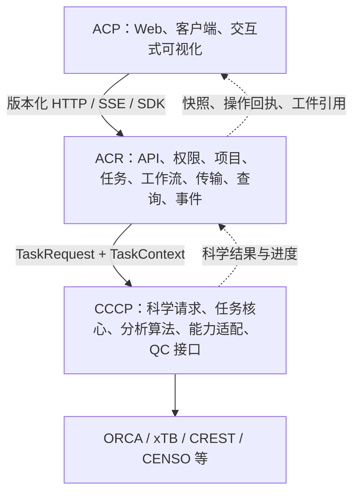

# ACP / ACR / CCCP 三模块架构与职责边界

日期：2026-10-15。状态：提案，未实施。控制层名称暂定 ACR（ACP Control Runtime），Python 包名 `acp_runtime`。本文细化并调整此前 `ACP_Product_Architecture_Optimization_Plan_20261015.md`：原拟新增的 `acp.workbench_sync` 收入 ACR 的同步与投影子模块，不再形成 ACP 内的另一套后台。

本文不修改现行 AGENTS.md 护栏。改变现有模块驻点、公开导入、CLI 或契约所有权的步骤，实施时须先形成已批准的边界修订，再同步架构测试、文档和兼容入口；迁移过程不能通过关闭旧护栏推进。

## 1. 总体决策

三模块按业务责任划分，而非简单按进程或目录划分：

1. **ACP：产品与交互层。** 用户如何组织工作、填写请求、查看状态与结果。包含浏览器界面、客户端 SDK/CLI 薄入口及用户侧交互逻辑。
2. **ACR：控制与数据服务层。** 接受合法请求，管理项目与任务权威状态，编排计算，选择执行位置，传输工件，提供查询与通知。对外公开产品 API，对内消费 CCCP 的计算契约。
3. **CCCP：科学计算层。** 输入科学对象和计算选项，执行科学算法及外部程序，返回可验证的科学结果和工件。可在没有 ACP/ACR 的 Python 环境独立使用。

ACR 的名称包含 Runtime，是因为单纯“传输层”不足以涵盖状态持久化、执行恢复、工作流和权限。三模块并不等于三个微服务；首期可同仓发布，ACR 内部按 API / controller / worker 角色运行。



虚线表示数据返回，不表示反向导入。静态依赖为 `acp → acp_runtime.public`（仅嵌入式客户端需要）与 `acp_runtime → cccp.public`。浏览器只依赖 API schema。`cccp` 禁止导入 `acp` 或 `acp_runtime`；`acp_runtime` 禁止导入 `acp`，包括通过字符串子进程调用 ACP 来间接依赖产品包。

## 2. 为什么不能只移动 scheduler

当前 `scheduler/runner.py` 和 `scheduler/remote/script_gen.py` 使用 `python -m acp.cli run <workflow>`。远端脚本还导入 `acp.catalog` 的参数转换函数；CalculationPlanExecutor 依赖 ACP 的 checkpoint、identity、结果发布与兼容 primitives。若只把 scheduler 改名，ACR 仍反向调用 ACP，独立性不成立。

另有科学逻辑仍位于 `acp/confsearch`、`acp/nmr`、`acp/calculations/pes`、`acp/chem`、部分 results 解析器与 legacy 协议引擎。必须按函数职责拆分，不能整目录机械搬迁，也不能在新旧包保留两个科学实现体。

现有科学内层继续保留：`cccp/calculation → cccp/backends → cccp/qc`。三模块是外层产品边界，不消除这些必要的内层分工。

## 3. 每个模块的允许范围与禁止范围

### 3.1 ACP：产品与交互

**拥有：** 页面布局和路由、项目/任务视图、表单和向导、展示配置、翻译文本、交互式图表、3D 相机/选点/测量工具、浏览器会话缓存、请求协调客户端、订阅/可见性管理、离线草稿副本、API 客户端与 CLI 展示。

**允许：** 根据 ACR 提供的 schema 生成表单；做即时格式提示；提交带幂等键和预期版本的请求；展示操作进行中；保留旧快照并标记陈旧；对图表做纯展示采样。

**禁止：** 直接读 SQLite、运行目录或 SSH；直接调用 CCCP；自建权威任务状态机；将表单校验当作最终科学合法性判定；解析 QC 原始日志决定科学成功；由 energy viewer 提交任务；在多个面板各建一套同资源轮询。

用户的候选选择和人工评价在 ACP 产生交互，最终记录由 ACR 持久化；自动化科学评分由 CCCP 产生。前端预览几何可临时存在浏览器，但用户选择保存后必须获得服务端 artifact 身份。

### 3.2 ACR：控制、传输与数据服务

**拥有：** 对外 API 和权威鉴权；项目/成员/任务/名称/标签/草稿/候选人工记录；job 生命周期、attempt、CAS；计划实例、依赖调度、资源准入；提交身份与 release；本地进程控制、LSF 提交/观测/暂停/取消；SSH/SFTP；目录映射；传输操作、缓存；工件登记与发布；运行态投影；分页/统计；事件重放；恢复/清理/审计/诊断。

**允许：** 选取工作流模板，调用 CCCP 验证科学参数，生成并冻结执行计划；传递科学选项；按依赖和前置条件运行步骤；读取 CCCP 完成证据；将科学结果映射为 result_manifest 与视图契约。

**禁止：** 直接构造 ORCA/xTB 科学输入、复制能量/频率/NMR 算法、直接调用 `cccp.qc.interfaces` 执行科学步骤；在 API GET 中同步执行远程拉取；让客户端事件决定任务终态；使用平台 task ID 改变科学缓存身份；让传输完成冒充计算完成。

ACR 内仍需严格子域：API 只调 application services；controller 负责执行意图与 CAS；worker 负责执行计划；transfer 负责数据运输；readmodels 只维护可重建投影。各子域不能把 SQL、远程命令和科学解析散落进路由。

### 3.3 CCCP：科学计算与分析

**拥有：** 分子/结构科学对象、化学格式解析和 embedding；方法/溶剂/电荷/自旋与约束的科学校验；构象采样与筛选算法；PES/IRC/TS 科学分析；NMR 数值分析；科学软件输出解析；科学完成判据；任务参数和产物契约；科学任务内部步骤与数值并行。

**允许：** 在 ACR 提供的工作目录中写科学工件；通过 ProgressSink/取消协作信号向调用者报告；使用指定可执行文件和资源预算；校验科学结果身份；返回可序列化 ScientificResult。

**禁止：** 用户/项目鉴权、JobStore/TaskIndex/平台 DB、任务名和标签、平台 attempt 自增、LSF 队列控制、SSH 凭据、前端字段、HTTP/SSE、result_manifest 平台登记；重新选择远端节点或扩大资源配额。

“CCCP 不拥有 LSF”指最终平台执行路径。当前 `cccp/qc/cluster` 尚有历史适配，需核查全部调用方；平台改走 ACR 后，对确有外部调用的旧接口保留有期限的兼容/弃用策略，不可未经审计直接删除。

## 4. 最容易混淆的边界

| 问题 | ACP | ACR | CCCP |
|---|---|---|---|
| 用户选择 opt→freq→SP | 收集意图、展示预览 | 选模板、冻结 plan、验证依赖并调度 | 定义各任务科学参数、计算与完成判据 |
| 参数是否合法 | 即时提示 | 最终 API 校验权限/结构；调用科学验证器 | 方法兼容、自旋/化学/约束等科学验证 |
| 参数改后是否重算 | 展示差异并提交 | 比较冻结 spec/依赖摘要，决定 attempt/恢复 | 生成或验证科学身份相关内容 |
| 工作流分支 | 显示分支结果 | 执行已定义的分支、人工审查等待 | 返回分类结果、阈值判定等科学证据 |
| 任务成功 | 展示 | 全部必需步骤满足条件后 CAS 置终态 | 判断单次科学任务是否产生有效结果 |
| 计算进度 | 展示并标记陈旧 | 汇总步骤和远端观测 | 报告程序阶段与科学进度 |
| 批量并发 | 输入批次 | 跨 job/step 资源分配与准入 | 单任务内部已授权数值并行 |
| 结构坐标 | 绘制/交互编辑 | 权限、artifact 引用、传输与存储 | 解析、生成、科学变换与校验 |
| 能量轨迹 | 绘图、缩放、展示采样 | 注册视图、分页、缓存、投影发布 | 提取/计算能量、路径、科学坐标与单位 |
| result_manifest | 消费公开响应 | 唯一平台写入者和版本兼容负责人 | 只提供 ScientificResult/工件描述 |
| 重跑后旧结果 | 可明确查看上一轮 | attempt 和目录/传输 generation 栅栏 | 不接收平台 attempt 作为科学参数 |
| 缓存 | 显示与请求缓存 | 投影缓存、远程文件缓存、授权隔离 | 算法内部缓存，按科学内容寻址 |
| 日志 | 显示增量 | 采集、存储、脱敏、游标、轮转 | 产生程序日志和结构化科学诊断 |
| 取消 | 提交并显示进行中 | 协调进程/LSF、确认停止再终态 | 响应协作取消、收尾科学临时文件 |

工作流模板由 ACR 所有，因为它关联产品 profile、人工审查、资源和执行策略；模板中的科学推断/选择算法由 CCCP 所有。CCCP 可包含具有科学意义的复合计算，但不能因此再造平台级 DAG 调度器。

Checkpoint 也需区分：ACR 保存平台 step 完成、依赖身份、发布重试和恢复决策；CCCP 保存外部程序或算法内部可重启工件及验证逻辑。两者通过工件引用和摘要关联，不共享同一个可任意修改的 checkpoint 对象。

## 5. 数据权威、文件和数据库

| 数据 | 唯一权威 | 持久位置与规则 |
|---|---|---|
| 项目/权限/任务名称/标签/草稿 | ACR | 平台数据库；浏览器只有副本 |
| job 状态、attempt、submission、release | ACR controller | jobs 及事务记录，CAS |
| 科学参数类型与完成判据 | CCCP | 版本化计算契约 |
| 已提交的完整执行意图 | ACR | 冻结 spec/plan、有效参数摘要 |
| 原始与派生科学结果 | CCCP 产生，ACR 管理生命周期 | 原工作目录布局；引用与内容摘要 |
| result_manifest/frame_candidates | ACR | 保留 v2/候选权威契约，写入只能有一个实现 |
| 展示投影/计数/缓存 | ACR readmodels | 可重建；注明 source revision 与 freshness |
| UI 视角/展开状态/临时选择 | ACP | 浏览器/用户偏好；不影响计算事实 |

三模块不是三套重复数据库。初期 ACR 独占现有平台数据库的业务访问；CCCP 无需数据库，ACP 无直接数据库访问。

平台目录仍由 ACR 分配，继续使用现有项目/任务人类可读目录和 attempt 回执归档。CCCP 只使用传入的 work_dir，不能根据 job_id 另建目录。拆包不迁移生产任务目录，不修改既有结果相对路径。

## 6. 跨模块接口

### 6.1 ACP → ACR：产品契约

由 ACR 定义版本化 OpenAPI/JSON schema，ACP 生成或使用对应客户端。至少覆盖：capabilities/catalog、projects、task queries、submit/controls、operations、artifact catalog/prepare/download、change stream。

提交包含 workflow/profile、科学选项、artifact references、资源意图、idempotency_key、expected revision（适用时）。ACR 检查项目权限、资源策略、工作流支持，再调用 CCCP 科学验证。不要让客户端提交任意文件系统路径或 Python 可执行函数名。

返回 task_id/operation_id、attempt、相关 revision、操作接受状态。HTTP 202 仅表示持久化接受，不代表 LSF 已提交或取消已完成。对同一幂等键但不同请求内容返回冲突。

查询与事件携带各自版本。job_revision、name_revision、catalog_revision、projection_revision 不能相互代替；终态后仍可能产生 catalog.ready。快照与 event cursor 一致，事件至少一次送达，客户端可去重和重置。

### 6.2 ACR → CCCP：科学契约

复用并收紧 `cccp.calculation.requests/results/context`，避免再引入一套平台化 TaskRequest。

```text
TaskRequest = 科学任务类型 + 输入科学工件 + 计算选项 + 资源预算
TaskContext = work_dir + 解析后的软件配置 + progress sink + 协作控制
TaskResult  = 科学完成状态 + 数值/单位 + 工件描述 + 验证证据 + 诊断
```

ACR worker 外层持有 task_id/attempt/submission/release；调用 CCCP 前去除平台身份字段。平台身份写在外层 ExecutionEnvelope，不塞入 CCCP 科学选项。工作流 profile 展开为明确有效参数后再传入，保持现有 CCCP 请求禁止平台 workflow/profile 身份的约束。

CCCP 定义 ProgressSink Protocol，ACR 提供实现。该依赖反转允许 CCCP 报告进度而无需导入 ACR。跨进程时由 worker 写结构化事件/回执，controller 消费；不让计算函数直接访问平台数据库。

### 6.3 ACR controller → ACR worker：执行契约

ExecutionEnvelope 包含 schema version、job/attempt、submission identity、冻结 plan、输入 artifact 摘要、工作目录、release、资源限制。worker 校验协议兼容和 release 后执行，输出完整科学回执与退出信息。

远端入口建议新增 console script `acp-worker = acp_runtime.worker.entrypoint:main`，由 ACR 发行包提供；不新增 `python -m cccp`，也不让远端依赖 ACP 产品包。现有 `acp run` 保留为用户兼容入口，委托 ACR 公共接口。平台远程功能仍经 Paramiko，不引入 subprocess ssh/scp。

离线 `acp run` 可嵌入 ACR 的单次执行服务，无需启动 Web、全局 poller 或第二 JobManager。向受管 run_root 注册完成结果走明确注册接口，不绕过既有 ownership 和登记约束。

## 7. 统一数据传输与刷新的归属

此前 WorkbenchSync 设计拆成两个明确组件：

- **ACP `sync_client`**：统一请求入口、共享实体缓存、面板订阅、可见性、取消、前端请求预算、SSE 与降级轮询切换。
- **ACR `sync/readmodels/transfers`**：共享采集、投影版本、事务事件、服务端重放、后台拉取、去重/重试/租约与资源预算。

实际 SSH/SFTP 只留在 ACR transport adapter；浏览器不因面板刷新触发独立远程观测。多用户读取相同结果时，数据库可各自查询，但同一身份工件只产生一个有效拉取操作。

正常路径：controller/observer 采集 → CAS 确认 → 持久投影/事务事件 → API 读取本地快照 → 一个项目变更流通知 ACP → ACP 仅补齐可见资源。远端原始程序输出需科学解析时，由 worker 调用 CCCP 解析器，不在 API 路由解析。

所有传输重试有上限、退避和错误状态；同节点大文件流量与控制命令有独立配额。批量 LSF 观测属于 controller 的 transport adapter，不再由浏览器数量决定调用频率。依旧保留 pending_fetch 后台驱动，不依赖浏览器 fetch=1。

## 8. 现有目录的迁移归属

| 当前实现 | 最终归属 | 迁移注意事项 |
|---|---|---|
| `frontend/` | ACP | 保留 viewer，抽统一客户端，渐进移除全局轮询 |
| `acp/api/` | ACR api | 路由按产品能力拆分，先兼容现有 URL/响应 |
| `acp/scheduler/` | ACR jobs/controller/persistence | CAS、ownership、attempt、恢复规则整体保留 |
| `acp/scheduler/remote/` | ACR transport/execution | 同时切掉对 acp.cli/catalog 的依赖 |
| `acp/workflows/` | ACR workflows 为主 | 科学 helper/旧引擎算法先移入 CCCP，再迁编排 |
| `acp/calculations/executor.py`、plans/checkpoint/identity | ACR execution | 不重造第二执行器；分离纯科学验证与平台状态 |
| `acp/calculations/primitives/` | 迁移期兼容导入面 | CCCP 仍唯一计算实现；最终 ACR adapter 直调 CCCP 公共接口 |
| `acp/calculations/batch/` | ACR 编排 + CCCP 科学批处理内核 | 只有 ACR 分配跨任务预算；内核消费预算 |
| `acp/calculations/pes/tsmode/irc` | 拆分 | 计划/人工审查在 ACR；路径/模式/化学分析在 CCCP |
| `acp/confsearch/` | 拆分 | 协议选择/发布在 ACR；采样、筛选、盆分析在 CCCP |
| `acp/nmr/` | 拆分 | DP4/DP5/谱处理等在 CCCP；修订身份、操作、报告发布在 ACR；显示在 ACP |
| `acp/results/` | 拆分 | 科学解析在 CCCP；manifest读取、缓存、视图投影、候选存储在 ACR |
| `acp/storage/` | ACR artifacts/layout | 保留磁盘契约与发布幂等性 |
| `acp/chem/`、`intake/`、`io/` | 拆分 | 科学格式/embedding 在 CCCP；上传限额、权限、暂存和登记在 ACR |
| `acp/catalog.py` | 拆分三部分 | 科学参数定义 CCCP；active工作流/profile/执行能力 ACR；翻译/布局 ACP |
| `acp/core/` | 按类型拆分 | 科学对象 CCCP；平台模型/运行目录/计划 ACR；客户端模型 ACP |
| `acp/compat/legacy/` | ACR compatibility | 仍只读，不扩展新写入 |
| `cccp/config.py` | 拆配置域 | 科学软件/方法 CCCP；节点/调度/凭据 ACR；兼容装配在 ACR |
| `cccp/qc/cluster` | 平台调度能力归 ACR | 先审计历史调用与兼容，禁止出现第二平台提交路径 |

catalog 必须消除多份有效参数定义：CCCP 导出科学 schema，ACR 组合 profile 和可执行能力，ACP 消费生成结果。前端不能硬编码退役默认工作流。Active 工作流与 edit coverage、远程允许集继续由 ACR 同源管理。

## 9. 建议目标目录

```text
frontend/                         # ACP Web 产品
src/acp/
  cli.py                          # 兼容用户入口
  client/                         # HTTP/嵌入式客户端、输出展示
  compat/                         # 迁移期显式旧导入转发

src/acp_runtime/                  # ACR
  public/                         # 对客户端的稳定应用接口
  api/                            # HTTP/SSE adapters
  application/                    # use cases、鉴权、事务边界
  projects/                       # 组织、成员、名称、标签
  workflows/                      # registry、profile、模板
  execution/                      # plans、checkpoint、恢复、发布协调
  controller/                     # 唯一执行 owner、调度与控制意图
  worker/                         # 本地/远端计划执行入口
  transport/                      # SSH/SFTP/LSF、release、节点
  transfers/                      # 工件传输操作、重试和预算
  artifacts/                      # manifest、布局、工件身份/缓存
  readmodels/                     # 列表、进度、视图投影
  sync/                           # 事件与重放、共享分发
  persistence/                    # 数据库、迁移、事务实现
  contracts/                      # 平台公开数据契约
  compatibility/                  # 历史结果只读与版本适配

src/cccp/
  calculation/                    # 唯一科学任务执行入口
  analysis/                       # 科学解析与分析（按需抽取）
  backends/                       # 科学能力适配
  qc/                             # 科学程序调用
  io/                             # 科学格式
  core/                           # 科学对象和协议
  config.py / software.py / utils/
```

目录为目标地图，可分阶段建设；避免为每个名称先创建空包。实现不放 __init__.py，不制造每层只转发一行的包装。

## 10. 配置、部署与发行边界

ACP 配置仅含服务地址、界面/客户端偏好；ACR 配置含 run_root、DB、资源、节点/队列、凭据引用、采集/传输/保留策略；CCCP 配置含软件路径与科学执行选项。平台凭据不传进科学请求、不返回浏览器。迁移期由 ACR 统一兼容读取旧 YAML 并生成三个域，保留内置默认与 YAML 同步规则。

最终可构建三份发行产物，但先同仓、同发布列车：ACP 前端/客户端；ACR api/controller extras 与轻量 worker extra；CCCP 独立库。远端节点只安装冻结 ACR worker + CCCP + 科学运行时依赖，不需要前端/FastAPI/平台管理界面。实际 ACR 科学工作流依赖必须归入 worker extra，不能仅给 API extra。

协议版本与发行版本区分：API schema、ExecutionEnvelope、CCCP request/result、manifest、checkpoint 各有兼容规则。首期继续现有四处版本同步规则；新增 ACR 版本纳入发布脚本，独立版本化作为后续 ADR，不能一次迁移顺便改所有版本策略。

ACR API reader 不创建 controller；controller 唯一持有 run_root owner；worker 由 controller 授权执行既定 attempt，不自行领取第二份任务。多 API 进程必须在此边界完成后启用。部署拆角色不要求另上消息中间件，初期可使用同机持久操作表。

## 11. 迁移步骤与退出条件

1. **边界基线。** 建立真实 import/子进程入口/文件写入矩阵，列出现有隐式依赖；按代表性工作流确定黄金输入输出与恢复 fixtures。批准 ADR 和架构护栏修订。
2. **建立 ACR 公共接口。** 在同仓引入包，把低依赖平台 contracts、仓储、应用入口迁入；旧 ACP 路径仅向新位置转发。新 ACR 不从旧 ACP 导入来“暂时完成迁移”；成环组件先解耦再迁。
3. **迁移唯一控制与传输。** 移动 scheduler/remote/storage/权限组织相关服务；同步移动被依赖的编排和平台模型。先在兼容入口下验证同一执行行为，不并行启动新旧 owner。
4. **切换 worker 入口。** 本地/远端由 acp.cli 改为 ACR worker envelope；release 同时携带对应协议版本。远端允许集维持现状，不能借迁移把本地专用能力放开。
5. **逐工作流抽出科学算法。** 拆 confsearch/PES/NMR 等混合模块；科学代码移入 CCCP 后只保留一个实现，先验证等价再切调用。CCCP 不能导回旧 ACP helper。
6. **交付统一数据服务。** 在 ACR 增加 readmodels/sync/transfers；后台一次采集、API纯读取；ACP 同资源旧轮询在新订阅启用时关闭。
7. **发行隔离验证。** CCCP 环境无 ACP/ACR；ACR worker 环境无 ACP/FastAPI；API 无计算实例 owner；ACP 对替身 API 独立运行。确认后限制并最终移除迁移 shim。

迁移 shim 只允许旧路径 → 新实现。import 图和子进程调用图都必须无反向边。所有阶段保持生产任务目录、attempt归档和冻结 payload 可读；旧 result_manifest/帧视图兼容通过显式适配，不静默更改科学语义。

切控制 owner 前停止新命令进入、核对在途 submission/lease/回执并交接；回滚不得同时消费两份命令。旧发布版需要的 manifest/checkpoint schema 不兼容时禁止简单回滚二进制，先做恢复演练与兼容矩阵。

## 12. 自动化边界验收

- AST/import 检查：CCCP 零 acp/acp_runtime 依赖；ACR 零 acp 依赖；ACP 无 scheduler/storage/cccp 直接使用。包含 lazy/TYPE_CHECKING 和字符串入口检查。
- 公共面检查：ACR 调科学任务只经 CCCP 明确公开接口；不导 qc/interfaces 或任务私有 helper；必要验证器先升为公共契约。
- 独立安装：CCCP 最小科学任务可运行；ACR worker 可在无 ACP 产品包的环境执行已冻结任务；前端可对契约替身运行。
- 状态写入：全部任务状态仍走 CAS；事件与状态事务一致；终态副作用顺序保持；暂停/取消语义保持。
- 科学一致性：参考输出、单位、能量、频率、构象、NMR 分析在既定容差内；不依靠修改快照掩盖行为变化。
- 资源隔离：20 个页面读取同一任务不放大同一远端采集；慢 SFTP 不阻塞快查询；控制操作有独立预算。
- 恢复隔离：attempt变化后旧事件/下载不能发布；必需 blocked 不判 completed；发布失败只重试发布。
- 现有护栏保留：唯一任务实现、markers、frame契约、active/edit coverage、retired拦截、路径身份、remote allowlist。

改包本身不等于性能提升：只有关闭旧重复采集/轮询、避免请求内 I/O 并落实共享投影后，才可按原优化方案测量收益。

## 13. 实施优先级

首批做“ACR 边界 + 一个纵向样板”：任务提交→独立 worker→CCCP task→回执/CAS→投影→ACP订阅。选择单步任务覆盖本地路径，再用既有远程支持任务验证 LSF 和回执恢复；之后扩展 BatchOptimize 和 Confsearch，最后处理科学/产品逻辑混合最多的 PES/NMR。

三模块完整迁移比上一轮数据刷新优化更大，不沿用原 6–9 周估算。先完成依赖矩阵与样板，根据混合模块数量、兼容需求和科学回归成本重新排期。
