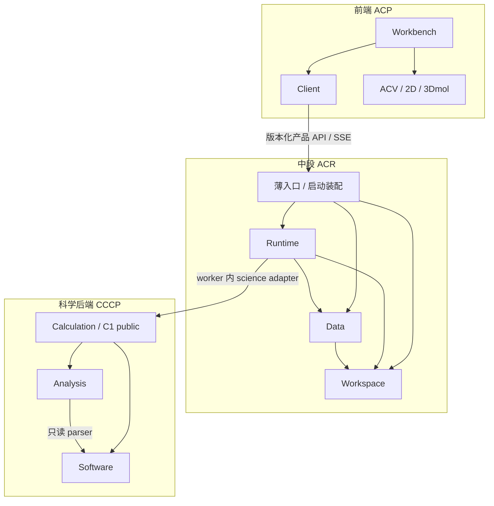

# ACP 完整架构调整方案

日期：2026-10-16。版本：设计方案 v1.5（本地优先、生态扩展与科研闭环战略）。状态：**方案已整理，代码迁移尚未开始；本文中的新增接口、目录、角色、账户、配额、Credit、安全隔离与 Agent 能力均为实施目标，除非明确标为现有。开源组件候选尚未经过本项目集成验证。**

本方案整合已确认的三层、高内聚模块、前端 ACV/3Dmol、CCCP 规范化科学输入输出与科学大数据处理方向，作为后续实施总入口。模块数量与归并按本文执行；旧稿保留作分析材料，不再各自形成另一套迁移顺序。

产品路线进一步确认为：**CCCP 是完整开源、可独立使用的科学底座；ACR＋CCCP 构成不依赖前端的完整 CLI 与未来 Agent 运行底座；前端＋ACR＋CCCP 构成免费使用的完整产品，线上仅按已声明的托管算力核时政策消耗 Credit。** 产品路线已确认，不表示独立发行、计费或 Agent 代码已经交付。具体规范见第 18—21 节。

多用户方向进一步确认为：**ACR 内统一管理账户、个人 API Key、账户等级、管理员权限、个人/项目工作区、计算和存储配额以及 Credit；Web/CLI/Agent 共用同一套身份、授权、资源与计量规则。** 开源自部署保留多用户/资源管理，商业支付可关闭。实现采用部署档位，避免要求每个部署者搭建独立 IAM/KMS/容器编排平台，详见第 22—25 节。

成熟组件候选、官方依据和轻量/线上组合见[《开源组件复用评估》](ACP_Open_Source_Reuse_Assessment_20261016.md)。该评估是候选选型，不表示已接入；各组件通过现有 owner 的 adapter/Port 使用，不改变三层九模块及科学/恢复/计量权威。

本轮正式纳入两条研究与交付路线：**实验室版 ACP Lab、线上多用户版 ACP Hosted**，共用代码、科学能力与产品契约，以部署配置和适配器组合区分。每个开源组件均归入现有模块的内部实现或受限基础设施，不新增业务层；双版本矩阵、组件归属和研究验证工作包见第 26—28 节。

v1.5 将两版路线展开为三种交付配置：**ACP Lab Standalone（个人本地）→ ACP Lab Server（实验室共享）→ ACP Hosted（按需托管）**，不新增科学分支或业务层。近期先交付本地完整图形科研闭环，再扩大协作与托管能力。第 30—35 节补充 AiiDA 借鉴边界、插件、可迁移项目、MCP、异构资源和切片里程碑；[战略与差异化路线](ACP_Product_Strategy_and_Differentiation_20261016.md)提供竞品依据和用户价值判据。v1.4 的安全、恢复、清理门继续有效。

## 0. 执行摘要

平台保留三层，每层三个主要模块：

| 层 | 模块 | 完整职责 |
|---|---|---|
| 前端 ACP | **Workbench 工作台** | 页面、表单、功能控制器、用户动作与跨面板流程 |
| 前端 ACP | **Client 统一客户端** | HTTP/SSE、请求合并、共享缓存、版本、订阅和刷新 |
| 前端 ACP | **ACV 可视化** | 二维图、3Dmol 适配、动画、交互、图片导出及图形资源生命周期 |
| 中段 ACR | **Workspace 工作空间** | 账户/会话/API Key、角色/等级/配额授权、项目/成员；Credit 账户/预留/账本 |
| 中段 ACR | **Runtime 任务运行** | 提交到完成的任务流程、CLI/Agent、个人环境开通、用户资源准入/进程隔离与可信用量 |
| 中段 ACR | **Data 数据资源** | 输入/工件/manifest、传输/缓存、候选/来源、租户存储/配额/可用性与数据查询 |
| 后端 CCCP | **Calculation 科学任务** | 稳定科学入口、唯一任务实现、科学局部步骤、完成证据 |
| 后端 CCCP | **Analysis 科学数据处理** | 科学结构、全量分析、规范化数据、分块/抽样及绘图数据产品 |
| 后端 CCCP | **Software 软件适配** | 科学能力适配、程序原生输入输出、只读解析器与进程机制 |

入口、查询、事件、Ports、数据库连接和启动装配不再独立计作业务模块。它们是上述模块内部组件或受限基础设施。**完整流程尽量在模块内闭环，对外少量类型化能力，对内保留规则、用例和 I/O 分离。**

本轮只交付文档，不迁移生产任务目录、不变更运行配置、不启动或停止计算、不改 CLI、不调整数据库、不发布服务。

## 1. 设计依据、优先级与目标

### 1.1 文档和规范的关系

1. 现行 [AGENTS.md](../AGENTS.md)、[作业文件布局](ACP_Job_File_Layout_Spec.md)、[执行完整性说明](ACP_Execution_Integrity_Rebaseline_Notes.md)、[CCCP Task API](ACP_CCCP_Task_API_DevDoc.md) 仍约束实际运行行为。
2. 本方案是最新架构调整和实施顺序入口；[高内聚设计](ACP_Three_Tier_Cohesive_Modules_20261016.md)解释模块归并，[三层主设计](ACP_Three_Tier_Architecture_20261016.md)提供详细上下文，[接口细则](ACP_Module_Boundaries_and_Interfaces_20261016.md)作为内部职责参考。
3. [此前评审方案](ACP_Architecture_Review_and_Execution_Plan_20261015.md)的需求治理优先、传输与 cache-only 配套交付原则保留；其历史性能推算不作为当前实测指标。
4. 旧稿中的后端 ACV、九个中段业务模块、强制每个组件独立服务的解释均不作为当前目标。
5. 新驻点与现有架构门冲突时，先对具体切片登记规则修订、增加等效或更强检查，再切换实现；不得用本文为理由关闭或静默放宽现有护栏。

### 1.2 目标

- 降低公共模块与跨模块调用数量，避免整体变成新的 JobManager 或全局 store。
- 软件差异由 CCCP 消化，前端只接收稳定科学数据和产品接口。
- ACV 作为静态前端库部署，3Dmol 对页面与业务逻辑不可见。
- API 查询只读已准备快照，执行/传输/分析用显式命令分开。
- 保持现有科学结果、任务生命周期、恢复、历史数据、CLI 与磁盘布局兼容。
- 先形成同仓高内聚模块，再按实际部署需求独立 worker、存储与控制角色。
- CCCP 独立开源，无账户/联网/计费依赖；中段和科学底座可组合成完整命令行产品，Web 是同一用例的另一种使用方式。
- 产品功能免费，托管算力按核时计量；Credit 不影响科学精度、算法可得性、结果读取或科学完成判据。

### 1.3 范围限制

不重建 retired 工作流，不增加第二科学任务根，不重写所有科学算法，不为重构选择新前端框架/消息中间件/数据库品牌，不强制拆成九个服务。科学结果数值政策、何时 completed、身份定义或目录协议的行为变更须另行明确，不能夹带在搬迁中。

## 2. 当前代码基线与实施前清点

本轮工作区清点：`src/acp` 268 个、`src/cccp` 87 个 Python 文件；frontend 20 个文件；scripts 12 个文件；tests 中 314 个 `test_*.py`。计数含初始化文件，非测试收集数量，后续以实施时重新清点为准。

| 现有事实 | 对调整的影响 |
|---|---|
| 一个 pyproject 同时发现 acp/cccp；无独立 acp_runtime 代码根 | 先隔离源码依赖，再证明可独立打包；不能声明 ACR 已存在 |
| 本地 runner、远端 script_gen 构造 `python -m acp.cli run` | 必须替换整条 worker 入口与 release 链，不能只移动 scheduler |
| script_gen 在控制服务器侧导入 acp.catalog 参数转换 | 生成器依赖也需消除；并非 shell 脚本直接 Python import |
| acp 中仍有 NMR、采样、PES、结构解析等科学实现 | 按符号拆分，不可整目录机械移动或复制到 CCCP |
| CCCP 已有 requests/results/context/progress 和唯一 tasks 根 | 原样复用公共科学任务契约，不再引入另一套任务/取消回调协议 |
| SVG/3Dmol 渲染已在浏览器，图形和网络逻辑部分混驻 | 先抽取 ACV 边界并复用现有 renderer，不整体换库 |
| NMR 无浏览器也会生成 JSON/XLSX/PNG | 保留批处理导出兼容，不因 ACV 前移取消报告或立即删依赖 |
| 部分 GET 有远端获取/原始解析回退，传输恢复尚需规范化 | cache-only 必须与持久 prepare/重试/后台预取一起切换 |

P0 必须记录：代码 revision 和未提交状态、软件/解析器版本、样本任务、公开入口、现有测试结果、数据布局、科学 fixture、HTTP 请求与 I/O 基线、当前配置来源及已安装依赖。未经采集的指标标为“未测”，不写成性能收益。

## 3. 总体依赖图



这是允许的模块依赖/调用关系。回调、进度、返回值和事件返回不意味着反向 import。纯契约与单位等基础可被双方依赖，但不能装入业务服务。

中段核心方向为 `runtime → data → workspace`，runtime 可直接获取 workspace 授权范围。通过 Port 注入时，应用不需要 import 对方具体实现；契约仍有明确提供方与版本，不形成双方各自定义同一 DTO 的漂移。

## 4. 前端模块调整

### 4.1 Workbench

- **拥有**：页面壳/导航、表单、任务/结果/结构功能控制器、用户意图、错误呈现与跨面板选择。
- **调用**：client 的查询/命令/订阅；ACV 的实例 API。
- **不拥有**：fetch/EventSource、共享实体权威缓存、图形库对象、科学解析/全量分析。
- **写权**：自己的表单与 UI 状态；正式更改通过 client 命令。

任务列表与结构面板联动由一个 workbench 用例协调，不让两个组件互改私有变量。页面只挂载容器、绑定动作、传入显示数据，不解析 ACV 生成的另一套页面。

### 4.2 Client

- **完整封装**：HTTP/SSE、超时/取消、错误分类、查询键、在途合并、缓存、版本、事件合并、可见性与刷新策略。
- **内部组件**：ResourceStore 唯一写共享缓存；QueryCoordinator 取数；CommandClient 管理回执；ChangeCoordinator 合并变更；RefreshPolicy 切换订阅与轮询。
- **公开能力**：类型化 query/command/subscribe/prepare；返回只读快照和操作回执。
- **边界**：不操作 DOM，不弹 UI 提示，不做科学数值派生；一个面板取消不得取消其他使用者共享的请求。

### 4.3 ACV

- **内部组件**：视图契约/样式声明、有限数据的显示模型、系列图 renderer、分子 renderer、3Dmol adapter、交互、导出、生命周期。
- **公开能力**：create、setData、setSelection、setStyle、resize、export、destroy，以及选点/取帧需求等回调。
- **唯一底层入口**：只有 3Dmol adapter 使用 `$3Dmol`；页面/feature 不持有底层 viewer 句柄。保留本地 vendor 版本与许可，无需修改第三方源码。
- **局部状态**：相机、缩放、hover、动画、临时显示测量；跨面板业务选择由 workbench 持有。
- **禁止**：联网、任务提交、读全局 selectedJob、原始 QC 解析、全量聚类/降维/抽样、正式科学判定。

同一实现可创建多个独立实例。结构、轨迹、振动共用三维核心；保留 scheduleViewerFraming/frame3DViewer 行为。隐藏/切换/销毁时停止动画并释放监听器和图形资源。3Dmol 猜键仅可为标明来源的视觉回退，不能当作科学拓扑证据。

## 5. 中段模块调整

### 5.1 Workspace：组织与访问完整流程

| 项目 | 规范 |
|---|---|
| 内部组件 | 账户/会话/API Key、成员/角色/等级、资源授权、项目/分组/配置、查询/审计；Credit 账户/额度/账本，支持自部署 quota-only |
| 权威数据 | 用户身份/凭据验证信息、项目/角色/等级/资源授权；Credit 账户余额/预留与不可变账本 |
| 公开能力组 | projects、access、groups、settings；线上模式增加 credits.reserve/settle/release/query；具体命令/查询为显式类型化方法 |
| 对外依赖 | 自身仓储和受限身份适配；不调用 runtime/data 执行业务 |
| 删除边界 | 关闭项目/禁止新操作；跨域清理由明确管理员维护流程协调，不跨模块删表 |

这是目标权限边界，不宣称当前已具备完整多用户 IAM。第一阶段可使用明确的本地运行身份与现有访问策略；不能将“未实现完整认证”解释为内部入口可无身份绕过检查。

### 5.2 Runtime：从提交到完成的任务闭环

| 项目 | 规范 |
|---|---|
| 内部组件 | commands、catalog/profile、planning、任务领域规则、controller、plan_runner、identity/checkpoint、恢复/完成处理、任务元数据、查询/投影/变更 |
| 权威数据 | job/spec/attempt、冻结 plan、提交/执行关联、控制意图、任务名称/标签/编辑草稿与任务操作 |
| 公开能力组 | commands、queries、execution；submit/pause/unpause/cancel/continue/rerun/edit 等保持既有语义 |
| 允许依赖 | workspace 公开访问能力、DataResourcePort、CCCP 公开科学 API |
| 禁止 | 复制科学任务、解析 QC、直接 SFTP、直接修改 data 私有 manifest/缓存、用事件代替 CAS |

controller 唯一推进任务生命周期，负责资源准入、派发身份、release、观测对账、暂停/停止确认。plan_runner 作为 worker 执行冻结步骤、验证依赖、调用科学任务并写执行/步骤回执；不直接连接 jobs DB、不自增 attempt。

SubmitCalculation 和 FinalizeExecution 是 runtime 内部用例。planning→controller→receipt/recovery 是内部组件协作，不为它们建立独立业务服务或全局流程总线。

### 5.3 Data：从输入到读取的工件闭环

| 项目 | 规范 |
|---|---|
| 内部组件 | 上传/输入资产、工件目录、平台 manifest、publication、transfers、缓存、generation 校验、结构来源/人工候选、读取/可用性事件、保留/回收 |
| 权威数据 | 工件/来源/候选元数据、平台 result_manifest、传输操作、缓存字节、可用性记录 |
| 公开能力组 | inputs、artifacts、transfers、organization；prepare 为命令，read 为查询 |
| 允许依赖 | workspace 公开授权能力、受限存储与传输适配 |
| 禁止 | 修改 job 状态、反调 runtime 启动计算、原始科学解析/数值分析、GET 隐式 prepare |

传输→校验→缓存发布→可用性提交在 data 内闭环。工件保存只读 task/project/attempt/generation 关联，不通过查询 runtime 私有表补齐权限。涉及当前任务状态的操作由 runtime 先校验，再传入有身份和版本守卫的数据命令。

原始上传可登记为未科学验证。需要解析/派生时显式提交 runtime 分析用例，后者调用 CCCP 并把结果交回 data 登记。data 不反向调用 runtime，也不因页面读取缺失而运行计算。

### 5.4 支撑代码、写入和远程职责

- 每个模块内部仍按入口/用例/纯规则/适配分离。查询和事件归实体 owner，不另设全局查询或同步业务模块。
- 薄 API/CLI 入口按资源进入对应模块；bootstrap 负责注入和启停，不包含跨域业务分支。
- runtime 拥有 worker/LSF 执行和安装 release 策略；data 拥有工件字节运输。SSH 连接池、底层协议是可共享的低层能力，不能因共享连接让 data 掌握 bsub 或 runtime 绕 data 发布工件。
- 工作目录由 data 的受控存储分配接口提供，runtime 冻结 attempt 的目录绑定并产生 scheduler markers 内容，通过规定接口物化；不得各自建立第二目录分配器。
- 平台 SQL 写入按 owner 仓储执行；必要的同库跨模块原子更新通过窄 UnitOfWork/操作接口协调，不能直接操作对方私有表。跨文件/远程事务采用持久阶段与幂等恢复。
- 统一事件分发器只重放已提交事件；模块仍拥有事件事实和投影逻辑。不能为了减少调用复制第二份 jobs 状态。

## 6. 科学后端调整

### 6.1 Calculation

继续使用现有 `cccp.calculation` 公开导出、TaskRequest/TaskResult/TaskContext，以及唯一 `calculation/tasks/` 实现。负责单科学任务的局部步骤、完成验证、协作取消/超时、科学回执、预算内 batch；调用 Analysis 和 Software。

平台 workflow/profile/资源准入在 Runtime。科学内部复合过程可在 Calculation，但不能形成第二平台 DAG/LSF 调度器。

### 6.2 Analysis

归并科学结构/格式、原始解析后的归一化、NMR/采样/PES/IRC/TS 科学算法、全量数据处理、统计/聚类/降维、面向展示的抽样/多分辨率及规范化产品。

Analysis 可用 Software 中明确只读的 parser，不能调用程序启动方法或反调任务。需要再算时由 Calculation 或 Runtime 明确安排。涉及平台修订身份、权限、发布重试的部分不迁入 Analysis。

### 6.3 Software

归并现有 backends、QC interfaces、程序特定 input/parser、软件发现、纯进程机制的职责边界，不要求改变物理目录。**现有 `cccp/software.py` 是软件发现文件，不用同名新目录覆盖它。**

内部仍为能力适配→程序接口→进程机制。backend 无 subprocess、不导入 tasks；parser 只读路径不能启动程序。LSF/SSH 平台控制目标归 ACR，旧 qc/cluster 需审计兼容调用后处理，不能直接删除。

### 6.4 C0 和旧类型

科学 errors/types/units/spec 为无 I/O 的共享基础，不依赖执行层。跨层公共类型迁位时旧路径重导出同一个类，保持 isinstance、异常捕获与序列化。常量单点定义。新实现不写入 `__init__.py`，现有被明确允许的例外继续保留。

## 7. 统一接口和数据规范

### 7.1 接口清单

| 边界 | 提供方 | 输入/输出 | 实施状态 |
|---|---|---|---|
| Workbench→Client | Client | 类型化查询/命令、订阅 → 快照/回执 | 目标归并接口，复用现有产品 API |
| Workbench→ACV | ACV | 科学载荷/显示选项 → 实例/回调/本地导出 | 目标前端接口，逐视图适配旧载荷 |
| ACP→ACR | ACR | catalog/query/command/artifact/changes | 现有 URL/字段兼容优先，逻辑分组不等于新增路径 |
| Runtime→Workspace | Workspace | principal/资源范围/动作 → 授权结果或版本化范围 | 目标公开能力；每次敏感操作验证有效性 |
| Runtime→Data | Data | 输入引用/冻结来源/发布证据/期望版本 → 准备回执/发布回执/可用性 | 目标 DataResourcePort，无任意路径/函数名 |
| Data→Workspace | Workspace | 工件项目归属/principal/动作 → 授权结果 | 不依赖 Runtime 内部表 |
| controller→worker | ACR Runtime | ExecutionEnvelope → 观测/ExecutionReceipt | 目标显式协议，复用现有身份和回执事实 |
| Runtime science adapter→CCCP | CCCP | 现有 TaskRequest + 本机 TaskContext → TaskResult | 现有科学契约，缺少的分析/摄入入口增量公开 |

统一接口不使用任意 `call(function_name, dict)`，不建立承载所有业务的单个超级 manager。公开符号由各 owner 声明，私有组件不能因存在方法就被外部调用。

### 7.2 ExecutionEnvelope 与科学身份

Envelope 在平台外层持有 schema、job/attempt/submission/release、owner/fencing、冻结 plan、工件摘要、目录映射、预算及协议能力。TaskRequest 只持有效科学参数与输入；不塞入平台 workflow/profile/candidate/task 身份。

TaskContext 是本机运行对象，已有 progress/cancelled/timeout 继续使用，不跨网络序列化回调。科学内容身份与平台 plan/step 恢复身份通过工件摘要关联，不混为一个 hash。

### 7.3 科学产品

| 产品 | 规范字段/语义 | ACV 可做 |
|---|---|---|
| 曲线/散点 | schema、产品身份、series/point 稳定 ID、x/y/单位、参考系、缺失原因、来源映射 | 坐标轴、主题、图例、有限显示选择 |
| 结构/轨迹 | structure/frame ID、atom_uid、元素、坐标单位、拓扑来源、帧顺序/块索引 | 3Dmol 显示、相机、播放和临时测量 |
| 振动 | 原生模式编号、频率单位、原子顺序/身份、位移向量与归一化约定 | 箭头、显示振幅、动画 |
| 分块/抽样 | 输入摘要、算法/版本/参数、范围、分辨率、原始点映射、科学关键点保留信息 | 按需显示，不能冒充全量科学结果 |

统一科学语义不要求 ORCA/xTB/CREST 原生文件相同。Software 生成/解析各自格式，保留原始文件、有效参数、软件与解析器版本及来源；专属功能使用类型化选项/能力声明。不支持就明确失败/不可用，禁止静默丢参数。

CCCP 负责科学规范化与大规模数值处理；Data 仅管理产品及字节/元数据分页，Client 只管理副本，ACV 只处理显示。原始缺失、科学不适用、解析失败与尚未准备不能统一填零。派生缓存身份包含输入、算法、参数、范围、分辨率与 schema，不能只靠 job_id。

当前 VIEW_REGISTRY、TrajectoryFrame.to_node/TrajectoryAnnotation.to_annotation 仍是现行帧投影契约；由兼容 adapter 接新科学产品，CCCP 不导入 acp.results。显示样式不进入科学 JSON，平台 manifest 不由 CCCP 直接登记。

### 7.4 查询、命令、错误和事件

- 查询返回授权快照、revision、observed_at/freshness 和 availability；未就绪不伪装空成功。
- 命令带幂等键和适用预期版本，返回操作身份与受理状态；202 不等于已提交 LSF、已取消或已完成。
- job/name/catalog/组织 revision 独立比较；release_id 不替代产品、worker、科学产品或磁盘 schema。
- 事件描述已提交事实，持久 cursor、可去重、过期 cursor 可重置快照；单一受权流复用各 owner 的事件，避免每个任务各建一条流。
- 错误区分输入、权限、冲突、未准备、网络/远端不可达、科学未收敛/解析失败、取消/超时、渲染不可用。TaskResult 与 JobStatus 显式映射，现有状态集合以 jobs.py 及消费者为准。

## 8. 四条端到端链路

### 8.1 提交与执行

```text
Workbench → Client.command → Runtime.submit
→ 权限/幂等/科学校验 → 冻结 plan 与持久提交操作
→ Data 准备输入 → controller 验证目录/release/提交身份并派发
→ plan worker → CCCP Calculation → Analysis/Software
→ worker 回执 → Runtime 验证/恢复/完成流程
→ 按既有发布阶段调用 Data → CAS 与持久后续工作 → 变更通知
```

链路是逻辑职责，不改变当前 `result_publication` 与 completed 的时间语义。终态副作用必须在终态持久化后，幂等可重试；科学完成、发布完成和远程缓存就绪是不同事实。

### 8.2 观察与刷新

```text
科学 progress / worker 回执 / LSF 观测
→ Runtime 校验 attempt/观测资格 → CAS/投影/持久事件
→ Client 合并 → Workbench 更新 → ACV 局部刷新
```

终态停止进度轮询但仍接收 catalog.ready。SSE 激活后关闭对应重复轮询；降级策略统一。无投影时仍能显示 jobs 权威基础数据，不同步扫描磁盘补全。

### 8.3 数据准备与绘图

```text
Client → Data.read（就绪数据或 availability）
缺失时：Client → Data.prepare → 持久排队/传输/校验/缓存发布
→ catalog.ready → Client 读取可见数据块 → Workbench → ACV
```

若缺科学派生产品，Workbench 显式请求 Runtime 的分析任务，由 CCCP 产出后登记。Data 不反向启动计算，GET 不暗中传输或解析。

### 8.4 编辑、候选与再次计算

ACV 发选点/几何草稿事件，Workbench 决定动作；保存候选经 Client→Data，编辑任务/重算经 Client→Runtime。正式科学校验由 CCCP 执行。energy viewer 继续仅保存候选，任务提交由已有任务用例承担。保持 expected revision、stable candidate_id、frame_candidates 权威与输入角色/来源约束。

## 9. 现有代码迁移归属

计数只表示本轮 Python 文件数；目录内混合职责按符号拆分。迁移台账必须补全静态/懒加载/registry/脚本/持久格式引用后才允许删除。

### 9.1 `src/acp/` 的全部模块

| 当前目录 | 数量 | 目标归属 |
|---|---:|---|
| 根文件 | 4 | 用户 CLI/版本与兼容薄入口；catalog 拆科学定义/平台工作流/显示文本 |
| api | 14 | 薄入口进入 Workspace/Runtime/Data；内联用例下沉相应 owner |
| scheduler（含 remote） | 45 | 项目/分组→Workspace；jobs/manager/runner/编辑/规划/执行→Runtime；工件/结构来源/传输/缓存→Data；共享低层连接仅支撑 |
| calculations | 64 | plan/executor/checkpoint/identity/requirements→Runtime；result publication→Data 并由 Runtime 控顺序；PES/TS/IRC/batch 科学 helper→CCCP；primitives 留兼容 |
| workflows | 18 | 平台编排→Runtime；嵌入科学过程→CCCP；retired 历史/复用引擎先审计 |
| confsearch | 22 | profiles/平台流程→Runtime，采样/去重/筛选/Boltzmann→CCCP，科学 manifest 内容与平台发布分开 |
| nmr | 25 | 数值/谱处理/科学 protocol→CCCP；操作/修订身份→Runtime；科学结果登记→Data；现有无人值守导出器保兼容 |
| results | 25 | 原始 parser/科学派生→CCCP；manifest/候选/缓存→Data；纯显示装配→ACV，旧 API 投影经 Data adapter |
| storage | 6 | Data；保持唯一平台写入与布局契约 |
| core | 10 | 科学对象→CCCP 基础；平台计划/状态/路径/ownership 按 Runtime/Data 拆分 |
| backends | 14 | 保持 CCCP re-export shim；legacy batch 审计后归其 owner，不能新增实现 |
| chem | 3 | CCCP Analysis 科学结构能力 |
| intake | 4 | 上传/暂存/登记→Data，科学格式→CCCP |
| io | 2 | 科学读写→CCCP，旧路径保兼容，平台路径解析→Data |
| compat | 5 | 只读历史适配由 Data/兼容入口调用，不能新写或当死代码删除 |
| init_wizard | 7 | 用户交互→Workbench/CLI，节点执行配置→Runtime，传输/存储配置→Data，探测复用科学软件公开能力 |

### 9.2 `src/cccp/` 与前端/支撑

| 当前目录 | Python 数量 | 目标归属 |
|---|---:|---|
| cccp 根 | 4 | 科学软件/config/版本；平台远程配置分离到 ACR，保留兼容装配 |
| calculation | 30 | Calculation，按需提取公共 C0；唯一 tasks 根不变 |
| backends | 13 | Software 内能力组件 |
| qc | 25 | Software 原生接口/解析/进程；共享纯科学规则归基础/Analysis；平台 cluster 目标 Runtime |
| core | 5 | 科学 protocol/candidate→基础/Analysis，混合 state/registry 按语义审计 |
| io | 2 | Analysis 科学摄入 |
| pipeline | 2 | 科学局部过程→Calculation；平台跨步骤部分→Runtime；薄历史入口审计 |
| utils | 6 | 公共单位/几何/溶剂等纯基础；受限文件/资源工具按科学机制分配 |
| frontend | — | 页面/用户动作→Workbench；网络/缓存/刷新→Client；全部绘图/3Dmol→ACV |
| scripts/config/build | — | 按运行角色维护，不变成第四业务模块；依赖与部署同步 |
| tests/baseline/docs | — | 契约、恢复、科学证据与历史资料保留；不得清除活跃 fixtures 或审计材料 |
| 运行数据/生成物 | — | 安装目录与数据目录分开；本次不迁移、不删除实际任务或 artifacts |

必须完整保留 15 个 active 工作流：Confsearch、PESsearch、BatchOptimize、XtbPathSearch、OrcaGradient、XtbConstrainedOpt、irc、scan、tsmode、casscf、nmr、singlepoint、optimize、frequency、xtb_optimize。保留 edit coverage 和现有本地专用限制；retired 只读/内部算法复用不是新增 active CLI 的理由。

## 10. 目标目录和发行方式

```text
frontend/
  workbench/                  # 页面壳、features、workspace 用例
  client/                     # transport、store、queries、commands、refresh
  acv/                        # contracts、models、renderers、3Dmol adapter
src/acp/                      # 用户 CLI 与保留的兼容导入面
  cli.py  __main__.py          # 由 ACR CLI 发行提供，保留旧导入/命令路径
  calculations/primitives/    # 零科学业务逻辑 shim
  backends/                  # 零科学业务逻辑 re-export
src/acp_runtime/              # 目标包，分阶段创建
  workspace/                 # public / 用例 / 纯规则 / 查询 / 仓储
  runtime/                   # public / planning / controller / worker / recovery
  data/                      # public / inputs / artifacts / publication / transfers
  entrypoints/ bootstrap/    # 薄适配、实例构造、启停
  contracts/ compatibility/  # 稳定协议、纯基础、受限历史兼容
src/cccp/
  calculation/               # 现有任务根，保留
  analysis/                  # 候选新增驻点，逐项归并科学算法
  backends/ qc/ io/ utils/   # 现有 Software/Analysis/基础的物理驻点
```

内部不强制每个模块都创建全套空目录；只在有实际代码与隔离需求时建立组件。现有软件接口根可保留，逻辑边界优先于形式整齐。

先同仓同发行隔离，再验证角色依赖后拆发行包。`include=[acp*,cccp*]` 可能发现新包并不等于独立安装；须实际 wheel/最小环境测试。用户入口继续 `acp run`/`python -m acp`；未来 ACR worker 入口独立，禁止新增 `python -m cccp`。**CLI 在产品归属上是 ACR 的命令行入口，ACR＋CCCP 安装必须包含它；现有 src/acp 路径仅作兼容，不代表 CLI 需要安装浏览器前端或 ACV。**

`acp` 旧兼容入口可以转调新实现；新 `acp_runtime`/CCCP 不能反向 import acp，也不能用字符串 subprocess 调旧 acp.cli 绕过依赖检查。移交一个符号时先建立唯一实现和旧路径转发，不保持两份逻辑。

## 11. 数据、存储与集群部署

### 11.1 权威数据

| 数据 | owner | 规则 |
|---|---|---|
| 项目/成员/访问策略 | Workspace | 每次敏感操作验证，撤销权限不能靠浏览器缓存放行 |
| jobs/attempt/提交/plan/任务元数据 | Runtime | CAS、控制意图不被旧观测覆盖、终态不可复活 |
| 平台工件/manifest/候选/来源/传输 | Data | 唯一发布实现、内容与 generation 校验 |
| 科学结果与算法证据 | CCCP 产生，Data 管理平台关联 | 授权工作区内写科学工件；平台关联不混入科学身份 |
| 浏览器资源副本 | Client | ResourceStore 唯一共享缓存写入口 |
| 显示实例状态 | ACV | 不等于服务端事实，正式保存经命令 |

### 11.2 物理存储

保留当前人类可读项目/任务目录、WORK/RESULT、远端映射和 `WORK/00_RUNTIME/attempts/<N>/`。不将 job_id/时间戳放入磁盘任务路径，不默认相对 run_root 或 `/tmp`，不将慢网络挂载当作节点活跃默认工作盘。

用平台工件身份、内容摘要和 storage binding 分离逻辑身份与物理位置；客户端不提交任意服务器路径。同一工件多副本需校验和可用性记录。未来对象存储用上传→完整性确认→登记发布，不依赖 POSIX rename，不将未验证 ETag 当内容摘要。

原地 rerun/continue 复用存储映射，旧 attempt 回执隔离；先确认旧执行停止或被隔离再复用目录，lease 失效不能阻止遗留程序写磁盘。scheduler markers、正向调度身份判定、远端 job.json/task.json 上传必须保留。

### 11.3 部署演进

| 阶段 | 部署方式 | 前提 |
|---|---|---|
| 同仓模块化 | 静态前端；现有服务内模块；本地/LSF worker | 先完整回归，不强制新增进程 |
| 独立 worker | ACR controller 派发版本化 envelope，worker 装 ACR 子集+CCCP | 入口/release/依赖/身份闭环，无 acp 产品反向依赖 |
| 数据角色隔离 | Data transfer worker 与缓存/存储适配独立预算 | 持久操作、租约、重启恢复、generation 守卫 |
| 控制与 API 扩展 | API 可多副本，controller 按分区单有效 owner | 服务数据库/事务 CAS、fencing、持久事件、故障演练 |
| 存储扩展 | 本地/集群工作盘与归档对象存储组合 | 存储协议、目录/身份兼容、容量与恢复验证 |

SQLite 阶段保持单 owner，不能把 DB/WAL 放网络共享盘并允许多写 controller。租约、数据库适配、多副本能力未完成前，不宣称已支持多写集群。当前 Local/LSF 之外的调度器需要单独 capability/adapter 验证，不在本方案中视为现成能力。

无独立 ACV 服务或 render worker 部署要求。无浏览器自动 NMR 导出仍保现有路径；依赖审计与等效替代前不删除 matplotlib/openpyxl/模型资产。

## 12. 迁移策略和切换纪律

### 12.1 单切片切换

每次只迁移一个资源或一组强关联符号：登记 owner/调用方 → 固定 fixture/行为 → 提取唯一实现 → 旧路径兼容 → 切换调用 → 定向测试与边界门 → 保存证据 → 才标记可删旧实现。

新旧查询可在受控样本上只读对比；写入始终单 owner，不能以双写两份任务/manifest 验证一致。功能开关只选一条有效执行路径，不能同一任务同时派发新旧 worker。

### 12.2 科学迁移与 ACR 独立性的依赖

近期请求/传输/ACV 原地治理可不改 CCCP。**但 ACR 独立 worker 的验收必须等其依赖的科学闭包已经脱离 acp。** 将直接阻塞独立 worker 的科学 helper 作为前置子切片迁入 CCCP，其余按科学阶段归并；不为维持“科学迁移最后做”的形式而让新 Runtime 反向调用旧 acp。

Task/API/config/parser/C0 类型的每次修订与对应测试同批交付；不提前移动全部目录。跨版本 fixtures 保持可运行，不用迁移后的输出覆盖旧基线来掩盖差异。

### 12.3 跨域维护

项目关闭先阻止新操作；任务/工件清理通过显式管理员维护用例调用各 owner 的公开清理能力，确认执行停止、传输/引用释放、保留条件与级联规则。此窄维护入口不是新的全局业务模块，不允许 Workspace/Runtime/Data 相互访问私有表绕过清理规则。

## 13. 分阶段实施工作包

工作量不在未完成符号审计时承诺固定周数。以下编号可直接作为任务清单，按依赖和通过条件交付；所有状态初始为“待实施”。

| 阶段/编号 | 交付内容 | 依赖与验收 |
|---|---|---|
| P0-01 | 冻结实际代码/配置/数据与测试基线，登记 dirty/untracked | 不覆盖用户工作；记录可重现 revision/环境 |
| P0-02 | 公共符号、动态入口、数据写入者和兼容台账 | 全部顶层模块有 owner；优先识别独立 worker 科学闭包 |
| P0-03 | API 请求/延迟/I/O/缓存/事件与典型大数据规模采样 | 输出真实基线和量测方法；无数据标未测 |
| P0-04 | 一致性备份与恢复演练基线 | DB 备份与任务/manifest 关联、恢复样例及可回退 release |
| P0-05 | 模块依赖/公开符号 allowlist、切片验收模板 | 现有护栏不放宽；历史债务逐项有位置/原因/删除条件 |
| P1-01 | Client 类型化 transport 与结构化错误 | 不泄露 AbortError；本地/远程预算按现有场景区分 |
| P1-02 | 任务列表查询合并/ResourceStore/可见性刷新样板 | 同 key 只有一个共享在途查询；删除该资源旧定时器 |
| P1-03 | Runtime 只读投影与任务摘要快照 | jobs 仍权威；无投影仍可显示；不得同步 rglob 回退 |
| P1-04 | 事件 schema/cursor/版本及刷新降级 | 去重/重连/快照重置可复现；SSE 与对应轮询不重复 |
| P2-01 | DataResourcePort 与工件/来源/manifest 唯一写入口 | 原 URL/相对路径/候选文件/期望 revision 兼容 |
| P2-02 | 持久 prepare/传输状态、租约、重试、去重 | 重启恢复、并发合并、失败可见、取消不影响计算 |
| P2-03 | 临时下载/摘要/generation 校验与发布 | 旧 attempt 迟到、部分文件、权限撤销不污染当前缓存 |
| P2-04 | cache-only 读路径与后台预取配套切换 | `_job_read_root` 统一；不靠 fetch=1 才得到远程结果 |
| P2-05 | 文件/数据块查询接 Client，删除对应旧请求路径 | GET 无 SSH/SFTP/QC 解析；大文件有界读取 |
| P3-01 | 二维 ACV 样板，纯模型/渲染/交互分离 | 原 frame_id/单位/缺失值/选点不变，Client 与 ACV 无依赖 |
| P3-02 | 3Dmol adapter/统一实例 API | 页面不直接用 $3Dmol；相机 framing 与多个实例隔离保持 |
| P3-03 | 结构/轨迹/振动迁入 ACV 与资源销毁 | 切换/隐藏无重复动画或监听器残留；原生模式序号保留 |
| P3-04 | 浏览器导出与能力声明 | 现有 PNG 可用；不承诺所有 3D 导出为 SVG；自动报告仍通过 |
| P4-01 | 原地归并 Runtime 的 commands/planning/controller/recovery | 原过程单 owner，CAS/控制意图/发布顺序等价 |
| P4-02 | Workspace 与 Data/Runtime 的权限/元数据边界 | task 名称/标签和来源组织 revision 不交叉覆盖 |
| P4-03 | worker 必需科学闭包先迁移并验证 | cccp 不反向导入 acp；保持唯一实现、类型和数值 |
| P4-04 | 明确 ExecutionEnvelope/Receipt、兼容版本与身份映射 | 回执拒绝旧 attempt/submission/release，不序列化 TaskContext |
| P4-05 | 切换本地/LSF 入口、script_gen、release 与节点依赖 | 不再 subprocess acp.cli 绕依赖；标记文件/目录映射保持 |
| P4-06 | 创建/拆包 ACR，独立环境安装及角色启停 | 达到独立部署需求并通过隔离测试后实施，不提前强拆 |
| P5-01 | 统一科学产品 schema 与科学输入/输出 adapters | 不丢软件选项，原始输入输出/版本/单位可追溯 |
| P5-02 | 其余 NMR/采样/PES/IRC/结构科学逻辑逐项归 CCCP | 每项科学 fixture/黄金值/不可用语义通过，模型资产/许可随包 |
| P5-03 | 大数据产品、分块/抽样/分辨率与缓存身份 | 原点映射与科学关键点说明完备，不在 ACR/ACV 重算 |
| P5-04 | C0 类型/常量、配置域、历史科学导入归并 | 同一类重导出、默认配置同步、无第二常量/实现 |
| P6-01 | 角色依赖与软件/资源能力声明 | worker 不依赖前端/Web，保留实际必需科学/报告依赖 |
| P6-02 | 服务 DB/租约 fencing/持久事件与多副本前置 | 事务 CAS、未知提交对账、重复/乱序回执验证 |
| P6-03 | 分布式存储 adapter 与发布/回收协议 | 无未完成对象可见；旧目录可读、引用/保留策略安全 |
| P6-04 | 灰度/故障注入/恢复演练与运维交接 | 失联/崩溃/磁盘满/重复回执/旧 worker 仍活着均可对账 |
| P7-01 | 清理旧实现与同步文档/护栏 | 调用、动态/历史兼容及回滚窗口全部满足才删除 |

P0—P7 是依赖与验收工作分解，交付批次按第 35 节垂直切片组织，不要求整阶段完成后才交付用户功能。原逻辑顺序 P0→P1→P2→P3→P4→P5→P6→P7；符合依赖的切片可交错，例如 P4-03 是 P4-05 的前置科学迁移，不等待其余 P5 完成。P6 只有集群部署需求和前置验收满足后开展，非首期强制新增基础设施。

## 14. 验收矩阵与测试策略

### 14.1 必须保持的四项执行不变量

1. 每 attempt 对应已确认存储位置、已验证 release 和先持久化的提交身份。
2. 用户控制意图不被旧观测覆盖，终态不复活，取消必须确认停止，进度不覆写状态/spec/result。
3. 只复用身份与证据有效的结果，旧 v1 保守重算，发布重试不重算，科学/平台身份可追溯。
4. 失败/缺失上游阻断依赖者，必需 blocked 不得判 completed，诊断性继续显式且恢复时重判。

### 14.2 验收门

| 类别 | 验收证据 |
|---|---|
| 依赖/公开入口 | AST/import/lazy/TYPE_CHECKING + 字符串 CLI/registry 检查；三个主要模块无循环；旧 shim 零业务逻辑 |
| 数据 owner | 跨模块写入可定位至唯一仓储/文件 writer；Runtime 不绕 Data，Data 不写 jobs |
| 前端 | 无页面直接网络/3Dmol，Client 合并与共享取消，ACV 资源生命周期、选点、帧身份、错误策略 |
| 科学 | 同 fixture 比数值/单位/原子映射/模式序号/完成证据；容差用已有科学基线或先明确论证，不用任意统一阈值 |
| 输入/输出 | 软件能力声明、专属参数、原始文件/解析器版本、typed unavailable、科学/平台 schema 兼容 |
| 恢复/发布 | 现有 recovery fixtures、plan/step identity、发布失败仅重试发布、旧回执拒绝 |
| 远程/传输 | 标记文件、目录分配、未知 bsub 对账、generation 防污染、断线/重启恢复、终态预取 |
| 数据兼容 | manifest v2、frame_candidates、来源 UID、名称与组织 revision、retired 历史只读、模型资产可加载 |
| 独立交付 | CCCP 无 Web/平台依赖可用；ACR worker 无产品包可用；ACV 使用 fixture 可独立渲染；wheel 包含模型/许可 |
| 运维 | 备份恢复、单 owner/租约、防旧进程写入、发布/回滚、日志与指标可用 |

复用现有测试入口，包括 `test_architecture_invariants.py`、`test_f4_scope_audit.py`、`test_scheduler_markers_audit.py`、`test_acp_job_edit.py`、`test_acp_frames.py`、`test_cccp_isolation.py`、远程系列与 NMR 系列；实施前以实际文件和 test collection 为准。新增测试只覆盖真实边界、兼容与故障风险，不编写镜像实现的低价值测试。

定向检查通过后按变更范围跑非慢测试；最终集成执行项目既定 `pytest -m "not slow"` 与适用 compileall。安装测试环境含 `.[dev,api,remote]`；真实科学软件/LSF 测试按已配置环境与 marker 门控，结果明确 PASS/FAIL/NOT_VERIFIED，跳过不算真实验证通过。

### 14.3 性能与资源验收

P0 为典型项目/任务页及轨迹规模固定样本与预算：请求数、P50/P95、远端调用数、DB 写入、传输队列、缓存命中、浏览器帧率/内存、长时间切换资源释放。之后同样本前后对比，不承诺未经测量的百分比。

硬性可验证目标：相同资源键单共享在途查询、已迁移资源无旧重复定时器、快照 GET 无远程控制/传输/科学执行、所有传输有界并可恢复、产品块有界、旧 generation 不可发布。绝对延迟/帧率目标在 P0 根据部署硬件和目标规模确定并写入验收基线，未定前不宣称性能验收完成。

## 15. 发布、灰度、备份与回滚

### 15.1 每个切片交付

交付代码、对应兼容入口、数据/协议变更、测试与证据、依赖/部署更新、回滚步骤。科学接口改动同时登记 QC scope amendment 和等效架构门；不能先发代码后补规则。

通过单测试点→固定历史样本→可控测试项目→逐资源/逐角色切换推进。新旧前端脚本和数据 schema 需要兼容窗口与完整静态版本，避免页面混载。实际修改代码后按项目运维规范重启服务；unit 由 install_systemd.sh 生成，不直接手改。

### 15.2 回滚条件

出现科学结果偏离、重复派发、控制意图丢失、目录误分配、历史任务不可读、当前缓存被旧 attempt 污染、任务/工件 owner 双写或协议不兼容即暂停扩大切换，保存证据并对账。

- **代码回滚**：切回兼容 release/旧入口映射，不重复提交同一 attempt。
- **在途任务**：按原 release/envelope 继续观测或明确停止；新服务不能将其自动当作未接受重提。
- **数据库**：优先可回退的扩展 schema，旧列在兼容窗口不删；若新写入无法被旧版本理解，不能仅回滚代码，须前向修复或按演练恢复后对账。
- **文件/存储**：不搬迁生产任务目录；已发布新格式保留原版本和 reader；缓存可重建但科学原件不能当缓存删除。
- **备份恢复**：恢复 DB 与工件的关联快照，重启前对账远端仍运行/已提交任务；不能恢复旧 DB 后直接把已有计算再次派发。

保护旧生产结果、用户工作区和未提交更改；新旧双写/静默覆盖基线不属于合法回滚手段。

## 16. 风险与明确决策

| 风险 | 决策/控制 |
|---|---|
| 三个模块再次膨胀为大文件 | 外部能力少，内部按职责/变化原因拆组件；无全局 manager/store；不要求组件独立服务 |
| 独立 ACR 仍依赖旧 acp | worker 科学闭包前置审计，禁止动态 CLI 绕路，独立环境证明 |
| 科学输出统一丢失程序功能 | 公共语义+类型化专属扩展、capability 检查、原始结果保留 |
| 自动报告因 ACV 前移消失 | 现有无浏览器导出保留，后续渲染合并单独决策 |
| 过早 cache-only 导致远程结果不可见 | 持久 prepare/后台重试/可用性同包上线 |
| 单向依赖阻碍必要事务 | 限定 UoW/持久阶段与维护接口，不让任一模块直接改对方表 |
| 多控制实例或旧进程污染 | 初期单 owner；fencing/执行停止确认/工作区隔离实证后扩展 |
| 过多文档冲突 | 本方案为调整入口，旧稿标明关系；各切片只维护自身规则与证据，不再生成平行的实施顺序 |

已决定：三层各三个主要模块、ACV 前端/3Dmol 封装、CCCP 科学大数据处理、Runtime 完整任务流程、Data 完整工件流程、保留兼容。需在实施时以测量/环境决策：精确产品 schema、性能预算、独立发行边界、服务数据库/归档存储实现及多 controller 启用时机；这些选择不能阻塞前期原地边界治理。

## 17. 迁移台账与完成定义

每项记录：ID/owner、旧符号/路径、全部调用方（含动态）、目标唯一实现、公开接口、写入者、兼容要求、依赖工作包、fixture/测试、切换点、回滚办法、删除条件、证据位置、状态。

状态：待核验 → 职责确认 → 唯一实现归位 → 调用切换 → 兼容/恢复通过 → 可删旧实现 → 关闭。只保留纯 shim 的项目可完成迁移，不能以“旧文件还在”要求删除长期兼容面。

最终完成须同时满足：

1. 九个主要模块的 owner/公开入口/禁止依赖明确，主要模块无循环，内部组件无需绕全局总线。
2. 科学任务与算法唯一，CCCP 无平台反向依赖，ACV 无网络/全量科学处理，前端页面无底层 3Dmol。
3. 15 个工作流、CLI、edit coverage、目录/attempt、CAS、恢复、发布及历史结果兼容通过。
4. Data 的只读查询、持久传输、发布和可用性闭环通过，Runtime/worker 权限不越界。
5. 本地/远端入口、release、依赖和模型资产一致；独立角色能力按实际交付验证，不将未来集群特性算作已完成。
6. 测试、真实验证状态、性能测量、备份恢复、灰度回滚和维护资料齐备，旧实现按台账关闭。
7. 产品独立交付与核时 Credit 的附加门按第 21 节分别验收，不能把设计路线写成开源发行/计费/Agent 已上线。
8. 多用户账户、进程/存储隔离、配额、个人 API 与管理员能力按第 25 节逐部署档位验收，账号注册成功不等于已具备公开多租户能力。
9. 实验室/线上两版均有可复现部署、组件 manifest、角色依赖和同输入科学一致性证据；候选组件只有按第 28 节通过试点后才可冻结选型。

**本方案完成的是设计交付；代码迁移是否完成，仅由上述实施与验收证据判定。**

## 18. 产品形态与每层的独立价值

### 18.1 三种可独立交付的使用形态

| 形态 | 组成 | 独立使用者与能力 | 费用边界 |
|---|---|---|---|
| **CCCP Open Science** | CCCP 源码、科学 API、规范/示例、测试及适用模型资产 | 研究者、方法开发者、其他软件/Agent 可直接导入，执行科学任务和数据分析，不需要 ACP/ACR | 不依赖平台账户/Credit，自有算力成本不属于平台收费 |
| **ACP CLI / Agent Runtime** | ACR＋CCCP，含兼容 acp CLI；Web/SSE 可选 | 命令行用户、集群脚本、流水线和 Agent 完成摄入、计划、执行、恢复、读取/导出 | 本地/用户自有资源不要求平台 Credit；显式使用平台托管算力时按同一线上核时政策 |
| **ACP Free Workbench** | 前端 Workbench＋Client＋ACV，加 ACR＋CCCP | 通过浏览器完成完整研究工作；与 CLI 使用相同任务、工件和科学契约 | 产品功能免费；线上托管计算消耗 Credit，不设绘图、恢复、结果读取或 Agent 协议功能费 |

第一行费用边界：CCCP 本身无平台账户、充值或在线验证依赖；实际科学软件、数据/模型及用户算力各自的可用条件由其来源声明。这里单独说明，不把第三方程序称为 CCCP 已开源提供的内容。

“完整开源 CCCP”要求可取得并构建全部自有核心科学代码，而不是只有 Python wrapper、缺失的服务端算法或需要远端私有服务才能完成核心分析。当前仓库 LICENSE/pyproject 标示 MIT，后续拆发行须保留适用许可、第三方 notices 和模型来源；本轮不自动改变任何代码/模型许可。无法随包分发的外部资源使用明确 provider/availability，不伪称已随开源包交付。

免费产品不自动等同其他层已全部开源，也不擅自决定其许可证。中段与前端的源码发行政策另行明确；它们的免费功能承诺不作为限制 CCCP 科学 API 的理由。

### 18.2 九个模块的产品与科学价值

| 模块 | 用户可直接感知的使用价值 | 科学意义/质量责任 |
|---|---|---|
| Workbench | 可理解的研究步骤、参数编辑与证据浏览 | 保留输入角色、来源、缺失/不确定状态，避免把推荐当确定结论 |
| Client | 多面板一致、操作可追踪、弱网恢复 | 不让陈旧/乱序快照伪装新科学事实，不篡改数值 |
| ACV | 通用曲线/散点、3D/振动、可分享图像 | 科学量与单位忠实呈现，显示抽样可追溯，视觉效果不改变判据 |
| Workspace | 可协作的研究项目、权限、预算与用量账本 | 研究归属/审计明确；授权和财务记录不污染科学身份 |
| Runtime | 可复现的计划、CLI/自动化、恢复及资源控制 | 固定有效参数与执行版本，验证证据，记录实际用量与失败事实 |
| Data | 一次准备、多端读取、来源/候选/导出归档 | 原始文件、工件摘要和派生链可追溯，防止旧结果与当前 attempt 混用 |
| Calculation | 可嵌入的标准计算能力、无需工作台也可执行 | 唯一科学实现、明确完成判据、正确处理部分结果与取消 |
| Analysis | 可独立复用的科学分析和规范化数据产品 | 算法/单位/不确定性/适用范围公开，避免前端与平台重复实现 |
| Software | 降低不同计算软件接入与替换成本 | 有效参数、原生输入输出、解析器/软件版本可审计；不静默降级 |

不因用户付费等级改变相同请求的科学精度、误差报告、验证门、算法或结果导出能力。资源预算不同可改变被明确记录的计划规模，不可暗中降低方法/基组或掩盖科学未收敛。科学报告包含资源与软件/算法来源；商业价格不进入科学结果内容身份。

### 18.3 产品与部署依赖

```text
CCCP：独立 Python 科学库（无账户、Web、计费或 Agent 框架依赖）
ACR＋CCCP：完整 acp CLI / 嵌入式 Runtime / 集群 worker
前端＋ACR＋CCCP：免费浏览器产品
任一托管入口：共同使用 ACR 资源准入、核时计量与 Credit 结算
```

同一份 CCCP 同时服务三种形态，不复制免费/付费科学引擎。不新增“商业层”或“Agent 层”业务模块；计量和账户归现有 owner，CLI/Agent 为薄入口。

## 19. CLI 与 Agent 优先的统一运行能力

### 19.1 CLI 属于完整中段产品

ACR 的命令行安装必须在没有 frontend、ACV、浏览器或运行中 Web 服务的条件下，完成目录/能力发现、输入登记、计划预览、提交、状态/日志、暂停/取消/恢复/重跑、工件准备与结果导出。科学软件缺失须有结构化可用性说明，不伪装完整科学执行成功。

现有 `acp run`、`python -m acp`、兼容公开导入保持；命令行入口与 GUI 入口都进入相同 Runtime/Workspace/Data 用例，不各建状态机。新命令/选项在实施时明确注册、兼容与测试，不在本文把示例名称算作现有功能。

区分两种执行模式：

- **本地/自有集群模式**：使用自己的软件和算力，嵌入 ACR 用例或连接自己的服务，使用现有本地单 owner/LSF 规则，不要求平台充值或连接线上计费服务。
- **平台托管模式**：CLI 显式连接线上产品接口，用与 Web 相同身份、任务状态、工件和 Credit 规则；不能因为没有浏览器就绕过预算或科学验证。

命令行安装角色与服务器/worker 依赖分开；兼容 CLI 文件可以暂留 src/acp，但完整 CLI 发行不得把前端静态资源作为必需依赖。CCCP 仍无新 `python -m cccp` 入口。

### 19.2 面向 Agent 的确定性接口

| 能力 | 目标要求 |
|---|---|
| 发现 | 可版本化的工具/工作流/科学能力与输入 schema，明确软件、资源和模式限制 |
| 规划 | 校验与 dry-run/estimate 不启动科学程序，返回冻结计划摘要、费用估算口径和不可用原因 |
| 提交 | 非交互结构化输入，幂等键、范围身份、适用 revision、资源和 Credit 预算上限 |
| 观察 | 机器可读 JSON、稳定退出码、操作/任务身份、可重放事件；诊断与科学结果分离 |
| 取结果 | 规范化科学结果/工件引用/prepare 回执，保留单位/证据/来源，不让 Agent 猜文件名或解析页面 |
| 控制 | 取消、暂停、继续等显式类型化操作，区分受理和最终完成 |
| 可追溯 | 记录调用方、请求/计划、预算、软件与算法版本、使用的科学工件及执行证据 |

Agent adapter 只转换协议，复用 CLI/API 的应用用例；未来选择 MCP/SDK 等协议不影响科学与生命周期实现。禁止任意 shell/Python 函数名分派；授权范围、可用工具和预算由服务端验证。已授权预算内可自动推进，不要求每一步人工确认；越权、超预算或策略要求的不可逆操作需形成明确受理/拒绝或审核流程。

Agent 的循环/重复尝试受 attempt、总预算和重试上限约束；不能用新幂等键无限绕过预算，也不能把科学失败改成成功后继续。只读发现/查询不产生收费计算。

## 20. 线上核时与 Credit：计量和科学解耦

### 20.1 收费边界

线上产品只收已声明的托管算力核时费用。页面、绘图、普通查询/订阅、结果下载、CLI/Agent 协议使用不另设功能费用；免费使用仍可有公开的容量/频率/保留额度，不能把限额暗中变成存储、传输或功能扣费。

科学数值分析/大数据处理若被显式提交到托管计算资源，同样是计算任务，按同一核时政策计量；不能因为界面叫“查看”而隐式启动收费分析。浏览器 ACV 绘制和已有数据读取不计托管核时。未来增加 GPU/其他计价维度需新政策和用户可见说明，本版不默认启用。

### 20.2 归属与调用方向

| 内容 | owner | 禁止事项 |
|---|---|---|
| Credit 账户、额度、预留、结算、冲正与余额查询 | Workspace 内账户/账本组件 | 不导入 Runtime 查询科学结果；不改任务状态 |
| 估算、准入、资源用量证据、版本化算价与结算请求 | Runtime 内资源/计量组件 | 不直接改余额；不以客户端计时或 progress 当权威用量 |
| 用量原始证据/结算回执的工件保留 | Data 按 Runtime 提供引用登记 | 不自行判定收费政策或扣余额 |
| 余额/预算/估算/用量展示 | CLI/Agent 输出、Workbench | 不成为计价权威；CCCP/ACV 不感知账户或扣费 |

保持 Runtime→Workspace、Runtime→Data、Data→Workspace 单向关系。Workspace 接收经认证的 Runtime 用量/算价记录及幂等关联，不反向导入 Runtime；所有线上入口统一经过准入。用户自有资源模式注入明确的本地资源策略，不连接线上账本。

### 20.3 核时口径与算价

实施前冻结一个可审计政策，明确 `metering_basis`。**分配核时**（分配 CPU 核数×符合政策的运行时长）与**实际 CPU 核时**（调度器/操作系统记录的累计 CPU 秒）必须区分，不能混用或都笼统标成“实际用量”。

若采用分配核时，公式为：`core_hours = Σ(eligible_interval_seconds × allocated_cores) / 3600`；若采用实际 CPU 秒，则按已验证的不重复累计 CPU 秒除以 3600。`credits = Σ(core_hours × rate_for_resource_class)`，精度、累计方式与舍入规则在版本化价格政策定义。

具体采用哪种核时、每核时多少 Credit、暂停期间是否属于可计区间、节点类别价格、失败与重试政策均未在本轮指定，**不能在代码中自行补成隐藏价格**。方案要求：排队等待、数据传输、网页轮询和结果发布不计计算核时；暂停/分配保留成本须事先明确，线上可观测状态与计费区间一致。估算展示资源类别、核数、时长假设、价格版本与不确定范围，不当成最终账单。

同一请求价格政策固定快照；预留与最终结算使用约定的同一规则，不能运行后换价。资源档位变化分段计量。父任务/子步骤/外部程序只能选定不重叠计量层级，不能 LSF 作业核时与内部 ORCA 进程核时相加重复收费。

### 20.4 UsageRecord 与账本

Runtime 的可验证用量记录至少包含 usage_id、project/account、job/attempt/submission、执行资源/外部作业身份、计量口径/区间/核数、证据来源与版本、是否最终确认、排除区间、资源类别/price_policy、核时与 Credit 计算结果、证据摘要。

这些是平台侧 Execution/Usage 契约，**不放进 TaskRequest、科学 options、CCCP 内容身份或 ACV 数据模型**。CCCP 可以报告已有资源诊断，不能成为可信扣费账本写入者。对无法确认的远端用量保持待对账，不把缺失值当零或无证据估扣。

Workspace 账本采用定点/整数最小单位，避免浮点余额；预留、消费、释放、冲正为有版本和幂等键的记录。余额/预留变动在同一账户事务内校验，两个并发请求不能重复花费同一可用额度。修正用追加调整记录，不静默覆盖历史；结算唯一键关联 usage_id/attempt 及政策，重复消息不能重复扣费。

Credit 是平台计算额度单位，充值/赠送等来源单独记账；支付接入若后续实施，支付确认与额度入账均幂等，不能凭客户端“支付成功”改余额。本方案不设置具体货币价格、Credit 有效期或其他未确认商业条件。

### 20.5 准入、预留、执行与结算闭环

```text
CLI / Agent / Web 提交同一类型化请求与预算上限
→ Runtime 科学校验/计划 + 资源/费用估算
→ Runtime 先持久化操作意图、稳定预留键与请求摘要
→ Workspace 按该键原子预留额度 → Runtime 持久化预留关联
→ 身份/release/目录确认 → 持久提交记录 → 托管执行
→ Runtime 对账用量/身份 → Workspace 幂等结算与释放剩余预留
→ Data 保留证据/回执 → 各入口查询同一用量与账单
```

额度预留是资金/资源准入事实，不代表已提交外部作业；中途失败时按持久操作关联补偿释放。提交应答丢失先对账 submission，不先释放额度再盲目重提。保留未完成的预留/结算操作并重启重放，不依赖进程内 finally 收尾。

预留键绑定租户、账户、操作与 attempt；重试沿用同一键和请求摘要，同键异参拒绝。Workspace 在同一事务内保存预留与幂等回执，提供按键查询；Runtime 在关联持久化前不得派发。预留成功但响应或关联丢失时，按原键查询/幂等重试，不能新建键再次冻结额度。只有确认无外部执行后才能补偿释放，超时/租约过期本身不是释放依据。双方通过公开接口对账未决操作和孤立预留，以版本守卫幂等恢复，不直接读对方私有表。PR-07/08 必测意图落库前后、预留提交后响应丢失、关联写失败、重复恢复、取消竞争，以及提交未知时禁止提前释放。

预算不足时不能新派发；超过原估算需在已授权总上限内原子追加预留，不能先产生无限费用再告知用户。无法追加时按事先公开的资源上限/取消政策处理，保持科学日志和部分结果；不能直接改科学参数降精度。未拿到额度不冒用 RUNNING 状态，不为账务再增加一套 JobStatus；额度等待/结算状态放独立操作/账务维度，现有 JobStatus 变更仍走完整同步规范。

### 20.6 失败、恢复与结果访问

| 场景 | 科学/执行处理 | Credit 处理要求 |
|---|---|---|
| 提交前校验失败/未执行 | 返回明确原因 | 不消费核时；释放已建立的未使用预留 |
| 取消 | 确认执行停止后才取消终态 | 仅按已声明政策结算可确认的执行区间，释放剩余预留 |
| 科学未收敛/输入导致程序失败 | 科学状态真实保留，不冒充成功 | 是否收费及核时口径在运行前公开；不能把科学失败自动当零用量或平台成功 |
| 平台故障/平台自动重试 | 分清原执行与替代执行，保留证据 | 用户可见的故障补偿/免重复收费政策；不能对同一用量重复结算 |
| checkpoint continue/rerun | 按现有科学身份与 attempt 规则 | 复用结果不重复计历史核时，新执行计新用量；重跑不能复用旧结算 ID |
| 发布/传输失败或下载重试 | 只重试对应阶段 | 不再次产生科学计算收费，不重复扣已有用量 |
| 科学完成但远端核时未确认 | 科学结果可正常登记/读取 | 账务保持待对账，不阻止/改写 completed，不将账务状态混为科学状态 |

余额不足或账务待对账不应阻止用户读取已授权、已产生的科学结果。继续使用新托管算力可受预算准入限制。账务异常不能改写科学成功/失败，也不能通过删除任务丢失需保留的用量/冲正证据；任务 purge 仍走既有级联和受控保留规则。

## 21. 产品化交付与附加验收

### 21.1 增补工作包

以下纳入 P0—P7 依赖推进，不新增第四业务层。产品免费/CCCP 开源可先交付；**Credit 闭环未通过前不开放付费托管执行**，可以保持显式免费试验/不收费模式，不能宣称已可靠结算。

| 编号 | 交付 | 前置/验收 |
|---|---|---|
| PR-01 | CCCP 开源独立构建、示例、API/模型资产与来源清单 | P0、科学边界/必要迁移；无需账户/网络/ACR 即可运行科学 fixture |
| PR-02 | ACR＋CCCP 完整 CLI 发行与本地/托管模式 | P4 worker/依赖闭包；无 frontend/浏览器/在线账本也可本地使用 |
| PR-03 | 统一机器可读输出、稳定错误/退出码、dry-run/estimate | P1 接口和 P4 用例；预览不执行科学软件、不扣 Credit |
| PR-04 | Agent tool schema/薄 adapter、范围身份和累计预算 | PR-02/03；与 Web/CLI 复用同一执行状态机，重复调用幂等 |
| PR-05 | 版本化计量口径/价格/失败和重试政策 | PR-05a：共同用量口径、周期及失败/重试规则；PR-05b：仅 credit 模式的价格政策；先审计资源证据 |
| PR-06 | Runtime usage 采集、LSF/本地对账、防重复计量 | P4 执行身份、PR-05a（无需价格/账本）；未知用量待对账，父子资源不重复累加 |
| PR-07 | Workspace Credit 账户/预留/结算/释放/冲正 | PR-05/06 与持久操作；并发不超用，重启/重放不重复扣费 |
| PR-08 | 托管准入和预算闭环 | PR-06/07；未执行预留可补偿、超预算不隐式无限消费、取消只结算已确认区间 |
| PR-09 | Web/CLI/Agent 用量/预算/账单与科学证据联动 | 同一任务三入口同账；已产生结果不因余额不足被锁住 |
| PR-10 | 端到端产品发布/故障与结算恢复演练 | P6 按需、PR-01—09；科学/账务/存储恢复分别有可验证证据 |

### 21.2 产品验收矩阵

- **独立科学价值**：全新环境只装 CCCP 可调用公开任务/分析、解析科学 fixture 和输出标准产品，无平台账号、商业服务与私有科学算法依赖。
- **独立 CLI 价值**：ACR＋CCCP 在无前端、无 Web 进程条件下完成受支持的命令行完整任务流程；自有资源无需线上 Credit。
- **科学一致性**：固定有效参数/版本/预算/输入时，Python、CLI、Web、Agent 使用同一科学实现和判据；按已有科学容差比较，不能因收费渠道改变数值政策。
- **免费产品边界**：页面/绘图/普通查询/下载/协议使用无功能扣费；只有显式提交的托管计算产生已声明核时消费。数据保留限额公开且不伪装额外收费。
- **用量可信**：覆盖 LSF/本地观测差异、核数变化、暂停/取消、缺失用量、重复采集、父子重复统计及平台重试。
- **账务幂等**：覆盖并发预留、超预算、提交未知、重复回执、结算后重放、余额/账本恢复、冲正和任务删除后的必要证据保留。
- **Agent 可控**：无任意 shell 分派，权限与资源/总 Credit 预算不可通过重试绕过，结构化输出可恢复，科学失败不会被解释成成功。
- **层级纯度**：CCCP 无账户/Credit/支付/Agent 框架依赖，ACV 无计费逻辑，Workspace 不 import Runtime，用量与价格不进入科学请求身份。

新增完成条件：PR-01/02 分别证明科学底座和 CLI 可独立交付，PR-05—09 通过才能宣称线上核时收费可用；免费使用、开源可用和收费已上线是三个不同交付事实，文档与产品页面必须分别标注。

## 22. ACR 多用户、账户等级与集群资源管理

### 22.1 产品交互与个人研究工作区

采用账户式 Web 使用体验：注册/登录 → 获得个人工作空间与默认项目 → 查看额度/配额 → 上传科学输入 → 提交任务 → 自动分配计算资源/工作目录 → 查看结果与用量。浏览器交互由 Workbench 呈现，全部身份、授权与资源事实由 ACR 执行。

**个人工作区不是每人一台常驻 VM、永久 shell 或无限运行的 bot。** 注册时建立逻辑空间和配额，物理目录可幂等创建或按需分配；计算按任务在共享池动态调度，执行身份和数据边界必须隔离。Agent 只能调用公开任务能力，不获得服务器任意命令权限。

注册策略可配为个人本地、管理员邀请/审批、开放注册；实验室默认可用邀请，不强制邮箱服务、外部身份平台或充值。线上开放注册需要验证、注册/登录限流与滥用控制，不能一注册便获得无限实际算力。

### 22.2 不新增用户业务模块：仍归三个 ACR owner

| 能力 | Workspace | Runtime | Data |
|---|---|---|---|
| 账户与权限 | 注册/登录/禁用、会话、API Key、角色、项目成员、审计 | 校验任务 owner/操作权限、受理资源意图 | 校验工件/来源/下载权限 |
| 等级与配额 | 保存有版本的等级/资源授权模板与用户覆盖值 | 执行 CPU/内存/并发/运行时长/队列额度 | 执行容量/inode/上传/缓存/保留配额 |
| 开通个人环境 | 创建身份/默认项目、持久化环境开通意图 | 环境开通用例消费意图，调用公开接口并对账 | 创建命名空间、存储绑定与必要权限 |
| 使用量/Credit | 账户、额度预留、结算/冲正、分配审计 | 采集/核对实际执行用量，预算准入 | 工件、配额用量与计量证据保存 |
| 管理员能力 | 管用户/角色/等级/账户额度 | 管节点/队列/租约/执行与配额异常 | 管存储池/配额/缓存/回收与数据异常 |

保持 Runtime→Data/Workspace、Data→Workspace。Workspace 登记开通意图后不 import Data；Runtime 内 ProvisionWorkspace 用例幂等消费持久意图，调用 Data.ensure_namespace，再经 Workspace 公共命令更新环境状态。中途失败可重试，只读注册接口不偷偷同步 SSH/创建系统账户。

仅声明 API 认证无法证明已有多租户能力。当前代码的目录、缓存、索引、日志、SSE、全局单例与默认项目均需完成租户范围审计，才可开放真实多用户数据。

### 22.3 身份、租户与计费主体

最小逻辑实体：User、Workspace/Project、Membership、RoleBinding、AccessCredential、ResourceGrant、StorageBinding、CreditAccount、Reservation/UsageRecord。是各 owner 内的概念实体，不要求一个实体一个服务，也不在本轮直接建表。

- 用户是登录主体；项目是研究共享范围；租户范围是隔离/授权边界；账务账户是费用承担方，四者不能只用一个 user_id 代替。
- 默认个人工作空间可一用户一账务账户；实验室共享项目可显式指定公共账户和成员预算，不能因为上传者是 A 就把项目所有计算记到 A。
- 用户名/邮箱改变不改变任务/数据归属；共享项目由显式成员权限开放，不依赖全局默认项目。
- 每个任务、工件、操作、缓存键、事件订阅及用量记录均关联适用的租户/项目范围。范围从已验证身份及资源 owner 得到，不能信任客户端提交的 tenant_id。
- 禁用账户、撤销成员资格或 API Key 后，读取/新提交及时生效；在途任务是继续、停止或转移，按明确管理员动作/政策处理，不可随意删数据或让旧 worker 遗留失控。

### 22.4 账户等级、角色与资源授权分开

| 维度 | 用途 | 规则 |
|---|---|---|
| 等级 Tier | 基础/研究/团队等可配模板 | 定义额度上限，不自动赋予管理员角色，不改变科学算法 |
| 角色 Role | 普通用户、项目维护者、平台管理员 | 决定可管理对象；支付/升级等级不能获得平台管理权限 |
| 资源授权 ResourceGrant | 某用户/项目的核数、内存、并发、时间、存储和队列 | 记录授予者、适用范围、有效期、版本；按需覆盖模板 |
| Credit | 可消费计算额度 | 余额不等于同时可用核数；有余额仍受物理容量和并发限制 |

等级具体数值由管理员配置，不在方案中虚构现有套餐。授权至少覆盖：单任务核数/内存、用户/项目累计活动核数、并发/排队任务数、单任务时长、允许节点/队列、周期核时预算、存储字节/inode、单次上传/文件数、临时工作盘、传输并发与保留策略。

有效资源为用户授权、项目授权、API Key/Agent 子预算、节点/队列限制和当前实际容量的共同约束。检查和预留必须原子或有可靠租约，不能“读剩余→分别派发”导致并发超用。排队不预占实际运行 CPU，但可预留 Credit 和存储预算；PAUSED 仍可能占内存/磁盘，不能把它当零资源。

等级变更记录新政策版本。排队任务派发前重验；在途任务不静默改变科学参数或瞬间删除超额数据。降配先限制新分配，必要的取消/回收由显式流程执行，保留证据。

### 22.5 进程隔离与集群调度

ACR 承担用户准入、资源授权、任务调度协调、身份绑定、用量/目录管理职责；已有 LSF 负责真实节点作业调度，不重建一套通用 HPC 调度器。Local/LSF 之外调度器仍需独立 adapter 验证。

普通多用户模式要同时实施应用授权和操作系统/调度器资源限制。Linux 资源限制可由 cgroup v2 等机制约束 CPU、内存和进程数，其接口以[Linux 内核文档](https://docs.kernel.org/admin-guide/cgroup-v2.html)为准。它是资源控制，不是完整的文件访问或恶意代码隔离方案。

- Local：将用户/租户映射到受限 OS 身份或受控容器/sandbox，任务进程组/资源组绑定 ExecutionEnvelope；CPU/内存/进程限制由执行机制强制，不能只设置 OMP_NUM_THREADS。
- LSF：持久保存平台身份到执行账号/队列/资源策略/外部作业的绑定；优先复用可审计的集群用户隔离，适配器不能靠客户端传入的任意用户名执行。
- 多个互不信任用户若共用同一 Unix UID 且可见同一工作盘，仅分目录/加登录页不足以隔离。面向公开用户的托管部署必须有合适的 OS/容器隔离与最小挂载，不能以实验室可信模式上线。
- API 服务不以 root 运行。确需创建 OS 用户、设置 quota 或启动隔离环境时，通过安装时配置的最小特权 broker/受限执行接口完成，禁止暴露任意 sudo/shell 参数。broker 是基础设施，不成为第四业务模块。
- 科学任务不能读取服务端 API Key、SSH 主密钥、平台 DB 或其他租户目录；网络/挂载权限按受支持软件需要限定。管理员管理板块不是远端任意 shell。

CCCP 只接收已授权本地 workdir、资源预算与科学选项，不知道用户等级或进程隔离策略。单控制 owner、CAS、停止确认、lease/fencing 与旧进程隔离仍按前述规范，不因多用户改弱。

### 22.6 管理员专属板块

Workbench 提供单独的管理员界面，展示：用户/成员/角色、等级/配额、Credit 发放/冲正与对账、节点/队列/活动任务、存储池/使用量/异常、审计/凭据撤销及运维诊断。界面只是 ACR 管理能力的客户端，服务端每个管理入口重新鉴权；隐藏菜单不构成权限控制。

管理员 Credit 发放/额度修改、身份禁用、任务停止、存储清理等操作记录执行人、对象、前后版本、原因与时间。默认不回显密码/API Key/主密钥；业务管理员权限不自动意味着随意读取科学内容，紧急访问需明确授权范围与审计。线上管理员应启用额外认证/高风险动作再认证；小型开源部署可从单管理员开始，但不能内置通用默认密码。

## 23. 多用户存储与个人 API

### 23.1 工作区与分布式存储

Data 为个人/项目提供逻辑命名空间和 storage binding，物理位置可随容量/节点变化。注册时分配的是权限和额度，不必立即占满磁盘或长期独占计算节点。

目标目录可采用：`<storage_root>/<租户安全叶子>/<项目安全叶子>/<任务安全目录>/WORK|RESULT`。保留现行任务名、远端分配和 attempt 规则，**不把 job_id/时间戳塞进任务路径**；既有目录通过显式 owner/storage binding 接纳，不批量迁移或重命名。

多租户目录是现行两层远端映射契约的显式扩展，实施前须同步修订作业布局规范、相关 AGENTS.md 和等效路径护栏。Data 唯一分配 StorageBinding，绑定稳定租户/项目身份、存储端点、受控根、完整相对路径和映射版本；显示名称变更不重新分配。Runtime 冻结该绑定，执行与传输使用同一解析结果。共享远端根必须保留唯一租户命名空间；独立租户根本身也属于绑定身份。多租户路径解析失败时禁止截取末两层或回退全局平铺目录，缺失/越界/身份不符明确拒绝派发。

既有 result.remote_dir 等映射验证 owner、端点和受控根后原位接纳，不按显示名称重推路径；新绑定是有版本的演进，不新增可独立修改的第二路径权威。旧平铺探测仅用于显式历史接纳，不能用于新租户分配。MU-07/OS-07 必测跨租户同项目同任务名、共享根/独立根、缺失或错误 run_root、旧映射接纳、重命名、rerun/continue、跨端点迁移、软链接逃逸与并发分配；旧任务保留原目录与 attempt 证据。

- 存储支持元数据数据库、节点 scratch、持久工作区、缓存/归档对象存储的分层；每类有明确 owner、生命周期、配额和恢复策略。
- 上传/派发前预留容量；字节与 inode/文件数都要限制，科学程序生成的临时/隐藏文件也计入。应用层扫描只用于核对，不能替代文件系统/存储后端的硬限制。
- 配额区分逻辑工件大小、工作盘实际占用、缓存/副本物理占用；计数避免重复或忽略临时放大，并在任务恢复/取消后对账释放。物理盘不足时不能仅凭用户账面额度继续派发。
- 本地/共享文件系统使用适用的 OS 权限与 quota；对象存储通过 scoped adapter/策略和应用预算控制，不宣称仅靠 prefix 就有硬配额。硬限制缺失时须公开能力限制，不开放不受控多租户。
- 缓存/去重/下载授权携带租户范围，内容 hash 不能当作授权凭据；跨租户去重若后续启用，不能暴露他人文件是否存在或其引用。
- 读取、Range、预览、日志、导出、SSE、结构来源/候选及远程缓存均做 owner 检查。防目录穿越、软链接逃逸和不可信归档解包；不能只在列表页过滤用户。
- 存储超额先限制新分配并告警，不删除已完成科学结果来自动偿还 Credit；回收按公开保留政策、引用与明确授权处理。

存储仍只做配额管理，不增加此前未承诺的存储/传输商业费用。开源自部署使用同一资源模型，可由管理员发放周期核时或本地 Credit，无需外部支付服务。

### 23.2 个人 API Key，不是每用户独立服务器

账号开通后提供 API 使用能力，共用服务地址，每用户可创建多把命名 API Key。完整明文只在创建时显示一次，可设置期限、项目范围、允许动作、并发/速率及累计 Credit 上限，并支持查询元数据、轮换和立即撤销。

Key 由密码学安全随机源生成，含可定位记录的公开标识和高熵秘密；服务端只保存安全摘要/校验信息，不保存可用于直接调用的明文。高熵随机 Key 与低熵用户密码不同：密码需要慢哈希；Key 校验可采用合适的摘要/MAC 与常量时间比较，具体通过维护良好的库实现。

CLI 使用服务地址、选定项目和安全保存的凭据调用同一产品 API；优先 OS 凭据库，文件后备须最小权限，不提交到项目配置/脚本仓库，不把 Key 放 URL/命令行可见参数或日志。Key 的持有不等于无限权限，服务端仍校验资源归属和剩余额度。认证信息不进入 TaskRequest 或科学结果。

浏览器使用独立会话机制，不要求把长期 CLI Key 存在页面。管理员 Key 与普通计算 Key 分开，普通 Key 默认无管理员能力。API Key 在注册后由用户显式创建/受控签发，不通过邮件/日志长期传播明文。

Web、CLI、Agent 共用用户/项目预算，某一把 Key 的额度还受上级账户约束；用多把 Key 不能累计突破账号总并发、存储和 Credit。读取和管理权限可以细分，Agent 按最小范围获得工具能力。

### 23.3 双部署模式

| 模式 | 账户/资源能力 | Credit/支付 |
|---|---|---|
| 开源实验室/机构部署 | 邀请或管理员创建用户、等级、OS/LSF 绑定、存储与核时配额、个人 API、管理板块 | 可关闭收费，仅记核时/额度；管理员发放本地 Credit 亦可；不连接平台充值 |
| 平台线上托管 | 注册/身份验证、相同配额/隔离模型、公开使用政策与更严格运维 | 启用原子预留、按确认用量结算、支付/赠送与冲正审计 |

关闭支付或选择 quota-only 不得关闭用户/进程/存储隔离。自部署免费使用与平台托管计费是资源提供方政策差异，不是两套科学代码。

### 23.4 计量模式与独立交付依赖

支付开关不决定计量策略。三种模式均强制身份、授权、CPU/内存/并发/运行时长/存储限制与可信用量：

| 模式 | 周期核时预算 | Credit/价格/账单依赖 |
|---|---|---|
| usage-only | 仅记录和告警，不以累计核时拒绝；须由管理员显式选择 | 无 |
| quota-only（Lab 默认研究基线） | 用户与项目共同约束，强制核时预留/准入/核销 | 无；直接使用核时单位 |
| credit | 按资源授权执行，且同时满足 Credit 预算 | 价格快照、Credit 预留/结算；支付连接器仍可关闭 |

核时配额须固定周期边界、时区、舍入、未知用量保留与跨周期运行分段规则；执行前预留可验证上限，按确认用量核销，耗尽按公开停止政策处理，不能仅靠事后统计防超用。模式切换先处理未决预留/在途执行，保留原政策快照；关闭 Credit 不抹除账本或共同资源限制。MU-10a 可独立于 PR-05b/07—09 与 MU-10b 交付；文中 MU-10 泛指 a/b，按启用模式验收。Hosted 关闭 credit 时仍须通过共同隔离、资源和可信用量门，Credit 专属门仅在启用时适用；付费执行仍必须通过完整账务门。

## 24. 加密、安全与部署复杂度

### 24.1 最小必要配置

**采用成熟组件，不自行设计加密协议；默认不要求独立 IAM、KMS 或 Kubernetes 服务。** 小型部署可为现有 ACR 服务＋本地数据库＋受权工作盘＋标准 HTTPS 入口；OS/LSF 隔离能力由部署档位检测。公网多用户和多 controller 的数据库/隔离要求不能因追求一键部署而省略。

| 对象 | 最小设计 | 不解决的边界 |
|---|---|---|
| 网络传输 | 对外 HTTPS，节点 SSH/SFTP 验证主机身份；内部通信按网络暴露范围保护 | TLS 不隔离同主机两个用户进程 |
| 用户密码 | 维护良好的 Argon2id 等慢哈希库，参数随部署基准验证，独立盐；无可逆密码保存 | 密码哈希不是数据文件加密 |
| 浏览器会话 | 服务端可撤销会话，安全 Cookie、过期/轮换、CSRF 防护 | HttpOnly 不代替 XSS/服务端授权 |
| 个人 API Key | 高熵随机、摘要保存、限权/期限、轮换/撤销 | Key 不替代对象归属检查，也不是用户磁盘解密密钥 |
| SSH/存储凭据等可恢复秘密 | 成熟加密库/secret provider，主密钥与 DB/仓库分离；最小权限文件或宿主 secret 挂载 | 不把平台主密钥放进科学 worker 可读目录 |
| 科学文件/备份 | 按部署敏感度启用卷/文件系统或存储提供方静态加密，备份同样保护 | 静态加密不防已解锁宿主 root，也不防被授权执行期明文访问 |

密码慢哈希方案依据 [OWASP Password Storage](https://cheatsheetseries.owasp.org/cheatsheets/Password_Storage_Cheat_Sheet.html)。网络与 API 凭据不进 URL 依据 [OWASP REST Security](https://cheatsheetseries.owasp.org/cheatsheets/REST_Security_Cheat_Sheet.html)；会话 Cookie 和 CSRF 边界依据 [OWASP Session Management](https://cheatsheetseries.owasp.org/cheatsheets/Session_Management_Cheat_Sheet.html)。这些是实现参考，当前代码未因此自动具备能力。

普通部署可以由安装工具生成必要服务秘密，保存到受限路径并提示备份/恢复，不让管理员手动管理多套每用户证书。高保障部署可替换成熟 secret/KMS/OIDC provider，但不作为 CCCP、本地 CLI 或实验室基本使用的必选服务。密钥生命周期、存储与复杂度取舍参考 [OWASP Cryptographic Storage](https://cheatsheetseries.owasp.org/cheatsheets/Cryptographic_Storage_Cheat_Sheet.html)。

### 24.2 执行期明文与端到端加密

服务器要计算科学任务，已授权 worker 必须能读取相应明文输入。不能同时宣称“服务端永远不可解密”与“服务端自动执行现有科学程序”。本版采用传输保护、身份/资源隔离和适用的静态加密，不承诺平台不可见的端到端计算。

每用户专有密钥、包裹密钥、多租户 envelope encryption 可作为未来敏感数据档位，但不强制普通用户管理私钥；需验证轮换、旧备份可恢复、Range/分块读取、摘要/科学身份与清理。禁止自己拼密码算法、复用密码作为科学文件密钥或把 Key 与文件放同一可公开存储。

### 24.3 安全运维基线

注册/登录/密码重置/Key 发行/管理员操作限流并记录事件，避免用户枚举和明文凭据泄露。管理员敏感动作再认证/多因素按部署档位要求；登录身份、应用用户、OS 执行账号、计费账户有可审计映射，不能互相冒用。

密钥轮换与吊销必须支持不中断已授权任务对账；凭据不放 job.json、公共日志、导出包、事件广播或截图。备份恢复需验证身份、账本、存储绑定和密钥版本，否则不能证明系统可恢复。检查失败须有明确错误，公网档位不能悄悄退回无认证/无隔离运行。

### 24.4 加密开销与 Credit 计算

HTTPS、登录哈希、Key 校验、存储加密/解密与后台核对是平台安全/服务成本，不另加“加密费”，不按 API 请求/文件块扣用户科学核时。账户等级不能通过关闭必要安全能力省 Credit。

优先把网关/传输/存储加密放在 ACR/Data 的独立资源预算中，与科学 worker 计量分开。若部署将加密处理放在同一个可计费工作进程，必须先拆分或公开真实计量口径，不可一边称只算科学 CPU 一边把所有服务 CPU 计入。按分配核时计价时，用户看到的是已声明的资源区间，不宣称已精确扣除无法测得的系统开销。

实际成本需在目标机器测量：认证吞吐/登录成本、TLS 与文件加密吞吐、CPU 占用、I/O 放大、密钥服务延迟及备份恢复。无证据不写固定百分比，不要求为了这些指标新部署一套安全服务集群。Credit 继续按第 20 节的可验证核时记录结算，防重复/迟到/篡改靠身份、事务和证据，不靠“文件加密后就可信”。

## 25. 多用户交付、部署档位与验收

### 25.1 部署档位：同一产品逐步启用

| 档位 | 用途 | 最小前置 |
|---|---|---|
| local-single | 本人本地 CLI/工作台 | 明确本地身份/loopback，CCCP 无账户依赖，不要求商业账户 |
| lab-multiuser | 可信实验室/机构用户 | 本地账户/邀请、项目授权、个人 API、配额、OS/LSF 身份与工作区权限、HTTPS 对外入口 |
| hosted-multiuser | 公开多用户/付费托管 | 经验证的进程/存储隔离、注册滥用防护、管理员安全、可信计量与公开政策；credit 模式另需可恢复账本 |
| distributed | 多节点/多副本/存储池 | 在相应多用户档位上追加角色数据库、租约/fencing、存储发布与恢复协议 |

默认提供安装向导/doctor 检测账户、数据库、证书、OS 隔离、quota、队列映射、密钥、备份与计量能力；输出 PASS/FAIL/NOT_VERIFIED。未支持某隔离能力时拒绝启用依赖它的公网模式，不悄悄降级。Windows 开发/单用户可保留现有行为，Linux 多租户能力不能未经实测宣称跨平台等价。

### 25.2 增补工作包

| 编号 | 交付 | 前置/验收 |
|---|---|---|
| MU-01 | User/租户/Project/Membership/Role/ResourceGrant 模型与权限矩阵 | P0 台账、Workspace owner；用户/等级/角色/账户不混用 |
| MU-02 | 注册/邀请/登录/会话/禁用、首次管理员引导 | MU-01、安全库/HTTPS/限流；无默认通用密码 |
| MU-03 | 幂等个人空间/默认项目开通与旧数据显式 owner 绑定 | Runtime 开通意图、Data 存储接口；失败可恢复，无 Workspace→Data 反向调用 |
| MU-04 | 个人 API Key、项目/工具范围、期限、撤销和 CLI 配置 | MU-02；只显示一次明文、日志不泄露、撤销及时生效 |
| MU-05 | 等级模板/用户覆盖值、并发/核数/内存/时长准入 | Runtime 资源预留、版本守卫；多 Key 和并发提交不能超配 |
| MU-06 | Local/LSF 执行身份、进程组/资源限制和隔离 adapter | P4 任务身份/权限，OS/集群实证；无跨用户读写/停止 |
| MU-07 | 存储命名空间、字节/inode/scratch/上传配额与硬限制 | P2 Data、StorageBinding；临时文件/后台任务不能绕过 |
| MU-08 | 全路径对象授权与缓存/事件租户隔离 | 列表/详情/日志/下载/Range/候选/来源/prepare/恢复/管理路径均测试 |
| MU-09 | 管理员板块与受限管理 API/审计 | MU-01—08；普通等级/Key 不能访问，不用任意 root shell |
| MU-10a | 共同用量与 usage-only/quota-only、周期核时预留及对账 | MU-05、PR-05a/06；无价格/Credit/支付服务可验收，用户/项目共享预算与跨周期恢复通过 |
| MU-10b | credit 模式的多用户账本与预算联动 | MU-10a、PR-05b/07—09；共享项目扣正确账户，服务加密成本不额外扣费 |
| MU-11 | 简化安装/doctor/secret 轮换/备份恢复 | MU-02/06/07；无需独立 IAM/KMS 的受支持档位可复现部署 |
| MU-12 | 多用户/公开托管故障与攻击面演练 | 前述包与适用 P6；隔离、撤销、额度竞争、断线与恢复有证据 |

MU-13：Workspace 负责 LocalIdentity→OIDC 身份关联迁移与回退，依赖 MU-01/02/04，按第 26.4 节验收；不以替换登录页面视为迁移完成。

上述 MU 包挂接 P0—P7 与 PR 工作包，不要求已实施的产品先重建所有层。真实公开多用户与收费必须等相应隔离/计量验收通过；可信实验室和付费托管的前置条件分别记录。

### 25.3 必测场景与上线门

1. A 用户不能猜 ID、切 project、改 storage locator、复用 hash/缓存或事件 cursor 读取 B 数据；共享项目仅按明确成员权限可见。
2. 普通用户/Key 不可调用管理员接口；提升账户等级不提升管理员角色；停用/撤销/降配后新操作立即按新策略判定。
3. 并发任务/多把 Key/多个 CLI 竞争同一用户与共享项目配额，不超核数/内存/并发/存储/Credit；PAUSED 资源正确保留。
4. 恶意或异常科学进程不能读他人文件/平台秘密、杀他人进程、突破进程数与内存；绕过 API 直接写 scratch 仍受资源限制。
5. 注册/开通/目录分配/预留/派发/结算任一阶段崩溃重启可对账，不多建默认空间、不丢余额、不重复派发，不释放仍在使用的工作区。
6. 用户删除、项目关闭、任务 purge、存储迁移与 Key 轮换不丢科学可追溯性和必要用量证据；备份恢复后对账远端在途任务再开放派发。
7. 加密开销在独立预算中可观测，未被添加为隐藏费用；计量无证据保持待确认，科学完成/结果读取不被账务混淆。
8. 安装过程、受支持 OS/文件系统/集群能力、管理员操作手册与密钥恢复步骤完整，未验证的档位标 NOT_VERIFIED，不以页面登录成功作为多租户上线证明。

**用户管理、资源控制、存储配额与 Credit 统一位于第二层 ACR；前端只是相应使用/管理界面，CCCP 仍是无账户和收费依赖的独立开源科学组件。**

## 26. 双版本产品、部署与研究路线

### 26.1 共用代码的两种交付配置

| 项目 | ACP Lab：实验室版 | ACP Hosted：线上多用户版 |
|---|---|---|
| 面向人群 | 个人、可信实验室、机构自有集群 | 公开用户、在线团队、平台托管研究 |
| 核心组合 | 同一 Workbench/Client/ACV＋ACR＋CCCP；完整 CLI 可脱离 Web | 完全相同科学/任务内核；按需增加身份、隔离、计量与运营基础设施 |
| 注册与身份 | 邀请/管理员建号优先；本地认证库为轻量候选，也可接机构 OIDC | Keycloak/机构 OIDC 为完整身份优先候选；开放注册策略与滥用防护按实际部署配置 |
| 用户与角色 | 普通/项目维护/管理员、个人 API、用户与项目配额 | 相同模型，追加公开多用户档位要求；等级不赋予管理员权限 |
| 数据库 | 单人明确受限模式可继续 SQLite；真实多用户/额度账本优先 PostgreSQL | PostgreSQL 为服务化元数据/账本首选候选，迁移/CAS/事务需先验证 |
| 计算调度 | 现有受控 Local/LSF，机构已有调度器优先复用 | 现有 LSF 可保留；新增开源集群可评估 Slurm adapter |
| 进程隔离 | 验证 OS 用户/目录权限及相应资源控制，实验室可信模型明确 | 满足公开多用户的身份/挂载/进程/资源隔离，受控 Podman 等为候选；不能降级为同 UID 分目录 |
| 存储 | 本地/已有共享盘＋权限与 quota；命名空间/存储绑定统一 | 同一 ArtifactStore，容量驱动 SeaweedFS 等对象存储候选；scratch/持久/缓存分层 |
| Credit/收费 | quota-only/usage-only，可由管理员发本地额度；无支付服务依赖 | ACR 预留/计量/账本闭环，按确认核时消费 Credit；商业通用账单组件可选 |
| 图形与报告 | ACV 内现有 3Dmol、可用 SVG；ECharts 仅按视图试点 | 同一渲染与科学证据语义，不因收费版本更换科学算法/隐藏验证 |
| 入口与加密 | 对外访问需要合格 HTTPS；Caddy 为自动化入口候选，无强制外部 IAM/KMS | 合格 HTTPS、管理员安全、密钥生命周期与隔离门控；相同成熟加密原语 |
| 运维 | 最小可用日志、doctor、一致备份/恢复；可选监控 | 审计、指标/告警、可恢复账本、容量与故障演练；Prometheus/restic 为可选组件 |

“实验室版/线上版”是交付组合，不复制两套代码分支。`local-single`、`lab-multiuser`、`hosted-multiuser`、`distributed` 仍是安全/执行能力档位；它们与是否启用收费分开。机构可以使用 Hosted 级隔离而关闭支付，也可在 Lab 资源模型中启用本地额度核算。

本版“默认/优先候选”表示研究与模板实现的优先顺序，**不是已有安装默认值或无需验证的最终采购/技术决策**。具体组件锁定版本、配置和依赖在 PoC 验证后形成决策记录；现有 config/defaults.yaml 与 Python built-in 不在本轮改写。

### 26.2 最小部署与增长边界

Lab 模板优先控制新增常驻服务：ACR 服务/worker、受权工作盘、适用数据库和既有或标准 HTTPS 入口；身份/权限/密码库可嵌入。已有合格 DB、集群或 OIDC 时优先复用。选择 Keycloak 可减少完整账户功能开发，但需要维护一个额外身份服务及其数据；不能同时承诺零认证开发和零身份运维。

Hosted 模板由同一核心添加必要 adapter 与服务配置，不强制把 Keycloak、Slurm、Podman、SeaweedFS、Lago、Prometheus 全部同时安装。已有 LSF 不为了统一品牌迁走；只有容量/功能需求和验证证据满足时才增加分布式存储/计费平台。

每个模板必须输出：组件/角色清单、必须和可选依赖、身份与秘密来源、数据路径/卷权限、资源隔离能力、schema/release 版本、备份恢复、对外端口与信任边界、禁用组件后的行为。服务不存在或失败不等于可以取消授权、配额或计量检查。

### 26.3 双版本的统一使用价值

- 科学开发者可以仅装 CCCP；命令行用户可仅装 ACR＋CCCP；工作台用户按需求选 Lab/Hosted 部署，同一科学产品可在 CLI/Web/Agent 间复用。
- Lab 研究重点是低部署门槛、已有集群适配、可复现科学结果和可管理配额；Hosted 研究重点是在同一科学语义上增加多租户隔离、可信计量和可恢复运营。
- 两版都提供管理员/普通用户、项目/任务/工件管理；差异不用于收费锁住科学方法、图形、恢复与结果证据。
- 迁移 Lab 到 Hosted 主要是身份/数据库/存储/执行适配器和策略切换，不重算科学结果、不改工件内容身份，也不能直接复制旧会话/API 明文密钥或把旧默认项目暴露给所有注册用户。

### 26.4 身份提供方迁移契约

Workspace 内部不可变 user_id 保持任务/成员/账务归属；外部登录以经验证的 issuer（或本地 provider 命名空间）+ subject 唯一关联该主体。邮箱、用户名和 provider 显示名称不可用于自动合并。切换提供方只变更登录绑定，不新建替代业务用户，不改科学 hash 或执行账号历史。

MU-13/OS-03 先生成迁移预览：旧主体、新绑定、受影响项目/角色/账户、冲突与凭据处置。关联要求验证双方身份，或由经授权管理员执行可审计恢复流程；重复 subject、一对多/已占用绑定必须显式处理，不覆盖。操作意图、绑定和审计有版本/幂等守卫；验证新登录成功后才停用旧入口。旧会话撤销，API Key 明确选择撤销重发或保留原内部主体下的受限授权，不迁移明文；外部同名 role 不自动获得管理员权限。

可分批迁移，但每用户有效登录策略明确。回退只恢复验证过的绑定/策略，不复活已吊销凭据；保留迁移期间新增业务数据、在途执行和结算。必测同邮箱不同主体、重复导入、禁用用户、共享项目、旧 Key、管理员、提供方不可用、中断重放和回退；OS-12 将这些与存储绑定及计量模式切换联合验收。

## 27. 开源组件归入现有九模块

### 27.1 模块与组件所有权

| 既有模块 | 内部组件/开源候选 | Lab 采用路径 | Hosted 采用路径 | ACP 保留职责 |
|---|---|---|---|---|
| Workbench | 页面/feature；复用现有 HTML/JS/CSS，身份 provider 登录界面可跳转复用 | 保持现有界面逐步拆分；不为组件选型先换前端框架 | 同一页面增加账户、额度和管理员视图 | 研究交互、错误呈现、跨面板协调；Keycloak UI 不替代科研管理板块 |
| Client | 现有浏览器 HTTP/SSE、api/apiRemote 包装归并 | 请求/缓存/刷新统一，不强制增加前端状态框架 | 同一客户端接相同版本化产品 API | ResourceStore、幂等/事件/版本/共享取消；协议层不能复制任务权威状态 |
| ACV | **现有 3Dmol**；现有 SVG；**ECharts 候选** | 先封装已有 renderer，二维样板验证后选是否替换 | 同一库和输入契约，渲染无独立服务 | 统一 API、原子/帧/模式映射、相机/动画/销毁及导出能力声明 |
| Workspace | **pwdlib** 密码哈希、**Authlib** OIDC、**PyCasbin** 权限引擎、**Keycloak** IdentityProvider 候选；PostgreSQL 仓储 | 本地身份实现或机构 OIDC；库不等于完整注册/会话服务 | Keycloak/机构 OIDC 优先，ACP 管理业务权限和 Credit | 身份稳定映射、项目/成员、等级/授权、个人 Key、预留与账本；一个主身份事实来源 |
| Runtime | **现有 Local/LSF/Paramiko**；**Slurm** 执行/用量候选；**cgroup v2/Podman** 隔离机制；PostgreSQL CAS 仓储 | 复用既有集群与受控进程 | 按部署档位启用已验证调度/隔离与计量 | 任务/attempt/plan/release/submission、停止确认、科学回执/恢复、预算/核时证据 |
| Data | **本地/集群文件系统及 quota**；**SeaweedFS** ArtifactStore 候选；现有 Paramiko/SFTP；PostgreSQL 资源元数据 | 已有盘＋权限/容量/inode 管理 | 容量需要时加对象存储 adapter | 工件/来源/候选、manifest、租户授权、generation、传输/缓存/发布与配额对账 |
| Calculation | **现有 CCCP TaskRequest/Result/Context 与 tasks**；科学基础库继续复用 | 现有唯一实现，按任务验证 | 同一开源代码，不加载账户/账单 SDK | 单科学过程、完成证据、取消/超时、预算内步骤；通用框架不替代这些契约 |
| Analysis | **现有 NumPy/SciPy/RDKit/nmrglue 等**；**QCElemental** 科学模型候选 | 复用现有科学基础，标准化先做字段/数值兼容 | 相同产品 schema/版本及科学算法 | 全量数据处理、NMR/PES/采样算法、规范化/抽样产品、不确定性与来源 |
| Software | **现有 backends/QC 接口和软件发现**；**QCEngine** 执行 adapter、**cclib** 只读 parser 候选 | 单程序/版本 fixture 验证后按能力引入 | 同一 adapter，不新增线上私有科学实现 | 原生 I/O、程序特性/版本、线程预算/日志/取消和科学解析证据；backend 不导 tasks |

现有基础库不因本章被移为另一个可导业务层；只按 owner 归入内部组件。上述新增名称是候选，已用/候选在组件 manifest 中分别记录，不把评估列表变成全部安装的 requirements。

### 27.2 跨模块基础设施的唯一管理边界

| 基础设施/候选 | 管理边界 | 使用方式与限制 |
|---|---|---|
| FastAPI/Uvicorn（已有）、Caddy 候选 | ACR entrypoints/bootstrap 与部署脚本 | 薄协议适配/HTTPS，不包含科研、权限或计费业务分支；已有入口可替换 |
| PostgreSQL | 各模块拥有自己的 repository/表写权，bootstrap 管连接资源 | 一个实例可承载多个 owner，无须每模块一数据库；公共连接池不意味着跨模块盲写 |
| Paramiko/SSH 低层连接（已有） | 受限基础设施；Runtime 用执行命令，Data 用字节传输 | 不复制连接池；不把 bsub/kill 等执行策略放进 Data 或通用连接器 |
| cryptography 等成熟安全库 | Workspace 秘密/凭据组件与 Data 安全存储 adapter 按用途使用 | 非业务共享服务，无手写密码协议；CCCP 无平台密钥与账户依赖 |
| Prometheus 候选 | ACR 运维/metrics adapter | 收集最小必要指标，业务标签/租户可见性受控，不作为核时扣费或科学回执权威 |
| restic 候选 | 部署/备份恢复组件 | 输入是一致 DB 快照和关联工件/密钥版本；工具不自动保证跨存储一致性 |
| Open OnDemand 可选集成 | 机构入口 adapter/部署方案 | 机构已有门户时评估把 ACP 作为应用接入；非 ACP 必装门户，不产生第二套任务/账户权威 |

同一服务被多个模块使用不改变依赖图。例如 Runtime/Data 各自使用 PostgreSQL adapter，并不因此直接读对方表；基础设施 provider 不可向业务注入回调发起另一条隐式流程。

### 27.3 Lago 与 Credit 的归位

Lago 等通用计费服务只能通过 Workspace 内 BillingProvider adapter 接入。Runtime 仍提供确认用量/价格政策和结算请求，Workspace 仍负责账户准入、原子预留与可审计账本。Data 保留证据引用，不调用计费 API 扣余额。

首期采用 **ACR 自有窄账本/预留＋可选外部商业账单** 的研究基线，避免双钱包。后续若改由外部服务承担某项权威，须先完成 ADR、实时性/并发/幂等/回滚验证和数据迁移，不能内外同时扣费。已核验的 Lago 文档将 Real time wallet balance 标为 Premium；不把候选的宣传功能直接视为免费社区能力。详见[复用评估及官方链接](ACP_Open_Source_Reuse_Assessment_20261016.md)。

开源/免费模式无需安装 Lago 或支付连接器即可运行用户、配额和完整科学流程。商业模式也不按图形/查询/认证/加密请求加价，只按既定托管核时政策记 Credit。

### 27.4 适配接口与故障语义

内部组件可直接协作，以下 Port 只用在真实可替换的外部边界，不给每个函数建 Protocol：

| owner / 接口族（目标示意） | 可替换实现 | 失败/恢复要求 |
|---|---|---|
| Workspace / IdentityProvider | LocalIdentity、Keycloak/OIDC | 身份唯一以 provider+稳定 subject 映射；认证不可用不退回匿名/默认管理员 |
| Workspace / AccessPolicy | 现有窄规则、PyCasbin adapter | 拒绝未知作用域，策略版本和撤销生效一致；不能两个引擎各存独立成员事实 |
| Workspace / BillingProvider | ACR 账户/窄账本，可选商业账单 | 用量/预留/消费/冲正幂等，账单服务故障不重复扣费、不改科学结果 |
| Runtime / ExecutionBackend | Local、LSF、候选 Slurm | 外部提交不确定先按 submission 对账，不盲目重提；协议/能力不兼容拒绝派发 |
| Runtime / ExecutionIsolation | OS 身份/资源组、候选 Podman | 不支持隔离级别则拒绝该部署档位；进程退出/停止可确认，非仅容器命令返回成功 |
| Data / ArtifactStore | 本地/集群文件系统、候选 S3/SeaweedFS | 临时写入/摘要/完整性/generation 后发布，存储不可达明确不可用，旧相对引用兼容 |
| 各 owner / Repository、UnitOfWork | 现有 SQLite、候选 PostgreSQL | 原 CAS/事务/幂等与数据兼容等价，连接池租户上下文不串用；迁移可演练回退 |
| CCCP / 科学模型及软件 adapter | 现有实现、候选 QCElemental/QCEngine/cclib | Task 公共入口与唯一实现保持；缺字段/不支持版本/取消无效不能默默用另一条执行路径 |

组件的内部 ID、role 名称、bucket/key、库专用对象或外部账单状态不直接泄漏为 ACP 公共科学契约。外部身份不进入科学 hash，外部 storage locator 不替代工件授权，图形库 options 不替代科学产品 schema。

## 28. 双版本与开源复用的研究实施计划

### 28.1 研究问题与证据

| 研究问题 | 对照/试点 | 记录与成功判据 |
|---|---|---|
| R1：能否以少量服务交付完整实验室版？ | 在干净环境安装 Lab，分别验证本地身份/可选机构 OIDC | 安装步骤、人工配置/秘密数、服务/依赖数、升级/恢复；账户/CLI/科学任务/结果完整通过，不省略隔离 |
| R2：身份服务减少了多少开发与维护？ | 对照嵌入式库组合与 Keycloak/机构 OIDC | 注册/恢复/MFA/撤销/管理员与 API Key 场景覆盖、需要自研代码与服务资源；以事实记录取舍，不预设百分比 |
| R3：两版本能否共用科学语义？ | 固定输入/有效参数/版本/预算，跑 CLI/Web/Agent fixture | 科学数值/单位/证据按现有容差一致，模块/账户/价格不改变判据，不依赖浏览器 |
| R4：外部调度/存储能否保持身份与恢复？ | 现有 Local/LSF 基线；需要时增加 Slurm、SeaweedFS 样板 | 目录/attempt/release/submission、传输 generation、重启/重复/迟到/不可达试验通过，无第二状态机 |
| R5：复用科学标准/解析器是否可靠？ | 单程序单任务对比现有 adapter 与候选 QCEngine/cclib/QCElemental | 能力/原生版本/字段、模式/原子映射、失败/部分输出、取消预算与科学容差；缺失明确不可用 |
| R6：商业组件能否保持正确 Credit 准入？ | ACR 窄账本基线；外部账单候选只在隔离测试环境 | 并发预留、提交未知、重复结算、停机/冲正/恢复、许可/社区能力；未通过不开放付费托管 |

不把第三方项目的星数、示例运行或登录页面成功作为 ACP 科学/安全/结算的验收证据。比较记录性能、服务数量、恢复复杂度和所需适配代码，不只统计少写了多少行。

### 28.2 增补工作包与原计划衔接

以下为 OS 组件复用研究包，状态均为待实施；与 P0—P7、PR、MU 包引用衔接，不复制一套相同开发任务。

| 编号 | 交付与 owner | 衔接与验收 |
|---|---|---|
| OS-01 | 双版本组件 manifest/决策台账，架构与部署 | P0；每项标现有/候选/试点/已批准，锁定版本、许可/社区功能、维护方、增量服务和回退 |
| OS-02 | Lab 最小模板、依赖/秘密/存储说明，ACR bootstrap | P0/P4、MU-11；干净环境按文档复现，CLI 完整，支付关闭仍有授权/配额 |
| OS-03 | 本地身份与 Keycloak/OIDC 对照 PoC，Workspace | MU-01/02/04/13；只选一个主身份事实，撤销/限权/项目/管理员场景和本地重置完整 |
| OS-04 | PostgreSQL repository/CAS/账本与迁移试点，各 owner | P4/P6、PR-07；事务/并发/租户上下文、备份恢复与单 owner 兼容；不得跨模块盲写 |
| OS-05 | Hosted 模板和能力预检，Runtime/bootstrap | MU-05/06/09/11；隔离/资源/密钥前置全部明确，依赖失败不降级匿名/无配额 |
| OS-06 | 执行/用量 adapter 复用试点，Runtime | P4、MU-06/10a；保留现有 LSF，按需要验证 Slurm/Podman，停止/暂停/未知提交/核时证据通过 |
| OS-07 | 文件系统与可选 SeaweedFS 存储试点，Data | P2/P6、MU-07/08、第 23.1 节租户映射；摘要/generation/权限/硬配额/故障恢复，社区功能与容量目标匹配 |
| OS-08 | ACV 现有 renderer 封装与 ECharts 可选样板，前端 | P3；二维选型按保真/资源/交互对比；3Dmol 独占适配入口，无科学分析进 JS |
| OS-09 | 科学模型/执行/parser 复用 PoC，CCCP | P4-03/P5、PR-01；同 fixture 能力/数值/映射/证据验证，不产生第二任务链 |
| OS-10 | ACR 账本与 Lago 等商业账单衔接评估，Workspace/Runtime | PR-05—10、MU-10b；社区/付费功能和唯一余额权威明确，不能以异步统计代替实时预算准入 |
| OS-11 | Caddy/监控/备份等运维组件集成验证，部署 owner | P0-04/P6、MU-11；HTTPS、秘密恢复、关联备份、事件/指标不泄露数据，收费证据不依赖监控采样 |
| OS-12 | 双版本端到端比较与冻结 ADR，三层 owner | OS-01—11 按采用范围；含身份迁移、租户映射与计量模式切换；按选用范围通过安全/科学/部署/恢复/账务矩阵，生成各版支持清单和 NOT_VERIFIED 项 |

顺序：先 OS-01 明确范围 → OS-02/03/04 与 MU-10a 形成可用 Lab 与身份/数据基础 → OS-05/06/07 按需求扩展 Hosted 能力 → OS-08/09 随原科学/前端阶段推进 → OS-10/11 随计费/运维前置验证 → OS-12 形成发布决定。不存在需求的分布式/计费组件保留未启用，不为“研究完成”强制安装全部候选。

### 28.3 选型台账和冻结规则

每项至少记录：所属九模块/基础设施 owner、解决的问题、内嵌库或独立服务、上游官方链接、候选版本/发布时间与支持策略、许可证/模型资产与社区/付费边界、Python/OS/科学软件兼容、部署/内存/服务/秘密增量、公开契约映射、数据 owner/迁移、故障/恢复/回退、PoC 样例和证据、Lab/Hosted 启用状态。

本轮候选状态：现有 FastAPI/Uvicorn、Paramiko、3Dmol、科学基础库已在代码/依赖中使用；Keycloak、Authlib/pwdlib/PyCasbin、PostgreSQL、Caddy、Slurm/Podman、SeaweedFS、ECharts、QCElemental/QCEngine/cclib、Lago、Prometheus/restic 均需按实际采用范围验证。它们的官方能力依据见[复用评估](ACP_Open_Source_Reuse_Assessment_20261016.md)，**不因列名而成为新增安装依赖**。

固定版本 PoC 通过后才将状态更新为已批准，并在同一切片更新 packaging、角色依赖、配置和等效护栏。实现新 `acp run` 运行时依赖需同步 pyproject/requirements-node；Web/IAM/账单组件不得误入 CCCP 最小科学发行。外部组件发行后功能/许可变化需重新核验，不以本文日期替代后续维护。

### 28.4 双版本发布门

1. **共同科学门**：同一 CCCP 唯一实现与科学契约，两版科学 fixture/完成证据一致；没有因账户等级或收费渠道更改数值政策。
2. **Lab 门**：支持配置可干净安装、用户/API/管理员/资源/存储/CLI/报告闭环，支付和非必需服务关闭后功能仍可用；隔离能力限制公开。
3. **Hosted 门**：公开用户隔离、资源/存储硬限制、授权/撤销、可信用量与所选模式的预算控制、管理员审计与恢复通过；credit 模式另须预留/账本门。未通过不得以 Lab 模板冒充托管能力。
4. **组件门**：每个启用项有锁定 manifest、owner/公开 adapter、备份/升级/故障/回退和许可/社区功能记录；无不必要的重复门户/身份/任务/余额权威。
5. **运维门**：两版各有部署手册、doctor/能力报告、数据/密钥恢复证据；跨版本升级先验证账户/工件/任务/账务迁移，不盲目重派在途任务。

**两版共用科学与业务内核，开源组件承担各 owner 的成熟基础能力，ACP 保持研究流程、科学可复现性、任务恢复与核时 Credit 一致性的责任。**


## 29. 本轮代码质量与冗余清理交付门

本节与 P0—P7 同步实施，不以搬目录或减少文件数作为质量提升。代码证据、候选与保护清单见[代码质量清理台账](ACP_Architecture_Code_Quality_Audit_20261016.md)。本轮为静态审计与设计补全，清理代码尚未实施；候选不等于已证实无用。

### 29.1 清理范围与顺序

| 工作包 | owner / 衔接 | 交付与验收 |
|---|---|---|
| CQ-01 | 三层 owner / P0-02/05 | 冻结引用、重复实现、异常吞没、巨型文件、兼容导出和依赖基线；动态/字符串入口、fixtures、外部公开 API 分别记录 |
| CQ-02 | Runtime/CCCP / P4-03/P5-04 | 归并等价的纯函数与相同精度常量；逐一验证 globals、签名、异常和副作用；不同精度常量另立数值变更切片 |
| CQ-03 | Client/ACV / P1/P3 | 网络、订阅、共享缓存和 renderer 各有唯一入口；每个视图迁移同时移除被替代的旧调用/定时器，动画定时器不当网络轮询误删 |
| CQ-04 | Runtime/Data / P2/P4 | API 用例下沉、缓存/发布/恢复单 owner；新 prepare 可恢复后才删除 GET 的解析/传输回退，保留明确不可用语义 |
| CQ-05 | Software / P5/P7 | 旧可执行文件发现逻辑先做行为兼容 adapter；仅无公开/动态/历史使用的实现可删除；QC 层改动登记 F4 amendment |
| CQ-06 | Runtime/兼容 owner / P4/P7 | retired 内部引擎提取唯一实现并保留必要转发；legacy batch 缓存、旧导入与页面逐项做使用审计，不整目录删除 |
| CQ-07 | 各 owner / 各切片 | 将非必要宽泛捕获改为具体异常及结构化失败；边界兜底须说明隔离职责并保留日志/关联身份；不以空列表/成功掩盖失败 |
| CQ-08 | 测试/部署 owner / P6/P7 | 按责任拆大测试文件并保留原断言与 fixtures；角色依赖最小安装、架构门、非慢测试及适用 compileall 通过，清理证据闭环 |

先做 CQ-01，再优先 CQ-02 的等价低风险项；CQ-03/04 跟随功能切片交付，CQ-05/06 等兼容证据完备后处理。CQ-07/08 随每个切片持续执行，不把全部质量工作拖到最终 P7。

### 29.2 删除与合并规则

每个候选登记旧符号、调用者/导出/持久格式、目标 owner、保留/转发/合并/删除决策、行为证据、回退和验收。静态零调用只能作为候选线索；AST 相同函数体不证明全局常量、装饰器和调用约定等价。禁止为减少重复创建万能 utils 或新的业务层。公开 shim、历史 reader、恢复 fixture、第三方 vendor/许可、模型资产和运行数据均不能按体积清除。

兼容保留无需最终删文件；新增代码只能使用目标公开入口，旧入口不得继续增长业务实现。相同值常量归一时保留旧导出名；精度不同、权重/热化学/能量基准不同的函数禁止无论证统一。严禁以更新黄金值、删除测试或放宽 grep/AST 门让重构通过。

### 29.3 可核验的质量收益

P0 记录基线，每个切片提交前后对比：重复实现组及关闭原因、业务 owner/写入入口数、旧调用方数、宽泛异常分类、公开兼容面、角色依赖与定向行为结果。文件行数仅作导航，禁止承诺未经实施测量的削减比例。

发布门：已迁移能力只保留一个实现/权威写入入口；登记候选全部有处理结果或具体保留原因；受影响路径无新增裸 except Exception；旧公开接口与恢复 fixtures 仍有效；相关 lint/format 不引入新债务（先记录既有基线，不做全仓机械格式化）；科学容差、15 个 active 工作流、状态 CAS、目录与计量身份门全部保持。最终集成按第 14 节执行，未做真实软件/集群验证明确标 NOT_VERIFIED。


## 30. 产品定位与 AiiDA 借鉴边界

### 30.1 主定位与交付形态

ACP 面向分子计算化学研究者，目标是本地优先、跨科学程序、可追溯且可交给外部 Agent 调用的完整科研工作台。优先打通结构准备→参数解释/预检→计算→失败诊断/恢复→结果比较→人工选点/修订→可复核报告，而非以调度器数量或 GUI 是否存在证明差异化。现有 15 个 active 工作流是迁移基线，不等于所有链路已达到该体验。

| 配置 | 初始依赖/运行 | 近期目标与边界 |
|---|---|---|
| ACP Lab Standalone / local-single | SQLite、本地文件系统、显式本地 principal、受控 Local；本地 Web 服务按需启动 | 主攻个人科研；不要求外部 IAM/DB/支付或独立常驻队列服务；仍有授权接口、工作区边界、进程资源上限和恢复记录 |
| ACP Lab Server / lab-multiuser | 服务数据库、邀请或 OIDC、项目权限/配额、既有 Local/LSF | 先复用机构环境；Slurm 按实际需求验证，不作为交付必选；多人不能沿用单用户信任假设 |
| ACP Hosted / hosted-multiuser | 同一内核加经验证隔离、可信计量与运维；按需 Credit/对象存储 | 后置到实际需求与发布门满足，不绑定强制安装所有候选 |

Standalone 关闭登录交互而不绕过访问策略：固定本地身份、loopback、Origin/CSRF 与本地访问保护仍需验证，不能由远端请求切换 local 模式。对外共享必须显式升级部署档位。CLI 同步执行和按需子进程均可；关闭 UI/控制进程后的执行、退出与重启接管必须明确，不能用“无 daemon”承诺失去 owner 后仍可靠托管。离线运行验收以软件、依赖和模型已合法准备为前提，不承诺离线下载安装。包名/安装命令待发行验证，不把 `acp-core` 当已发布包。

研发以本地用户闭环优先、服务器基础并行、托管后置。聊天中的 80/20 和阶段投入百分比作为待团队容量核定的建议，不作为测算工期或验收指标。第三方科学程序许可与可获得性独立声明，平台免费不意味着商业科学程序免费。

### 30.2 AiiDA 的采用决定

保持 ACP/ACR 自有生命周期和 CCCP 唯一任务实现，不整体迁入 AiiDA 引擎/ORM/数据库，不在同一任务下并列运行两套 controller。AiiDA 借鉴主要落 Runtime/Data 和 Software 的运行边界；部署到集群不是把 CCCP 改成平台调度层。

借鉴：类型化输入输出、明确数据/过程溯源、持久执行/恢复、插件能力与版本、可导出的科研数据。ACP 需自行验证暂停/取消、attempt、目录、计量与科学证据语义，不能声称抽取几个类便“原生兼容 AiiDA”。源码复用须逐模块审计依赖闭包、许可证/notice、更新责任与测试；未通过则借鉴设计而不复制。

未来 AiiDA 互操作优先从只读来源/数据包映射做 PoC；保留外部 UUID/来源命名空间，报告未映射字段。若采用外部执行平台，独立 ADR 明确唯一执行 owner、终态/取消映射及重试责任，不允许 ACP 与 AiiDA 同时直接控制同一外部作业。默认路线不依赖此桥接。

AiiDA/AiiDAlab、Avogadro、Chemcraft、AMS 均有各自成熟能力；不能宣传“没有化学 GUI”或“ACP 全面超过竞品”。产品差异以第 35 节同场景验证形成证据，竞品事实和局限见战略附件。

## 31. 插件化科学能力与异构资源

### 31.1 小核心、受控扩展

CCCP 保留完整科学核心和内置任务，不能退化为只含 DTO 的空总线。插件先覆盖可替换 Software engine/parser 与明确 Analysis 能力；采用 Python entry_points 作为候选发现机制（组名待 ADR 固定）。不将账户、调度、账本或所有内部函数插件化，不把历史工作流机械转为插件。

发现元数据与加载执行分开：仅加载管理员/本地用户明确启用的可信插件，启动不自动下载安装或导入任意发现项。插件是可执行代码，entry point 不是安全沙箱；Hosted 插件安装是受控运维动作。清单含名称/发行与版本、API/schema 兼容范围、科学软件版本、能力、资源要求、许可证、依赖和错误语义。名称冲突拒绝，不默默覆盖内置能力；升级不得改变在途 release。

外部 adapter 经公开能力入口调用，内置 `calculation/tasks` 仍是唯一任务执行驻点。试点只替换一个能力实现并沿用 TaskRequest/Result/Context；未来新增任务种类须单独注册、edit coverage 与架构门，不能绕任务层直接调度。每次执行锁定插件及依赖版本/摘要并纳入 release 与适用 step identity；parser 版本进入派生产品身份；插件缺失明确 unavailable，不自动替换科学方法。

交付插件 SDK、最小示例、契约测试套件、能力/schema 文档及弃用政策。验收含错误版本、缺依赖、重复能力、部分输出、单位/原子映射、取消超时和回滚；首先验证 xTB adapter 或只读 parser 单切片，不要求全部科学代码外置。

### 31.2 GPU 等资源能力预留

Runtime 资源请求可演进为加速器类型/数量、每设备内存需求、运行时兼容条件与独占/共享政策；区分“请求”与“实际分配”，不能以 CUDA 版本代替硬件能力。CCCP 仅消费授权资源与科学能力，不接触队列/账户。

Local/LSF/候选 Slurm 分别声明支持情况，按已验证集群配置转换，禁止照搬一个 rusage 示例到所有 LSF；不支持时拒绝而不静默降级 CPU。GPU PoC 覆盖可见设备、资源隔离、取消释放、内存不足和重启对账。首期仅预留契约，不宣称 GPU 可运行或可计费；GPU 价格/计量是独立政策，未批准前不开放收费 GPU。

## 32. 科研项目可迁移性与证据链

### 32.1 可移植项目包

目标导出/导入命令为产品能力设计，具体 CLI 在实施时注册。Data 拥有版本化 archive schema，包含包 manifest、科学任务/参数/版本及来源关系、原始输入输出与标准 products；体积大时支持可验证分块/流式传输。文件扩展名不是格式契约。

包清单逐文件记录内容摘要、大小、类型、相对路径与来源；明确完整包/仅产品包/引用包及缺失内容，不把引用包宣称离线自包含。导出冻结一致快照，在途任务只输出明确时点事实，不输出可接管执行权。排除密码、会话、API Key、SSH 秘密、原执行凭据、支付信息及可直接使用的主机路径；涉及共享项目时检查导出权限和敏感内容。

导入先限额暂存并检查 schema、摘要、路径穿越、链接/归档炸弹和空间/inode预算，再原子登记。目标 Workspace 验证接收人和项目权限，重新分配平台 ID 与 StorageBinding，保留科学内容身份及 source_namespace/source_id 映射；相同摘要不代表访问权限。重复导入幂等，不覆盖已有项目/当前 attempt；外部任务状态是来源记录，不能被本地 poller 当活跃任务收养。

科学内容可比较不等于可续跑：跨环境默认作为可读历史结果；继续计算创建新的本地执行身份，经软件/插件/输入/角色/依赖证据和 checkpoint 兼容检查后才复用有效步骤。不复制 submission/lease 或重放扣费；计量历史仅作来源资料。未知插件/缺原件可离线查看可用 products，禁止伪造可复算承诺。

必测本地→Lab→本地往返、同名/重复导入、断线/磁盘满/损坏/旧 schema、部分包、权限撤销和未完成任务；导入绝不自动执行科学程序或反序列化任意 Python 对象。

### 32.2 可解释证据与研究修订

Runtime 记录执行/计划/操作关系，Data 登记工件及来源边，CCCP 给出科学派生与版本证据；持久事实形成可重建的只读研究溯源投影，不另建任务状态机。边至少区分使用、产生、派生、人工选择/修订和复用，并保留原子/帧/模式映射。

Workbench 展示“此结果来自何输入、方法、软件、attempt、选择与修订”，支持从图点回到证据和缺失说明。人工候选与诊断建议不能覆盖原科学结果；修订生成版本化记录。不同方法/单位/参考态的能量比较先检验可比性，不直接拼曲线。报告包含原始证据索引、科学版本、容差/不确定性与限制，支持离线查看和再生成。

## 33. MCP、可观测性与国际化

### 33.1 外部 Agent 接口

MCP 是 ACR 薄入口，与 CLI/Web 使用同一公开用例；不拼任意 shell 命令、不另建运行状态机。按锁定协议版本实现 tools/list、tools/call 与结构化 schema，不使用聊天示例中的 get_tools 作为协议方法。工具集优先能力发现、预检/估算、受控提交、状态/取消、工件准备/读取及显式分析。长任务返回 operation/job 引用并查询，不让会话连接生命周期决定作业存活。

本地 stdio 使用显式本地权限范围；远程 HTTP 使用适用协议授权并映射 Workspace 身份，不把长期 API Key 传给任意工具。只读与写入/消耗资源能力分开，预算、幂等与撤销由服务器强制；提供用户可见操作记录、拒绝/停止与按政策确认能力。工具输出中的科学原文、文件内容不成为授权指令，不允许 Agent 自行扩权。

ACP 不托管 LLM 账户、Prompt 编排或 Token 账单；LLM 提供方由用户选择。不能承诺所有模型/框架兼容，发布已联调客户端与协议版本矩阵。科学错误、平台错误和工具协议错误区分，结果含 unavailable/证据引用，禁止包装失败为成功。

### 33.2 诊断与 OpenTelemetry

先交付本地结构化日志，OpenTelemetry 是可选观测适配而非常驻必需服务。request/operation/job/attempt/submission 是持久业务关联，trace/span 用于诊断；重试/长排队/恢复可产生新 trace 并链接既有操作，不强制一个 TraceID 覆盖整个科研项目。传播上下文须校验并去除秘密/敏感结构内容。

日志/trace 故障不得阻断结算或成为恢复权威；采样不能代替账本/审计。UI 直接区分预检、排队、运行、传输、发布与恢复阶段，允许导出脱敏诊断包；管理员可见性受控。运维观测与科学溯源分别存储、分别设保留策略。

### 33.3 国际化与错误契约

新错误提供稳定 code、结构化 params、可安全显示的默认 message、retryable、关联 operation 和诊断引用；不禁止后端所有可读文字，避免破坏旧 API/脚本和无人值守日志。科学程序原始 stderr 保留为受控证据，不冒充已本地化说明，不向普通响应泄露路径/秘密。

Workbench/CLI 按语言包渲染，缺翻译回退默认文本；catalog 标签/帮助与科学标识分开，单位、方法名、枚举 token 不随语言变化。中英文切换不改请求 hash、计划或科学结果；前端和 CLI 使用同一错误语义，渐进兼容现有错误字段。

## 34. 产品功能优先级与可验证差异

近期主用户为进行分子构象、能量/频率、反应路径与 NMR 分析的个人研究者和实验室。先选两条主线，避免同时承诺周期材料、长时分子动力学、机器学习训练等全部领域。

| 优先级 / 产品闭环 | 本轮完善目标 | owner 与验收 |
|---|---|---|
| 首要：结构→计算→解释→报告 | 摄入/编辑、charge/multiplicity/方法能力检查、软件发现、参数与资源预览、失败诊断、结果查看/比较和带证据报告 | 三层共同；新用户不写脚本完成一个支持任务，错误能定位并通过合法恢复处理 |
| 首要：Confsearch→候选→BatchOptimize | 搜索来源/筛选依据、人工候选、批量计划和热化学可比性 | Runtime 编排、CCCP 科学、Data 候选；保存候选后显式提交，energy viewer 不直接派发 |
| 下一步：PES→TS/IRC 证据 | 约束/路径与输入角色解释、模式映射、诊断和端点证据 | 保留现有专用限制；不恢复 retired mechanism 引擎或伪称自动证实机理 |
| 下一步：NMR 研究闭环 | 实验谱导入、归属/缩放/候选比较、修订与置信/适用性说明、离线报告 | 复用现有 NMR；缺模型/证据时明确 unavailable，不承诺普适结构判定 |
| 跨闭环：项目迁移与溯源 | 本地/实验室往返、证据链检查、离线 products | 第 32 节，迁移不自动执行/扣费 |
| 跨闭环：Agent 与插件 | 同一请求的 GUI/CLI/MCP 一致行为，可信插件独立发布 | 第 31/33 节，版本/取消/失败一致，插件不能复制任务权威 |

化学 GUI 的基线能力仍要逐项评估：建模/键编辑、轨迹/振动、轨道或体数据、谱图、图像/表格导出。已有/待改进/未支持分别登记；轨道/电子密度等未验证能力先补产品 schema/parser 与样例，不能只添菜单。高级可视化不抢先于主闭环可用性。前端以可访问表格/文字提供图形等价信息，长任务有进度/取消/恢复，空/错/部分结果均有状态。

## 35. 垂直切片里程碑与战略门

P/PR/MU/OS/CQ 编号保留为依赖和证据索引；下面是交付顺序，不另造平行开发清单。每片复用现有实现，迁移一个闭环同时清理替代代码；现有受影响工作流在每片回归，不等最终里程碑才检查 15 个 active 工作流。

| 里程碑 | 可用成果 | 关联工作包 | 进入/退出门 |
|---|---|---|---|
| M0 基线与主场景 | 冻结两个科研场景、支持矩阵、安装/恢复与源码质量基线 | P0、CQ-01、OS-01 | 固定输入/机器/版本/成功定义，未测不填收益 |
| M1 本地完整闭环 | 至少一个结构→计算→ACV→证据报告流程，GUI/CLI 均可；仅一个可信插件样板 | P1—4 必需切片、PR-01/02、CQ-02/03、OS-02/08/09 | 干净受支持环境安装；外部依赖预装后可离线；取消/重启/失败不丢证据，不要求外部服务 |
| M2 可迁移与可调用 | 第二个科研主线、项目包本地往返、MCP、错误双语和诊断关联 | P2/P3/P5 切片、PR-03/04、CQ-04/07；第 32/33 节 | 包完整性/幂等/权限通过；至少一个客户端联调；GUI/CLI/MCP 同科学结果与错误 |
| M3 实验室协作 | Lab Server、多用户隔离/配额、现有 LSF 与本地项目往返 | P4/P6 适用项、MU-01—09/10a/11—13、OS-03—07/11 | 跨用户攻击/撤销/并发/恢复通过；先 LSF，Slurm/GPU 有需求才试点，不阻塞基础发布 |
| M4 按需求扩展 | 更多插件/科学闭环、可选 AiiDA 数据桥接、Hosted 验证 | PR-05b/07—10、MU-10b/12、OS-10/12、CQ-05/06/08、P7 | 托管收费先过账务/安全/运维门；对象存储按容量需求；无需求不安装 |

第 32/33 节的新能力分别由 Data/Runtime 与入口 owner 登记切片任务与 fixtures，无需等待所有 P5 科学迁移。M1 不要求重写所有引擎或新前端框架，M4 不要求把所有历史代码插件化。高风险依赖未满足时缩小发布支持范围，不降低安全/科学门。

衡量差异：固定场景的首次成功耗时、人工步骤/命令数、可解释失败比例、受支持中断恢复通过率、项目往返完整性、GUI/CLI/MCP 一致性、额外常驻服务数和安装资源，以及独立插件所需核心改动数。M0 确定样本/测量方法与阈值；用户访谈和同场景实测前不写“最快/最强/全面领先”。商业继续遵守科学功能免费与已声明托管核时政策；订阅/支持服务等新收入路线仅为待决策选项，不自动改变承诺。
