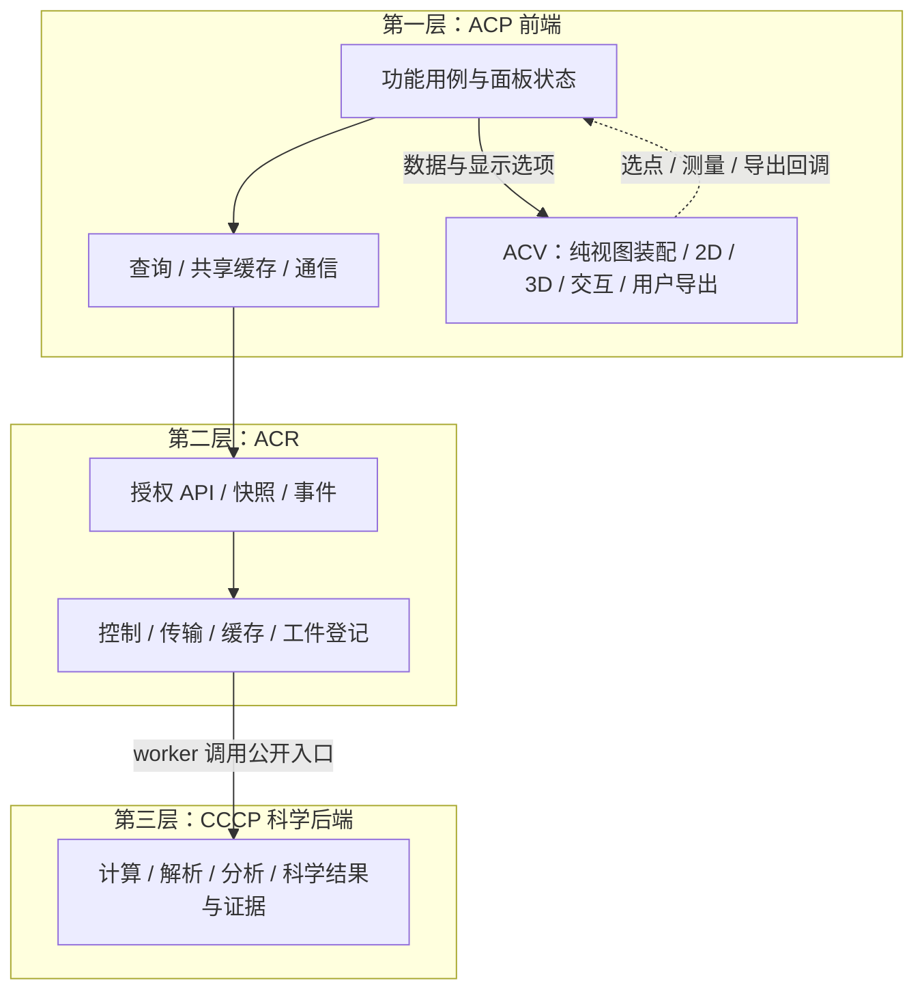

# ACV 归入前端的可行性分析

日期：2026-10-16。性质：基于当前代码的架构调整分析；未修改运行代码。讨论对象为[三层架构合并设计](ACP_Three_Tier_Architecture_20261016.md)中的 ACV 归属，不改变现行科学任务、文件布局或执行完整性契约。

后续讨论已确认前端 ACV 方向，主设计已同步：3Dmol 收入 ACV 适配边界；科学大数据分析、抽样与规范化科学输入输出归 CCCP。本文保留可行性论证；其中“待确认/待更新”的步骤视为已完成设计确认，代码迁移仍未实施。

## 1. 结论

**可行，建议将 ACV 定义为 ACP 前端内部独立的可视化模块，随前端静态资源一起交付。** 它负责浏览器视图装配、二维/三维渲染、交互及用户触发的图像导出；独立指代码边界、公开 API 和测试独立，无须独立服务器、端口或运行进程。

前提是将“绘图”与“科学数据生成”“无人值守报告”分开：科学解析、数值派生和完成判据继续由 CCCP 负责；ACR 管理授权、数据准备、缓存、登记和传输；当前没有浏览器也会生成的报告产物不能在移动 ACV 时消失。

该方案主要降低**原目标架构的后续部署复杂度**。目前仓库尚无独立 ACV 服务，不能宣称本次设计已经减少现有进程数，或解决了查询中的远程 I/O、重复轮询等问题。

## 2. 当前实现提供的依据

| 代码事实 | 位置 | 对方案的意义 |
|---|---|---|
| 能量图在浏览器调用 `energyGraphBuildSvg` 并更新 DOM | `frontend/ACP_Workbench_v2.html::energyGraphUpdateChart` | 大量实际渲染已位于前端，主要工作是抽出边界与消除全局状态依赖 |
| 3Dmol 随本地静态资源加载，多个查看器在浏览器创建实例 | `frontend/js/vendor/3Dmol-2.5.5.min.js`、主 HTML | 交互 3D 不需要新增服务器渲染服务 |
| 振动箭头/动画使用浏览器主 viewer | `frontend/js/vibration_viewer.js` | 可作为 ACV 的分子/振动渲染适配能力 |
| 截图按钮调用 `viewer.pngURI()` 下载 PNG | 主 HTML 的 `btn-screenshot` 事件 | 已有用户触发的浏览器导出路径；不等于所有图形格式都已支持 |
| 服务端存在稳定帧节点与注解序列化 | `src/acp/results/frames.py` | 可以继续消费现有数据契约，无须先迁移所有 Python 投影构建器 |
| 振动来源发现包含历史 ORCA 输出解析回退 | `src/acp/results/vibration_projection.py` | 不能把整个“viewer”目录原样搬到浏览器，须分离科学解析与渲染 |
| NMR 自动写 JSON/XLSX/PNG，PNG 使用 matplotlib Agg | `src/acp/nmr/report.py::write_all_reports/write_plots` | 无浏览器的报告路径必须保留或有等效替代，不能当成普通前端函数抽取 |
| sampling 投影读取磁盘并组装科学量与元数据 | `src/acp/results/sampling_graph.py` | 数据读取、科学口径、显示装配需按职责拆分，不是把 Python 代码逐行翻译为 JS |

以上是静态代码核验；未做浏览器性能实测、导出格式兼容性或大体系压力测试。

## 3. 调整后的三层与调用链



图中的回调不是 ACV 导入 feature。ACV 不直接调用 ACR API、不启动 SSE、不独立轮询，也不直接访问 CCCP 或工件存储。缺帧/选点等事件交还 feature，feature 再通过统一数据层取数。

对应现有 A1–A4：ACV 的渲染属于 A1，纯数据到显示模型的转换属于 A1 内部无副作用辅助模块；加载、保存、提交和跨面板流程仍在 A2/A3/A4。不要借 ACV 独立而再建一套查询缓存或全局控制中心。

## 4. ACV 的职责与内部结构

建议先按现有 JS 技术逐步抽取，暂不以引入新框架、构建工具或发布到包仓库为前置条件。

```text
frontend/js/acv/
  contracts/          # 稳定输入类型、显示选项、交互事件
  specs/              # 视图类型、轴/主题/单位显示、默认交互
  models/             # 纯显示模型转换，无 DOM / 网络 / 科学判据
  renderers/          # SVG / canvas / 现有 3Dmol 适配
  interactions/       # 缩放、选点、相机、测量、动画
  exporters/          # 浏览器 PNG/SVG 等按能力支持
  lifecycle/          # resize、可见性、资源释放
```

公开 API 可收敛为 `create(container, options)`、`setData(data)`、`setSelection(ids)`、`resize()`、`export(options)`、`destroy()`，通过注册的 `onSelect/onFrameRequest/onExport` 等回调报告交互。名称为目标示意，不表示当前已经实现。

| 数据/行为 | 所有权 |
|---|---|
| 相机、缩放、hover、动画进度、临时测量 | ACV 实例局部状态 |
| 当前任务、跨面板选择、表单、错误呈现策略 | ACP feature；通过公开 API 同步 ACV |
| 服务端资源副本、请求合并、刷新策略 | ACP A3 数据层 |
| 正式候选、编辑后保存的结构、项目偏好 | ACR 持久化；ACV 发事件，无直接写权 |
| 帧身份、原子身份、单位、科学分类、完成证据 | 后端科学契约；显示转换不能更改其含义 |

允许坐标轴映射、格式化、按用户选择临时切换显示单位、可视范围抽样；这些只影响呈现，不能回写科学数据。涉及相对能参考系、RMSD/MCS、盆划分、概率、阈值判定等结果语义，应由后端统一给出权威口径。前端几何编辑结果只是草稿，保存时走现有验证/资产登记流程。

## 5. 自动报告与导出的方案选择

| 方案 | 部署影响 | 能力影响 | 判断 |
|---|---|---|---|
| 所有渲染仅浏览器执行 | 最少服务端绘图依赖 | 不打开页面就不能生成新图；现有 CLI/定时批处理 PNG 契约受影响 | 仅在明确放弃自动绘图产物后可选，不宜直接切换 |
| **前端 ACV + 保留现有批处理报告导出器** | 无新增 ACV 服务；现有 Python 依赖先保留 | 交互与自动报告均可用，但跨语言不能天然保证像素一致 | **近期建议**，先降部署复杂度，保持产物兼容 |
| 前端 ACV + 可选无头浏览器导出任务 | 可复用前端渲染，但增加浏览器运行时、字体、资源与隔离维护 | 可无人值守；同源并不保证所有环境完全一致 | 有强需求与验证后再考虑，不能把它宣传为零部署成本 |

第二种方案中的批处理导出器是现有兼容能力，近期驻点可保持 `acp.nmr.report`，不重新命名为“后端 ACV”，也不需要独立 HTTP 服务。ACR 编排报告导出/登记，科学指标仍由科学模块计算；长期驻点按报告能力的独立需求再作边界决策。

XLSX/CSV 是数据导出，不因 ACV 归前端就必须迁入浏览器。当前 `write_all_reports` 会生成 PNG，不能无版本决策改为“用户打开页面后才生成”。也不能据此立即删除 matplotlib/openpyxl 或改薄计算节点依赖；须先审计全部调用与发行契约。

采用前端 ACV 后，“唯一实现”应分别约束科学算法与每种渲染路径：不复制科学计算；交互渲染在 ACV 收敛，批处理渲染保留一条受控路径。统一科学产品与图形规范保证语义一致，不承诺 Python 和 JS 共用同一份可执行渲染代码。

## 6. 收益、限制与对应措施

| 方面 | 实际收益或限制 | 应对/验证 |
|---|---|---|
| 服务部署 | 不新增 ACV API/worker 服务、端口、健康检查和服务间版本协商 | ACV 随前端静态资源发布；产品 API 仍是唯一入口 |
| 集群部署 | 交互渲染不占计算队列；交互库不用安装到科学节点 | 自动报告依赖仍需明确保留；不是所有节点依赖都会消失 |
| 服务器负载 | 浏览器承担渲染；后端仍需解析、准备、传输数据 | 不预估节省比例，分别测量 API 时间、带宽与浏览器负载 |
| 大轨迹/大分子 | 全量上传浏览器可能增加传输、内存及 GPU 压力 | 服务端提供窗口/分块/必要列，前端按需取帧、受控缓存、保留稳定 frame_id |
| 前端包体 | 图形依赖集中可能拖慢首屏 | 非活动 viewer 按需初始化；必要时拆分加载，避免一次加载全部轨迹 |
| 多面板/切换 | 多个 WebGL 实例与动画容易残留 | 明确 destroy、停止动画、释放监听器/资源；保留统一 framing 入口 |
| 导出可靠性 | 3D 常为栅格图，不自动等于矢量导出；字体与外部资源影响截图 | 按 renderer 声明导出能力，做目标浏览器/字体/尺寸验收，不承诺所有视图支持 SVG |
| 多用户可复用性 | 服务器不再缓存所有人的渲染结果 | 复用科学数据与传输缓存；共享图片需经上传命令由 ACR 登记 |
| 安全与权限 | 移到前端不改变服务端授权责任 | API/工件每次鉴权；标签/注解作为不可信文本渲染，不执行输入 HTML/脚本 |
| 静态版本缓存 | 老页面可能拿到新脚本或不兼容数据 | 前端资源版本一致、API/schema 兼容窗口、明确不支持版本的错误与刷新提示 |

集群可扩展性主要仍来自 ACR 的所有权、CAS、持久操作与工件引用；ACV 前移对此兼容，但不能替代这些工作。

## 7. 渐进迁移与验收

1. **先冻结边界与 fixture。** 使用当前节点/注解和视图载荷；保留 `acp.results.frames` 的 VIEW_REGISTRY、to_node/to_annotation，不在前端创建一套相互漂移的科学视图标识。
2. **抽取二维样板。** 从现有 SVG 能量图分离纯显示模型、渲染和交互；数据仍经现有 feature 获取。先验证行为一致，再接统一数据客户端。
3. **抽取 3D 核心。** structure/vibration 共用 ACV renderer、相机 framing、选择与销毁机制；保留 `scheduleViewerFraming/frame3DViewer` 的既有约束。
4. **移除旧渲染实现。** 每个视图切换完成后删去对应旧绘制函数；请求协调改动则同步删除旧轮询，不能留下两条路径。
5. **接入导出能力。** 先覆盖已存在的截图与可直接支持的二维导出；后端自动报告保持通过，再逐项统一图形规范。
6. **更新总架构（设计已同步）。** 主设计已将后端 ACV、render worker、Python 视图包和 ACR→ACV 调用替换为前端模块边界；旧方案注明历史，代码切换仍须逐项验收。

验收至少包含：数值/单位/缺失值与参考系不变；选点和帧身份一致；energy viewer 不提交任务；无网络/DB/QC 访问进入 ACV；实例切换无残留动画/监听器；目标规模轨迹的帧率/内存/交互延迟达到项目定义的预算；导出在目标浏览器可用；无浏览器执行 NMR 仍生成原约定 JSON/XLSX/PNG；历史任务与现有接口继续可读。

**推荐落点：三层保持不变，ACV 成为第一层的独立前端库；科学数据处理在第三层，控制与传输在第二层；无人值守报告暂保兼容导出器，不增加独立绘图部署单元。**
