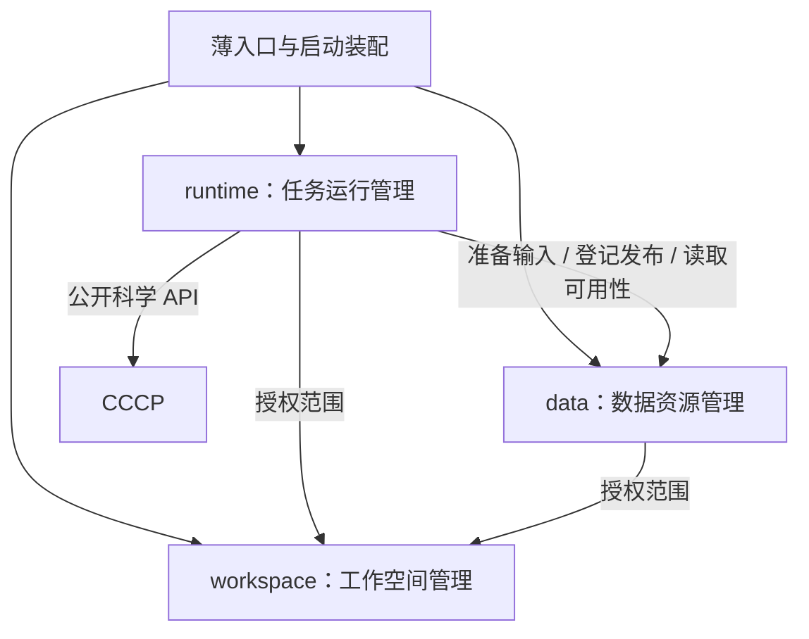

# ACP 三层高内聚模块设计：减少模块数量与跨模块调用

v1.6 增补见[主方案第 36 节](../../../ACP_Architecture_Adjustment_Plan_20261016.md#36-统一交互初始化acp-init-与组件装配)：复用现有 acp init，将部署档位/组件选择、配置预览与应用、doctor 验证纳入 IN-01—06；现有软件/节点向导继续兼容，完整部署装配待实施。

v1.5 战略增补见[完整方案第 30—35 节](../../../ACP_Architecture_Adjustment_Plan_20261016.md#30-产品定位与-aiida-借鉴边界)和[产品战略与差异化](ACP_Product_Strategy_and_Differentiation_20261016.md)：本地完整科研闭环优先，Lab 分 Standalone/Server 配置，Hosted 按需后置；保持独立运行内核，借鉴 AiiDA，引入受控插件、项目迁移与 MCP。新增能力均为待实施目标，v1.4 的设计补全与质量门保留。

架构设计 v1.4 已补齐预留恢复、租户存储映射、身份迁移和独立核时配额依赖；代码质量清理按[主方案第 29 节](../../../ACP_Architecture_Adjustment_Plan_20261016.md#29-本轮代码质量与冗余清理交付门)及[源码审计台账](ACP_Architecture_Code_Quality_Audit_20261016.md)执行。当前为设计与静态审计结果，未实施运行代码清理。

实施总入口：[《ACP 完整架构调整方案》](../../../ACP_Architecture_Adjustment_Plan_20261016.md)。工作包、阶段依赖、验收与回滚统一按该方案维护；本文保留架构/模块解释，不再形成独立实施顺序。

日期：2026-10-16。状态：**最新目标组织方案，运行代码尚未迁移**。本文根据本轮讨论，替代前版“前端五个、中段九个、科学端八项均作为独立模块”的计数方式；前版的具体职责和安全/恢复约束保留为内部组件规范。

产品化增补见完整方案第 18—21 节：CCCP 独立完整开源；ACR＋CCCP 提供无需前端的完整 CLI/Agent 底座；全栈产品免费，线上仅按公开核时政策消耗 Credit。Credit 账户/账本归 Workspace，用量/准入归 Runtime，不新增商业业务层。

多用户细化按完整方案第 22—25 节：Workspace 管用户/凭据/角色/等级/授权/账户，Runtime 管用户环境开通与任务资源/进程，Data 管租户存储/配额/工件；所有能力仍归 ACR 三模块。个人 API 使用共用地址＋限权 Key，管理员角色不由付费等级获得，自部署 quota-only 不关闭隔离。

双版本与组件归位按完整方案第 26—28 节：实验室版 ACP Lab、线上多用户版 ACP Hosted 共用本架构，开源组件作为既有 owner 的内部实现/adapter；身份、调度、存储、绘图及科学适配各有唯一归属，不新增业务层。具体候选须 PoC/版本/社区功能与许可核验后才冻结。

## 1. 核心调整

三层各保留 **三个主要职责模块**，公共契约、启动装配和底层连接是受限支撑代码，不作为可以发起业务的第四模块。模块是可独立理解、测试和维护的能力边界，不要求独立包、进程、微服务或统一基类。

| 层级 | 三个主要模块 | 封装目的 |
|---|---|---|
| 前端 ACP | 工作台应用、统一数据客户端、ACV 可视化 | 页面和用户动作在一起，请求与刷新在一起，全部绘图在一起 |
| 中段 ACR | 工作空间管理、任务运行管理、数据资源管理 | 组织与权限在一起，完整任务生命周期在一起，工件生命周期与搬运在一起 |
| 科学后端 CCCP | 科学任务、科学数据处理、软件计算适配 | 科学计算过程在一起，解析后的全量分析与标准数据产品在一起，软件原生 I/O 与进程适配在一起 |

**聚合完整流程，不合并全部实现到一个文件或 manager。** 对外少量稳定接口，对内可以有规划、控制、恢复、查询等组件。模块内部仍区分纯规则、用例、I/O 与写入者；允许组件通过清楚的接口直接协作，不需要为了每次内部调用建立 Port 或事件。

## 2. 第一层：三个前端模块

| 模块 | 内部组件 | 边界与写权 | 对外入口 |
|---|---|---|---|
| **工作台应用 `workbench`** | 页面壳、导航、表单、任务/结果/结构功能控制器、workspace 用例 | 拥有布局、用户意图、功能 UI 状态、错误呈现；无网络/底层图形库/科学大数据处理 | 页面挂载、用户 actions |
| **统一数据客户端 `client`** | HTTP/SSE、QueryCoordinator、CommandClient、ResourceStore、RefreshPolicy、ChangeCoordinator | 一次封装请求、缓存、订阅、超时与刷新；ResourceStore 是客户端共享缓存唯一写入口 | query/command/subscribe/prepare，返回只读快照与回执 |
| **ACV `acv`** | 显示模型、2D renderer、3Dmol adapter、相机/选点/动画、图片导出、资源释放 | 拥有渲染实例与局部显示状态；不请求 API、不管理任务、不处理全量科学数据 | create/setData/setSelection/setStyle/resize/export/destroy + 回调 |

静态依赖：`workbench → client`、`workbench → acv`。client 与 acv 互不导入；回调是 workbench 注入的函数，不是 acv 依赖 workbench。页面与 feature 的区分仍保留，但已是 workbench 内部组件。

完整界面动作在 workbench 内封装。例如“选择任务并查看帧”由一个用例读取 client 快照、更新选择、设置 ACV；不再依赖五个对外模块逐级协调。只有 client 内通信组件可以联网，只有 ACV 的 3Dmol adapter 可以操作 `$3Dmol`。

## 3. 第二层：三个中段模块

### 3.1 工作空间管理 `workspace`

**完整流程：创建/管理项目 → 成员与访问策略 → 工作空间配置与组织视图。**

- 内部组件：项目、成员/身份、访问策略、分子分组、工作空间配置、项目级草稿、组织审计、对应查询及变更记录。
- 唯一写权：项目、成员/授权、项目级配置、分子分组等组织信息。
- 公开能力：`get_access_scope`、`manage_project`、`manage_members`、`query_workspace`、`update_workspace_settings` 等类型化能力。名称为目标示意，不表示新增现有 API。
- 不拥有任务运行状态、计算参数重算流程、科学工件字节或远程连接。
- 不调用 runtime/data 实现完整任务或传输流程；项目删除先标记关闭/禁用新操作，后续清理必须经过显式维护流程，不直接跨模块删表/目录。

任务自定义名称、任务标签、编辑重算草稿和操作审计归任务运行管理；输入/结构候选及来源集合的名称、标签、人工选择归数据资源管理。按实体唯一归属，不因为都叫“组织信息”就放入一个跨域仓储。

### 3.2 任务运行管理 `runtime`

**完整流程：受理 → 校验/规划 → 排队/派发 → 运行/观测 → 暂停/取消/恢复 → 验证回执/完成处理。**

- 内部组件：提交/控制入口、工作流 catalog/profile、planning、任务规则、controller、plan_runner、identity/checkpoint、生命周期 CAS、任务级名称/标签/编辑、任务查询、任务投影与事件。
- 唯一写权：任务状态、attempt、冻结计划/有效参数、提交记录与 release 关联、任务操作、任务自己的投影和变更记录。controller 推进生命周期，worker 仍只写执行/步骤回执。
- 公开能力分为 `commands`（submit/pause/cancel/continue/rerun）、`queries`（catalog/tasks/detail/operations）及执行协议（envelope/receipt）。是一个模块内的接口分组，不是三个独立模块或一个任意字典分派器。
- 调用 workspace 公开能力获得访问范围；通过 DataResourcePort 调用 data 的输入准备、发布登记和可用性；科学执行只能通过 CCCP C1。
- 无科学算法、原生 QC 解析、SFTP 细节和直接写 data 私有 manifest 的能力。

旧版 `Processes/Commands + Planning + Execution + 任务侧 Queries/Sync` 都收进 runtime。SubmitCalculation、FinalizeExecution 是 runtime 内部用例，直接协调其 planning/controller/receipt 等组件，不再是全局跨业务“大流程模块”。

### 3.3 数据资源管理 `data`

**完整流程：输入接收 → 工件登记 → 存储/传输/校验 → 缓存发布 → 可用性/读取 → 保留与回收。**

- 内部组件：上传暂存、输入资产、工件目录、平台 manifest、发布阶段、SSH/SFTP/存储适配、持久传输队列、缓存、generation 守卫、结构来源/人工候选、数据查询及可用性事件。
- 唯一写权：工件/来源记录、平台 `result_manifest` 与候选权威文件、传输状态、缓存字节、数据可用性投影。操作必须走相应内部写入者，不能任意共写一个文件。
- 公开能力分为 `inputs`（upload/register/resolve）、`artifacts`（register/publish/prepare/availability/read）、`organization`（候选/来源组织）、`transfers`（操作查询/取消），仍属于一个模块。
- 可使用 workspace 公开访问策略；工件登记时保存只读的 task/project/attempt/generation 关联，**不查询或修改 runtime 的私有任务表**。
- 不调用 runtime 发起计算、不判断任务科学完成、不解析原始 QC 输出、不计算降维/聚类/全量抽样。

传输完成 → 校验 → 缓存发布 → 可用性更新在 data 内一次封装，无须 transfers→publication→sync 跨三个模块回调。初次上传可登记为尚未科学验证的原始资产；需要科学解析/校验时由明确 runtime 用例安排 CCCP，不能在 data getter 中自动启动。

### 3.4 三模块调用方向



核心静态依赖为 **runtime → data → workspace**，runtime 可直接使用 workspace 的公开权限能力。通过消费者声明的 Port 注入时，运行时调用方向同样保持这个单向关系。data 不导入 runtime，workspace 不导入两者。

入口、启动装配、协议契约与低层连接不是第四个业务模块。API/CLI 路由按所属资源进入对应模块；不强制所有查询先走 runtime，也不在通用入口建立新的跨域业务 manager。

任务授权由 runtime 根据自己的任务事实判定，工件授权由 data 根据已登记归属与有效访问范围判定；涉及任务当前执行状态的操作先由 runtime 校验，再发送带身份/版本守卫的数据命令。不能用用户随意提交的 task_id 或无期限授权快照绕过检查。

## 4. 原九模块的明确合并表

| 旧模块 | 新归属 |
|---|---|
| EntryPoints | 降为薄入口组件；分派至 workspace/runtime/data 的应用接口 |
| Processes/Commands | 任务流程收进 runtime；项目管理流程收进 workspace；工件操作流程收进 data |
| Organization/Intake | 项目/成员/分组 → workspace；任务元数据/编辑 → runtime；输入/候选/来源 → data |
| Planning | runtime 内部 planning 组件 |
| Execution | runtime 内部 controller/plan_runner/receipt/recovery 组件 |
| Publication | 登记、manifest、工件发布 → data；何时发布与整体完成顺序 → runtime 内部完成用例 |
| Transfers | data 内部传输组件，与缓存/发布同属一个完整流程 |
| Queries | 各模块查询自己的数据；复杂组合查询使用只读快照/受限组合入口，不建全局查询业务模块 |
| Sync | 各模块维护自己的投影与持久变更；共享事件日志/重放器只是基础设施，不能掌握第二份任务状态 |

因此 runtime 内提交→规划→派发、data 内传输→校验→发布都不再是跨模块业务调用。跨模块不可避免的“任务使用工件”只保留稳定 DataResourcePort。

## 5. 第三层：三个科学模块，原五层保留为内部规则

| 模块 | 内部组件与现有驻点 | 允许调用/边界 |
|---|---|---|
| **科学任务 `calculation`** | 公开 TaskRequest/TaskResult/TaskContext、唯一 tasks 根、任务步骤/完成判据、受限 batch | 编排 analysis 与 software；无平台 job/LSF 策略；不新增第二任务实现 |
| **科学数据处理 `analysis`** | 科学格式/结构、解析后数据归一化、NMR/PES/采样等算法、全量数据处理、分块/抽样产品 | 可调用 software 的明确只读解析接口及公共纯规则；不启动程序、不反调 calculation tasks |
| **软件计算适配 `software`** | 现有 backends、程序 interfaces/parser、软件发现与纯进程机制 | 执行入口供 calculation 使用；只读 parser 供 analysis 使用；不导入任务/平台模块 |

此处 `software` 是职责归组名，不要求创建同名包；现有 `cccp/software.py` 可继续作为其内部软件发现组件，不能因命名相似直接覆盖文件。原 backends→interfaces→process 依赖仍然保留，只是不把三者分别当外部业务模块维护。

科学契约/错误/单位等 C0 是共享纯基础，旧类型同一性保持。C1/C2 属于 calculation，C3 分布于 analysis 与 software 能力适配，C4/C5 属于 software 内部。跨软件科学类型不能驻留到某个具体 parser 再强迫所有模块反向依赖。

CCCP 外部仍只通过稳定公开科学入口使用以上能力，不直接导入 backends/interfaces。大数据分析、规范化和绘图数据生成完全归 CCCP；ACR 做元数据与字节传输，ACV 做有限数据渲染。

## 6. 完整流程在模块内闭环

### 6.1 提交与执行

```text
workbench → client → runtime.submit
  runtime 内：权限/幂等 → planning → 持久化 → controller 派发
  → data.prepare（公开能力）
  → plan worker → CCCP.calculation → software/analysis
  → runtime 内验证回执、恢复/完成处理
  → data.publish（公开能力）
  → runtime 按现行语义提交状态与持久后续工作
```

图示为职责关联，不重新规定现有发布/终态执行顺序。任务完成判据、`result_publication` 阶段和终态副作用顺序必须保持；发布失败只重试发布，不能因此再次执行科学计算。

### 6.2 结果准备与显示

```text
client → data.read：返回就绪数据或可用性快照
client → data.prepare：显式命令，内部排队/传输/校验/发布
data 记录就绪事件 → client 缓存更新
workbench → ACV.setData → SVG/3Dmol → 页面
```

读取不隐式触发 prepare。需要科学新产品时由 workbench 通过 client 请求 runtime 的分析任务，不让 data 反调 runtime。runtime 若等待输入准备，以持久阶段/操作引用查询 data 操作；data 返回回执/事实，不直接调用 runtime 的完成函数。

### 6.3 对外查询与统一事件

任务列表/详情主要由 runtime 查询返回，工件目录/数据块由 data 查询返回，项目/成员由 workspace 查询返回。避免每行任务跨模块 N+1 查询：使用批量公开读取或可重建的只读组合投影，注明来源 revision/freshness，不能另建权威数据库。

客户端可以使用单条受权变更流。通用事件分发器从持久日志重放各模块已提交记录，不负责业务转换，不反向调用模块进行“修复”。需要发布确认/事务顺序时仍用明确命令或持久阶段，不用事件替代必要的同步保证。

## 7. 数据与一致性边界不因合并而放宽

- runtime：controller 唯一推进任务生命周期；CAS/revision/attempt 守卫、先持久提交记录再 bsub、旧回执拒绝、暂停/取消及原地 rerun 规则保持。
- data：工件发布、传输和缓存写入者仍有明确分工；generation/摘要守卫、平台 manifest 唯一写入、候选权威文件与历史只读兼容保持。
- workspace：项目关闭/权限撤销后，各模块命令/读取仍重新验证访问资格；不能只依赖浏览器缓存权限。
- module-local：同一流程的纯组件可直接调用；事务由上级用例控制，内部组件不偷偷 commit；不因合并而形成循环 import 或允许查询隐式 I/O。
- cross-module：同库事务需要协调时通过窄 UnitOfWork/操作接口实现，禁止一方直接写对方表；跨 DB/文件/远程操作使用持久阶段与幂等恢复，不声称全局原子事务。
- delete：项目/任务/工件的跨域清理由显式管理员维护用例按公开清理接口协调，先停止新操作、确认在途引用和执行停止，再级联清理；不能出现 workspace 直接删除 runtime/data 私有记录的绕路。
- compatibility：现有自动 NMR JSON/XLSX/PNG 导出保留，primitives/backends shim 保留，15 个 active 工作流与 retired 历史能力不受模块归并影响。

## 8. 建议目标组织与维护规则

```text
frontend/
  workbench/                     # 页面与功能用例
  client/                        # 网络、共享缓存、刷新整体封装
  acv/                           # 2D、3Dmol、交互、导出
src/acp_runtime/                 # 目标包，当前尚未创建
  workspace/                     # 自己的 public、用例、规则、查询、仓储
  runtime/                       # 自己的 planning/controller/worker/recovery 等
  data/                          # 自己的 inputs/artifacts/publication/transfers 等
  entrypoints/ bootstrap/        # 薄协议适配与启动装配
  contracts/                     # 稳定协议与纯基础，禁止堆放业务服务
src/cccp/                        # 保持现有 tasks/backends/qc 驻点与兼容路径
  calculation/                   # 科学任务模块
  ...                            # analysis/software 按现有目录逐项归并
```

每个主要模块只维护：公开能力清单、内部组件图、权威数据清单、外部依赖白名单和关键契约测试。内部函数不逐个成为“公共服务”。新组件只有在形成独立完整流程、拥有独立数据生命周期且能显著减少现有耦合时，才考虑升级为新模块。

验收重点：主要模块没有循环依赖；runtime 不绕 data 读写工件，data 不绕 runtime 控制任务；同模块组件无需绕行全局总线；接口无任意函数名分派；CCCP 唯一科学实现与纯分析禁执行守卫通过；恢复/发布/旧结果兼容不变。先按业务切片原地归并调用，再迁目录，不因本设计批量移动代码。

**最终边界：页面流程归 workbench，联网刷新归 client，绘图归 ACV；项目组织归 workspace，完整任务流程归 runtime，完整工件流程归 data；科学任务、科学数据处理与软件适配在 CCCP 内各自闭环。**
