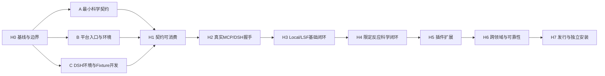

# ACP 2.0 三 Agent 并行执行总索引

**日期**：2026-10-20  
**用途**：将[四组分总方案](../../ACP_2.0_Four_Component_Collaboration_Plan_20261020.md)拆为可分发给三个 Agent 的执行计划。本文与三份分计划定义后续工作，不代表实现、安装或验收已经完成。  
**前提**：按架构 debug 已完成规划；执行时使用 `.omo/plans/acp-architecture-acceptance-remediation.md` 实际交付的冻结候选与证据，不继续在移动中的 debug 工作区实施。  
**本机操作依据**：[MCP / DSH 本服务器联调手册](ACP_2.0_MCP_DSH_Server_Acceptance_Runbook_20261020.md)。

**基线核对（2026-10-22 更新）**：[正式报告](../../../reports/architecture_remediation_20261020/REPORT.md)记录的科学/平台代码候选为 `ab492cc8be9e46125fa2d2fae69a3ecaac64a548`；包含当时 Harness 与报告的 debug 交付 revision 为 `096cdffe9a3817d8ee443d824830d87ec6e07bc2`。两者均为历史参考，**不得直接作为后续开发基线**：工作树中还有后续 debug 与质量修复。B00/B02 必须使用包含这些修改的 `final_debug_candidate`，核验[本次修复报告](../../../reports/architecture_repair_20261022/REPORT.md)中的源码快照和 SHA-256，再把经审查候选落为实际 commit，分发同一完整 SHA。真实科学/LSF、生产、恢复部署及六项延期接线沿各自证据保持 OPEN / NOT_VERIFIED；历史报告不改写为 PASS。

## 1. 三份可独立分发的计划

| Agent | 计划 | 主要产物 | 首轮可以立即开始 |
|---|---|---|---|
| **A：科学底座** | [A / CCCP](ACP_2.0_Parallel_Plan_A_CCCP_20261020.md) | 科学类型、Capability/Recipe、科学验证和 EvidenceReport、科学插件/Fixture | 清点既有 Task/Plugin API，交付最小科学 Schema 与正负 Fixture |
| **B：执行平台与集成** | [B / Runtime](ACP_2.0_Parallel_Plan_B_Runtime_20261020.md) | ACP CLI/HTTP/MCP、单 Controller 接线、持久幂等/审批/预算、Data/恢复、集成发行 | 隔离 Python/数据/配置；以现有 singlepoint 交付入口，不等待新反应 Recipe |
| **C：RPH 与 Workbench** | [C / RPH & Workbench](ACP_2.0_Parallel_Plan_C_RPH_Workbench_20261020.md) | DSH 工具桥、研究循环/记录、化学交互与证据视图、真实客户端/浏览器验收 | 隔离 Node/pnpm/DSH/Chromium；以固定 Fixture 开发 Bridge/UI |

三份计划覆盖 **P0～P5，共 93 项：A 30 项、B 27 项、C 36 项**。每项列前置、动作、文件/产物、验证、失败断言、证据与交接。按阶段交付；P0/P1 不等待 P4/P5 的全部能力。Fixture 开发可先行，但只有真实入口、模型、科学软件与集群执行形成的证据，才能关闭相应实测行。

| 阶段 | A 任务 | B 任务 | C 任务 |
|---|---|---|---|
| P0 | A-00～08 | B00～07 | C00～09 |
| P1 | A-09～13 | B08～14 | C10～16 |
| P2 | A-14～20 | B15～20 | C17～25 |
| P3 | A-21～23 | B21～22 | C26～28 |
| P4 | A-24～26 | B23～24 | C29～31 |
| P5 | A-27～29 | B25～26 | C32～35 |

A-02～04/A-07 是可在 P0 并行开展的反应/Recipe 预研，最迟在 A-14/A-15 消费前交付；不进入基础 P0/P1 的必需依赖闭包。阶段编号描述研发安排，不等于把所有预研变成该阶段验收前置。

执行期间三个 Agent 保持上述职责，B 兼任集成操作者，不额外要求第四个长期 Agent。跨域检查由非实现者核对契约和回执；返修仍由文件 Owner 完成。

## 2. 开工步骤与写入边界

### 2.1 开工顺序

1. B 在基线记录中填入 debug 候选完整 SHA、报告路径及范围。已执行失败仍记 FAIL，环境缺失仍记 NOT_VERIFIED；本方案不把旧结论改为全绿。
2. 三方阅读根 AGENTS.md、对应嵌套 AGENTS.md、总方案、本索引、本轨计划和服务器手册。记录文档摘要，确定实际分支/目录。
3. 用同一基线创建三个独立开发 checkout/worktree 和一个 B 管理的集成 checkout；既有工作区、未提交修改及历史验收报告保留。
4. 三方分别执行本轨第一项，提交边界清单/风险和最早契约。契约消费采用版本化文件与明确 commit，不临时引用其他 Agent 未提交的工作目录。
5. B 登记契约总 manifest。H1 到达后，各轨继续独立实现；H2/H3 在冻结集成版本和本服务器测试环境中验证。
6. 每阶段达到检查点后自动推进下一阶段的已明确工作；依赖未到时继续本轨无依赖任务。接口不符时开具体返修记录，不擅自修改另一轨文件。

**示例命令**，路径由实施时填写，B 执行一次。`ACP2_BASE_REV` 必须是实际已验收候选的 commit，不能填 `HEAD` 作为移动引用：

```bash
# 由 B00 填入已审查、包含最终 debug/质量修复的真实 commit。
# 若尚未生成该 commit，先核验修复报告的源码包；不要从历史 SHA 开工。
: "${ACP2_BASE_REV:?B00 must set the reviewed final_debug_candidate commit}"
export ACP2_CHECKOUT_ROOT='/可写绝对路径/acp2-development'
mkdir -p "$ACP2_CHECKOUT_ROOT"
git -C <repo> worktree add -b acp2/a-science "$ACP2_CHECKOUT_ROOT/A" "$ACP2_BASE_REV"
git -C <repo> worktree add -b acp2/b-runtime "$ACP2_CHECKOUT_ROOT/B" "$ACP2_BASE_REV"
git -C <repo> worktree add -b acp2/c-experience "$ACP2_CHECKOUT_ROOT/C" "$ACP2_BASE_REV"
git -C <repo> worktree add -b acp2/integration "$ACP2_CHECKOUT_ROOT/integration" "$ACP2_BASE_REV"
```

若分支/目录已存在，核对其基线后复用，不执行覆盖/重置。开发 checkout 彼此独立；本机安装、科学作业与真实模型测试只由被指定操作者运行，避免三方重复执行同一笔计算。

三份计划和本索引当前可能仍是未提交文档。B00 须单独提交所需规划文件，或将其作为带 SHA-256 的只读文档包分发到各 checkout；不把主工作区其他修改混入规划提交。代码起点、文档版本和验收候选分别记录。

### 2.2 单一文件 Owner

以下是写入权限约定；读取其他域允许，跨域修复通过 Owner 交接。列为“拟新增”的目录需在本轨首项登记，不代表当前存在。

| 文件/资产 | 唯一写入 Owner | 其他轨的做法 |
|---|---|---|
| `src/cccp/**`；科学专属测试/Fixture；`acp2-contracts/science/**`（拟新增） | A | B/C 消费公开类型/JSON，不能复制科学类型或执行核心 |
| `src/acp_services/**`；`src/acp/**`；平台 CLI/HTTP/MCP/迁移；平台测试 | B | A/C 提交失败用例和请求，禁止加第二应用实现 |
| `frontend/**`；`rph/**`（拟新增独立包）；体验专属测试；`acp2-contracts/experience/**`（拟新增） | C | B 只接发行挂载/公开 API，科学解析归 A |
| `acp2-contracts/runtime/**` 及总 `manifest.json`（拟新增） | B | A/C 交付自己的子目录与版本，不并改总清单 |
| `pyproject.toml`、`requirements-node.txt`、CI、统一启动/安装脚本、四处版本号、根/跨域 AGENTS.md | B | A/C 提交 `shared-change-request`，含所需改动、原因、测试和回滚 |
| Services 六列表台账、handoff/shim 清单、公共协议矩阵/closure | B | A/C 给新增行/证据建议，B 核对状态后写入 |
| 新 `scripts/acceptance/acp2_science.py`（拟新增）及科学断言 | A | B/C 按冻结 CLI 调用，不改科学阈值 |
| 新 `scripts/acceptance/acp2_runtime.py`（拟新增）及集成/清单验证工具 | B | A/C 按接口提交证据 |
| 新 `scripts/acceptance/acp2_experience.py`（拟新增）及 DSH/浏览器自动化 | C | B 提供冻结测试服务，禁止脚本暗中启动第二 Controller |
| A/B/C 各自计划、领域文档和领域证据 | 对应轨 | 他轨提交评审意见；总索引/总方案由 B 汇总更新 |

已有测试不因分类变更直接删除或重命名。A/C 如需改非本轨旧测试或公共 fixture，由 B 先登记具体文件 Owner；新增测试分别使用 `test_acp2_science_*`、`test_acp2_runtime_*`、`test_acp2_experience_*`，不会共同改一个 `conftest.py`。

## 3. 早期必须冻结的交接包

契约包是执行任务的产物，统一位置为 `docs/reference/next-change/acp2-contracts/`（拟新增）。先冻结最小可用子集，再按兼容规则扩展；不要求 P0 交付完整科学研究系统。

| ID | Owner → 消费者 | H1 最小内容 | 后续扩展 |
|---|---|---|---|
| K-SCI | A → B/C | CapabilityDescriptor、现有 TaskRequest/Result 序列化映射、科学错误、Schema/version；singlepoint/optimize/frequency 正负 Fixture | ReactionSpec/QuestionSpec/Recipe/EvidenceReport/Provenance、TS/IRC 条件与科学插件 |
| K-APP | B → C/A | 任务与工件引用、错误、revision/attempt/generation、只读查询、显式 prepare、输入映射；同一应用命令入口 | 权限 scope、审批、累计预算、事件 cursor、恢复及 Plugin API |
| K-MCP | B → C | 启动清单格式与拟实现的 argv/cwd/env 参数约定、transport/协议支持、八工具 Schema、启动/关闭副作用约束 | H2 交付实际可执行入口和填写完整的 launch 清单；新客户端/传输单独登记支持矩阵 |
| K-EXP | C → A/B | ResearchProposal/ResearchRecord 的引用关系、展示所需 ViewModel、工具桥映射、客户端错误投影 | 科研轮次、假设与证据历史、人工修改和审批反馈 |
| K-ENV | B/C → 全体 | B：Python/配置/单 Controller/软件/LSF；C：Node/pnpm/DSH/模型/浏览器；各自版本与验证状态 | 独立安装/断网恢复/升级回滚与发行包 |
| K-TEST | B（规范）+ A/C（场景）→ 全体 | `acp2.acceptance.v1`、场景 owner、退出码、超时、清理、证据路径、Fixture run key | 科学/平台/体验分别添加场景，不偷改 debug 原 Harness 枚举 |

H1 的类型字段至少明确：版本、必填/可选、默认值、枚举/单位、拒绝条件、兼容策略、序列化示例及负向数据。H1 是契约可消费门，不要求先完成 H2 的真实进程实现；H2 使用真实启动清单替换 H1 的模板，不能拿模板执行或报 PASS。K-APP 中的身份由服务端解析，不能信任模型传来的 tenant/role。

科学 ID 由 A-01 冻结：`vibration.compute` 表示会调用 frequency Task 的计算；`vibration.analyze` 表示消费已有频率/Hessian 的纯分析，不启动 QC。B/C 不把二者共用一个“只读分析”入口。

P2 的证据契约必须区分 `supported / refuted / inconclusive / not_evaluated`，每项命题引用原生/标准化工件及摘要；LLM 回答不是验证事实。ScientificRecipe 只描述科学 DAG、依赖和完成条件，平台任务状态/attempt/队列由 B 独占。

若一个契约升级：Owner 提交版本差异、兼容/不兼容 Fixture 和影响清单；B 更新 manifest；消费者明确确认通过新版本契约测试后切换。禁止三轨各自修改同名 JSON 字段并期待最终合并时自动相容。

## 4. 并行波次与 H0～H7



以上是**阶段关闭顺序**；H4/H5 的契约和纯开发可以在 H3 验收期间推进。真实运行时仍以通过的依赖与冻结版本为准。

依赖中的“提供 H4/H7 的契约/候选”指生产者的中间交付，不要求整个 H4/H7 已关闭。阶段总签收是扇入操作：各轨先形成自己的事实与回执，再由 B 汇总；不能让 A 的关闭等待 B 的关闭、B 又等待 A 的关闭。

| 易产生等待的工作 | 必须采用的可执行先后关系 |
|---|---|
| Node 与 RPH/Harness | C00 → C04 安装 Node/DSH；C01+C04 → C02 workspace；C01+C02 → C03 Harness；之后补录早期步骤的 Harness 汇总 |
| P0 最小科学契约 | B00 → A-00 → A-01；B01/B03 与 A-01 → C01；A-05/A-06 可不等完整反应类型；真实入口 B04～B06 与 C07～C09 → H2 |
| P1 科学执行与签收 | A-09 静态 Fixture 提前交付；B08/B09 → C12/C13 提交，B10/B11 取平台事实；A-12、C15 对同一工件核验；A-13/C16 本轨签收后 B14 汇总 H3 |
| P2 研究记录与审批 | C01 先交 Proposal/Record Schema；A-14～16 先交科学计划/validator；B16/B17 与 B18 的项目资源 CAS 先实现；C18 实现记录、C19 接审批，再进入研究循环 |
| P2 DA 实测 | B18 绑定 A-15/A-16 的静态 DAG/判据，不等 A-20；C24 发起的登记作业同时供 A-17～19 校验，B20 记录执行，三方都不必为签收重跑整条 DA |
| P5 打包与安装 | A-27 先交科学包规格，C32 先交 RPH/静态资产；B25 据规格构建实际候选包；A-27/28、C33/34 在该包上安装复验；A-29/C35 签收，B26 最后汇总 H7 |

为使等待条件可直接执行，下列跨轨任务使用子交付 ID；93 项主任务数量不变：

```text
P2：A-14～16 静态输入/DAG/判据 → B18 执行绑定 → C24a 批准并提交
    → B20a 执行/发布回执 → A-17～19 科学校验 → C24b 证据反馈/页面记录
    → A-20 科学签收、C25 体验签收 → B20b 汇总 H4

P5：A-27a 打包规格 + C32 客户端/静态资产 → B25a 实际构建包
    → A-27b/A-28 科学安装/示例、C33/C34 客户端安装/手册复跑
    → B25b 包验证汇总、A-29 科学签收、C35 体验签收 → B26 汇总 H7
```

依赖方只等待箭头对应的子交付，不要求生产者整项关闭。B20a 是任务/工件执行事实，不能代签科学结论；B25a 是实际包和摘要，不能代签安装通过。

| 检查点 | 关闭条件 | A 交接 | B 交接 | C 交接 |
|---|---|---|---|---|
| H0 开工 | 实际 debug 基线、写入 Owner、分支/证据根明确 | 既有科学 API 清单 | 基线/环境与共享修改台账 | RPH workspace/前端边界清单 |
| H1 契约 | K-SCI/K-APP/K-MCP/K-EXP/K-ENV/K-TEST 最小版本可消费 | 单点/优化/频率映射与正负 Fixture | 稳定 singlepoint 命令契约、MCP launcher 规范 | Bridge/ViewModel/研究引用 Fixture |
| H2 P0 | 本服务器真实 MCP 进程、DSH 默认协商/工具发现通过；所需环境就绪 | 能力发现/预检只读条件 | 正式入口接真实用例；同一 Controller；持久性设计 | 官方 DSH 客户端、实际协议/工具记录，非“能聊天即通过” |
| H3 P1 | MCP→DSH→真实 Local 与 LSF；CLI/Web/MCP 同一引用、attempt、状态和工件；基本重连/取消/发布恢复 | singlepoint/optimize/frequency 科学产物断言 | 持久幂等、数据完整性与平台故障证据 | 真实模型工具事件、浏览器同任务视图 |
| H4 P2 | 限定 DA 科学 Recipe、TS/频率/IRC/EvidenceReport；持久审批/预算/会话恢复 | 先冻结科学判据，再跑 Fixture；不从结果倒推标准 | 审批/预算/事件、恢复/发布回执 | 问题→提案→批准→证据→研究记录；局限可见 |
| H5 P3 | 一个独立第三方科学插件，不改核心源码即可发现、准入、运行并展示；不兼容版本明确拒绝 | 插件与验证 Fixture | 运行环境/许可/版本冻结与后端适配 | 自动发现/表单、插件工具与结果视图 |
| H6 P4 | NMR/热化学复用能力；多项目多用户隔离；升级/恢复/跨领域证据 | 跨领域科学可比性/产品 | 授权/配额/迁移与资源隔离 | 科研多假设/预算策略、UI/研究记忆一致性 |
| H7 P5 | 实际候选发行包在干净环境安装，第三方按手册完成声明范围；SDK/插件示例、许可证和回滚清楚 | CCCP 独立 SDK/科学包规格及复验 | 包构建/锁/安装/迁移/回滚；集成结果和限制 | RPH/Workbench 独立安装和用户/开发者操作文档 |

阶段只检查该阶段 `IN_SCOPE` 内容及真实必要依赖。P1 的安装/运行不能被完整 NMR/P5 发行工作间接阻塞；反过来，也不能把 P2 的审批预算缺口记成已经交付。全方案关闭需要 P0～P5 全部声明范围完成。

## 5. 本服务器环境配置的明确分工

操作命令以服务器手册 §3、§5、§6 为准。

| 环境任务 | Owner | 给其他轨的交接 |
|---|---|---|
| ENV-01 系统工具/资源/文件系统/权限 | B | 原生数据根、磁盘/内存/核数可用量和本轮上限 |
| ENV-02 Python venv/依赖/冻结源码导入 | B | 绝对解释器路径及三包来源、锁定环境清单 |
| ENV-03 Node/pnpm/DSH 隔离安装/build | C | 精确版本、可执行路径、DSH SHA/锁摘要 |
| ENV-04 配置/DB/端口/Controller/MCP launcher | B | 单 Controller 地址、进程/数据所有者、`mcp-launch.json` |
| ENV-05 DSH profile/overlay/模型 | C | 无密钥的配置摘要、真实调用用量和兼容矩阵 |
| ENV-06 Local 科学软件/SSH/LSF | B（环境）；A（科学正确性） | 版本/路径/运行环境与科学 Fixture run key |
| ENV-07 Playwright/Chromium | C，使用 B 交付的 Python venv | 实际可启动浏览器与缓存路径；安装包不是启动证据 |
| ENV-08 下载网络/模型/SSH/端口 | B/C 各自测试目标 | 每条实际连接结果；不打印密钥/代理凭据 |
| ENV-09 重开终端环境复用 | B 汇总、C 提交 DSH 片段 | 受限环境文件/无秘密复现清单及再激活证据 |

A 可以在自己的 checkout 用独立轻量 venv 做科学单测；不得修改 B 的集成 venv。C 的 Chromium 下载可独立，变更共用 Python 依赖须交 B，避免同时 pip install 改同一环境。测试实例不使用生产数据目录或远端任务目录。

## 6. 集成运行、真实测试与证据

### 6.1 B 的集成操作顺序

1. 收集三轨本阶段 commit、测试回执及文件 Owner 检查；只选择已交付的 commit/patch，记录依赖顺序。
2. 在专属集成 checkout 依次接入契约及实现；按 A/B/C 域解决冲突，不把“最后写入者胜出”当成冲突解决。无法判断的实现冲突回 Owner 返修。
3. 应用 A/C 的公共文件修改请求，统一同步四处版本号、配置默认、依赖与 Services 台账；检查公开 shim 仍为 identity forwarder。
4. 运行当期必要检查并保存原始完整日志。示例现有守护命令如下；新增 Harness/测试按各计划先交付再执行。

```bash
python3.11 -m pytest tests/test_acp_services_isolation.py tests/test_architecture_invariants.py tests/test_services_worker_contract.py -q
python3.11 -m pytest tests/test_services_doc_sync.py tests/test_services_closure_record.py -q
node frontend/js/module_tests/run_all.js
```

5. 冻结集成源码 SHA、配置/依赖/Fixture 摘要、合同版本和实际二进制版本；再构建运行产物。构建后的候选及 release 不允许移动。
6. B 只启动一套对应测试 DB 的 Controller。C 用清单连接 MCP/DSH/浏览器；A 的科学验证器读取其授权工件。关闭 DSH 不决定科学任务生存。
7. 按 K-TEST 运行真实场景、故障和负向用例。若返修代码/依赖/配置，形成新候选并重跑受影响的证据，不复用不同候选的 PASS。
8. 关闭阶段时由非实现者核对原始日志/摘要/实际 job/attempt；B 汇总结果和限制。发布包先形成可审查产物和独立安装结果；生产部署按会话授权和项目发布规则执行。

### 6.2 科学与模型作业登记

B 维护本轮运行登记：`fixture_id + scientific_payload_digest + provider/environment_digest + backend + scenario + candidate_revision`，其 run key 只用于验收记录，不放进科学任务磁盘布局。

- 正常同任务对照：只提交一次，A 验科学、B 验执行、C 验 UI/Agent，共用 job/operation 引用。
- 不同入口的独立提交实验：明确是不同任务，使用不同幂等键，比较科学结果而非要求 job_id 相同。
- 幂等重放：相同身份/项目/键/payload；断线和新进程重放后仍只有一次 dispatch。
- 幂等冲突：同键改 payload 必须拒绝。不能用永远返回固定引用的测试服务冒充已实现持久幂等。
- 故障/取消场景单独登记测试 job/PID/超时与可用配额，不对未知任务或生产服务发控制命令。

### 6.3 证据格式

根目录示例：`reports/acp2_implementation/<candidate-label>/{A,B,C,integration}/`。每个任务有编号目录，每个场景单独 JSON/日志/工件摘要。`<candidate-label>` 是验收标签，完整代码 SHA 另存字段。

每份回执必须包含：任务/场景 ID、阶段与 `scope`、代码/契约/配置/环境版本、真实命令与 cwd、退出码、起止时间、断言、结果/原因、工件相对路径及 SHA-256；科学作业另有 job_id/attempt/release/submission/receipt。秘密值不进入报告。

`PASS / FAIL / NOT_VERIFIED` 与 `IN_SCOPE / DEFERRED / NOT_APPLICABLE` 分别记录。未执行、缺环境、只跑 mock、`--dry-run`、只通过语法检查均不能让真实场景 PASS。已执行失败保持 FAIL；没有真实模型/LSF 凭据时记明确缺口，所属必需阶段门保持未关闭。

## 7. 总方案覆盖检查

| 总方案要求 | 主 Owner | 必须收到的其他轨产物 | 最迟阶段 |
|---|---|---|---|
| CCCP 独立、九模块边界、既有兼容路径 | A/B/C 各自域；B 集成 | 三轨依赖/唯一实现根守护 | 全程，H1 起 |
| Capability/科学类型/Recipe/验证/Provenance | A | B receipt/ArtifactManifest、C 问题/证据需求 | H1/H3/H4 |
| CLI/HTTP/MCP 共用用例与真实 stdio | B | A Task 映射、C 官方 DSH 协商记录 | H2/H3 |
| 身份/项目授权/API key scopes/配额审批 | B | C 人工审批/错误展示、A 科学预检 | H3 本地范围、H4 完整审批、H6 多用户 |
| 单 Controller、CAS、恢复、发布、Data prepare/read | B | A 身份/结果有效性条件、C 断线/界面观察 | H3/H4 |
| RPH 双循环、假设/研究记录/技能与记忆 | C | A 科学证据与限制、B 持久任务/事件 | H4/H6 |
| 化学问题/反应输入、Schema 表单、独立 Workbench | C | A Reaction/Question、B 授权读写/查询 | H4/H5 |
| Diels–Alder 真实纵向切片 | A 科学；B 执行；C 体验 | ADR-008 Fixture 与先验通过/不足条件 | H4 |
| 三类插件、未知依赖/许可/版本安全失败 | A/B/C 各自插件；B 准入/发行 | 三轨兼容矩阵和外部示例 | H5 |
| NMR/热化学、多用户、多假设与可靠性 | A/B/C | 科学可比性+平台隔离+研究记录 | H6 |
| 独立发行、SDK/手册/社区接入、许可政策 | B 打包；A/C 域规格 | ADR-005/007、实际构建/安装回执 | H7 |

ADR 归属：A 起草 ADR-002/003/008 的科学部分；B 起草 ADR-001/004/005/007 的平台/发行部分；C 起草 ADR-006 及 ADR-003/008 的体验部分。B 汇总共享 ADR，涉及开源/商业政策先形成具体可审查决定稿；在许可未确定时不替项目自行变更许可证或声称完整开源发行。

## 8. 可直接交给三个 Agent 的启动指令

**Agent A**：阅读本索引、A 计划、服务器手册和对应 AGENTS.md。从 A 的首项起执行；先交 H1 最小科学契约，不等待完整平台/RPH。只改 A 域文件；公共文件/服务接线交 B。实际科学实验使用 B 登记的 run key，保留原始产物与科学判据。

**Agent B**：阅读本索引、B 计划、服务器手册和对应 AGENTS.md。确认实际 debug 基线，建立隔离环境、分支与总 manifest；从现有 singlepoint 任务提供最早平台入口。你是共享文件、Controller/DB、集成冻结与发行装配的单操作者；逐阶段消费 A/C 交付，维护真实证据和返修清单。

**Agent C**：阅读本索引、C 计划、服务器手册和对应 AGENTS.md。先配置隔离 DSH/浏览器环境与 RPH workspace，用契约 Fixture 开发 Bridge/UI。H2 起连接 B 的单 Controller，使用官方 DSH MCP 插件和真实模型验证；不建立第二任务数据库，不直接通过 shell 运行科学任务。沿用 A 的科学证据和 B 的权限/预算事实。

三方均以本轨任务的具体产物/验证/证据作为完成定义。遇到缺依赖时报告缺少的契约版本或返修任务并推进独立工作；不得为了继续实施降低断言、删除兼容面或把 NOT_VERIFIED 改写为 PASS。

## 9. 本次规划核对范围（2026-10-21）

- 核对 A/B/C 主任务编号连续且唯一，共 30/27/36 项；每项有前置、动作、产物、验证、失败断言、证据及交接。
- 检查三轨文件 Owner、ENV-01～09 分工、MCP/DSH 的真实运行门、共享作业登记和证据目录一致；新模块/测试/Harness 明示为拟新增。
- 对照 debug 正式报告核对实际起点；现有测试路径、本地文档链接、Bash/JSON 示例及嵌入 Python 的语法单独检查。
- 修正 Node/workspace/Harness、H1 契约与 H2 真实入口、DA 联合执行与签收、打包规格/构建/安装之间的等待关系，采用上述明确的子交付顺序。
- 本次交付为执行计划；未执行计划中的新增实现、安装、真实模型或科学作业。规划检查不能替代后续 H2～H7 的真实验收。
