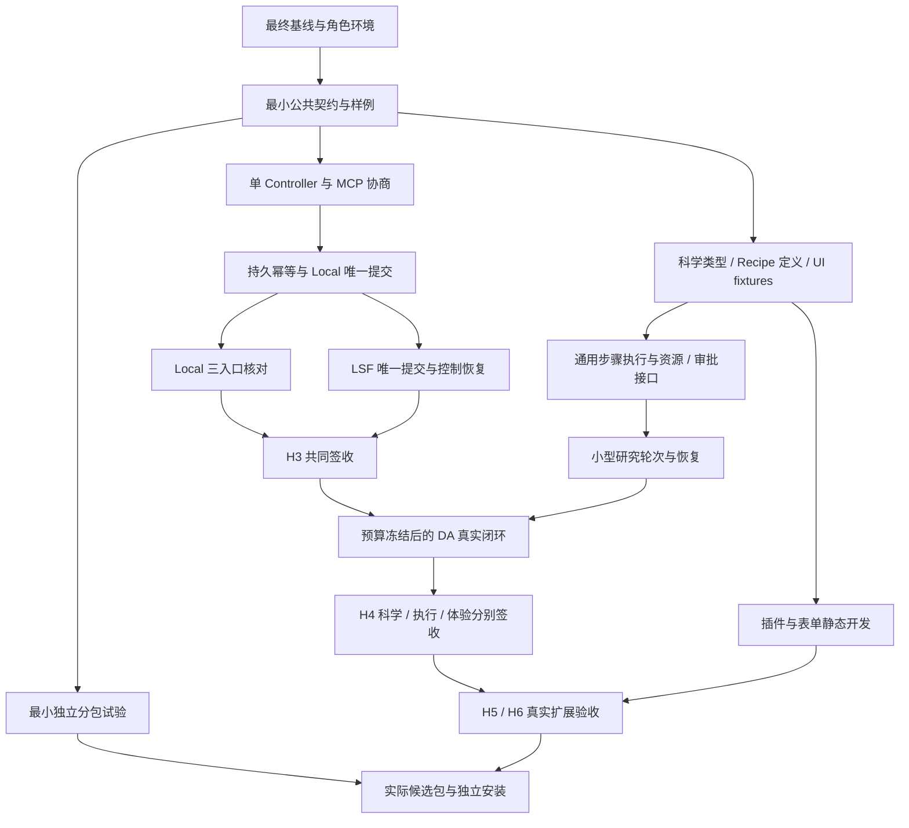

# ACP 2.0 三轨执行计划详细评审报告（第三轮）

**评审日期**：2026-10-21  
**评审性质**：架构、可实施性、跨轨依赖与验收设计审阅  
**评审对象**：主计划及 A/B/C 三份 `.omo` 执行计划的当前文件版本  
**结论**：保留四组分架构和三轨分工；允许推进基线、环境、静态契约及已有明确接口的开发；在相应阶段前关闭本报告列出的关键设计与交接缺口。当前计划尚不足以支持“全程无需新增设计决策”的执行承诺。

本报告承接[第一轮评审](ACP_2.0_Parallel_Plans_Review_20261021.md)和[第二轮复核](ACP_2.0_Parallel_Plans_Review_R2_20261021.md)。已经写入新版计划的修订不再作为原问题重复提出；新增发现按 R3 编号追踪。本报告是评审交付物，不代替原计划，也不表示实现、科学验证或发行已经通过。

## 1. 评审范围、版本与证据边界

### 1.1 评审基线

工作区 HEAD 为 `096cdffe9a3817d8ee443d824830d87ec6e07bc2`，分支为 `feat/frontend-plan1-closure`。工作区存在未提交业务修改及未跟踪规划文档，因此本文的代码判断绑定于**本次读取的工作区文件**，不能仅用 HEAD 代表全部被审内容。正式实施仍应按 B00/B02 重新冻结实际 debug 候选。

| 文档 | 行数 | 实施 todo / 终验 | 本次 SHA-256 |
| --- | ---: | ---: | --- |
| [主计划](../../ACP_2.0_Four_Component_Collaboration_Plan_20261020.md) | 292 | — | `018247dd1df0df9d8ce6fce93d44d0bdf9ee051a565de9d67090d98e73aa3e38` |
| [A 科学轨](../../../.omo/plans/acp2-plan-a-cccp-science.md) | 780 | 51 / 4 | `8410ed69a532add15d2e950e6032e72ae8987d07187c4c34556b15e48e7f5801` |
| [B Runtime 轨](../../../.omo/plans/acp2-parallel-plan-b-runtime.md) | 541 | 33 / 4 | `2bdf7cee901d80c8073aa487050b1efe2efdb1465517f588407c735f5ab9b70f` |
| [C RPH/Workbench 轨](../../../.omo/plans/acp2-plan-c-rph-workbench.md) | 680 | 46 / 4 | `f5ac439b12e319c1d1f3d471106bd44735cebd63b8a5dc2997d8e117966c0cc5` |
| [并行总索引](ACP_2.0_Parallel_Execution_Index_20261020.md) | 248 | — | `f803e36a597bab129d80431de7d413b029770f139117e5d8a385fd4d2e8e95a8` |
| [服务器验收手册](ACP_2.0_MCP_DSH_Server_Acceptance_Runbook_20261020.md) | 542 | — | `91c738a3a3580c264b843c62dbcb78f63a900f5d6eb6c1dad9fcabcad7e1bd66` |

三轨共 130 个实施 todo、12 个终验条目。任务数量不等于工期，也不能据此推算三 Agent 会获得三倍速度。

### 1.2 本次实际检查

- 阅读主计划、三份执行计划、总索引、验收手册及已有两轮评审。
- 对照 CCCP 请求/导出、Runtime plan/worker、MCP 工具白名单、JobManager 提交链、结构解析与打包配置。
- 通过标准库 AST/文本检查确认：CCCP 有 15 个 `TaskKind`；现有平台 `StepKind` 有 6 项；包根尚未声明计划拟补的三个 XtbConstrainedOpt 导出名。
- 计算文件摘要、核对任务数量、人工检查跨轨交付关系。
- 核对 MCP 2025-06-18 生命周期、JSON Schema 2020-12 验证词汇及锁定 DSH revision 的配置。

本次未运行产品 pytest、真实 QC、LSF、模型或浏览器；未复现生产故障；未启动或重启服务。这里发现的设计缺口不等于已经发生的产品故障。本次也没有运行全局依赖图验证器，因此不宣称已经机械证明全部跨轨依赖无环。

### 1.3 发现类型与优先级

| 标记 | 含义 |
| --- | --- |
| 已确认 | 能由当前计划文本、代码或所引规范直接确认 |
| 设计风险 | 尚未实现，现有表述允许不一致实现或条件性等待，需要冻结选择 |
| 待实测 | 缺少当前环境的真实运行证据，不能由静态阅读判定成功率或性能 |
| S0 | 主闭环所需能力或交接缺失；应先形成设计，不能直接进入相应闭环实现/验收 |
| S1 | 在相关实现或阶段冻结前必须修订；不阻塞无依赖工作 |
| S2 | 工程效率、报告一致性与可维护性优化 |

S0/S1 是本报告的风险优先级，与主计划 P0～P5 阶段编号无关。

## 2. 总体可行性与合理性

### 2.1 可以保留的设计

1. **产品职责与代码分层分开定义。** CCCP、CLI/ACR、Workbench、RPH 的职责可以落在现有目录，不需要为产品名称进行目录重命名。
2. **科学事实、平台执行事实、研究决策分别有权威。** CCCP 判科学证据，Runtime 判任务/attempt，RPH 保存问题、假设和决策。这是恢复、审计和结果可信度的基础。
3. **审批不扩充任务状态机。** 以独立持久记录绑定计划，避免滥用 WAITING_REVIEW/resume，符合既有约束。
4. **复用单个真实作业的多轨事实。** A 审科学、B 审执行、C 审消费，同一 TaskRef 不为签收重复提交。
5. **保留独立使用与兼容路径。** CCCP 无平台依赖、Workbench 无模型可用、保留 15 active workflows 与历史 reader，方向正确。
6. **三态结果与证据冻结。** PASS/FAIL/NOT_VERIFIED、scope 分列、run_id 不覆盖、原生工件摘要及候选版本绑定，应继续作为硬门。
7. **先单 Supervisor，后扩展 Agent 角色。** 首期避免多角色互相确认替代确定性科学验证，控制了系统复杂度。

### 2.2 分阶段判断

| 阶段 | 可行性判断 | 主要限制 |
| --- | --- | --- |
| P0 | 可以推进 | 环境归属、公共 Schema、MCP 协商与最早交付关系需落地 |
| P1 | 有明确实现基础 | 幂等短事务/租约、身份准入、Local/LSF 和消费端验收仍是实质工作 |
| P2 | 有条件可行，工作量低估 | 通用 Recipe 编排、研究资源调用面、审批身份与真实 DA 成功预算尚未闭合 |
| P3 | 方向可行 | 插件调用与信任策略要区分；静态开发不宜依赖 DA 科学成功 |
| P4 | 范围基本合理 | 选择性真实工件缺生产者；跨领域与多项目不能互相替代验收 |
| P5 | 目标合理 | 分包可安装性风险暴露太晚，应前移最小验证，正式发行仍留在 P5 |

不建议推翻主方案。当前需要的是修订具体接口、编排能力、交接和验收，而不是再增加一套同规模计划。

### 2.3 上轮问题的当前状态

下表“已修订”仅指计划文本，不能计为产品实测 PASS。

| 上轮主题 | 当前状态 | 本轮处理 |
| --- | --- | --- |
| B25a → A/C 安装 → 最终汇总，解除 C35/B26 等待环 | 已修订 | 保留，不重复提出原环 |
| B04a 最小 Controller、B05 stdio、B07 双适配器检查 | 已修订 | 本轮只补协议协商语义 |
| 最终 debug 基线及实测前的 H2/P1 候选 | 已修订 | 实际工作区仍需按计划冻结 |
| B08 独立写连接与长事务冲突 | 已修订为短事务分阶段协议 | 本轮补租约失效及 DB/目录窗口，见 R3-05 |
| 公共回执单一 Schema、A/C 提前交样例 | 已修订 | 本轮补科学 Schema 语义、writer 一致性检查 |
| LSF 正常完成和取消分配不同 TaskRef | 已修订 | 保留 |
| LSF timeout 来自冻结窗口 | 已修订 | B/C 计算公式仍需完全一致，见第 6 节 |
| DA 3h45m 停止新增计算、预留 15m 导出 | 已修订 | 不再把原问题列为未修复；补实测预算依据 |
| B00/B03 生产全局 dependencies.json | 已写入任务 | 本轮补交付物粒度和遗漏依赖 |
| 模型代理实现、预留、流式 usage、重启规则 | 已写入 T-13 | 本轮补复杂度估算、累计预算与发行边界 |
| F4 最后、完整 lint 基线、项目解释器检查 | 已修订 | 环境实例归属和部分命令仍需收敛 |

## 3. 发现总表

| 编号 | 优先级 / 类型 | 主题 | 主责 | 最迟处理点 |
| --- | --- | --- | --- | --- |
| R3-01 | S0 / 已确认＋设计风险 | 通用 Recipe DAG 与现有执行能力之间有缺口 | B，A 协作 | P2 契约冻结前 |
| R3-02 | S0 / 已确认 | 研究资源、审批请求和恢复的客户端入口不完整 | B/C | P2 接口冻结前 |
| R3-03 | S1 / 已确认＋设计风险 | 整项依赖掩盖中间交付，可能形成条件性等待环 | B 汇总，A/C 修本轨 | H1，持续复核 |
| R3-04 | S1 / 已确认 | 选择性真实工件缺生产者 | A/B/C | P4 开始前 |
| R3-05 | S1 / 设计风险 | 幂等租约 fencing 与 DB/目录/派发窗口未定 | B | B08 实施前 |
| R3-06 | S1 / 设计风险 | 提交前计划摘要、步骤身份、审批摘要未分层 | A/B/C | A-07/B16 冻结前 |
| R3-07 | S1 / 已确认＋设计风险 | Schema 词汇、校验层次及未知字段策略需统一 | B 协调，A/C 各自负责语义 | H1；P3 表单前复验 |
| R3-08 | S1 / 已确认 | MCP 版本不一致与协商失败被混用 | B/C | H2 前 |
| R3-09 | S1 / 已确认＋设计风险 | Playwright 依赖与各 worktree 解释器归属缺口 | B/C，A 消费 | B02/C T-01～08 |
| R3-10 | S1 / 已确认 | 真实验收门不必要地锁住静态开发 | A/B/C | 调度前 |
| R3-11 | S1 / 待实测＋设计风险 | DA 预算缺依据，执行链验证与搜索能力应分开 | A 主责，B/C 协作 | ADR-008/DA 实测前 |
| R3-12 | S1 / 已确认 | CDXML 输入链没有明确交付任务 | A/B/C | 化学输入范围冻结前 |
| R3-13 | S1 / 设计风险 | 模型预算代理复杂度、累计预算及发行边界 | C，B 接预算事实 | 模型实测前，P5 复核 |
| R3-14 | S2 / 已确认＋设计风险 | 验收形式成本偏高，分包风险暴露偏晚 | B 协调，A/C 协作 | P1 起持续处理 |

## 4. 逐项详细评审

### R3-01：不能把通用 Recipe DAG 视为已有执行接口的简单绑定

**位置与证据。** [A-07b](../../../.omo/plans/acp2-plan-a-cccp-science.md#L373)、[A-15a](../../../.omo/plans/acp2-plan-a-cccp-science.md#L503)、[B18](../../../.omo/plans/acp2-parallel-plan-b-runtime.md#L360)。现有 [`StepKind`](../../../src/acp_services/runtime/plan_contracts.py#L69)有 singlepoint/optimize/frequency/scan/thermochemistry/casscf 六项，明确说明 IRC 为独立请求；[`CccpTaskExecutor`](../../../src/acp_services/runtime/worker.py#L313)从一个 `plan.payload` 构造一个 TaskRequest 并调用一个 `run_*`；[`FrozenWorker`](../../../src/acp_services/runtime/worker.py#L1344)遍历步骤做前置校验，随后只调用一次 executor。

**判断。** 现有单任务核心、线性 CalculationPlan、BatchOptimize 与专用 IRC 工作流提供了基础，但静态阅读不能据此认定它们已经承载任意有分支、跨步骤产物引用、双向路径、失败阻断和持久恢复的科学 DAG。B18 把这部分主要描述为“映射/绑定”，明显低估实现量。

**风险。** 执行者可能在 RPH、CCCP Recipe 或新的平台旁路中补临时循环，形成第二编排权威；也可能把多个子任务藏在一个 payload 中，导致预算、取消和恢复不再覆盖实际执行。

**建议修订。** 在既有执行权威内扩展能力，先决定一个研究提交如何表示：一个现有平台任务包含多个持久步骤，或一个平台计划引用关联多个既有任务。若选择后者，必须同步修改 C“唯一 TaskRef”的表述为唯一研究提交/计划引用及其子任务清单，不能新增一个无人管理的引用就声称仍等价。

| 需要冻结的契约 | 必须回答的问题 |
| --- | --- |
| 步骤标识 | 稳定 step_id、TaskKind/Capability、输入/输出类型如何对应 |
| 数据依赖 | 上游产物如何通过 OutputRef 绑定，下游何时取得实际摘要 |
| 执行单位 | 哪个层循环派发，哪个层只做科学计算 |
| 恢复 | 每步完成事实、依赖摘要、发布状态存在哪里，如何复用 |
| 控制 | 整计划取消、运行步骤取消、未开始步骤阻断如何传播 |
| 预算 | TaskRef、步骤、QC invocation、attempt、bsub 如何分别计数 |
| 版本 | 哪些字段属于科学定义，哪些属于 Runtime 冻结执行环境 |

将 B18 拆成可单独消费的“契约转换”“执行接线”“恢复与发布验证”子交付。单任务核心继续位于 CCCP；Runtime 负责通用执行意图和生命周期，不能写反应专属科学算法。

**关闭条件。** 用一个廉价、有限的三步骤实例验证输出传递、必需上游失败阻断、Controller 重启后只恢复未完成步骤、发布失败不重算、取消不产生新步骤；静态/模拟验证与真实运行分别记录。验证通过后再让 DA 消费该执行能力。

### R3-02：P2 研究资源与审批在客户端侧没有完整调用路径

**位置与证据。** [C T-09](../../../.omo/plans/acp2-plan-c-rph-workbench.md#L270)规定 Bridge 底层只调用 DSH 注册的官方 MCP 工具；[T-25](../../../.omo/plans/acp2-plan-c-rph-workbench.md#L430)又要求创建/读取/CAS 更新 B Data 项目资源；[B16](../../../.omo/plans/acp2-parallel-plan-b-runtime.md#L340)、[B18](../../../.omo/plans/acp2-parallel-plan-b-runtime.md#L360)新增审批及资源能力。现有[八工具白名单](../../../src/acp_services/entrypoints/mcp.py#L186)没有显式研究资源写入、审批请求/查询或事件订阅工具。

**判断。** 不是断言八工具绝不可能扩展，而是当前计划未说明新增能力走哪条受控通路、怎样被 RPH 调用。仅交付服务端 API 不等于 Bridge 可达。

**建议修订。** B/C 冻结操作映射表，至少覆盖：

| 业务操作 | 权威 | 需声明的调用入口与边界 |
| --- | --- | --- |
| Proposal/ResearchRecord create/read/CAS | Data | 类型化资源端点；版本、项目、摘要、冲突错误 |
| request/query approval | Runtime | 可由研究客户端请求和查询；不能自行批准 |
| approve/reject/revoke | Runtime | 绑定真实批准者身份及权限，不信任模型声明 |
| task/approval/budget waiting | Runtime | 持久 cursor 或有界查询＋权威快照 |
| research resume | C 研究语义＋B 资源事实 | 通过已授权记录恢复，不以聊天 Session 决定任务事实 |

可采用版本化 MCP 扩展，或明确允许 Bridge 使用注入的受限 HTTP 客户端。两种方式均可行，但必须选择并写清；P1 的“恰好八工具”应限定为该契约版本，而非永久禁止新增业务能力。禁止为省工具数添加任意 shell 或无类型的万能执行接口。

**关闭条件。** 无 Workbench 页面参与时，headless RPH 能创建提案、持久化记录、请求并查询审批；用户通过受权通路批准；客户端断开后恢复同一资源 revision 和任务引用。模型身份尝试替代用户批准时被服务端拒绝。

### R3-03：按整个任务关闭调度，仍可能产生隐性等待

**位置与证据。** [B10/B11](../../../.omo/plans/acp2-parallel-plan-b-runtime.md#L270)、[C T-18～21](../../../.omo/plans/acp2-plan-c-rph-workbench.md#L360)、[B19](../../../.omo/plans/acp2-parallel-plan-b-runtime.md#L370)。B10 的完整验收包含 Workbench 三入口核对；C T-21 要同时等 Local 与 LSF 引用；B11 又以 B10 为前置。

**判断。** 若严格按整项完成派发，并把 B10 的浏览器证明交给完整 T-21，就会出现 `B10 → 等 C T-21 → 等 LSF/B11 → 等 B10`。这是按这些消费关系产生的**条件性等待环**，不是声称三份本轨矩阵自身已经存在显式图环。执行者可以凭中间交付绕开，但计划应明确而非依赖临场解释。

**建议修订。** B10a 先交付 Local TaskRef/原生工件/执行事实；C T-21 拆出 Local 与 LSF 两个可独立验收子结果；B10 的 Local 三入口验证不等待 LSF；B14 统一汇总。B19 同样拆成“事件契约/实现就绪”与“真实 C 恢复验收”，避免 C 必须先消费接口才能完成的证明反过来阻塞接口交付。

全局 ledger 的边应指向交付物，至少包含 producer、consumer、artifact_id、version、digest、readiness 和必要条件。建议 readiness 区分 `contract_ready / implementation_ready / deployed / verified`；AND/OR 关系使用显式结构，不用“11 or 12”“必需项”等自由文本充当机器规则。

**关闭条件。** 同时核对任务正文、矩阵和阶段门；模拟 LSF 不可用时，Local 的三入口验证仍可完成，但 H3 总门保持开放；模拟 C 恢复端尚未交付时，B19 事件接口仍能独立交接。验证器必须拒绝缺生产者、悬空引用和错误阶段顺序，不能只检查手工填入的边是否无环。

### R3-04：选择性实测要求真实双路径工件，但 B/C 没有对应交付

**位置与证据。** [A-25a/b](../../../.omo/plans/acp2-plan-a-cccp-science.md#L663)要求有可区分端点的选择性 fixture，并消费注册的 `cross-domain-live` 实测；[C T-40](../../../.omo/plans/acp2-plan-c-rph-workbench.md#L580)的明确实测项为 NMR 与热化学；[B23](../../../.omo/plans/acp2-parallel-plan-b-runtime.md#L430)也未明确承担选择性双路径计算。

**影响。** A-25b 无法凭现有生产者交付关闭，影响 A-26、A-27，继而影响 C32/B25a 的发行依赖。NMR/热化学成功不能证明竞争反应路径已计算。

**建议修订。** 默认保持已有完整 P4 范围：在现有场景注册表增加明确的 selectivity 子场景，A 提供两条路径的输入与判据，C 作为唯一研究提交驱动，B 执行并导出受权工件，A 审核。无需为此再增加一套独立框架。

若决定延期，则必须同步主计划、A-25/A-26、B/C 场景矩阵及 H6 声明；不能只在某一轨把它改成 NOT_VERIFIED，其他轨仍声称完整完成。

**关闭条件。** 明确提交 owner、run key、预算、两条路径及产物清单；缺任一合格路径时不得给相对偏好；范围内真实正例没有执行时，该交付不能关闭。

### R3-05：短事务协议还需租约 fencing 和跨存储窗口设计

**位置与证据。** [B08](../../../.omo/plans/acp2-parallel-plan-b-runtime.md#L250)已经选择短事务＋可恢复阶段，这是对上一轮问题的有效修订。但 `finalize_idempotent_job(record, claim_id)` 未明确携带/检查当前 owner token；job 入库后采用 staging 目录、持久 dispatch intent 的顺序也仍需具体化。

**风险场景。** 旧请求暂停，租约过期，新请求接管，旧请求恢复后仍继续预留或 finalize。仅有唯一键能阻止重复 job 行，不能自动防止旧执行者分配资源、清理新 owner 目录或派发外部进程。

**建议修订。** 将租约所有权检查变成接口不变量：claim_id＋owner_token/单调 epoch，接管时 CAS 更新；旧 owner 的 finalize、释放、清理和派发请求必须失败。每个可恢复阶段记录足以对账的资源与存储绑定。

数据库事务与目录 rename 不能组成天然的跨系统原子提交。应明确“可派发”的唯一判断，以及以下窗口的恢复动作：

| 窗口 | 必须保证 |
| --- | --- |
| 预留成功，job 尚未入库 | 可按 claim 找到预留，失效后恰好回收一次 |
| job 已提交，目录尚未采用 | poller 不会提前执行；恢复能完成或明确终止分配 |
| 目录已采用，绑定完成事实尚未提交 | 可识别该目录归属，不能重复分配或误清理 |
| job 已提交，dispatch intent 尚未提交 | 持久扫描能补齐意图，或 job 行本身就是定义明确的派发意图 |
| 本地进程/bsub 已发生，响应丢失 | 原 submission 身份对账，禁止盲目重提 |
| 接管清理与旧 owner 恢复并发 | 旧 owner 无写权，清理不会删除新 owner 已采用的资源 |

可把 dispatch outbox 与 job/claim 同事务提交，也可将满足条件的 QUEUED 行定义为唯一持久意图；应选定一种。不要为了修复原子性再新建第二套 job 状态机。

**关闭条件。** 在实际数据库布局上使用两路连接及可暂停执行者做失败注入，除“只有一行 job”外，还证明资源预留、目录、QC/bsub 不重复；已经成功受理的任务不会永久不派发；恢复操作可重复执行。

### R3-06：计划定义、步骤执行身份与审批绑定需要明确分层

**位置与证据。** [A-07b](../../../.omo/plans/acp2-plan-a-cccp-science.md#L373)要求 identity 覆盖依赖工件摘要；[B16](../../../.omo/plans/acp2-parallel-plan-b-runtime.md#L340)在提交前批准冻结计划；[C T-03](../../../.omo/plans/acp2-plan-c-rph-workbench.md#L210)的 Proposal 包含 approval_ref，后续又以 proposal digest 绑定审批。

**设计缺口。** 下游步骤使用优化/IRC 等步骤新产生的工件，提交前没有全部内容摘要。若把它们都要求纳入一次性审批前身份，计划无法冻结；若执行中随意重写摘要，审批和恢复又失去约束。

**建议修订。** 在现有 plan_identity/step_identity 体系内明确两阶段物化，不新增相互竞争的恢复真相：

| 身份/摘要 | 冻结内容 | 冻结时点 |
| --- | --- | --- |
| 科学计划定义 | Recipe、初始输入、方法、版本、参数、依赖选择器、允许的有限替代范围 | 预检/审批前 |
| 步骤执行身份 | 实际上游字节摘要、物化参数、执行实现版本 | 步骤派发前 |
| 审批绑定 | 科学计划定义摘要＋项目＋预算＋允许变更范围 | 用户批准时 |

`proposal_digest` 应按明确的语义字段投影计算，排除 approval_ref、审批状态、更新时间等可变管理字段；后续正常追加 TaskRef/evidence ref 也不应偷偷改变此前批准的科学定义。未知科学字段不得被静默忽略后仍复用结果。

**关闭条件。** 同一计划正常生成上游产物后能够继续，无须为每个派生字节重新批准；改方法/映射/初始输入必须使旧批准失效；改上游实际字节必须改变对应步骤身份；展示名称变化不改变科学身份；摘要规范应包含字段顺序、数值和单位归一化规则。

### R3-07：Schema 需要统一词汇与校验层次，而不只是统一文件名称

**位置与证据。** A todo 4 使用标准库受限断言助手；B01/B03 要求唯一校验器、跨文件引用及版本兼容；[C T-38](../../../.omo/plans/acp2-plan-c-rph-workbench.md#L560)声明支持 `object/array/enum/required/range/nullable`。A 历史类型要求保留未知字段，B 又要求严格拒绝未知请求字段。

**判断。** 原则可以兼容，但当前还没有统一的可执行语义。`range`、`nullable` 不是 JSON Schema 2020-12 的标准验证关键词；范围可使用 minimum/maximum，可空类型可用包含 null 的类型等标准结构。若保留自定义字段，应作为明确的 UI 扩展，不能期待通用校验器执行其业务约束。[JSON Schema 验证词汇](https://json-schema.org/draft/2020-12/json-schema-validation)

**建议修订。** H1 冻结以下三层及其 owner：

| 层 | 负责内容 | 不能替代的内容 |
| --- | --- | --- |
| JSON 结构 | 类型、required、enum、数值边界、数组/对象、引用解析 | 电荷守恒、Provider 是否安装、权限 |
| CCCP 科学语义 | 映射/角色/方法/状态/单位/科学适用性 | 平台授权和预算 |
| Runtime 平台约束 | 项目、权限、启用策略、资源和预算 | 科学结论是否成立 |

capability 重复 ID 属于集合/注册表检查，已安装 Provider 是否可用属于环境检查；不能以单文档 schema fixture 全绿代替它们。

未知字段策略按操作冻结：新执行请求拒绝不支持的执行字段；历史读取保留未知字段但不自动获得执行/恢复资格；未知 major version 不进入执行；允许的额外元数据放在命名空间扩展中。UI 支持子集与完整服务端验证可以不同，但 UI 必须显式阻止它无法正确表达的必需结构。

不必为满足 Schema 测试强制给科学节点安装新依赖。可由 B 管理控制端/开发依赖，CCCP 保持纯类型与科学校验；若选择自写受限校验器，必须声明支持关键词并拒绝未支持约束，避免“生成完整 JSON Schema、实际只检查少数字段”。

**关闭条件。** 同一组 corpus 分别经科学类型、服务端请求校验和 C 表单消费；边界值、可空、未知执行字段、旧版只读、跨文件引用、重复 ID 各有明确判定。至少一个实际 A descriptor 经 B discovery、C 表单、B 校验进入 CCCP，往返科学参数不变。

### R3-08：MCP 请求版本不同，不等于双方无法协商

**位置与证据。** [B05](../../../.omo/plans/acp2-parallel-plan-b-runtime.md#L220)、C T-11 的负向场景包含向服务端发送不支持版本并期待拒绝。MCP 生命周期规范要求服务端在不支持请求版本时返回自己支持的版本；客户端不支持返回版本时才应断开。[MCP 2025-06-18 生命周期](https://modelcontextprotocol.io/specification/2025-06-18/basic/lifecycle)

**风险。** 官方客户端可能先发送较新的首选版本，但仍支持服务端版本。把版本字符串不相等一律视为不兼容，会错误拒绝可兼容客户端。保留显式失败测试是正确的，失败条件应是“没有共同支持版本”。

**建议修订。** B05/C T-11 共同冻结版本支持集合及以下矩阵：

| 场景 | 预期 |
| --- | --- |
| 客户端请求版本受支持 | 服务端返回同版本，完成初始化 |
| 客户端首选版本不同，但支持服务端返回版本 | 正常协商，回执记录实际版本 |
| 客户端不支持服务端可用版本 | 明确断开/失败，不执行后续工具 |
| 未完成初始化即调用业务工具 | 按冻结生命周期规则拒绝或限制，不隐式初始化业务状态 |
| notification、EOF、断线 | 不伪造普通 request response；适配器结束不等于取消已提交计算 |

锁定 DSH revision 的 package.json 确认了 `pnpm@11.28.5` 和 `node: ^22.19.0 || >=24.0.0`，当前工具链选择有源码依据，但不构成真实插件兼容证明。[冻结版 DSH 配置](https://raw.githubusercontent.com/deepseek-ai/deepseek-harness/687f282e8625c6b8d11ff58211a90524be2e4317/package.json)

**关闭条件。** 独立协议探针及锁定的真实 DSH 客户端分别覆盖兼容与不兼容组合；stdout/stderr 分离；发现不新增任务；实际协商版本写入公共回执。需要改 handler 时同步 ADR-006、矩阵和测试。

### R3-09：浏览器依赖和各 worktree 的解释器需要独立归属

**位置与证据。** [B02](../../../.omo/plans/acp2-parallel-plan-b-runtime.md#L190)安装 `.[dev,api,remote]`；[C T-08](../../../.omo/plans/acp2-plan-c-rph-workbench.md#L260)直接在 B venv 运行 `python -m playwright`。当前 [pyproject.toml](../../../pyproject.toml#L41)把 Playwright 放在独立 browser extra；服务器手册仍写“随 dev 依赖安装”。

第二个问题是 A/C 要求开发测试导入各自 worktree，而又共用 B 提供的 `$ACP2_PYTHON`。一个 venv 中的一份 editable install 不会仅因 cwd 改变就切换到另一个 checkout。只打印路径、没有检查解析位置，也不足以证明测试了对应代码。

**建议修订。** B 明确安装 browser extra 到浏览器验收环境，并同步手册。按用途分别登记解释器，允许复用内容相同的依赖缓存，但不能让 import 来源含糊：

| 用途 | 建议变量 | 应导入的代码 |
| --- | --- | --- |
| A 开发测试 | ACP2_A_PYTHON | A worktree |
| B 开发测试 | ACP2_B_PYTHON | B worktree |
| C Python Harness 开发测试 | ACP2_C_PYTHON | C worktree |
| 冻结真实联调 | ACP2_INTEGRATION_PYTHON | 冻结集成候选 |
| wheel 独立安装 | 由安装测试记录单独解释器路径 | site-packages，不能依赖源码目录 |

变量名可以调整，但环境角色必须明确。每次执行记录 interpreter、cwd、模块 `__file__`、candidate 与 dependency digest；通过实际断言校验路径。

C 的 `c_accept()` 当前固定从 C 源码路径取 Harness，而 live 声明又强调冻结集成候选。若允许独立 Harness revision，必须明确并记录实际组合；若要求全部来自集成候选，wrapper 必须切换到对应路径。

**关闭条件。** 新 shell 可复现每个角色的 import 来源；故意使用 B 的 editable venv 跑 A 开发代码时 guard 拒绝；浏览器环境能安装和启动 Chromium；wheel probe 在仓库外运行且不受 PYTHONPATH 或旧 editable 安装影响。

### R3-10：阶段验收严格，不要求所有静态开发等待真实科学成功

**位置与证据。** A todo 22 的静态驻点验证器、todo 24 的快照消费者均依赖 todo 21 的真实单点；[A todo 38](../../../.omo/plans/acp2-plan-a-cccp-science.md#L593)的插件 manifest 依赖 todo 37/H4；C T-31 证据视图依赖 T-30 真实研究轮次。它们与“缺环境时继续独立工作”的总体原则存在张力。

**影响。** 软件许可、LSF 队列或 DA 正例不足，可能阻断并不依赖这些事实的类型、UI、插件和打包开发。调度上的串行化会吞掉三轨协作收益。

**建议修订。** 对同一任务允许区分 `contract_ready → implementation_ready → integration_ready → verified`。例如科学验证器用真实格式的固定输出/构造负例完成实现与单元验证，随后再用注册真实任务证明科学链；C 证据视图先消费冻结报告，真实页面联调后单独签收。

| 原强依赖 | 建议替换 |
| --- | --- |
| 静态验证器必须等真实 singlepoint | 依赖 TaskResult/频率产品契约；真实验收继续等单点/optfreq 工件 |
| artifact consumer 必须等真实运行 | 先用正负快照开发；live 验证依赖 B 导出 |
| 插件契约必须等 DA 科学成功 | 依赖 capability/registry/任务边界，H5 关闭仍按总阶段纪律 |
| 证据 UI 实现必须等模型研究成功 | 依赖 EvidenceReport/ViewModel；live 行等真实研究 |

**关闭条件。** 模拟一个外部环境缺失，相关 live 行诚实地保持 NOT_VERIFIED；无该事实依赖的实现仍可推进。不能通过解耦开发门把未执行科学行改成 PASS，也不能提前宣布整体阶段关闭。

### R3-11：DA 首例应分别证明执行链和研究搜索能力

**位置与证据。** A-14～20、B20、C T-34/35 已明确 TS、模式、双向 IRC、端点与能量可比性，且保留 inconclusive。C 仍以候选 TS≤3、总墙钟≤4h 作为默认上限，当前计划未提供这一上限可取得合格正例的实测依据。

**判断。** 四小时可以作为明确资源约束，不能直接作为成功交付工期。静态阅读无法判断指定方法、起始几何和节点资源下的成功率。

**建议修订。** ADR-008 明确两种能力验证：

1. **执行/验证链验证**：使用来源清楚、事先冻结的起始几何或候选，验证 TS 优化、频率、双向 IRC、端点与热化学贯通。
2. **研究规划/候选搜索验证**：从声明支持的用户输入开始，RPH 在限定预算内提出候选并消费证据决定停止/修订。

前者不等于自动搜索能力；后者失败时不能事后替换成已知 TS 再称为搜索成功。预先使用已知候选是合理测试设计，但应标明范围与来源。

先运行预算内代表性步骤以形成耗时与资源依据，再冻结 full-chain 的预算。说明 Local/LSF 选择、排队是否计入总墙钟、跨 phase 计时基点、在途步骤停止策略和导出窗口。3h45m 只停止新增步骤的规则已正确修订，应保留；另需说明正在运行的步骤如何在总预算内停止或保留引用对账。

科学 validator 的命题也应更精确。A-11a 中“未收敛 → refuted”可以用于“本次优化已收敛”这一执行/数值命题，但不能无条件用于“该区域不存在目标驻点”等更强命题。缺计算证据、数值未收敛、目标端点确实错误应分别有状态规则。

**关闭条件。** ADR-008 写清输入、步骤、方法、参考态、判据、成功命题、失败分类、资源依据和明确不支持的结论；真实正例不能由“正确显示 inconclusive”的负例替代；预算不足时保留实际工件和开放的 H4，不伪造科学成功。

### R3-12：CDXML 输入链需要具体 owner 或明确阶段范围

**位置与证据。** 主计划把 ChemDraw/CDXML 列为化学研究入口；[C T-23](../../../.omo/plans/acp2-plan-c-rph-workbench.md#L410)要求 CDXML 走 B 的公开解析服务，没有服务则子行 NOT_VERIFIED。当前[结构解析分发](../../../src/cccp/analysis/structure/parsers.py#L273)没有 CDXML 分支；A/B 也没有清楚指认的 CDXML 交付任务。

**判断。** 这里不是要求首期支持所有 ChemDraw 特性，而是当前“消费者需要、生产者未安排”的范围缺口。

**建议修订。** A 负责受支持格式的结构/反应语义与转换限制；B 提供上传、限额、受权解析入口和结构化错误；C 展示预览与歧义确认。冻结是否只支持结构、是否支持反应箭头/多组分/原子映射/立体标记，以及不可表达项如何拒绝。

若首期确定使用 MOL/SDF/SMILES，应同步主计划、C 任务和场景矩阵，将 CDXML 明确排入后续范围。单写 NOT_VERIFIED 不能同时支持“ChemDraw 起点已经完整交付”的产品声明。

**关闭条件。** 已声明支持的输入通过真实解析入口形成可追溯结构引用；失败和信息丢失均显式显示；原子标签、映射及立体不被静默改写；格式不支持时不产生空结构任务。

### R3-13：模型预算代理是服务开发，累计预算与发行边界仍需补齐

**位置与证据。** [C T-13](../../../.omo/plans/acp2-plan-c-rph-workbench.md#L310)现在已经要求实现代理、流式/非流式 usage、预留、重启与错误结算，上一轮“只写启用”的问题已修订。但其执行类别仍是“配置＋记录”；C 预算多数按单场景，B17 则明确不代理模型 tokens，并把模型额度强制能力单独标记。

**风险。** 代理包含协议、并发、流式中断、持久化和费用核对，工作量不能按安装命令估计。更换 run_id 或重跑同一场景如果重置预算，单场景不超限仍可能使整个验收批次不断支出。测试代理存在也不能证明发行的 RPH 包具有同等能力。

**建议修订。** 将 T-13 拆为代理实现/自测与真实模型贯通两个子交付，明确支持哪种上游协议；“兼容 base URL”并不自动覆盖全部模型 Provider 的协议差异。预算使用独立于 run_id 的持久 batch/scenario 身份，重试和重启继承剩余额度；正式产品的模型预算权威与验收批次费用控制分别标注，不建立第二份科学资源账本。

| 预算对象 | 必须声明 |
| --- | --- |
| 请求次数 | 已发起、上游失败、客户端重试如何计数 |
| 输入 tokens | 预留估算、支持 tokenizer/Provider 的范围及误差策略 |
| 输出 tokens | 发起前限制，流式中断和实际 usage 对账 |
| 缺 usage | 保守结算或待对账，禁止伪造精确数值 |
| 验收批次 | 全部场景、run_id 和重跑的累计上限 |
| 产品发行 | 代理是否随 RPH 发行；若不发行，不能宣称具备同等预算 enforcement |

证据根接近磁盘上限时停止新增运行，保留已引用的原生输出和回执；仅清理未被引用的临时中间产物。只停止新模型请求不足以处理已运行科学任务，清理仍走 B 的权威控制与停止确认。

**关闭条件。** 受控上游验证单次及累计上限、流式/非流式、中断、缺 usage 和重启；真实 Web/headless 路由各有证据；第 13 次请求被拒作为预期负测通过，不能把拒绝本身算作已超支；改变 run_id 无法绕过累计额度。发行说明准确区分已强制、仅记录和未验证能力。

### R3-14：减少形式验收成本，提前暴露分包风险

**位置与证据。** 三轨共有 130 个实施 todo，很多任务同时要求独立回执、负向修改、文档、提交和交接。C 若干任务以最少测试数量或逐守卫 mutant 检查验收；B 部分命令仍有 `...`。另一方面，[A-27a](../../../.omo/plans/acp2-plan-a-cccp-science.md#L693)、[B25a](../../../.omo/plans/acp2-parallel-plan-b-runtime.md#L460)才安排实质分包。

**判断。** 完整覆盖和真证据是优点，但任务数量、测试数量、文件齐全不能代替行为正确。打包是主计划独立组分承诺的基础，直到 P5 才验证会造成后期返工。

**建议修订。**

- 按关键行为矩阵验收，测试数量仅作零执行保护，不作质量目标。
- 对权限、幂等、科学误判和陈旧结果采用重点故障/变异验证；普通文档或简单字段不要求同等成本。
- 单元/契约测试保留允许的 mocks；live 行要求可核验真实执行来源。Harness 不能仅靠字符串扫描证明“绝无 mock”。
- 公共回执 validator、摘要、脱敏和不可覆盖目录由 B 单写；A/C 复用，避免三套同名不同义实现。
- 阶段汇总引用原始记录；不因生成一份文档就重复执行昂贵作业。
- 冻结计划时将未定义命令、`...` 和未命名 validator 替换为实际可执行入口；不能把语法示例计为已可运行。
- 对修改影响做显式映射，允许复用未变化代码/依赖/配置/输入/validator 的证据；最终 HEAD 不必等于所有历史原始回执的 SHA，但证据适用关系必须可核验。

P0/P1 提前构建最小 CCCP wheel、worker role、Web/static 安装样本，确认分发与 import 边界；正式 release、完整资产和独立复现仍保留在 P5。

| 早期打包检查 | 防止的后期返工 |
| --- | --- |
| 各 distribution 拥有的顶层包和文件清单 | worker/Web/科学包互相覆盖相同文件 |
| 包间依赖及版本约束 | 靠开发 checkout 才能 import |
| 安装、升级、卸载组合 | 卸载一包破坏另一包仍需的文件 |
| NMR 资产、notice、静态资源定位 | 源码运行正常，wheel 缺文件 |
| 无软件时的 import/discovery | 把外部 QC 二进制变成安装前置 |

**关闭条件。** 一个最小独立安装样本在仓库外运行，import 路径来自安装包；测试、开发和真实验收的证据种类清楚；关键不变量覆盖不减少；昂贵复跑有变更依据。不得以减少成本为由放宽 Services/架构/恢复硬门。

## 5. 按轨道的可实施性与修订要求

### 5.1 A：科学轨

**可行性。** 现有 15 个 TaskKind、共享科学对象、解析/频率/TS mode 模块及任务核心使本轨有较好的增量基础。计划明确修复 XtbConstrainedOpt 的包根导出缺口，该项与本次静态检查一致。主要新增工作是科学协议与确定性验证，不是重做 QC 接口。

**主要风险。** Capability/Recipe 的语义比枚举字段复杂；可组合 DAG 的输入引用不能都提前变成普通文件路径；EvidenceReport 的状态必须绑定命题；历史读取兼容不能自动获得恢复复用资格。DA 和选择性成功率不可由类型测试保证。

| 原任务 | 建议修订 | 交给其他轨的最小产物 |
| --- | --- | --- |
| A-01～03 | 区分结构/科学语义/环境校验；冻结历史与执行版本规则 | Schema＋正负 corpus＋错误分类 |
| A-04 | 明确不可变容器与历史未知字段；保持纯类型 import 边界 | 可序列化类型和历史 adapter |
| A-05/06 | 分别描述 compute 与 pure-analysis 调用语义，保持已有任务唯一实现 | Capability → TaskKind/分析处理器映射 |
| A-07 | 增加 OutputRef、物化时机、定义摘要与步骤身份边界 | B 可消费的有限 DAG 契约 |
| A-11/A-12 | 静态实现与 live 验证分开依赖 | verifier＋构造负例＋快照 consumer |
| A-14～16 | DA 范围/判据先于计算；把执行链证明与候选搜索证明分开 | Fixture、判据、预算估算输入 |
| A-21～23 | metadata-only、显式 enable、版本/验证范围分开；静态部分不等 H4 | 外部插件样本和兼容矩阵 |
| A-25 | 指定双路径工件生产者及预算 | selectivity 子场景输入、判据和输出要求 |
| A-27 | 最小包规格前移，P5 保留最终完整验收 | 包拥有文件清单、依赖/资产列表 |

建议 A 的主要评审精力投入科学身份、适用性、失败分类与真实产物验证；不要把大量工作耗在复制 B 的回执 writer 或平台授权逻辑上。

### 5.2 B：Runtime 与集成轨

**可行性。** 当前 Store/CAS、worker receipt、prepare/read、events/outbox 和 identity/admission 模块为接线提供基础。单 Controller＋薄 stdio 适配器是合理方案。

**主要风险。** 模块存在不等于默认入口已接通；B 同时承担共享文件、协议、持久幂等、准入、执行编排、真实 LSF、迁移和打包，关键路径最长。不能把 B18 当成几行 DTO 映射，也不能将 B08 事务 correctness 降为“unique constraint 测试通过”。

| 原任务 | 建议修订 | 交接要求 |
| --- | --- | --- |
| B00/B02 | 一个最终 source candidate；角色化 venv；browser extra；环境及源码来源核验 | A/C 无需猜测的基线/环境引用 |
| B01/B03 | 共享 validator 实现与作用范围；P2 业务接口表；依赖 readiness | 版本化样例、错误与实际调用入口 |
| B05 | 正确的协议协商及 lifecycle 测试 | 支持集合、launch、真实 probe 结果 |
| B08/B09 | fencing、跨存储恢复、dispatch eligibility、预留与准入的单一权威 | 状态/恢复表与两路连接故障证据 |
| B10/B11/B14 | Local/LSF 中间交付分开，三入口验证不形成反向等待 | 每 backend 的唯一 TaskRef/manifest |
| B16/B17 | 审批绑定语义、批准者权限、累计预算与预留结算 | 可供 C 使用的服务接口及拒绝场景 |
| B18 | 显式交付 Recipe 执行能力、资源 CAS 和注册/发布接口 | 独立可消费子交付，不等整条 DA |
| B19 | 事件就绪与 C live 复验分开 | cursor/快照/撤权语义 |
| B23 | 纳入选择性工件，或同步缩小范围 | 明确生产者，不只列跨域类别 |
| B25 | 早期最小打包验证；最终正式包按既定顺序汇总 | 文件归属与独立安装事实 |

共享文件单写者制度应保留，但对共享修改请求建立清晰的接收、最早可消费交付和下次集成窗口。A/C 可以提供精确 patch，B 负责审查与应用，不必让 B 从描述重新实现领域代码。

### 5.3 C：体验与 RPH 轨

**可行性。** 官方 MCP client＋薄科研语义 Bridge、既有 Client/ResourceStore＋增量 Feature 的路线合理。Manual Research 与 Agent-Assisted 分开，也符合主计划独立性目标。

**主要风险。** C 同时横跨 Node 工具链、DSH profile、模型代理、研究持久化、前端与浏览器，实际是两个产品面的工作。尤其 T-13、T-25、T-32 并非简单配置步骤；MCP-only 限制与 P2 新资源接口需要协调。

| 原任务 | 建议修订 | 需要 A/B 先提供 |
| --- | --- | --- |
| T-01/04/08 | 明确环境 owner、解释器来源和浏览器依赖；版本变更更新统一 lock | B 环境角色、最终基线 |
| T-02/03/09 | 补 P2 调用映射和 digest 语义；不复制科学/平台权威 | A 科学 Schema，B 资源与审批 API |
| T-11/12 | 正确协商；“八工具”限定于版本；实际工具全集检查保留 | B launch、协议支持集合 |
| T-13 | 拆代理实现与真实模型贯通；提高工作量等级 | 受限模型配置及批次预算身份 |
| T-17/21 | 真实浏览器前置显式登记；Local/LSF 分开签收 | B 单任务引用、A 描述 |
| T-23/24 | CDXML scope 与 producer 明确，信息缺失不静默补齐 | A parser/语义，B 公开入口 |
| T-25～30 | 经明确 API 写资源、请求审批、等待证据 | B Data CAS、审批、事件/查询 |
| T-31 | fixture 驱动 UI 先行，真实记录到达后签收 | A EvidenceReport、B 投影 |
| T-32/33 | 用持久记录恢复，不依赖 B19 全项验收已结束 | 已可消费的事件与快照接口 |
| T-40 | 增加选择性子场景的执行责任或明确不承担 | A 双路径 fixture，B 执行窗口 |
| T-43～46 | 区分验收脚本与发行能力；安装复核来自 B25a | 实际包、版本、模型预算支持声明 |

保留模型不可直接执行 QC、工具错误不得包装成功、ResourceStore 单写与 ACV 不调 API 等边界。页面完成的判据应是科研用户能理解输入、执行状态、证据和限制，而非把全部内部实现状态原样暴露给用户。

## 6. 需要同步清理的细节与残留矛盾

这些项目通常不需要独立大型任务，可随相关契约修订一并完成。

| 编号 | 当前表述 | 建议处理 |
| --- | --- | --- |
| D01 | A/B/C 均有通用文字宣称验证无人工干预，但 B26a/C T-36/T-45 又要求独立执行者，DA 还有真实用户审批 | 区分自动测试、独立复现和用户批准；提前指定角色，不能由作者复跑后冒充独立验证 |
| D02 | C T-04 允许 engines 不匹配时重新选版本，但验收仍硬断言固定 Node/pnpm 值 | 实际版本来自批准的 compatibility lock；例外变更同步 lock、命令及样例，不只改安装步骤 |
| D03 | C T-10 的 Blocks 包含 T-11，但 T-11 Depends on/Blocked by 未列 T-10 | 将正文、矩阵和机械 ledger 同步；若 T-10 非硬前置，删去相反描述 |
| D04 | C T-17 要执行 manual-browser-fixtures，却没有明确依赖 Chromium 就绪的 T-08 | fixture 可替代数据，不能替代浏览器；执行真实页面前显式依赖环境就绪 |
| D05 | B 使用四段 LSF 时间＋margin_seconds，C 使用四段之和×1.1 | 用同一总期限规则或由 B 直接发布派生值；定义多格矩阵串行/并行时总场景 timeout |
| D06 | C 总预算文字把“触达上限”判 FAIL，T-35 则允许恰好用满且操作完成时 PASS | 全局统一：超过上限或必需操作未完成才失败；预期拒绝负测单独判定 |
| D07 | C 泛化 Bridge 负测要求缺 project/attempt/generation 一律拒绝 | 按操作类型定义必填；discovery 不应凭空要求任务标识，submit 前也没有结果 generation |
| D08 | C T-12 把缺 ACP_RUN_ROOT 设为发现必然失败 | MCP 是 HTTP 适配器时，应检查必需 controller/identity/config；不能为了负测而让适配器重新拥有本地 run root |
| D09 | B26b 写最终 SHA 匹配全部证据，早期段又允许跨候选复用 | 区分 source candidate、client/harness revision、证据生成 revision 和复用适用映射；汇总文档提交不能触发无限重跑 |
| D10 | A-03a provenance 要求引用结果均有 method/software；P3 又支持纯 converter/validator | method 对需要电子结构方法的结果必填；纯分析产物使用适用的算法/version/input digest，不虚填量化方法 |
| D11 | A-24b 正文说归一化权重，验收又要求未归一化权重拒绝 | 明确 API 接收的是原始权重还是归一化权重；拒绝规则、容差与转换 provenance 一致 |
| D12 | 插件 manifest/trust 与“只读分析不能启动进程”容易被解释成安全隔离保证 | 描述、启用策略和进程隔离分别验收；in-process 插件不是 sandbox，第三方执行环境约束由 B 明确 |

D12 不要求首期构建通用沙箱。可将首期插件执行范围限定为明确受信任插件；不能同时宣称允许任意不可信代码且只靠 metadata 实现隔离。

## 7. 建议的推进顺序与关键路径

### 7.1 保留三轨，按中间交付解耦

以下是建议的交付关系，不代表这些能力已经实现：

阶段关闭顺序仍按 H0～H7；图中允许无真实运行依赖的契约、UI、插件与打包预研提前推进。B 仍负责集成 Controller 和真实资源窗口，不产生第二执行 authority。

### 7.2 修订批次

| 批次 | 修订内容 | 完成后可推进 |
| --- | --- | --- |
| 开工准备 | 最终基线、各轨解释器、browser extra、产物依赖 ledger | 静态契约、环境和组件开发 |
| H1 契约冻结 | R3-02/06/07；P2 入口及定义/执行身份；公共回执 writer 对照 | A/B/C 消费同一协议 |
| H2 入口联调 | R3-08/09；真实 DSH、版本协商和工具集合 | 受控模型与平台基础调用 |
| B08 实施前 | R3-05 的租约、事务、目录及派发恢复表 | 持久幂等、准入与故障注入 |
| H3 集成 | R3-03 Local/LSF 子交付；同任务真实读取 | 基础执行闭环签收 |
| P2 实测前 | R3-01/11/12；最小 DAG、研究资源、科学输入和 DA 预算 | 研究循环与 DA 正例/负例 |
| P3/P4 | R3-04、插件边界、选择性 producer、多项目与跨域矩阵 | 扩展性和跨领域真实验收 |
| P5 | R3-13/14；包归属、预算能力声明、干净安装和独立复现 | 有范围边界的发行候选 |

R3-10 的开发门解耦应随调度修订立即处理；R3-14 的最小打包试验可在 P0/P1 并行进行。

### 7.3 工作量与进度判断

不建议在缺少 P0 真实兼容性和 DA 代表性运行证据时给出精确总工时。已有 debug 耗时、todo 数量和测试条数均不能直接用于估算 ACP 2.0。

| 工作块 | 相对复杂度 | 估算前需要的证据 |
| --- | --- | --- |
| Node/DSH/Chromium 隔离安装 | 中 | 冻结源码可构建、系统依赖可满足 |
| stdio 协议和 CLI/HTTP 适配 | 中到高 | 真实客户端协商、错误/断线路径 |
| 持久幂等、准入、审批与累计预算 | 高 | 实际连接/存储布局、故障窗口验证 |
| Recipe DAG 执行与恢复 | 高 | 表示方式冻结、三步骤试验 |
| 科学验证器与 DA 候选搜索 | 高且受环境影响 | 真实原生输出、代表性耗时及正例可得性 |
| 模型预算代理与会话恢复 | 高 | 上游协议/usage 行为、持久记录路径 |
| 前端增量 Feature | 中 | A/B 稳定契约、浏览器环境 |
| 独立发行与安装 | 中到高 | 最小 wheel/worker/Web 包先行验证 |

优先消除 B 的串行等待，而非增加同时写共享文件的执行者。集成窗口应有明确候选、输入工件和结束条件；等待队列时推进静态工作，不做频繁的无变化全量复验。

## 8. 关闭本轮评审的可核验条件

修订应落回原三份计划、并行总索引和必要的 ADR/契约草案。以下是复审检查表，不是本次已经完成的实施任务：

- [ ] R3-01：明确 Recipe 平台表示、执行 owner、输入物化、恢复和取消；B18 有可消费子交付。
- [ ] R3-02：研究资源、审批请求/查询/人类批准、等待与恢复均有明确客户端调用入口。
- [ ] R3-03：Local/LSF 签收拆分；跨轨 ledger 使用产物 readiness；正文消费要求与矩阵一致。
- [ ] R3-04：选择性双路径工件有唯一生产者、预算和交付清单，或全部相关范围同步延期。
- [ ] R3-05：fencing、DB/目录/派发窗口和恢复动作写入 B08 验收。
- [ ] R3-06：科学定义摘要、物化步骤身份与审批摘要投影明确，不产生循环绑定。
- [ ] R3-07：Schema 方言、UI 子集、科学/平台语义、未知字段规则及共同 corpus 一致。
- [ ] R3-08：MCP 测试区分首选版本不同与无共同版本，保留明确失败场景。
- [ ] R3-09：browser 依赖有 owner；各环境 import 来源可以断言，不靠 cwd 推测。
- [ ] R3-10：外部环境或科学正例未就绪时，独立静态任务可继续，live 门不被放宽。
- [ ] R3-11：ADR-008 区分执行链与搜索能力，预算由代表性步骤提供依据。
- [ ] R3-12：CDXML 支持范围和生产者明确，产品声明与实际范围一致。
- [ ] R3-13：模型代理实现量、批次累计预算、重跑规则及发行能力边界明确。
- [ ] R3-14：共同证据实现不重复；关键行为替代凑测试数；最小分包验证前移。
- [ ] D01～D12：逐条确认已修订、适用或有明确理由不采纳。

计划修订复审时可以核验上述设计是否明确；实现验收仍必须另查真实命令、工件、失败注入和候选绑定。两种关闭不能互相替代。

## 9. 核心证据索引与重审方法

### 9.1 关键代码文件摘要

这些摘要用于辨识本次静态判断对应的工作区字节，不把未提交改动冒充冻结发布候选。

| 文件 | 本次 SHA-256 |
| --- | --- |
| [runtime/worker.py](../../../src/acp_services/runtime/worker.py) | `5b8e5d00ecbbc8e26385f6fa9c693986f642b5ac10f416092cca0722164b68b9` |
| [runtime/plan_contracts.py](../../../src/acp_services/runtime/plan_contracts.py) | `2bbca71a78829816dcdb63c34608d5b56628b263132b5ebf2400f82720c6f112` |
| [entrypoints/mcp.py](../../../src/acp_services/entrypoints/mcp.py) | `0bcc34ad249b2f6e2fa60208f8cb966feec3ca25fbae44343a5f80bba50ed184` |
| [scheduler/manager.py](../../../src/acp/scheduler/manager.py) | `ab6978b275f366ec1ce1e07401b5dff90459ed549edf33df881e8a3274e4b492` |
| [structure/parsers.py](../../../src/cccp/analysis/structure/parsers.py) | `a4b1817bb6785b911bfce55619b62b7317b765fbc8979146580e19ac0131f7ff` |
| [pyproject.toml](../../../pyproject.toml) | `4d40cf842a31b9d04d18136a24086418422a17019b1bb90daa1bfc774423bbfb` |

### 9.2 下轮复审应提交的材料

1. 三份原计划与总索引的新摘要及差异；用 R3 编号标明采纳位置，不只写“已按建议修改”。
2. 产物级依赖清单：至少覆盖 Local/LSF、B18/C 研究资源、B19/C 恢复、选择性工件与 P5 安装交接。
3. Recipe 执行表示、身份/审批绑定、B08 恢复表三个小范围设计决定；复用既有 ADR，不另造平行设计权威。
4. P2 操作到 MCP/HTTP/CLI 的映射及正负样例，明确人类批准和模型请求的权限差异。
5. 角色环境清单、Schema corpus 规则、MCP 兼容矩阵和早期包验证方案。

上述材料足以判断计划是否消除了主要执行歧义。只有实施后的真实回执，才能证明 Local/LSF/DSH/DA 和独立发行已经完成。
