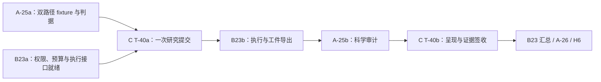

# ACP 2.0 三轨执行计划复评报告（第四轮）

**评审日期**：2026-10-22  
**评审对象**：修改后的 A/B/C 三份 `.omo` 执行计划，并对照主计划、总索引及服务器验收手册  
**总体结论**：架构方向和大部分 R3 修订可以接受；当前仍应判为“有条件通过”，尚不能按全文无歧义地自动推进 H0—H7。最明确的阻塞是 P4 选择性验证的跨轨依赖环；其余主要是公共契约、环境交付和验收口径没有完全同步。

本报告承接 [R3 详细评审](ACP_2.0_Parallel_Plans_Review_R3_20261021.md)。以下“已闭合”仅指计划设计已补齐，不代表实现或实测已经 PASS。本轮不重提已修复的原问题，也不建议重写整个方案。

## 1. 评审基线与方法

工作区 HEAD 为 `3670790363c7a1959ad1dbe4b4297adec518952a`。工作区仍有未提交业务修改及未跟踪规划文件；本报告以读取到的文件摘要确定评审版本，不能仅凭 HEAD 还原本轮计划。

| 文件 | 行数 | SHA-256 |
| --- | ---: | --- |
| [主计划](../../ACP_2.0_Four_Component_Collaboration_Plan_20261020.md) | 292 | `e789936fd65c13752e70edabc4983bb608431f821ce34a45cbfb631f28c71986` |
| [A 科学轨](../../../.omo/plans/acp2-plan-a-cccp-science.md) | 798 | `8dc780f23a8fa46828a6eb27b50261a16451024c65ed16dd5dc7db3a25dd3032` |
| [B Runtime 轨](../../../.omo/plans/acp2-parallel-plan-b-runtime.md) | 548 | `33a3603e991fbbc4b7684df174f5fba8aa33e0a0a0a7ae1033912b5fe6e41b74` |
| [C RPH/Workbench 轨](../../../.omo/plans/acp2-plan-c-rph-workbench.md) | 681 | `e6e3737283bc472565696839aa32cf91de43f5b44ae9eb32e3f6caf1ffa18584` |
| [并行总索引](ACP_2.0_Parallel_Execution_Index_20261020.md) | 248 | `f803e36a597bab129d80431de7d413b029770f139117e5d8a385fd4d2e8e95a8` |
| [服务器验收手册](ACP_2.0_MCP_DSH_Server_Acceptance_Runbook_20261020.md) | 542 | `e26a0b2a680a7207d54db1a3f5b730af901f0af289b9149583b014cc1466bdf5` |

与 R3 快照相比，三份执行计划均已修改；主计划、总索引、服务器验收手册的摘要完全相同。三轨仍为 51、33、46 个实施 todo，共 130 个；没有因为增加子交付而同步增加顶层 todo。

本轮重点检查 R3 问题的修订、正文与依赖矩阵、场景生产者与消费者、环境交付顺序、公共回执及可执行命令。另提取了 C T-04 的原始 `c_accept()` 函数，在临时目录用两个仅打印角色名的 shell 桩替代解释器，验证其选路；未调用产品 Harness。

本轮未运行产品 pytest、科学软件、LSF、模型或浏览器，未启动或重启服务。报告中的依赖环来自明确的文本交接关系；没有运行尚未交付的全局依赖验证器，不声称机械证明整个计划图无其他环。

**编号约定**：A-25a/A-25b 分别是 A todo 45/46；C T-40 是原 C29。本文同时标注这些编号，避免把原计划逻辑编号和 `.omo` todo 编号混用。

## 2. R3 修订复核

| R3 项 | 本轮状态 | 判断依据与剩余事项 |
| --- | --- | --- |
| R3-01 Recipe 的真实执行承载 | **核心设计已闭合** | A 明确只编译；B18 选择一个平台任务、多持久步骤，并拆 B18a/b/c；增加 OutputRef、恢复、失败阻断与发布重试验收。还需解决前置交付粒度，见 R4-07。 |
| R3-02 P2 研究资源和审批入口 | **基本闭合，需同步 C** | B03 明确选择版本化 MCP 扩展，并排除本计划中的受限 HTTP 路径；C T-09 仍保留二选一。 |
| R3-03 交付物级依赖 | **部分闭合** | B10a/B10b、B19a/B19b 已拆；但 P4 又出现整项等待，readiness 枚举也不一致。 |
| R3-04 选择性证据生产者 | **部分闭合，仍阻塞** | B23/C T-40 已认领生产职责；名称与依赖顺序尚不能接通，见 R4-01。 |
| R3-05 幂等 fencing 与跨存储窗口 | **核心设计已闭合** | B08 加入 owner token、lease epoch、接管 CAS、目录收养完成门及六类恢复窗口；明确 QUEUED 为唯一派发意图。需要的故障实测留在实施阶段。 |
| R3-06 两阶段科学身份与审批投影 | **核心设计已闭合** | A-07、B16 区分定义摘要、步骤物化身份和审批绑定；管理字段及追加引用不再使审批自我失效。 |
| R3-07 Schema 语义与共享校验 | **原则已闭合，公共字段仍冲突** | 标准关键词、三层校验、新执行与历史读取政策已补；phase/readiness 尚需统一，见 R4-03。 |
| R3-08 MCP 版本协商 | **主体已修订** | B05 加入正常协商与无共同版本的矩阵；负向 QA 仍应避免把任意版本不一致都写成拒绝，见第 5 节。 |
| R3-09 角色环境与 browser extra | **部分闭合** | 角色解释器、导入断言及 browser extra 已补；浏览器交付顺序和 wrapper 选路仍有问题，见 R4-02/04。 |
| R3-10 静态开发与 live 验收解耦 | **依赖设计明显改善** | A 22/24、38—42 及 C T-31 的静态前置已调整；C fixture 命令选路仍会回到集成环境。 |
| R3-11 DA 能力与预算 | **部分闭合** | 已区分已知候选链与搜索，要求代表性计时；T-30 尚不足以证明搜索，B/C 截止时间不一致，见 R4-05。 |
| R3-12 CDXML | **执行轨已选延期，主计划未同步** | A/C 明确首期不支持，避免无生产者接线；主计划仍以 CDXML 为端到端起点，见 R4-08。 |
| R3-13 模型预算代理 | **计划设计已闭合** | T-13 细分实现/实测，增加独立 batch budget、重启继承、流式结算、发行边界和合理复杂度估计。 |
| R3-14 验证成本与早期打包 | **方向已采纳** | 公共 writer、证据复用、早期 package smoke 已补；B02 任务负担和残留数量门仍值得精简。 |

这轮最有价值的变化是：三个轨道对“谁定义科学、谁执行任务、谁保存研究决策”的职责已经更清楚。建议保留这些修订，下一轮集中消除交接处的矛盾。

## 3. 剩余发现总表

S0 表示会阻塞相应阶段；S1 表示应在相关契约/阶段冻结前修正；均不要求停止无依赖的工作。本文没有把缺少尚未实施的真实测试当成计划缺陷。

| 编号 | 优先级 / 性质 | 发现 | 最迟处理点 |
| --- | --- | --- | --- |
| R4-01 | **S0 / 已确认** | 选择性验证存在双重等待环，场景标识也未对齐 | P4 派发前 |
| R4-02 | S1 / 已确认前置倒置 | B02 要求 Chromium 启动成功，安装责任却在依赖 B02 的 C T-08 | 环境交付前 |
| R4-03 | S1 / 已确认 | 公共 phase/readiness 枚举不一致，B Harness 缺明确阶段选择 | B00/B01/B03 冻结前 |
| R4-04 | S1 / 已验证选路问题 | C fixture/dry-run 选到集成解释器；A 与 B/C 的 SOURCE 含义不同 | Harness 冻结前 |
| R4-05 | S1 / 已确认 | T-30 不能承接搜索能力证明；DA 截止时间仍分裂 | ADR-008/H4 前 |
| R4-06 | S1 / 预算设计缺口 | 新增选择性后，跨领域场景的任务、步骤和时间预算未重新分配 | P4 live 前 |
| R4-07 | S1 / 已确认不一致与条件性依赖风险 | P2 MCP 选择未同步，B18 表单往返验收的生产者和阶段不明确 | B03/B18 冻结前 |
| R4-08 | S1 / 已确认 | 执行轨的范围与环境约定尚未同步到主计划、索引、手册 | H1/H4 范围冻结前 |

### R4-01：选择性验证的生产者已经补上，但等待环尚未解除

**证据位置**：[A 计划](../../../.omo/plans/acp2-plan-a-cccp-science.md)第 146、236、681—696 行；[B 计划](../../../.omo/plans/acp2-parallel-plan-b-runtime.md)第 437—442 行；[C 计划](../../../.omo/plans/acp2-plan-c-rph-workbench.md)第 581—587 行及 T-40 依赖矩阵。

目前有两条闭环：

1. C T-40 的 `Blocked by` 包含整个 A-25；A-25b 必须消费 B/C 实际产生的双路径工件；C T-40 又被指定为唯一研究提交驱动。因此 C 等 A 的最终审计，而 A 等 C 先提交。
2. C T-40 同时等待整个 B23；B23 的验收要求选择性双路径实证，正文明确由 C 提交。B23 若以整项完成作为交付条件，同样要等 C T-40。

这是对既有 R3-04 的实质推进，但还不能调度。`NOT_VERIFIED` 能防止虚假完成，不能解除循环。

标识也有冲突：A-25a/b 写成必须注册 `selectivity-live`；C 的固定 36 场景没有该 ID，只在 `cross-domain-live` 下新增 `selectivity` 子行；B23 同样使用子场景。A 第 236 行虽说名称以注册表为准，但 A-25 的验收又硬性要求该名称。执行者仍需临场解释。

**建议修订**：保留 C 的 36 场景，冻结唯一引用，例如 `owner=C, scenario=experience:cross-domain-live, subcase=selectivity`；CLI 可继续用短名。A-25b 引用该标识及 run key，不再要求另一个独立场景。

把 P4 交接改为以下顺序，箭头表示前者产物供后者使用：

上述子交付不要求新增一套执行器，也不必增加顶层 todo。需要同步正文、矩阵、Waves 和 `dependencies.json`：C 只等待 A-25a 与 B23a 的指定就绪级别，A-25b 等 B23b 工件，最终签收才等待各方 verified。

**关闭条件**：按产物级关系可拓扑排序；用“两个 qualified path 均有证据”和“缺一路只能 inconclusive”两种输入检查签收；三个计划引用同一场景标识。

### R4-02：B02 环境验收提前要求 C T-08 的浏览器结果

**证据位置**：[B 计划](../../../.omo/plans/acp2-parallel-plan-b-runtime.md)第 198、202 行；[C 计划](../../../.omo/plans/acp2-plan-c-rph-workbench.md)第 222—226、261—266 行，以及 T-01/T-04 的 B02 前置。

B02 应提供工具根、数据根、角色解释器和 browser extra；C T-08 明确负责执行 `playwright install chromium` 与真实启动验证。但 B02 的验收已经要求 Chromium launch probe 退出 0，而 C 的环境/工具链链条要先拿到 B02 才能进入 T-08。

如果 B 按现有分工等待 C 的启动结果，环境交接无法关闭；如果 B 自行安装并验证，则当前责任与重复验收安排不清。不能通过整项 B02 始终开放来让所有后续步骤“默认为可运行”。

**建议修订**：把 B02a 定义为可提前消费的环境交付，只要求 browser venv、extra、解释器和目录断言通过；C T-08 再安装 Chromium并提交启动回执；浏览器启动成功放到 H2 汇总。或者明确将浏览器安装全部交 B，C T-08 只复用，但须三处同时修改。

早期 package smoke 也适合成为 B02 的独立子交付，不应让环境路径必须等所有 wheel 的升级/卸载测试结束才可消费。B02 目前还标为 `quick`，与新增构建及安装矩阵的工作量已不相称。

**关闭条件**：在 Chromium 尚未安装时，C 能合法消费环境交付并执行安装；H2 仍要求真实浏览器启动证据，门槛没有降低。

### R4-03：公共回执和依赖词汇尚不能逐字对接

**证据位置**：[B 计划](../../../.omo/plans/acp2-parallel-plan-b-runtime.md)第 178、188、372、392 行；[A 计划](../../../.omo/plans/acp2-plan-a-cccp-science.md)第 105 行；[C 计划](../../../.omo/plans/acp2-plan-c-rph-workbench.md)Cross-track handoff ledger、T-06 第 242—246 行。

有三个独立问题：

| 字段/入口 | B 的定义 | A/C 的定义或用法 | 影响 |
| --- | --- | --- | --- |
| `phase` | `main, approval, budget, da-submit, da-evidence, aggregate`，允许命名空间扩展 | C 强制再包含裸值 `fixture, live` | C T-31 的合法回执未必能通过 B 的唯一 Schema；裸值也不属于命名空间扩展 |
| `readiness` | `contract_ready, implementation_ready, integration_ready, verified`，另有 planned/blocked | A/C 使用 `deployed` | 没有别名归一化或等价定义，合并依赖表时会出现未知值 |
| B Harness CLI | 列出 scenario/controller/launch/fixture/out/timeout 等，没有明确 `--phase` | 同一 `da-runtime` 在 B18 表示不计算的预检，在 B20a 表示真实执行 | 命令中没有明确选择两条行为的参数；不能靠输出目录或任务编号隐式分支 |

**建议修订**：

1. 在 B01 一次性冻结各场景允许的 phase；C 的两个值要么纳入共同枚举，要么使用登记的扩展值。不要由 C 再定义一份公共 `phase`。
2. 统一 readiness 词汇。`integration_ready` 与 `deployed` 若代表不同事实就分别定义；若等价就只保留一个，并明确旧别名读取规则。`planned/blocked` 可单列为交付状态，避免与就绪阶梯混用。
3. B Harness 显式支持 `--phase` 或 `--mode`，在注册表冻结每个组合的 owner、前置、允许副作用及超时。例如 B18 使用 `da-runtime --phase preflight`，B20a 使用 `--phase da-submit`；新增 `preflight` 也必须同步公共注册表。
4. 共用样例集应覆盖 C fixture/live、B approval/budget、B DA preflight/submit/evidence/aggregate，不只检查三个轨各一份最简单的 main 回执。

**关闭条件**：所有计划内的 scenario/phase/readiness 能由同一注册表解释；预检命令具备明确的零提交断言；未声明组合以用法错误退出，不能降级到默认 live 行为。

### R4-04：角色解释器已分开，实际命令选路仍不符合约定

**证据位置**：[C 计划](../../../.omo/plans/acp2-plan-c-rph-workbench.md)第 222 行 wrapper、T-31 第 496 行；[A 计划](../../../.omo/plans/acp2-plan-a-cccp-science.md)第 99—100、229 行。

C T-04 文字声明“fixture/dry-run 走 C 开发源码”，但函数只按场景名的 `*-live` 后缀选解释器，未使用已解析的 phase，也不判断 dry-run。

本轮提取原函数，用隔离 shell 桩执行，结果如下。此检查仅验证 wrapper 分支，不是产品测试。

| 输入 | 计划文字所需环境 | 实际选择 |
| --- | --- | --- |
| `c_accept evidence-browser-live 300 --phase fixture` | C 开发环境 | integration interpreter |
| `c_accept mcp-live 60 --dry-run` | C 开发环境 | integration interpreter |

这会使已经解耦的 C T-31 fixture 行再次依赖集成环境。当前函数始终从 C revision 取 Harness 脚本、live 使用集成解释器的组合本身可以成立；问题是 fixture/dry-run 没有例外分支，且仍需如实记录 harness 与被测产品版本。

A 的 `$ACP2_SOURCE` 则明确代表 A 科学 worktree，B/C 使用同名变量代表冻结集成候选。单独运行 A 的环境脚本可以正确，但若直接复用 B 的 `acceptance-env.sh`，`cd "$ACP2_SOURCE"` 和相对测试路径会落到不同目录。打印或检查 import 路径不足以证明选对了测试文件。

**建议修订**：以注册表的 evidence kind/执行模式选择解释器，优先处理 fixture 与 dry-run；显式定义 `$ACP2_A_SOURCE`、`$ACP2_C_SOURCE`、`$ACP2_INTEGRATION_SOURCE`，保留 `$ACP2_SOURCE` 时只设一种含义。验收同时记录和断言解释器、产品 import 路径、Harness 路径及测试文件所在 revision。

**关闭条件**：给 wrapper 增加四种选路检查：普通 fixture、名字含 live 的 fixture phase、live 场景 dry-run、真实 live；前三级无需集成服务可用，最后一级绑定真实集成版本。

### R4-05：DA 搜索能力的证明被转交给了不验证搜索的任务

**证据位置**：[C 计划](../../../.omo/plans/acp2-plan-c-rph-workbench.md)T-30 第 481—487 行、T-34/35 第 522—537 行；[B 计划](../../../.omo/plans/acp2-parallel-plan-b-runtime.md)B20a/b/c 第 388、398、408 行。

T-34 现在明确只证明已知候选的执行/验证链，这是正确的；但随即写“搜索能力由 T-30 的限定轮次单独证明”。T-30 的验收仅要求 `rounds>=1`、工具调用、任务/证据引用及停止原因。给一个已知候选跑单点，也可能满足这些条件，不能证明从声明的用户输入生成并筛选候选。

**建议修订**：T-30 默认只签“研究控制循环已接通”。若本期要验证候选搜索，补单独的子行，冻结初始输入类别、是否含 TS 种子、候选来源/数量、生成步骤、筛选与拒绝原因、验证器及成功判据；A 审科学，C 保存搜索轨迹，B 证明实际执行。没跑过该子行时，搜索能力保留 `NOT_VERIFIED`；若选择延期，须同步阶段范围。

时间约定也有残留：C T-34/35 已改成 `13380 + 900 + 120 = 14400` 秒，科学窗口到 3h43m；B20a/b/c 和 C T-35 部分正文/QA 仍用 3h45m。两者相差的两分钟正是 C 新留给 aggregate 的预算。

应把 `science_deadline_seconds`、`export_budget_seconds`、`aggregate_budget_seconds`、共同 `started_at` 和队列计时政策冻结在一个 run spec。各轨读取同一值，不再各写一条时间规则。还须定义必需步骤在截止前未完成时的停止/保留引用政策；保留活动任务引用不等于不再占用科学资源。

**关闭条件**：T-30 控制循环 PASS 不自动升级为搜索 PASS；A/B/C 的 DA 预算来自同一记录，阶段之间不能重置累计时钟。

### R4-06：跨领域验收增加选择性后，预算没有重新规划

**证据位置**：[C 计划](../../../.omo/plans/acp2-plan-c-rph-workbench.md)Budget and spend caps、T-40 第 582—587 行；[B 计划](../../../.omo/plans/acp2-parallel-plan-b-runtime.md)B23 第 438—442 行。

C T-40 现在要求 `nmr`、`thermo`、`selectivity` 各有真实小样本，但仍使用一个 `cross-domain-live 3600` 命令。冻结资源表仍规定每场景 Local ≤2 个任务、LSF ≤2 个任务，明确的例外只有 T-20。选择性的两个路径本身还可能包含多个科学步骤。

这里不能直接断言一定超额：多个步骤可以共用一个 TaskRef，部分分析也可能复用已获工件。但计划尚未选择具体组织方式。若三个领域按三个独立 Local fixture 提交，至少会触及现有两任务上限；若合成一任务，则必须说明输入、依赖及验收如何分行。B23 的 1800 秒究竟仅用于隔离矩阵还是也覆盖选择性执行，也未明确。

**建议修订**：为三个子行分别登记实际生产者、可复用工件、TaskRef 数、科学步骤数、QC 调用、backend、队列窗口及预算上限；父场景做累计汇总。明确 B23 的隔离检查消费已有引用，还是负责等待新的计算，避免 A/B/C 各为验收重复提交。

不建议直接放宽上限。先用代表性步骤和复用清单核算；确需提高支出时按原计划记录批准，否则降低首次 fixture 的规模，或明确延期范围。

**关闭条件**：三个子行有可执行的预算分配与合计，换 run_id 不重置预算；两条 qualified path 仍是选择性结论的必要证据，不能以父场景的绿色结果代替。

### R4-07：P2 入口选择和表单往返验收仍缺一次跨轨对齐

**证据位置**：[B 计划](../../../.omo/plans/acp2-parallel-plan-b-runtime.md)B03 第 208—212 行、B18 第 368—372 行；[C 计划](../../../.omo/plans/acp2-plan-c-rph-workbench.md)T-09 第 272 行、T-37/38 第 552—566 行。

B03 已选择版本化 MCP 扩展，且明确“不在本计划添加受限 HTTP 客户端”；C T-09 仍要求执行者在这两种方案中再选一个。这个设计决策不必重新讨论，直接把 C 同步为消费 B03 的冻结 MCP 表即可。

进一步需要把每个 P2 操作落实到工具版本、ControllerClient 方法、应用用例、权限与错误码，以及实际接线任务。仅新增应用契约或 Data 接口，不自动等于真实 DSH 已能调用。建议 B16/B18 分别承担审批、资源工具的服务端绑定与真实进程验证，C 消费对应交付物。

另一个阶段问题是：B18 已把“A descriptor → B discovery → C 表单 → B 校验 → CCCP 请求”列为验收；C 明确交付 Schema 自动表单的 T-38 位于 P3，且依赖 T-37，后者依赖 H4/T-36 和 B21，而 B21 又在 B20c 之后。

如果 B18 所说的 C 表单就是 T-38，会形成条件性阶段环：`B18 → H4/B20c → B21/T-37 → T-38 → B18验收`。如果打算用更早的 Manual Research 表单完成最小往返，则应指明该产物，不能让执行者猜测。本报告将此记为**生产者未明确的设计风险**，不把它当成已经证明不可避免的环。

**建议修订**：B18a 只等待一个明确的 P2 最小表单适配/fixture consumer；完整的插件 Schema 自动表单往返留到 T-38/H5。两者共用契约 corpus，但用不同 gate row 记录结果。B18b/c 的执行、恢复验收不依赖完整 P3 前端。

**关闭条件**：每个 P2 调用有唯一入口与实现 owner；B18 的每条验收能指出在 P2 已可交付的消费者；H5 仍保留真实动态表单端到端验收。

### R4-08：主计划、索引和手册仍保留旧范围及环境约定

**证据位置**：[主计划](../../ACP_2.0_Four_Component_Collaboration_Plan_20261020.md)第 168、208 行；[总索引](ACP_2.0_Parallel_Execution_Index_20261020.md)第 44—53、127—156 行；三份文件与 R3 相同的摘要见第 1 节。

A/C 对 CDXML 的延期合理地消除了“无解析生产者却承诺可用”的问题，但主计划仍将 `ChemDraw/CDXML → ReactionSpec` 写成科研主链入口。当前没有同步说明这是远期目标还是本期 H4 的必选项。不能仅凭分轨文档中的 DEFERRED，宣称已经满足主计划整条链。

总索引的示例仍直接设置历史 `096cdff...` 为 BASE_REV；新版 B00 明确它不是当然的最终 debug 基线。手册也未随角色解释器、browser extra、P2 MCP 扩展和新 phase 规则更新。示例可以保留历史信息，但必须避免成为可直接复制的现行默认值。

**建议修订**：由 B 单写一次同步变更，至少包含：本期输入范围与 CDXML 延期/回补条件、最终 debug 候选读取方式、角色环境变量、P2 MCP 契约版本、共同 phase/readiness、P4 子交付顺序和 H4/H6 必需行。

增加一条简短的文档优先规则，并将规范性枚举与依赖转为同一个结构化来源；旧日期、历史方案及旧编号保留为历史引用，不再承担现行执行命令的职责。延期是否符合原目标应显式记录为范围决策，不能把技术评审等同于用户已经批准改变目标。

**关闭条件**：主计划范围、索引 gate、分轨 todo 与手册命令给出一致结论；同一文件摘要被收录到实际候选 manifest。

## 4. 建议的最小修改顺序

不需要再增加一套长计划。建议按以下五个小批次修改，并直接替换冲突原句，避免继续追加“R4 decisions”但保留旧约定。

| 顺序 | 修改范围 | 预期产物 |
| --- | --- | --- |
| 1 | B00/B01/B03 与 A/C 对应公共字段 | 唯一 scenario/phase/readiness/角色路径表；B Harness 明确阶段参数；P2 MCP 选择同步 |
| 2 | B02、C T-01/T-04/T-08 | 环境可提前消费，Chromium 验证仍归 H2；fixture/dry-run 选路修正 |
| 3 | A-25、B23、C T-40 | 单一选择性场景引用、fixture→submit→execute→audit→signoff 的无环关系及预算表 |
| 4 | B18、C T-30/T-34/T-35/T-38 | P2 最小往返与 P3 动态表单分清；控制循环与候选搜索分开签收；统一 DA 运行时钟 |
| 5 | 主计划、总索引、手册与所有矩阵 | 同步范围、命令和 gate；生成依赖表并检查所有外部生产者 |

可继续推进的工作包括：科学静态契约、已有任务绑定、validator、冻结 fixture、独立组件与幂等/审批存储设计。P4 选择性实测应在 R4-01/06 关闭后启动；P2 的完整签收应先解决 R4-05/07。

不建议承诺三轨近似三倍加速。B 仍承担基线、公共契约、Controller、持久存储、集成和发行的串行主线。优先缩短交付等待，而不是增加并发写者。

## 5. 一并清理的较小残留

以下项通常可以在上述同步修改中一起完成，无需另立大型任务。

| 位置 | 残留 | 建议 |
| --- | --- | --- |
| A-24b 第 672—677 行 | 正文允许 raw weights 归一化；负向 QA 仅说总和 0.8 就拒绝 | 为负例明确 `weights_mode=normalized`；raw 模式的 0.8 应按既定政策归一化 |
| B05 第 228—233 行 | 主体验收允许协商；负向 QA 仍笼统写 unsupported version 必须拒绝 | 明确负例为客户端不接受服务端返回版本、双方无共同版本，不把版本字符串不同等同失败 |
| C T-06 第 242、246 行 | 场景模式要求 out/timeout，但 `--scenario evidence-browser-live --phase live --dry-run` 例子缺少二者且期待 0 | 补齐命令必填参数；参数错误与未执行状态分开 |
| C T-03 第 216 行 | 仍有未展开的 `ls .../experience/...` 和不完整 heredoc 示例 | 改为可执行的绝对路径/完整校验脚本，或明确标为说明而非验收命令 |
| C 验证策略与 T-07/T-31/T-38 | 已说测试数量不作质量目标，细项仍要求 N≥16/10/12 | 使用有名字的行为矩阵作为必要条件；数量只防零执行，避免为凑数造用例 |
| C T-10/T-11 | `Blocks` 与 `Depends on` 对负向 Bridge 测试的门控未明确对齐 | 说明 T-10 是 H2 必需行还是后续加强项，汇总不应漏掉它 |
| B08 第 258/262 行 | 正文六个恢复窗口，验收结尾仍只列“四个 crash windows” | 显式列入目录收养前后及旧 owner cleanup 的故障注入；已有设计保留，不重新列为架构缺口 |
| B/C Verification strategy | 仍保留笼统 “Zero human intervention” | 改为自动检查由 Agent 执行，实际批准者与独立复现按各自职责留记录 |

## 6. 下一轮关闭清单

- [ ] A-25b、B23、C T-40 无整项互等；依赖表含明确子交付与 readiness。
- [ ] 选择性生产者/消费者采用同一 scenario/subcase/run key。
- [ ] B02 环境交接不等待依赖自己的 Chromium 安装结果。
- [ ] 三轨共用 phase/readiness 定义；B 预检与 live 命令有明确选择参数。
- [ ] fixture、dry-run、live 的解释器/源码选路通过隔离检查；SOURCE 变量含义唯一。
- [ ] T-30 只证明其实际验收覆盖的能力；搜索证明有独立输入、轨迹和判据，或显式保持未验证/延期。
- [ ] DA 三个窗口从同一 run spec 读取，共享累计时钟与在途停止政策。
- [ ] P4 三个科学子行有合计预算与既有工件复用计划，不靠重新命名 run_id 重置用量。
- [ ] C 消费 B 已选择的 P2 MCP 路径；B18 往返验收有 P2 可交付的消费者。
- [ ] 主计划、总索引、手册与分轨执行计划同步，CDXML 范围明确。

完成以上修改后，计划可以进入分阶段实施；实现正确性仍由计划内的单元、真实进程、恢复与科学实测证据判断。本轮建议保持“有条件通过”，不再扩大架构讨论范围，把剩余工作集中在这些可明确关闭的交接问题上。
