# ACP 3.0 架构：化学研究编译、科学插件与可靠执行

**修订：2026-11-04 · 性质：方案（待实现部分不构成交付）**。双人实施顺序、职责与交接以本文 §10 为唯一总纲；§0—9 的工作站拓扑仍是部署目标，原周数与“工作站优先”排序由 §10 替代。CCCP/ACR 细节见[11-02 后端设计](ACP_V3_CCCP_ACR_Backend_Architecture_20261102.md)，界面范围与布局仍分别由前端 parity 清单和 DSH 插件计划持有。

**设计定位**：Per-User Workspace + DSH Agent + Distributed Scientific Computing。
过去的 ACP 围绕「科学计算任务」组织系统；ACP 3.0 围绕「研究者自己的计算工作环境」组织系统——每个用户拥有独立的 Linux 科研环境（文件、项目、终端、DSH Agent、模型配置、研究历史），从网页/APP/CLI 进入同一环境，并调用分布式集群资源。

日期：2026-10-31
定位：**架构提案与共享契约**，不是已实现记录。后端/前端拆分为两份可并行执行的计划：
- [后端实现计划](ACP_3.0_Backend_Plan_20261031.md)
- [前端兼容计划](ACP_3.0_Frontend_Plan_20261031.md)
细节附件：[多用户虚拟主机 + 一人一 DSH 拓扑](ACP_MultiUser_VirtualHost_DSH_Topology_20261031.md)（主机/VFS 的代码级差距与文件清单）、[前端目标形态](ACP_Frontend_Target_Workbench_Plan_20261030.md)（Ketcher/DSH 面板）。

---

## 0. 一句话

ACP 3.0 = **一个用户，一个虚拟科研工作站；一个工作站，一个主 DSH Runtime；多个项目，多个可恢复的 ResearchRun；底层计算与数据由 ACP Control Plane / CCCP 统一管理。**

> 术语：本文的 **ACP Control Plane**（即提案中的 ACP-CLI/ACR）在仓库中对应 `src/acp_services`（Workspace/Runtime/Data/Store）+ `src/acp`（API/Scheduler/CLI）；CCCP 为 `src/cccp`；Workbench 为 `frontend/`；RPH 为 `rph/`。

```
用户访问层：ACP Web · Desktop APP · CLI · 第三方 Harness
        │
ACP Gateway / Identity / Workspace Router
（认证、会话路由、权限、工作站唤醒）
        │
┌──────────── 用户 A 工作站 ────────────┐   ┌──────────── 用户 B 工作站 ────────────┐
│ DSH + RPH（会话/模型/Skills/工具）     │   │ 同上，完全隔离                         │
│ Terminal · Projects · ACP-VFS          │   │                                        │
│ 模型配置 / 个人 Skills                 │   │                                        │
└───────────────────────────────────────┘   └───────────────────────────────────────┘
        │
ACP Control Plane（Workspace · Runtime · Data · API/MCP）
任务调度 · 权限 · Artifact Catalog · 事件 Outbox · 研究恢复
        │
CCCP（科学能力与协议） → HPC 集群（Slurm/PBS/LSF/本地） · 分布式存储（热/归档/缓存）
```

---

## 1. 三个核心决策（已冻结）

### D1 每用户一个逻辑 Linux 工作站，而不是强制一台 KVM
- 三种形态对外同一逻辑：**Local-first**（本地 Linux/WSL2）、**Hosted Workstation**（每账户容器 + 持久 Home Volume）、**Isolated Workstation**（microVM/独立 VM）。
- 默认 `systemd-nspawn/LXC`，hosted 可升 microVM；开发环境 `ExistingHostProvider` 把单机 adopt 成工作站。
- 隔离必须来自容器/VM、UID、挂载、网络策略与密钥，**不能只改 `DSH_HOME`**（`isolation.py` 对伪隔离的拒绝语义保留）。
- 工作站可以休眠/唤醒，但**休眠不等于任务停止**：已提交到集群的任务由 Control Plane 持续管理。

### D2 每用户一个 DSH Runtime，RPH 是它的化学研究 Bundle
- 一个账户一个 `dsh web`，`DSH_HOME=/home/acpuser/.dsh`，独立端口、独立凭据、独立插件；**一个账户多个研究 Session，不为每个项目重复起 DSH**。
- RPH 拆为 `rph-dsh-bundle` / `rph-research-core` / `rph-acp-bridge` / `rph-skills`；`research-core` 不依赖 DSH 内部类型，保留跨 Harness 能力。
- **命名冲突**：DSH 自带 `acp` profile 指 Agent Client Protocol，ACP 的 Profile 必须叫 `rph` 或 `acp-rph`，文档与包名不得混用。
- DSH 是 Agent 运行底座，**不是** ACP 的任务调度器、HPC 数据库或分布式文件系统；DSH 的 Session/Storage 不得成为第二套任务权威。

### D3 统一逻辑文件系统，数据分布式存储
- 用户看到 `/home/acpuser/acp/projects/<project>/tasks/<task>/`，真实文件可在工作站、HPC 集群或归档存储；由 **ACP-Data / Artifact Catalog** 维护索引、状态与生命周期。
- 不要求把所有计算数据复制到用户工作站；本地只保留元数据与热缓存。
- 四种访问行为固定：本地缓存直接读；远端在线流式读；已归档展示元数据 + 申请恢复；不可用返回明确原因与最后位置，**绝不返回伪造空文件**。

---

## 2. 边界与权威（不可违反）

| 层 | 负责 | 不负责 |
|---|---|---|
| DSH | Agent 会话、模型、工具、终端、文件 UI、插件生命周期 | 任务调度、HPC 状态、跨集群文件、科学结果权威 |
| RPH | 化学研究逻辑：假设/计划/证据/研究状态；调用 ACP 能力 | 持有任务数据库、直接跑科学程序、定义 ACP 状态 |
| ACP Control Plane（ACP-CLI/ACR） | 任务/Attempt/Artifact、集群适配、事件 Outbox、权限、预算、研究恢复 | 重新实现 Agent Harness、持有模型会话 |
| CCCP | 科学能力与执行协议、证据/Manifest | DSH 依赖、用户/租户概念 |
| Workbench | 交互展示、面板编排 | 脱离 ACR 的后台计算、第二套任务状态 |

### 2.1 三个“不”
- DSH/RPH **负责思考**，不负责成为分布式任务的唯一状态权威。
- ACP Control Plane **负责执行与数据**，不负责重新实现 Agent Harness。
- Workbench **负责交互**，不负责创建一套脱离 ACR 的后台计算服务。

### 2.2 手动计算不依赖 LLM
用户可以在 Molecular 画分子、在 Execution 配参数、手动提交；没有模型或 DSH 不可用时，任务管理与科学结果仍通过 ACP API 可用。这是产品底线。

### 2.3 RPH 四包与长任务唤醒

```
研究者 → DSH Session → RPH Supervisor → Chemistry Skills/Planner
      → rph-acp-bridge → MCP → ACR（任务/研究状态） → CCCP → Cluster Workers
      → Artifact/Evidence
```

| 包 | 职责 | 现状/改造 |
|---|---|---|
| `rph-research-core` | 科学假设、实验计划、证据评价、研究状态；**不依赖 DSH 类型** | 现 `rph/packages/research` |
| `rph-acp-bridge` | 访问 ACP 科学能力/项目/任务/文件；类型化 MCP/SDK | 现 `rph/packages/bridge` |
| `rph-dsh-bundle` | 把 RPH 装入 DSH profile / Cordis 环境 | 现 `rph/packages/dsh-bundle`（profile 名 `rph`） |
| `rph-skills` | Mechanism/NMR/TD 等可移植科研方法 | 现 `dsh-bundle/skills`，拆出独立版本 |

**长任务不靠模型轮询**：RPH 提交 `science_submit` 拿到稳定 `task_id` 后结束当前推理轮次；ACR 持续监控集群；完成事件经 Outbox → Agent Host 唤醒对应 `research_run_id`，RPH 从持久研究状态与 `last_consumed_event_id` 继续。DSH Session 不是可靠任务队列，重启后必须能从 ACP 恢复。

**终端定位**：用户看到的是自己工作站的 shell（`acpuser@acp-workstation:~/acp`），不是某个 HPC 节点的 shell。建议提供 `acp project/task/fs` 与 `rph research` 子命令（尚未实现）；终端只是 ACP-CLI 的人机入口，不是第二套任务系统。

---

## 3. 共享契约（后端/前端并行开发的基础）

### 3.1 标识

| ID | 归属 | 说明 |
|---|---|---|
| `account_id` | Workspace | ACP 账户；`tenant_id` = 该账户 |
| `workstation_id` | Workspace | 一人一机；与 `account_id` 1:1（active） |
| `project_id` | Workspace | 工作站内项目 |
| `research_run_id` | Runtime/Research | 一次 RPH 研究活动，可引用多个 task |
| `task_id` | Runtime | 逻辑计算任务（现有 `job_id` 的对外名） |
| `attempt_id` | Runtime | 任务的一次运行/重试 |
| `artifact_id` | Data | 输入/输出/证据/衍生数据 |
| `dsh_session_id` | Agent Host | DSH 会话；绑定 `research_run_id` |
| `event_id` | Runtime | Outbox 稳定事件 ID；消费游标以它为准 |

**映射约定**：对外 API 用 `task_id`，内部 JobStore 继续用 `job_id`；`attempt` 保持 1-based；`artifact_id` 与现有 `result_manifest` product id/路径双向映射，不新建第二份元数据。

### 3.2 研究/任务关联（唤醒与幂等的基础）

```
account_id
  └── workstation_id
       └── project_id
            └── research_run_id
                 ├── dsh_session_id
                 ├── research_state
                 ├── task_ids[]
                 └── last_consumed_event_id
```

- 提交必须带幂等键；同一 `research_run_id + 科学请求` 重试不产生第二个 task。
- ACR 事件 → Agent Host 唤醒 RPH：以 `last_consumed_event_id` 去重，至少一次投递、恰好一次效果。
- 研究状态持久化在 ACP，不依赖 DSH 聊天历史；DSH 重启后从 `research_state` 继续。

### 3.3 API 面（对外稳定，语言中立）

| 面 | 路径（建议） | 权威 |
|---|---|---|
| 工作站 | `/api/v3/workstations`、`/api/v3/workstations/{id}/{start,stop,suspend,resume,reset}` | Workspace |
| 会话路由 | `/u/{account}/dsh/*`（反代）、`/api/v3/agent/sessions` | Agent Host |
| 项目/任务 | `/api/v3/projects`、`/api/v3/tasks`、`/api/v3/tasks/{id}/attempts` | Runtime |
| 研究 | `/api/v3/research-runs`、`/api/v3/research-runs/{id}/events` | Runtime + RPH |
| 文件/工件 | `/api/v3/artifacts`、`/api/v3/artifacts/{id}/{read,restore,pin}`、`/api/v3/fs/{list,stat}` | Data |
| 事件 | `/api/v3/events/stream`（SSE）、`/api/v3/events/{id}` | Runtime Outbox |
| MCP | `acp mcp serve --controller <url>`（八工具） | Runtime |

前端只依赖上表；具体实现可先 Python、后 Rust，路径不变。

### 3.4 事件枚举（最小集）

`task.submitted` / `task.started` / `task.completed` / `task.failed` / `task.cancelled` / `attempt.changed` / `artifact.published` / `artifact.archived` / `artifact.restored` / `research.run.updated` / `workstation.state.changed`。

事件信封：`{event_id, type, occurred_at, account_id, project_id, research_run_id?, task_id?, attempt?, artifact_id?, payload, schema_version}`。

### 3.5 文件系统路径

```
/home/acpuser/acp/
├── projects/<project_slug>/
│   ├── project.yaml
│   ├── molecules/
│   ├── research/{hypotheses,reports,evidence}/
│   └── tasks/<task_slug>/{input,attempts,results,manifest.json}
├── shared/
├── scratch/
└── .acp/{workspace.json,cache/}
```

- `Project` / `ResearchRun` / `Task` / `Attempt` / `Artifact` 是**内部关系**，不强行塞进同一目录层级；目录只表达 project/task/artifact。
- 计算结果默认只读；输入与用户工作文件可写；运行中日志用流式 tail，不作为普通可写文件。

---

## 4. 组件地图（现有九业务模块 + RPH，及六个新基础设施）

| 现有模块 | 3.0 改动 | 优先级 |
|---|---|---|
| CCCP/calculation | 远端 Worker 标准化任务；保持唯一 Scientific Capability Registry | P1 |
| CCCP/analysis | EvidenceReport 与可归档科学结果清单 | P1 |
| CCCP/software | 引擎适配/Parser 不变，不引入 DSH 依赖 | 保持 |
| ACR/workspace（`acp_services/workspace`） | Account → Workstation → Project；工作站管理 | P0 |
| ACR/runtime（`acp_services/runtime`） | 集群 Adapter、Task/Attempt 持久化、事件与 Agent 唤醒 | P0 |
| ACR/data（`acp_services/data`） | Artifact Catalog、Storage Backend、分级归档、ACP-VFS | P0 |
| Workbench/workbench（`frontend/`） | Research/Molecular/Execution 三工作区，适配 DSH UI 宿主 | P1 |
| Workbench/client（`frontend/js/client`） | API Gateway、事件流、资源引用与缓存 | P1 |
| Workbench/acv（`frontend/js/visualization` + viewer） | 保持独立可视化库，按需装载为 DSH UI Feature | P1 |
| RPH（`rph/`） | 拆 DSH Bundle / Research Core / ACP Bridge / Skills | P0 |

**六个新基础设施**（都不新建“大 Core”）：

| 组件 | 仓库落点 | 职责 |
|---|---|---|
| workstation-manager | `acp_services/runtime/{hosts,host_lifecycle,os_identity,host_providers}` | 创建/休眠/恢复/隔离用户 Linux 环境 |
| agent-host | `acp_services/runtime/{dsh_host,session_router,recovery_bridge}` | 启动/监控/恢复每用户 DSH；会话路由 |
| artifact-catalog | `acp_services/data/artifacts.py` + `scheduler/artifacts.py` 扩展 | 跨集群 Artifact 统一目录 |
| storage-lifecycle | `acp_services/data/{retention,archive,transfer}.py` | 完整性、分级归档、保留/清理 |
| acp-vfs | `acp_services/data/{virtual_fs,fs_cache}.py` + 可选 `acpfs` | 逻辑文件 API，后续 POSIX 挂载 |
| rph-dsh-bundle | `rph/packages/dsh-bundle` | 把 RPH 装入 DSH Profile |

**复用既有设施（不要重造）**：
- 事务性 Outbox 已存在（`runtime/outbox.py`：提交时同事务写事件、至少一次投递、稳定 dedup、游标重放）→ 直接用于 ResearchRun 事件/唤醒。
- 恢复语义已存在（`runtime/recovery.py` + `step_result`/`resume_source`）→ 用于 Attempt/工件恢复，不新建第二套 checkpoint。
- ArtifactRegistry 已存在（`scheduler/artifacts.py`，SQLite）→ 扩展为 Catalog 的本地索引，跨集群位置另存 `locations`。
- StorageBinding/Namespace/ReadRoot 已存在 → ACP-VFS 在其上做投影，不新增分配器。

### 4.1 DSH 能力采用表

| DSH 能力 | 采用 | 边界 |
|---|---|---|
| Cordis / Profiles / Bundles | **直接复用**，创建 `rph` profile | 不 Fork DSH 核心 |
| Agent Loop / Sessions | **直接复用** | 研究状态仍存 ACP，不把 Session 当任务队列 |
| Model Provider / 凭据 | 每用户独立配置 | 凭据只在工作站 `DSH_HOME` |
| SDK JSON-RPC | Agent Host 集成/事件监听 | 不用它当任务状态权威 |
| `ctx.fs`（本地/SSH 后端） | 工作站文件能力 | **不当作跨集群统一 VFS** |
| `ctx.subprocess` / `ctx.terminals` | **复用**，不重造 PTY | 终端会话不跨 Harness 重启存活 |
| Web Workspace Files | 文件展示/导航 | 不成为 Artifact 权威 |
| Client Slots / Sidebar | 承载 ACP 面板 | 面板内化学逻辑归 ACP |
| SSH Provider | 参考其远端工作区原型 | 它是单远端路径空间，**不负责 Slurm/PBS 生命周期与多集群目录** |

### 4.2 目录映射（提案树 → 当前仓库）

| 提案路径 | 当前仓库落点 |
|---|---|
| `acp-cli/workspace` | `src/acp_services/workspace` + `src/acp_services/runtime` |
| `acp-cli/runtime` | `src/acp_services/runtime` + `src/acp/scheduler` |
| `acp-cli/data` | `src/acp_services/data` |
| `agent-host` | `src/acp_services/runtime/{dsh_host,session_router,recovery_bridge}`（新） |
| `rph/research-core` | `rph/packages/research` |
| `rph/dsh-bundle` | `rph/packages/dsh-bundle` |
| `rph/acp-mcp-bridge` | `rph/packages/bridge` |
| `rph/skills` | 现位于 `rph/packages/dsh-bundle/skills`，计划拆出独立包 |
| `workbench/client` | `frontend/js/client` |
| `workbench/acv` | `frontend/js/visualization` + `frontend/js/structure_viewer.js` |
| `workbench/dsh-plugins` | `frontend/dsh-plugins/`（新） |
| `cccp/*` | `src/cccp/*`（不动） |

> 当前仓库没有 Rust 工程；语言策略见后端计划 §9-D1（Stage 0–2 Python，契约语言中立，Rust 后续可替换）。

---

## 5. 版本与命名

- **DSH**：pin 到具体版本（当前 0.2.1-rc 系列，MIT，Node 24）；主机镜像、插件、profile 同版本；升级灰度 + 回滚。
- **RPH**：四个包独立版本；`rph-dsh-bundle` 声明 `engines.dsh`；`bridge` 契约版本 `acp.research.v1`。
- **Profile 名**：`rph` / `acp-rph`（禁止用 `acp`，避免与 DSH 的 Agent Client Protocol profile 冲突）。
- **API 版本**：新面统一 `/api/v3`；旧 `/api/v1|v2` 保留一个迁移周期。

---

## 6. 安全基线（必须满足）

1. **DSH 不是多用户身份系统**：任何 DSH 端口只对可信内部网络开放；浏览器先过 ACP Gateway，再路由到专属工作站；launch token 不作为可分享链接。
2. **插件按账户隔离 + 审批**：DSH Plugin Manager 作用于当前 Profile，会影响该 Profile 的所有 Session——这正是「一人一 DSH」的理由。生产采用可信版本锁、安装审批、权限分级、升级回滚；不可信插件不得访问集群凭据/跨账户文件/ACR 管理 API。
3. **模型凭据**：只存用户工作站 `$DSH_HOME/.credentials.yaml`（`chmod 600`）；ACP 只存 ref 元数据；同 UID 的 agent 可读是工作站隔离边界内的事实，需明确接受。
4. **计算预算与模型预算分离**：模型/会话预算归 DSH；HPC 任务配额/存储配额归 ACP Runtime/Data，两者不混。
5. **手动路径**：无模型、DSH 不可用时，任务提交/查询/文件读取仍走 ACP API。

---

## 7. 路线图（先闭环，再扩展）

| 阶段 | 目标 | 验收 |
|---|---|---|
| **Stage 0** 固化契约 | Workstation/Project/ResearchRun/Task/Artifact ID 与 API 面；pin DSH；rph profile 加载测试 | RPH 在 DSH 内用 ACP MCP，且不建第二个任务库 |
| **Stage 1** 单用户闭环 | 本地 Linux/WSL2：独立 DSH Home、项目树、终端、RPH | 同一账户从 Web/终端/RPH 访问同一项目与计算记录 |
| **Stage 2** 多集群 | Slurm/PBS/LSF Adapter、Artifact Catalog、按需迁移 | 两个集群结果出现在同一项目树，原始文件无需全量复制 |
| **Stage 3** 长任务恢复 | Outbox → ResearchRun → Agent 唤醒；TS→频率→IRC→Evidence 真闭环 | 关浏览器/重启 DSH，任务继续，RPH 从研究状态恢复 |
| **Stage 4** 多用户/APP | 按需工作站、Gateway、隔离、安装引导、三工作区 UI、可选 FUSE | 两账户 DSH/文件/终端/模型凭据完全隔离；休眠/升级不丢任务 |

**下一个具体目标**（而非新写 APP / 大规模 VM）：**Workstation Manager + DSH RPH Bundle + Artifact Catalog 的端到端闭环**，先在单用户 Linux 验证，再扩多用户/远程集群/桌面。

### 7.1 后端/前端并行里程碑

| 周 | 后端 | 前端 | 共享门 |
|---|---|---|---|
| 0–2 | WP0 契约/迁移；RPH 包重排；DSH pin | FE-0 插件骨架；v3 mock/fixture；主题/语言桥 | **M0 契约定稿**（ID/API/事件） |
| 2–6 | WP1 工作站 + WP2 Agent Host | FE-1 Research 工作区（mock → 真接口） | **M1 单用户 DSH 闭环** |
| 6–12 | WP3 Catalog + WP4 VFS + WP6 第二集群 | FE-2 Molecular + FE-3 Execution | **M2 两集群 + 工件/文件** |
| 12–18 | WP5 ResearchRun/Outbox 唤醒 | FE-5 兼容 + FE-6 测试/发布 | **M3 长任务恢复** |
| 18+ | Stage 4 多用户/按需工作站 | APP/WebView、插件生态 | **M4 多用户隔离验收** |

前 6 周前端可完全用 mock 并行；M0 之后 API/事件变更必须走共享契约评审。

---

## 8. 冻结原则

1. 一个用户，一个虚拟科研工作站；一个工作站，一个主要 DSH Runtime；多个项目，多个可恢复的 ResearchRun。
2. DSH 是 Agent 底座，不是任务调度器/HPC 数据库/分布式文件系统。
3. ACP Control Plane 是任务、Attempt、Artifact、事件与预算的唯一权威。
4. Workbench 只做交互，不创建脱离 ACR 的后台计算。
5. 手动计算不依赖 LLM。
6. 新建基础设施只做适配器/运行设施，不复制现有权威状态。

---

## 9. 文档索引

- [后端实现计划](ACP_3.0_Backend_Plan_20261031.md) — 数据模型、API、迁移、工作包、测试。
- [前端兼容计划](ACP_3.0_Frontend_Plan_20261031.md) — DSH 宿主、三工作区、插件、旧入口迁移。
- [拓扑细节与代码差距](ACP_MultiUser_VirtualHost_DSH_Topology_20261031.md)
- [前端目标形态（Ketcher/DSH 面板）](ACP_Frontend_Target_Workbench_Plan_20261030.md)
- [身份支持范围](../next-change/ACP_Services_Identity_Support_Scope.md)

## 10. 双人阶段开发总纲（2026-11-04，唯一实施排序）

### 10.1 产品目标、来源与状态

目标是从化学结构、反应假设与研究意图出发，编译成可验证的科学计划，执行后用证据更新化学网络。先交付可信的手动计算入口与编译闭环，再交付授权内的自主机理研究。工作站、多租户、更多调度器、Rust、插件商店均不阻塞首条闭环。

本次吸收两段讨论：[完善分子反应网络](https://chatgpt.com/c/6aead494-b35c-83e9-b424-edcda9c5a754)、[GitHub 竞品分析](https://chatgpt.com/c/6aead232-2e84-83e9-ba55-ae7a83d68396)。其建议是设计输入，不是代码或竞品当前能力证明。未取得原始附件图像，本次不重新解释草图，界面继续遵循插件计划 §13.13—15。竞品启发转化为验收任务，不宣称 ACP 已领先。

| 核查面 | 当前工作区事实（HEAD d4f4ede6 + 未提交修改） | 不能据此宣称 |
|---|---|---|
| 化学网络 | B0/B1 投影、身份计算/持久化及前端已有代码；见[网络契约](ACP_Chemistry_Network_Contract_20261103.md) | 完整反应网络、TS/IRC 化学边、live 已验收 |
| 科学插件 | v1 metadata-only discovery；compute 引用已有任务；pure_analysis 已有接入 | V3 动态 compute、统一新 Manifest、Standalone CLI 已交付 |
| 科学编译 | 已有 calculation/recipes 与科学产品契约 | Chemical IR / ResearchPlan / NativeExecutionBundle 已实现 |
| 执行 | 现有 Services、Scheduler、冻结/回执和远程链 | Agentless、新工作站设施或第二调度器已验收 |
| 迁移 | 当前工作区 jobs migration 已含 028 selection_publications、029 structure_identities | 可以使用旧提案 024—027 或预占 030 |

本节只更新计划。所有新增里程碑初始证据为 NOT_VERIFIED；旧分项 PASS 按原 revision/环境保留，不升级发布门。

### 10.2 双人责任与改动所有权

角色 A = 用户（前端 + 化学编译）；角色 B = 队友（CCCP 科学执行层插件化）。这里的“负责”是拟定开发责任，不代表代码已存在。跨责任接口双人评审；一项改动只有一个主写者。

| 工作面 | 主写 / 评审 | 拟落点和交付 | 边界 |
|---|---|---|---|
| Workbench、DSH 面板、导入交互、网络展示 | A / B 核对科学文案 | frontend/js/{modules,client,adapters,shell}；复用现有网络/查看器 | UI 不判定化学身份、不运行 QC |
| Molecular/Reaction/Research IR、语义检查、Chemical Compiler | A / B | 拟新增 cccp/chemistry/ 与 cccp/compiler/chemical/；纯科学代码可独立于 ACP 使用 | 输出 ResearchPlan，不写原生软件关键词或执行脚本 |
| ResearchPlan → WorkflowRecipe 接入适配 | A / B | 拟 cccp/compiler/chemical/ 的唯一 lowering 适配器 | 消费 B 的工作流/能力目录，不复制第二套 recipe compiler |
| Workflow 编译、Capability/Provider、插件生命周期、共享 Renderer/Parser | B / A 核对交接 | 现有 cccp/plugin、calculation/recipes、capabilities；按切片迁移 qc/backends | B 是 Provider 选择与锁定的唯一实现者 |
| 几何/构象/TS 初猜能力、科学验证器 | B / A | 复用 calculation/tasks 与 analysis；必要时贡献统一插件能力 | A 只声明需求；不在导入器里实现 TS 搜索 |
| 网络领域对象、身份关联、证据投影 | A / B 评审身份与验证 | 科学规则复用 cccp/analysis；持久化复用 Services；API 在 acp/api | 不给 cccp 引入 DB、租户或 HTTP，不新建 Artifact 库 |
| ACR/Data 交接、原生远程执行、工件发布恢复 | B 主写 / A 联调 | 既有 Services + Scheduler remote 的端口与组合根 | 属于执行平台，不搬入 CCCP 插件；优先最小适配，新增平台大项单列排期 |
| API/MCP/Schema/fixture/安装文档 | 按生产者主写 / 对端评审 | A 写化学/网络接口；B 写科学目录/计划/结果与执行接口 | 同一 Services 表或路由文件先约定编辑区，不整文件覆盖 |
| RPH 与 benchmark | A 集成 / B 科学与执行审查 | 现有 rph 四包；共同留真实证据 | C5 前不扩大为另一个自主规划系统 |

目标目录仅表达职责。C0 冻结时先确认实际路径；此前不批量移动旧实现、不改包名或 CLI。cccp → acp/acp_services、acp_services → acp 的禁依赖继续有效。B 的平台适配通过已有端口在 acp 组合根装配。

### 10.3 两级编译与唯一权威

```mermaid
flowchart LR
  UI["绘图 / 文件 / 手动 / RPH"] --> IR["Chemical IR · A"]
  IR --> CC["语义检查与 Chemical Compiler · A"]
  CC --> RP["ResearchPlan"]
  RP --> WR["WorkflowRecipe 接入适配 · A"]
  WR --> WC["Workflow Compiler / Provider Resolver · B"]
  WC --> SP["CompiledSciencePlan"]
  SP --> NB["就绪 Step 的 NativeExecutionBundle · B"]
  NB --> RT["ACR / Local Executor"]
  RT --> EV["Parser + Validator · B"]
  EV --> NW["Services 证据记录 + 网络投影 · A"]
  NW --> IR
```



- A 决定研究问题、所需证据、竞争假设和能力要求；B 决定可忠实满足要求的 Provider、有效科学参数与可执行 DAG。具体软件或理论水平若由用户约束指定，必须保留；B 不能静默替换。
- Chemical IR 表达研究对象，ScientificInputIR 表达单项科学调用，ResearchPlan 表达所需研究步骤，CompiledSciencePlan 表达已冻结执行定义。四者不能用同一个无类型 JSON 互传。
- 反应图可循环、可逆、多反应物/产物；执行图必须有界且无依赖环；证据图记录结论与来源。统一引用身份但不把三图合成任务日志。
- 目标模式：CCCP 插件负责科学编译/渲染/解析；ACR 负责平台执行，Data 负责 Artifact 身份/位置；Standalone Local Runner 仅在独立模式拥有本地记录。当前唯一执行驻点规则继续约束迁移，新增原生执行须先有兼容适配和架构门，不能直接绕过任务层。
- 统一科学插件 Registry/Lifecycle；保留运行时基础设施 adapter registry 的独立职责。DSH UI 插件与 CCCP 科学插件是不同扩展域，不能混用启用授权。
- 远端默认仅需原生软件和受控提交脚本是 V3 目标；当前 Worker/release 路径保留恢复兼容。Standalone CLI 与现行“仅 acp CLI”有冲突，必须随发行/隔离/安装门和 AGENTS 同批批准实施；本文不提前开放新入口。

### 10.4 C0 交接契约清单（草案，非可调用 API）

生产者给出 versioned Schema、正反 fixture、兼容矩阵、canonical projection 和错误样例；消费者验收后状态才从 DRAFT 变为 FROZEN。拟名不构成现有工具、URL、字段或 wire 承诺。不得手改 acp2-contracts；新契约冻结时确定唯一源码与生成链。

| 对象 / 生产→消费 | 必须覆盖的语义 | C0 验收 |
|---|---|---|
| Chemical IR / A→A、B 只读 | schema_version、source_artifact_ref、revision；Molecular：稳定 atom_uid、同位素、键级、立体、电荷/多重度及未知态；Reaction：参与者计量/角色、原子映射、bond_changes、开放体系外部参与者；Research：问题、竞争假设、证据要求、停止规则 | 未知值不以 0/单重态填充；可回溯原导入位置 |
| ResearchPlan / A→B 接入 | IR 引用/摘要/revision、compiler/rulepack 版本、计划局部 step_id、能力约束、科学参数约束、输入/输出角色、依赖和质量门、诊断 | 相同输入/规则/目录快照生成等价计划；编译无提交副作用 |
| WorkflowRecipe 接口 / B 定义、A 适配 | 对 ResearchPlan 的唯一映射、支持的 recipe/capability、参数 schema、条件/分支上界与缺失能力行为 | A 不绑定 Python 软件类、不新增静态 TaskKind；未支持分支显式拒绝 |
| CapabilityCatalogSnapshot / B→A | Capability ID/contract、输入/输出 schema、方法适用域、可表达约束、Provider availability、snapshot digest | installed / enabled / runtime available / scientifically supported 分开；空目录可处理 |
| CompiledSciencePlan + ProviderLock / B→Runtime | 初始 Artifact 引用、科学参数、步骤 DAG、插件精确版本/摘要、规则/Parser/Validator 版本及 plan identity | 锁不兼容拒绝；后继输入依赖通过引用表达，不假装未来 inp 已存在 |
| NativeExecutionBundle / B→Local/ACR | 就绪步骤实际输入摘要、受控文件、结构化 argv、符号软件引用、预期输出和资源约束 | 无 SSH 凭据/集群绝对路径；跨目录/未校验 shell 拒绝；Data staging 校验后执行 |
| ScienceResult + ValidationRecord / B→Services→A | plan/step、实际输入/输出 refs、方法/环境/软件版本、验证器版本、判据、证据结论、诊断 | 平台补 task/attempt/project，CCCP 不造平台身份；exit=0 与科学有效分开 |
| NetworkEvidenceLink / A 服务适配→网络 | claim_id/revision、species/structure/TS/step 关联、plan/step/task/attempt/artifact、validation_ref、来源/授权、expected_revision | 幂等写入、CAS、跨项目拒绝、旧 attempt 只留历史不覆盖当前结论 |

所有诊断建议统一语义：code、severity（error/warning/info）、对象/字段定位、原因、可采取操作、是否可重试；最终 wire 字段由 C0 schema 冻结。最小错误族：语义缺失/映射冲突、能力不支持、Provider 锁冲突、环境不可用、数据未就绪、版本过期、权限/预算拒绝、解析失败、验证不确定。基础设施重试不能替换科学方法；重新编译产生新科学版本。

身份规则：atom_uid 不等于软件 atom index；索引转换必须保存映射与摘要。Species、Conformer、StationaryPoint/TS、ReactionStep、PlanStep、Task/Attempt 分别有身份；显示名、文件名与二维布局不是键。复用 canonical_digest 和既有科学身份实现，不让 A/B 各自实现 hash。

### 10.5 化学网络、导入与科学判定

网络按 Calculation/Evidence → Structure/Conformer → Species → ElementaryStep/Pathway → Network 分层。B1 的 molecule key 仅是身份关联起点；不自动把任务合并、不同构象抹平或过渡态视作稳定分子。TS 保留独立对象和几何/虚频模式/反应坐标，不能以普通键感知后的 SMILES 自动合并。

Species 判定保留立体、同位素、电荷、自旋、质子化和互变异构差别；配位/自由基、connectivity_only、stereo_ignored 等弱身份结果显式标注适用域，不能升级成严格物种等价。现有 mol_identity_v1 不原地重算；更严格规则另起版本并保留旧键映射、人工决定和可撤销关联。conformer 聚类另列能力与阈值评审。

导入分三层：分子拓扑 → 反应参与者/映射 → 机理假设/研究问题。保留源 Artifact、解析版本、对象定位与未解析元素；不把反应箭头当电子流弯箭头。先支持已验证的 SMILES/MOL/SDF/显式反应描述，CDXML/CDX/Ketcher 按实际依赖探测逐项交付。不能把“ChemDraw 任意机理全自动识别”写作 C1 完成条件。2D→3D 与 TS 初猜各有 B 提供的能力，普通嵌入不产出已确认 TS；缺映射/电子态时只阻塞依赖该信息的计算，未知产物探索可保留未知端点。

状态拆分：输入来源/确定性（known/hypothesized/unspecified）、执行状态（沿现有 Job 枚举）、证据结论（unassessed/supported/refuted/inconclusive）分别表达；现有 wire 枚举通过版本化适配保留。validated 只能作为某条已满足判据的 claim 投影，不能作为整个分子或 Job 的万能状态。

最低科学门：OPT 收敛；INT/极小值频率符合适用容差；TS 的相关虚频模式与反应坐标一致；双向 IRC 及适用的端点再优化确认实际连通性。容差与规则由 B 的版本化验证器定义。PES/scan 候选继续 BatchOptimize 和适用验证，纯扫描请求只交曲线。IRC 连到 D 而非预期 B 时，保留 B 假设并追加反驳/不确定证据，不删历史或强改端点。

能垒/选择性只能在方法、基组、溶剂、电子态、温度、标准态、计量和能量种类可比较时形成数值结论；E/H/G 不混排。不能比较时返回原因，不自动选最低数值。守恒检查支持显式质子/电子/溶剂等外部参与者，不用封闭体系规则误拒开放体系。

### 10.6 阶段、依赖与交接门

本表取代旧周历，按退出门而非日期推进。C 为化学/前端线，P 为 11-02 后端插件线；B0/B1 是网络历史批次，V0—V8 是 parity 批次，旧 Stage 0—4 是部署扩展，均不改名为新完成状态。

| 阶段 | A 的交付 | B 的交付 / 依赖 | 退出门（新增目标当前均 NOT_VERIFIED） |
|---|---|---|---|
| C0 × P0 | Chemical IR/ResearchPlan、网络身份/证据语义、UI mock、映射 adapter 合同 | Capability/ScientificInputIR/SciencePlan/NativeBundle/Result schema、golden、兼容方案 | 双方读写同一正反 fixture；版本/摘要/错误/未知态明确；无提交副作用 |
| C1 × P1 | 分子与反应导入预览、诊断、源追溯、必要补全、手动参数路径 | 统一 Registry 最小切片、xTB SP/OPT、共享 Renderer、Local Runner；2D→3D 能力边界 | 无 LLM 手动完成输入→计划预览→真实本机计算→结果导出；UI fixture 不代替真 QC |
| C2 × P2 | 物种/结构/任务层级、混合身份提示、独立 TS、claim 草稿、网络编辑 CAS | ORCA SP/OPT/FREQ、动态绑定/版本锁、身份适用域与验证器输出 | 同物种多任务聚合且结构不丢；异构体/自旋/弱身份不误并；无伪化学边 |
| C3 × P2 | Research IR→ResearchPlan→WorkflowRecipe；竞争分支、质量门、预算估计展示 | 编译/解析契约稳定、缺能力明确拒绝、有界 DAG、锁定 Provider | 同一 fixture 经两级编译可追踪到具体科学步骤；约束保真、不静默换方法 |
| C4-L × P2 | 第一条本机反应研究纵向切片、结果导航与证据回写 | 支持该案例必需的路径/TS/FREQ/IRC 能力和验证器（不能只交 SP） | 小体系从研究问题到真实 QC、驻点/端点证据回同网络；支持 refuted/inconclusive |
| C4-R × P3/P4 | 环境/工件可用性、等待/失败/恢复 UI；共享网络证据 | LSF agentless、中央解析、Env/Artifact staging、未知提交对账；B 主写平台接入 | 远端无 ACP/CCCP 依赖的实际计算；断线/重启/传输失败不重复 QC |
| C5 × P4 | RPH 根据证据缺口提出下一轮计划，停止/预算/矛盾展示，benchmark | 授权/预算/恢复端口与科学门；无“Agent 冒充 manual” | 同一次真实模型+QC 链完成至少一次有依据的重规划；手动路径仍可用 |
| 扩展 × P5/P6 | 第二 Harness、Personal 包装、更完整 parity 与多用户 UX | Slurm/跨集群、完整发行、隔离/工作站与按需归档 | 各部署组合独立安装/运行/恢复证据，不拼接不同环境 PASS |

并行规则：C0 后 A 可用标为 fixture 的目录/结果继续 C1/C2 UI；B 可独立推进 P1/P2，不等待完整前端。C3 真编译依赖目录/recipe schema 冻结；C4-L 依赖案例的全部科学能力，不被工作站或 P3 阻塞；C4-R 才依赖平台远程链。协议未冻结时仅实现内部可替换原型，禁止私下固化 wire。

下一批可直接拆工：

| 任务 | 主写 | 交付给对端 | 完成条件 |
|---|---|---|---|
| A-01 C0 化学契约 | A | 一个含两端点/一条假设/未知映射与错误电子态的 ResearchPlan fixture 包 | B 可验证并返回稳定诊断 |
| B-01 P0 科学契约 | B | 目录快照、Recipe/Plan/Bundle/Result 正反 fixture 与旧接口适配说明 | A adapter 能消费；不改现行提交行为 |
| A-02 C1/C2 UI | A | 导入→问题→编译预览→网络/证据导航，四态与真实来源标签 | 同项目上下文；缺能力无空按钮；不依赖 LLM |
| B-02 P1/P2 插件切片 | B | xTB 本机 + ORCA 共享 Renderer/Parser 与锁 | golden + 真计算分报；旧任务可恢复 |
| AB-01 C3/C4-L | A 集成，B 科学执行 | 首个小体系；先冻结输入、方法、预期判据与失败分支 | 双方分别复核 UI/追溯与科学结论 |

### 10.7 变更、合并与证据登记

主写者修改共享接口时，同 PR 更新唯一权威文档、Schema/fixture、消费者适配、错误/恢复、目录/安装和相关测试；对端确认消费兼容后合并。破坏性改动新版本显式协商，旧人工来源不可重写为 Agent。回包丢失先按原幂等意图对账；source revision/attempt/digest 变化时旧预览不能提交。

网络写入复用 Services 的授权、事务/CAS、outbox/游标和 Data Artifact；查询 cache-only，不触发远端抓取或 QC。证据写入按 claim revision 与实际 attempt 关联并去重；任务完成但证据发布失败只重试发布。重复完成/旧 generation/撤权/跨项目均要负例；二次投递不多建网络边。

每个 PR 描述至少列：任务 ID、主写/评审、基线 SHA+工作区改动、契约版本/摘要、上游/下游、兼容方式、验证命令/环境、证据位置、剩余阻塞。迁移编号合并前从实际 migrations 分配；不占旧编号、不假设连续、不让 UI 建表。

进度只记在本节下表，详细回执写 reports 并回链；不得另建并行总计划。状态列用 TODO/IN_PROGRESS/BLOCKED/DONE，证据列只用 PASS/FAIL/NOT_VERIFIED；DONE 必须满足退出门。

| 任务组 | 主写 | 状态 | 证据 | 阻塞 / 下次交接 |
|---|---|---|---|---|
| C0 / P0 | A / B 各自合同 | TODO | NOT_VERIFIED | 本次仅方案修订；双方提交 Schema+fixture 后评审冻结 |
| C1—C3 / P1—P2 | 见 §10.6 | TODO | NOT_VERIFIED | 依赖 C0；已有 B0/B1 不覆盖本组验收 |
| C4-L / C4-R | A 集成、B 科学/平台 | TODO | NOT_VERIFIED | 案例、能力矩阵与运行授权按实际环境补齐 |
| C5 / 扩展 | A / B | TODO | NOT_VERIFIED | 真实科学闭环先过门 |

### 10.8 验收与文档单源

层次分开留证：纯契约/golden → fixture 集成 → 真实 SDK → 真实 QC → 同次真模型+QC → 独立安装 → Local/LSF/其他后端。skip/平台垫片或浏览器原型不能关闭真实门。本次文档工作不启动生产服务、不提交真实模型/QC/LSF。

最小验收集包括：①无模型 OPT/FREQ/能量展示导出；②化学研究两级编译、不可表达约束明确拒绝；③多任务同物种与保留构象/独立 TS；④错误虚频、IRC 错端点、能量不可比，结论诚实；⑤重复提交/完成/过期版本、执行成功发布失败；⑥插件升级锁定与旧 attempt 恢复；⑦Agent 依据矛盾证据再规划并在预算/停止条件内终止。

benchmark 固定输入、方法、模型/工具版本和预算，对照人工脚本、固定 workflow、通用 Harness 与 RPH；报告科学有效率、端点正确率、人工干预、重复 QC、core-hours/token、成本和恢复能力。竞品仅作为可复跑基线候选，不抄未验证的星数/成功率；[autodE](https://github.com/duartegroup/autodE)、[Chemoton](https://github.com/qcscine/chemoton)、[DELFIN](https://github.com/ComPlat/DELFIN)、[quacc](https://github.com/Quantum-Accelerators/quacc) 的实际版本/许可/任务适用性在运行前单独核查。

| 内容唯一权威 | 文件 | 其他文档如何同步 |
|---|---|---|
| 双人责任、阶段排序、交接对象语义、进度 | 本文 §10 | 只加引用和各自任务映射，不复制另养全篇 |
| 插件/科学计划/原生执行/Data 边界细节 | [CCCP × ACR 方案](ACP_V3_CCCP_ACR_Backend_Architecture_20261102.md) | P0—P6 与 C0—C5 按 §10.6 关联 |
| 平台设施 WP0—WP8 | [后端计划](ACP_3.0_Backend_Plan_20261031.md) | 作为支撑/扩展，不抢占首条科学闭环 |
| 前端功能范围 | [3.0 前端计划](ACP_3.0_Frontend_Plan_20261031.md) | parity 清单保留；新增化学能力另标，不冒充迁移完成 |
| 布局与宿主 | [DSH 插件计划](ACP_Frontend_DSH_Pluginization_Plan_20261102.md) | §13.13—15 按各自实现/提案状态 |
| 当前网络 HTTP/B0/B1 | [网络契约](ACP_Chemistry_Network_Contract_20261103.md) | 后续 IR/claim 不直接塞进旧响应；版本化发布 |

优先规则：代码与现行 AGENTS 约束当前行为；本文 §10 约束新目标/分工/排序；专题持有详细接口；冻结机器契约约束 wire。发现冲突先更新对应权威与消费方再实现，不能用“新总纲”绕过架构测试。

本次文档范围及检查限制见[11-04 文档同步回执](../../../reports/acp3_docs_coordination_20261104.md)；本次不为任何 C/P 功能阶段签署 PASS。
