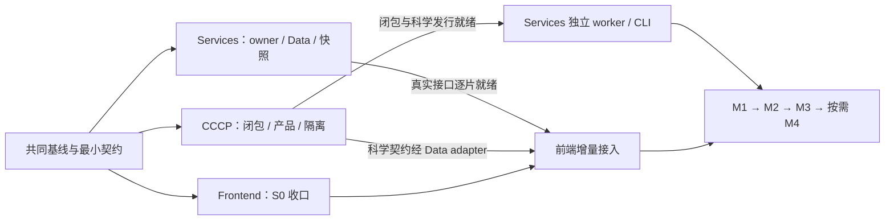

# ACP 架构计划完成情况与三路并行索引

日期：2026-10-18。依据：[主方案](../../ACP_Architecture_Adjustment_Plan_20261016.md) v1.12 及其 §41—43 实施记录。代码基线：`f410ac9dae035eb424c40c599692500fdea457cc`，开始核查时工作区干净。

本文及三份清单是主方案的状态核查与人员派发附件，继续使用原 P/PR/MU/OS/CQ/IN、H/R、M 编号。主方案的科学、恢复、兼容与发布约束继续有效。清单中的 A/B/C 仅表示工作归属，不新增架构层或第二套里程碑。

## 1. 核查结论与证据边界

**整体处于“前端大部分兼容重构已实现，平台服务与科学归并尚待实施”的阶段，不能认定完整架构调整完成。** 已有 CCCP 任务根、调度 CAS、恢复身份、manifest 和远端后台预取是可复用基础，不能因为下一轮目标未交付而重复实现。

本次通读主方案，检查源码、默认页面装载、打包配置、现有测试入口及实施记录；没有执行应用、测试、真实科学程序、远端作业或生产发布。因此下文“代码已实现”是静态核查结论，历史 PASS 是原记录中的结果，不是本次复验。未采集当前性能、备份恢复或真实集群指标，不计算缺少统一分母的总体完成百分比。

状态口径：

- **代码已实现**：找到实现与调用入口；运行通过情况另列证据。
- **部分实现**：有模块或既有基础，但尚未完成接入、职责迁移或验收。
- **未发现目标实现**：当前核查范围未发现对应实现，按待实施安排。
- **待复验**：有历史记录或测试文件，当前 revision 尚无本次运行证据。
- **条件后置**：原方案明确按部署需求或政策启用，不是近期发布的强制前置。

## 2. 按原工作包核查

| 范围 | 当前判断 | 可定位证据与剩余内容 |
|---|---|---|
| P0：基线、台账、性能和恢复 | 部分实现 | 已有方案、清理审计、恢复 fixtures 和历史前端记录；本次固定 HEAD/干净状态。当前完整符号台账、性能基线、关联备份恢复证据仍需补齐；主方案引用的 `.omo/evidence/frontend-arch-20261016/` 在本 checkout 不存在 |
| H：HTML/CSS/JS 维护拆分 | 代码已实现；完整验收待复验 | 默认 HTML 当前 1,252 行；`frontend/js/workbench/{features,compat,controllers,contracts}`、Client、Visualization 和外置样式存在。不再安排重新拆三万行 HTML；原外观、缓存/旧标签页与回退证据仍需核对 |
| P1-01/02、R1—R4：Client 与任务用例 | 主要代码已实现 | HTML 已加载 transport/store/task-view/detail/events/polling/commands/wizard-endpoints 及实际 controller；旧任务选择和命令已委托。wizard 内部四片、节点/后端用例等兼容余面仍在 |
| P1-03：只读任务投影 | 部分实现 | `scheduler/task_views.py::query_project_tasks` 与 v2 task-view 已有；`api/v2_routes.py::get_task_view` 仍调用 `_enrich_active_rows`。现有列表投影不等于目标“查询只读准备好的快照”全部完成 |
| P1-04：事件与刷新 | 浏览器侧已实现主要兼容；服务协议待实施 | Client 已有 SSE/轮询生命周期；服务已有每任务 JSONL 与 `after_seq`。尚无目标统一授权事件流、跨 owner 版本协议、过期 cursor 重置与事务发布闭环的完整证据；不能把现有持久日志说成完全没有事件能力 |
| P2：Data、prepare、cache-only | 部分基础；目标闭环未完成 | `_job_read_root`、RemoteStructureCache、终态后台预取已有；`api/v1_routes.py::_job_read_root` 仍同步 `fetch_catalog`，manager 使用进程内预取队列。未发现 DataResourcePort 与持久 prepare/租约/重试的目标实现 |
| P3、R5/R6：Visualization | 二维/framing/创建 adapter 已实现；实例边界未闭环 | 能量 renderer 和 framing 已接入。`scene_instance.js` 未被默认 HTML 加载；业务仍调用原生 viewer/model，详见下一节 |
| P4：Services、worker 与独立发行 | 既有执行基础可复用；目标迁移未实施 | CAS、attempt、提交/release、恢复仍在旧模块。未发现 `src/acp_services/`、ExecutionEnvelope/Receipt 目标协议；本地 runner 和远端 script_gen 仍构造 `python -m acp.cli run`，后者仍导入 `acp.catalog` |
| P5：CCCP Analysis 与科学产品 | 任务层已有；新增归并未实施 | `cccp.calculation` 的 requests/results/context 和唯一 tasks 根存在；未发现 `cccp/analysis/`。DP4/DP5、采样、PES 路径、ORCA 只读解析仍有实现驻留 acp；不能把旧四层任务迁移完成当作本轮科学闭包完成 |
| PR-01/02：独立科学与 CLI 发行 | 部分基础 | 有 CCCP 隔离测试、CLI、模型打包守护；当前仍由单个 `pyproject.toml` 发行 acp/cccp，NMR 模型归 `acp.nmr`。未证明目标 CCCP 与 Services＋CCCP 可分别独立安装并完成相应闭环 |
| PR-03/04、§31—33：结构化 CLI/MCP、插件、项目包/溯源 | 既有局部能力；目标待实施 | 已有 catalog、CLI、任务 lineage、诊断等可复用面；未发现主方案目标 MCP/可信插件发行/版本化项目包的完整实现，不应全部重建，也不应宣称已交付 |
| MU、PR-05—10：账户、隔离、配额、核时与 Credit | 未发现完整目标实现 | 现有 API 注释仍明确 trusted-network/no authentication。未发现 ResourceGrant/StorageBinding/UsageRecord/CreditAccount 等目标契约；现有项目/并发限制不能替代租户授权、硬隔离与可信预算 |
| IN-01—06：统一初始化 | 原命令已有；扩展未实施 | `init_wizard/flows.py::run_init` 已有本地/现有节点/新节点流程；尚非使用方式→档位→组件→计划/应用→doctor 的统一装配流程；纯节点校验仍有镜像 |
| OS、P6：组件与分布式角色 | 现有组件可复用；新增候选条件后置 | 已用科学库/FastAPI/Paramiko/3Dmol；新数据库、OIDC、对象存储、Slurm 等不能因写入候选清单而标已接入，也不要求全部安装 |
| CQ、P7：质量与旧实现清理 | 前端已完成部分；全局未关闭 | 已有 FE 清理记录和审计附件；需逐项复核调用者、兼容 reader、恢复 fixtures 与删除条件，不能将所有候选直接当死代码 |

本次源码盘点：`src/acp` 268 个 Python 文件，`src/cccp` 87 个，`tests/test_*.py` 315 个，frontend 77 个被文件检索识别的文件。文件数用于定位，不表示通过测试数或质量收益。

## 3. 必须校正的前端完成口径

主方案 §43 首轮记录及[前端收口记录](../current/ACP_Frontend_Closure_20261017.md)明确保留 R5 页面接入、wizard 四片与真实浏览器/S0 等余项；随后标题为“42.7”的追加记录却宣称 R0—R6 全完成，并引用当前不存在的 `job_session_controller.js` 与 `mol3d.createInstance()`。以当前代码确认：

1. 实际会话实现为 `controllers/task_session_controller.js`，HTML 已加载且 `reaction-builder.js::selectJob` 委托它，不能重复建立 job_session controller。
2. `visualization/scene_instance.js` 注释明确写 module-only；默认 HTML 没有装载它，各业务场景仍调用 `mol3d.create()` 后持有原生 viewer。
3. `mol3d_adapter.js::create()` 直接返回 `$3Dmol.createViewer(...)`；当前没有所称 `createInstance()`。直接 `$3Dmol` 收拢至 adapter 不等于原生句柄已封闭。
4. scene 当前要求外部注入 `opts.viewer`，`addModel` 仍透传底层返回值。后续既要完成页面接入，也要验证模型返回值及回调不会再次泄漏底层句柄；只加 script 标签不足以关闭 R5。
5. wizard 仍约 8,304 行，端点迁到 Client 已完成，四个表单职责切片尚不能据此判完成。`reaction-builder.js` 的通用节点/后端用例也仍在旧驻点。
6. 历史记录分别报 Node 45/87/183、pytest 508/808，不同范围和时点不能相加或直接认作当前基线。§41 的八个浏览器场景是较早版本证据；首轮收口记录对后续版本明确为 NOT_VERIFIED。当前存在浏览器测试文件也不代表已运行。

采用状态：**H 代码拆分完成；R1—R4 主要任务链已接入；R3 表单细分、R5 场景封装与 R6 总验收待收口；完整三层及真实远端/生产验收尚未完成。** 原历史记录保留以供追溯，本节作为本次派发基线。

## 4. 三份计划与可立即开始的工作

| 清单 | 完整范围 | 立即可做 | 跨路退出门 |
|---|---|---|---|
| [计划一：Frontend](ACP_Parallel_Plan_1_Frontend_20261018.md) | 前端收口、Client/Visualization/Workbench；后续真实服务接入 | A00—A03：现有 S0 上的场景实例、表单和通用用例；不等待 Services 改造 | 新 prepare/事件/科学产品只在 B/C 对应契约及真实实现就绪后启用 |
| [计划二：Services](ACP_Parallel_Plan_2_Services_20261018.md) | Workspace/Runtime/Data、入口/初始化、平台部署/运维、配额/计量 | B00—B04 的契约、现有仓储适配、持久操作、只读投影；可复用当前 CCCP API | 独立 worker 切换需 C01 科学闭包；独立发行需 C08；收费/多租户各过专门门 |
| [计划三：CCCP](ACP_Parallel_Plan_3_CCCP_20261018.md) | 科学闭包、Analysis、产品/分块、Software、独立科学发行与插件 | C00—C02：闭包审计、首个阻塞 helper 与科学产品契约；不依赖新页面或账户系统 | 平台调用切换由 B 接入；显示由 A 接入，科学完成不冒充整端验收 |

并行指三路各有可独立实现与合入的切片，不表示任何任务都没有前置。服务/科学工作量明显多于当前前端余项；前端提前完成后依契约接入新能力，不通过预造成功占位追求三路同时结束。

## 5. 单写者与交接规则

| 文件/契约 | 唯一写者 | 其他两路的参与方式 |
|---|---|---|
| `frontend/**`、Node 和前端专属测试 | A | B/C 提供接口与 fixture；若仍按 Antigravity/OpenCode 分工，由入口单写者接入，沿用主方案 §40 |
| `src/acp_services/**`、scheduler/api、平台 planning/recovery、部署/config/CLI/init | B | A 消费；C 提供科学入口。B 保持现有 `src/acp` 兼容路径 |
| `src/cccp/**`；登记移交的旧 acp 科学专属文件 | C | B/C 先固定逐文件或逐符号边界；C 提取唯一实现和旧 shim |
| 混合的 workflows/catalog/executor/results 等旧文件 | B 为接入写者 | C 提交具体符号迁移补丁及调用替换；登记移交后才转移文件写权，禁止双方整文件搬迁 |
| 科学 schema、黄金 fixture、数值/单位/模式身份 | C | B/A 审阅可执行性与可显示性；平台 manifest/frames adapter 由 B 写 |
| 平台 API/事件/prepare/envelope schema | B | A/C 共同审阅，先固定正常/空/部分/错误/旧版本样例 |
| `pyproject.toml`、`requirements-node.txt`、根 README/AGENTS、主方案、全局架构门、共享集成测试 | B 为集成写者 | A/C 提交精确修改需求；科学/QC 门修订由 C 提供证据。各专属清单由所属路维护 |

每片交接含基线 revision、调用方/旧 writer、真实签名/schema、版本/身份、错误/取消/超时、依赖装载、fixture、切换/撤旧清单、证据和回退。接口冻结后可依 fixture 开发；真实接口缺失时只记模块验证，功能关闭必须真实联调。共享契约逐片冻结，不以“全部设计完”为开工前提。

## 6. 原编号覆盖与里程碑

以下为主责任分配；有两路时显式区分交付物，原编号只登记一个联合关闭结论。

| 原编号/章节 | 主责任及具体分工 |
|---|---|
| P0-01—05；OS-01；CQ-01 | B00 汇总基线/备份/护栏/组件；A00、C00 提供各自清单 |
| P1-01/02 | A00/A04 复用已实现 Client，补真实证据与残余 owner |
| P1-03/04 | B03/B04 提供快照/事件；A04 接兼容 adapter 与刷新 |
| P2-01—05 | B02 提供 Data 全闭环；A04 只消费接口 |
| P3-01—04；OS-08；CQ-03 | A01/A03；C02 维护科学语义，候选 renderer 按需试点 |
| P4-01/02/04/05/06 | B01/B05/B06/B07；C01 是独立 worker 的明确前置 |
| P4-03；P5-01—04；OS-09 | C01—C07/C09；旧平台接线由 B 应用 |
| P6-01—04；P7-01 | B07/B12/B13 集成；A05、C10 关闭各自旧实现与验收 |
| PR-01 | C08 独立科学发行；B 仅集成共享打包文件 |
| PR-02/03/04 | B07/B08 完整 CLI/机器接口/MCP；C 提供同一科学 API |
| PR-05/06；MU-10a | B10 共同核时政策、可信用量和 quota-only；无需价格/Credit |
| PR-07/08/09；MU-10b | B11 账本/准入；A06 接用量/预算界面；PR-05b 价格政策先决 |
| PR-10；MU-12；OS-12 | B13 组织联合故障/发布验收，A05/C10 提供分层证据 |
| MU-01/02/04/13；OS-03 | B01 身份/权限/API Key/OIDC 迁移；A06 仅接真实能力 |
| MU-03/05/06/09；OS-06 | B09 开通、执行隔离/资源与管理；可信用量归 B10 |
| MU-07/08；OS-07 | B02 存储/授权基础，B12 按需对象存储试点 |
| MU-11；OS-02/11 | B07 初始化/模板，B13 运维与恢复 |
| OS-04/05/10 | B12 数据库/Hosted，B11 外部账单评估；都保留条件门 |
| IN-01—06 | B07 建共同计划/配置机制；B09 补 Lab，B12 补经验证 Hosted；C07 提供纯科学配置校验 |
| CQ-02/04/05/06/07/08 | C07 科学等价归并/Software；B05 平台归并、B02 数据边界；异常/测试/兼容清理随 A05/B13/C10 执行 |
| §31 插件/GPU | C09 科学插件；B12 资源请求/分配；A06 仅呈现已支持能力 |
| §32 项目包/研究证据 | B08 归档与平台溯源；C02 科学来源；A06 展示/交互 |
| §33 MCP/诊断/i18n | B08/B13 入口/结构化错误与日志；A04/A06 翻译和界面，C02 保持 typed 科学错误 |
| H/R/FE/OC、§37—43 | A00—A05 作为前端派发视图；已完成项复用，未测与余项分别关闭 |

联合发布顺序沿用 M0—M4：M0 固定两条主场景，建议采用既有“结构→optimize/frequency→证据报告”和“Confsearch→人工候选→BatchOptimize”，具体输入/软件版本在 B00 冻结；M1 先完成第一条本地 GUI/CLI/init 与一个可信插件样板；M2 交第二主线、项目往返/MCP/双语诊断；M3 交实验室多用户/隔离/核时配额；M4 按需求开放 Hosted、Credit、分布式或更多插件。每个里程碑只组合必需子切片，不等待整路全部任务完成。

## 7. 联合关闭条件

- 每片分别记录模块验证、默认入口接入、真实功能验收；历史 PASS 不覆盖后续新增或替换代码。
- 科学、CAS、目录/attempt、发布/恢复、十五 active 工作流、edit coverage、retired 只读和 frames 契约保持；规则迁位先登记修订并加等效门。
- 原方案要求的测试在实施片安排执行：先定向，再适用非慢/compileall；科学软件/LSF、性能、备份、浏览器和生产各自记录 PASS/FAIL/NOT_VERIFIED。
- prepare 可恢复、后台预取与旧 Client 兼容完成后，才逐资源启用 cache-only；不得先删除读取回退。
- 独立科学包、完整 CLI、Lab Server、Hosted 和收费是不同验收事实。价格/核时政策未确定时只交可配置契约与测试样例，不自行写入真实价格或宣传收费可用。
- 本次仅修改计划文档；不执行上述开发清单、不重启服务、不改变 DB/配置/任务工件。
