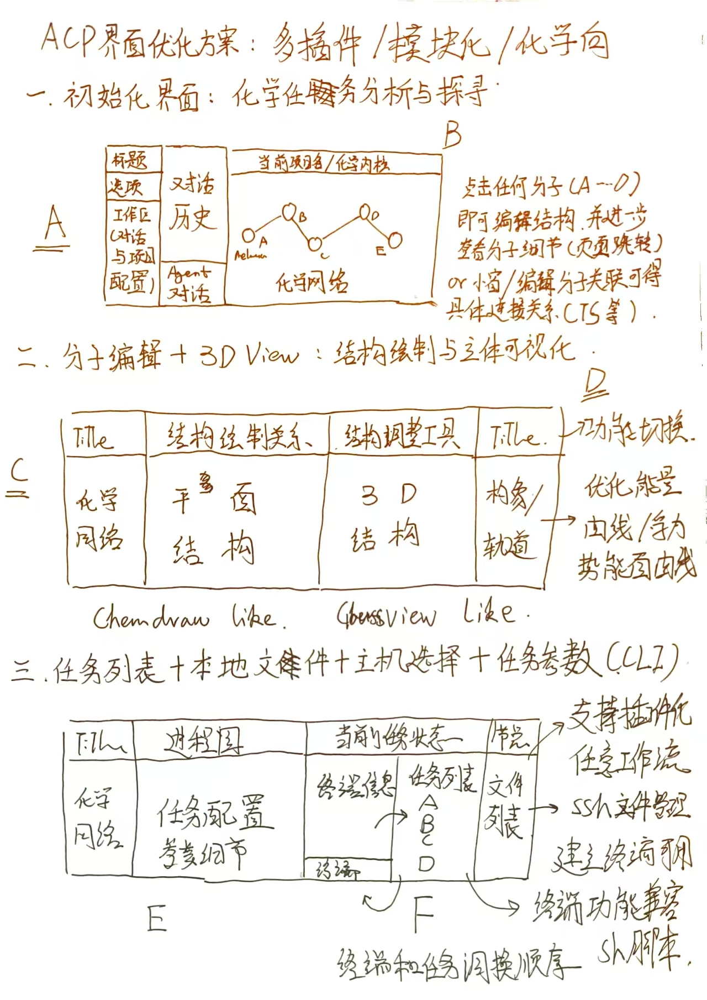

# ACP-NEXT：DSH 化学工作台插件与 RPH 接入修改计划

> **2026-11-04 双人开发同步**：本文只持有宿主/布局与 RPH 接入细节；新增化学导入、Chemical IR、网络分层和编译交接按[架构总纲 §10](ACP_3.0_Architecture_20261031.md)，由 A 主写，B 提供科学能力/验证。§13.15 窗口级固定工作台仍为提案；宿主停靠修复不等于化学科研闭环。当前 B0/B1 端点继续遵守网络契约，不能把 mock 计划或 lineage 边当已验证机理。

> **最新优化提案：[§13.15 窗口级固定工作台](#window-pinned-workbench-20261104)**。用户希望右侧 ACP/Agent 界面不随 DSH 对话切换。默认保留同一个工作台实例、项目与编辑状态；对话切换只改变浏览位置，关联研究会话由显式操作调整。本节是后续方案，尚未实现；继续保留 §13.14 已修复的原生停靠，不回到自绘浮层。

> **2026-11-04 宿主停靠修正：[§13.14](#native-docking-fix-20261104)**。已将自绘 `shell.overlay` rail 迁为真实 DSH docking tab，复用 §13.13 的 ACP 内部布局。实现与限定桌面验证见 §13.14.7；[回执](../../../reports/dsh_acp_docking_repair_20261104/REPORT.md)。独立原型检查不替代真实停靠验收；本轮冷启动因运行中任务未执行。

> **2026-11-03 最新布局入口：[§13.13 新草图 A—G 布局方案](#next-layout-20261103)**。以本次用户上传的七模块新手绘图为依据：老版视觉与操作习惯优先复用，DSH 常驻协作，D 当前任务栏提升到全局，A/B/C/E/F 按工作切换，G 统一停靠。该节取代 §13.10 中冲突的默认布局；既有功能对等清单、科学契约与宿主边界继续有效。附[可点击布局原型](assets/ACP_NEXT_Layout_20261103/index.html)，**仅示例，不是生产实现或 live 验收**。

> **2026-11-02 修订入口：先读 §13，草图逐区对齐见 §13.10。ACP-NEXT 即 DSH 化学工作台插件。** `/next/` 仅指现有源码实验页，不代表另一个目标产品。DSH 接入提前为开发主线，经典页与实验页承担迁移兼容与测试。§0—12 保留首稿供追溯；其中 API 骨架、工具数量、模块零改动、环境实测与人日均不能直接作为实施事实。冲突处以 §13 为准。源码核查 HEAD：`d4f4ede6`；本轮读取《回顾ACP2更新》原对话及手绘原图后修订计划，未运行 DSH、模型、QC 或生产联调。

**日期**：2026-11-02
**状态**：设计（DSH 侧宿主能力本机已核验；插件包未实现）
**上位文档**：[ACP 3.0 前端可视化适配计划](ACP_3.0_Frontend_Plan_20261031.md)（V8 宿主接入）、[UI-00 模块契约草案](ACP_Frontend_UI00_Module_Recipe_Contract_Draft_20261030.md)
**取代**：本文恢复并具体化 3.0 计划 §5 的 **V8 宿主接入**（该节标注"推迟，等 BE-GAP 与 C4 决策"）。V1–V7 的模块交付不变。

---

## 0. 结论

**两套前端，一套视图层。**

```text
            共用同一份视图层（framework-free classic JS）
frontend/js/shell/*       上下文/注册表/加载器/命令/布局/配方
frontend/js/modules/*     19 个面板模块（descriptor + factory）
frontend/js/client/*      12 个数据客户端
frontend/js/visualization/* 4 个渲染模块
            │
     ┌──────┴───────────────────────────────┐
     │                                      │
宿主 A：独立 Workbench                宿主 B：DSH 原生插件
frontend/next/index.html              @acp/dsh-panels
（现有，浏览器直开）                    ├─ Host 半（Node）：代理 + 会话桥
                                      └─ Client 半（纯 JS）：React 容器 + 挂载 ACPShell
```

三条设计决定：

1. **不重写模块**。19 个模块已经是"无框架、无构建、descriptor + factory"的形态，和 DSH 插件的"纯 JS ModuleLoader bundle"是同一种东西。DSH 侧只加**容器与依赖注入**。
2. **不引入第二套数据契约**。两宿主都只消费 `acp.view.v1` 与现有 REST/SSE；DSH 的 Session/Storage 不是任务真值。
3. **Agent 与手动并存**。Agent 通过 MCP 工具写；面板通过同一 Controller 读写。两条路径共用服务端授权与任务事实，面板不因为 Agent 存在而失去独立可用性。

---

## 1. 现状证据

### 1.1 最新 UI 已经具备"插件化"的骨架

| 事实 | 证据 |
|---|---|
| 新一代入口 = `frontend/next/index.html`（Shell），经典页 `ACP_Workbench_v2.html` 保留 | `frontend/next/index.html`；`frontend/js/shell/*`（11 个文件） |
| 19 个模块，统一 `descriptor {id, interfaceVersion, version, provides, binds, deps, singleton}` + `factory(host, api) → {mount, updateContext, suspend, resume, dispose}` | 各 `frontend/js/modules/*/module.js` |
| 模块以 `window.ACPNextModules[id] = {descriptor, factory}` 自注册；`registry.collectFrom()` 惰性校验 | `frontend/js/shell/module-registry.js:151-181` |
| 加载器已有**动态加载缝**：`loader.setResolver(fn)`（未来用 `<script>` 拉模块），当前是静态表 | `frontend/js/shell/module-loader.js:36-37,147-150` |
| 选择态单一来源：`ACPShell.context`（projectId/taskRef/structureRef/researchRef/networkNodeId + revision），冻结快照 + 订阅 | `frontend/js/shell/workspace-context.js` |
| 面板只通过 `deps.commands`（openTask/openStructure/openEvidence）导航，不跨 DOM | `agent-workspace` README §模块契约 |
| 模块测试是零依赖 VM 套件（`node frontend/js/module_tests/run_all.js`） | `frontend/js/module_tests/` |

### 1.2 DSH 已经是"一切皆插件"，且客户端插件**不需要构建链**

| 事实 | 证据 |
|---|---|
| 本机 DSH 0.2.1-rc.3；`dsh --profile acp --help` 正常 | 本机实测（2026-11-02） |
| 插件双半：`dsh.bundle.patch`（Host YAML）+ `dsh.client`（浏览器半，`platform: web`） | `~/.dsh/profiles/desktop/package.json`；`oh-my-coharness/package.json` |
| 客户端半是**手写 ModuleLoader bundle**：无构建链、无 JSX，React/UI 原语由宿主提供 | `oh-my-coharness/vendor/omd/npm-package/client/client.js` 头注释 |
| Host 半可注册 HTTP 路由/前缀、往 index 注入脚本 | `@deepseek-ai/dsh-host-webserver` README |
| 浏览器侧有认证 RPC/HTTP/WS 通道（`/api`）与 trust fence | `@deepseek-ai/dsh-client-connection` README |
| 右侧栏可开 loopback iframe 标签页（Desktop 默认启用） | `@deepseek-ai/dsh-client-ui-sidebar-browser` README |
| 动态插件（运行时定义、纯 JS 浏览器半）存在 | `@deepseek-ai/dsh-cordis-client-runner` README |
| Agent 侧：`dsh --profile acp` + 会话内声明 ACP-MCP 已实测通 | 本文配套 P0：`scripts/agent/acp_smoke.py` |

### 1.3 3.0 计划已有的宿主决策（本文继承）

- **D4**：视图层与宿主解耦，V1–V5 在两种宿主下都可运行（`ACP_3.0_Frontend_Plan_20261031.md` §8-C4）。
- **V8 推迟**的原因不是方向错，而是当时 DSH 嵌入能力全项未验证（§8-C5）。**本文用本机实测替换了那次"未验证"**：宿主存在、插件形态明确、Agent 通道打通。

---

## 2. 目标架构

### 2.1 分层

| 层 | 内容 | 归属 |
|---|---|---|
| L0 视图内核 | `shell/*` + `modules/*` + `client/*` + `visualization/*`（纯 JS，无 DOM 全局依赖） | ACP 仓库，两宿主共用 |
| L1 宿主适配 A | `frontend/next/index.html` + `shell/bootstrap.js` + 布局/配方 | ACP 仓库（现有） |
| L2 宿主适配 B | `@acp/dsh-panels` 的 Host 半 + Client 半 | 插件包（新） |
| L3 数据面 | ACP Controller REST/SSE（`/api/v1`、`/api/v2`） | ACP 服务（不变） |
| L4 Agent 面 | DSH 模型/会话 + ACP-MCP 12 工具 | DSH（不变） |

### 2.2 两个宿主如何复用同一内核

| 关注点 | 独立 Workbench（宿主 A） | DSH 插件（宿主 B） |
|---|---|---|
| 容器 | 自有 HTML 骨架（`next/index.html`） | DSH 槽位（右侧栏 tab / 对话页签 / 主面板） |
| 模块加载 | `<script>` 列表（现有顺序） | Client 半 bundle 预载核心 + `setResolver` 按需注入模块 |
| 选择态 | `ACPShell.context` 单例 | 同一实现；额外与 DSH 会话双向同步（§5） |
| 数据 | `ACPClient.*` 直连 `/api/*` | 同一客户端，`baseURL = /acp-api`（Host 半代理） |
| 导航 | 自有路由/命令 | `commands` 追加"在 DSH 中打开会话/文件" |
| 主题 | 自有 CSS 变量 | 继承 DSH 主题变量（`--dsh-*` → `--acp-*` 映射） |
| 认证 | 当前 loopback 单用户 | DSH 浏览器 cookie + Host 半携带 `X-API-Key` |

**关键点**：模块本身零改动，差异全部收敛到"宿主注入的 `deps`"。

### 2.3 DSH 侧两个半

**Host 半（Node 插件，运行在 DSH Host 进程）**

| 职责 | 实现 |
|---|---|
| 反向代理 ACP API | `register({ path: '/acp-api', match: 'prefix' })` → 转发 `http://127.0.0.1:8765/api`；注入 `X-API-Key`；SSE 直通（不缓冲） |
| 静态资源 | `/acp/js/*`、`/acp/css/*` 从 ACP checkout 的 `frontend/` 读取（带 sha256 校验，复用 `static_assets` 规则） |
| 会话桥 | `POST /acp-api/ui/focus` 记录"某 DSH session 当前选中什么"；`GET` 供 Agent 工具读取 |
| Agent 工具 | 注册 `acp_ui_context`（只读：返回当前 session 的 ACP 选择态 + 最近任务） |
| 健康 | `/acp-api/health` 透传 Controller 健康，面板据此显示"未连接" |

**Client 半（浏览器插件，纯 JS）**

| 职责 | 实现 |
|---|---|
| 容器 | React 组件只做三件事：建 `<div>`、调用 `ACPShell.loader.instantiate(id, instanceId, host)`、卸载时 `dispose()` |
| 槽位 | 右侧栏 tab（`task-explorer`/`exec-detail`）、对话页签（`agent-workspace`）、主面板（`reaction-network`） |
| 依赖注入 | `deps = { context, commands, client }`：`context` 桥接 DSH session ↔ `ACPShell.context`；`commands` 追加 DSH 导航；`client` 用 `/acp-api` base |
| 样式 | 注入 `<link href="/acp/css/...">`；主题变量映射 |
| 降级 | Host 半 503 / Controller 不可达时显示"未连接"，模块仍可渲染空态（四态契约） |

---

## 3. 插件包设计

### 3.1 目录

```text
E:\Calculations\Plugins\ACP-DSH-Panels\        # 与 Oh-My-CoHarness 并列
├── package.json
├── cordis.patch.yml
├── src/
│   ├── index.js            # Host 半：路由/代理/会话桥/工具
│   └── proxy.js            # 上游转发 + SSE 直通
├── client/
│   ├── entry.js            # Client 半入口（React 容器 + 槽位注册）
│   ├── core.bundle.js      # 构建产物：shell + client + visualization
│   └── modules/<id>.js     # 构建产物：按需加载的模块
├── assets/                 # 构建产物：css 合并
├── scripts/build.mjs       # 无 bundler 的拼接脚本（读 next/index.html 顺序）
└── test/smoke.test.mjs
```

### 3.2 `package.json`（照 `oh-my-coharness` 的双半形态）

```json
{
  "name": "@acp/dsh-panels",
  "version": "0.1.0",
  "type": "module",
  "main": "./src/index.js",
  "engines": { "dsh": ">=0.2.1-rc.2 <0.3.0-0", "node": ">=20" },
  "dsh": {
    "bundle": { "patch": "./cordis.patch.yml" },
    "client": {
      "platform": "web",
      "immediately": true,
      "inject": ["@deepseek-ai/dsh-client-locale", "@deepseek-ai/dsh-api-remotes"]
    }
  }
}
```

### 3.3 `cordis.patch.yml`

```yaml
- insert:
    - id: acp-panels
      name: '@acp/dsh-panels'
      config:
        controller: http://127.0.0.1:8765
        uiBase: /acp            # 静态资源前缀
        apiKeyEnv: ACP_API_KEY  # 只引用名字，值走宿主环境
        panels:
          tasks: right-sidebar
          agent: conversation-view
          network: main
```

### 3.4 Host 半路由表（最小集）

| 方法 | 路径 | 说明 |
|---|---|---|
| `GET` | `/acp-api/health` | 透传 Controller 健康（面板"未连接"依据） |
| `GET` | `/acp-api/v1/tasks` | 透传任务视图（同参数） |
| `GET` | `/acp-api/v1/jobs/{id}` | 透传任务详情 |
| `GET` | `/acp-api/v1/jobs/{id}/events` | SSE 直通（`after_seq` 游标） |
| `GET` | `/acp-api/v2/...` | 白名单前缀透传（研究/证据） |
| `POST` | `/acp-api/ui/focus` | 会话选择态（仅 loopback，绑定 DSH session） |
| `GET` | `/acp-api/ui/focus?session=` | 供 Agent 工具读 |

**代理纪律**：只透传白名单前缀；不转发任意 URL；不缓存 SSE；超时/错误映射成结构化 `{code,message}`；不记录 body 中的凭据。

### 3.5 Client 半入口（骨架）

```js
// client/entry.js —— 纯 JS，React 由宿主注入
export function apply(ctx) {
  const shell = window.ACPShell;                 // core.bundle 已加载
  shell.loader.setResolver(function (id) {        // 动态加载模块
    return loadScript("/acp/js/modules/" + id + "/module.js")
      .then(function () { return shell.registry.resolve(id); });
  });
  ctx.slots.inject("sidebar.right.tab", {
    id: "acp-tasks",
    title: "ACP",
    render: function (props) { return h(AcpPanel, { module: "task-explorer", host: props.host }); }
  });
}
```

> 槽位名与 `slots.inject` 的准确 API 以 `@deepseek-ai/dsh-client-ui-layout` / `dsh-client-ui-sidebar-right` 的声明为准，实施第一步先用一个空白面板验证（P0）。

---

## 4. 模块映射（19 → DSH 面板）

| 阶段 | 模块 | DSH 落点 | 依赖 | 备注 |
|---|---|---|---|---|
| V8.0 | `task-explorer` | 右侧栏 tab "ACP" | `/acp-api/v1/tasks` | 只读列表，最小闭环 |
| V8.0 | `exec-detail` | 同 tab 详情区 | `job-detail-query` | 四态 |
| V8.1 | `molecule-viewer` | 右侧栏 tab "结构" | 3Dmol + `scene_instance` | 单活动实例（ANTI：3D 单创建栈） |
| V8.1 | `energy-profile` | 右侧栏 tab "能量" | `energy_chart_renderer` | 只读，不提交 |
| V8.1 | `pes-handoff` / `path-view` | 主面板 "路径" | PES review | 只读候选 |
| V8.1 | `reaction-network` | 主面板 "网络" | `/v2` 网络读 | 只读 |
| V8.1 | `nmr-report` | 对话页签 | NMR 产物 | 只读 |
| V8.1 | `research-record` | 对话页签（证据） | `/v2/research` | 只读 |
| V8.2 | `agent-workspace` | 对话页签（与聊天并排） | Agent 事件桥 | 工具时间线接真事件 |
| V8.2 | `approval-card` | 对话内嵌 | 平台审批 + DSH 权限两套映射 | 不合并 |
| V8.3 | `task-config` / `task-wizard` | 模态/抽屉 | `wizard-endpoints` | 写操作，最后做 |
| V8.3 | `job-edit` / `capability-form` / `s2-scan` / `tsmode-editor` / `mechanism-plan` | 抽屉 | 各自客户端 | 写操作，逐项验收 |

**规则**：写操作模块（V8.3）在只读面板稳定前不进入 DSH；任何模块在 DSH 里不得新增第二套失效/轮询逻辑（沿用 `client/*` 单例语义，必要时按 instance 包装）。

---

## 5. Agent 化前端工作流

这是"两套前端"里 DSH 版独有的部分，分三层，逐层验收：

### 5.1 选择态上行（面板 → Agent）

```text
用户点任务 → ACPShell.context.setFocus({taskRef})
          → client 适配器 POST /acp-api/ui/focus {session, snapshot.revision, taskRef}
          → Host 半按 session 保存（内存 + 最近 N 条）
          → Agent 调工具 acp_ui_context 读到"用户正在看 job X attempt 2"
```

- 只上行**引用**（job_id/attempt/structureRef），不上行面板 DOM、不上行用户输入。
- revision 单调，Host 半拒绝过期 revision（防乱序覆盖）。

### 5.2 工具调用下行（Agent → 面板）

```text
Agent 调 mcp__acp__acp_submit → 返回 task_ref
   → DSH session 事件（tool result）
   → client 半订阅会话投影 → ACPShell.context.setFocus({taskRef})
   → 面板自动切到该任务，高亮"由 Agent 提交"
```

- **来源标注**：面板必须区分"人选的"与"Agent 提交的"（`source: "agent"`），不得混写。
- 事件订阅依赖 DSH 的 session 投影/Remote 事件；**本层是 P2 的 spike 项**，未验证前不得宣称可用。

### 5.3 审批与写路径（不合并）

| 动作 | 归属 | 约束 |
|---|---|---|
| DSH 工具权限（`session/request_permission`） | DSH | 一次性 allow/reject |
| 平台 research approval | ACP | `plan_digest` 绑定 + 人审，Agent 不能自批 |
| 面板提交任务 | ACP API | 与 Agent 提交同一套校验/幂等 |
| Agent 提交任务 | ACP-MCP | 同一 Controller 授权，来源标 `agent` |

---

## 6. 构建与资产

### 6.1 无 bundler 拼接（与 oh-my-coharness 同路线）

`scripts/build.mjs` 读 `frontend/next/index.html` 的 `<script src>` 顺序，产出：

1. `client/core.bundle.js`：`client/*` + `shell/*` + `visualization/*`（不含 19 个模块）
2. `client/modules/<id>.js`：单模块（含其 `model.js` 等附属文件）
3. `assets/panels.css`：按 `index.html` 的 `<link>` 顺序合并
4. `manifest.json`：每文件 sha256（复用 ACP 的静态资产清单规则）

不做 tree-shaking、不转译：输入本来就是 ES5 风格 classic script。

### 6.2 资产路径

- 现有 shell/模块用绝对路径 `/js/...`、`/css/...`。DSH 宿主下必须改为**基址感知**：
  - 引入 `window.ACP_UI_BASE`（默认 `""`）；
  - `next/index.html` 的 `script/link` 改为相对或 `base + path`；
  - 动态加载器（`setResolver`）统一走 `resolveAsset(path)`。
- 这样同一份文件可服务 `/next/`（独立）与 `/acp/`（DSH 代理）两个挂载点。

### 6.3 3Dmol 与重度资产

- `vendor/3Dmol-2.5.5.min.js`（537 KB）由 Host 半从 `/acp/js/vendor/` 提供；Client 半按需注入 `<script>`。
- 若 DSH 页面 CSP 禁止同源脚本注入：退化为 **iframe 面板**（下方 §7），或把 3Dmol 打进 `core.bundle.js`（体积 +537 KB，可接受）。
- Ketcher/波函数等超出本期范围的，一律走 iframe，不重写。

### 6.4 两宿主的一致性

- 同一 `manifest.json` 同时供：ACP `static-assets.manifest.json`、DSH 插件 `files` 校验。
- CI 增加一条：`build.mjs` 产物与仓库内 bundle 字节一致（防手改）。

---

## 7. 两种面板形态（同一模块，两种容器）

| | 原生容器（推荐主线） | iframe 容器（兜底/先行） |
|---|---|---|
| 实现 | React 容器 + `ACPShell.loader.instantiate` | `<iframe src="/acp/panel/{module}?session=...">` |
| 共享选择态 | 直接（同一 `context`） | 需 postMessage 握手 |
| 主题 | 继承 DSH 变量 | 需显式透传 |
| 复用度 | 模块零改动 | 整页复用 |
| 适用 | 只读面板、轻量交互 | 3D/Ketcher/重资产、快速验证 |
| 风险 | 槽位 API 需要 spike | 跨 iframe 通信债 |

**决策**：V8.0 用原生容器验证一个最小面板；重资产（3D/2D 绘图）先用 iframe；两者都不合格才考虑重写组件。

---

## 8. 安装、升级、回退

| 项 | 做法 |
|---|---|
| 安装 | Desktop profile 由 Electron 独占管理：走 GUI 插件页安装本地包（`link:`），或由应用内置插件管理器执行 `dsh plugin --profile desktop add <path>`；**不要**用 CLI 直改 desktop profile |
| 生效 | 重启 DSH 应用（会话记录保留） |
| 升级 | DSH 不支持原地升级：卸载再装；版本写进 `engines.dsh` 与 ACP 版本对照表 |
| 回退 | 禁用/卸载插件 → 回到独立 `/next/` 与经典页；**卸载不影响已提交任务** |
| 私有索引 | 可选：只列 `@acp/dsh-panels`；不开放任意第三方索引 |

---

## 9. 验收矩阵

| 层 | 用例 | 通过条件 | 证据等级 |
|---|---|---|---|
| 模块 | 现有 `module_tests`（19 模块） | 全绿，且新增 `acp2_dsh_host_*` 用例 | fixture |
| 构建 | `build.mjs` 产物哈希稳定 | 两次构建字节一致 | fixture |
| Host 半 | 代理白名单/SSE 直通/超时/未连接 | 单测 + 真实 Controller 只读 | live |
| Client 半 | 空白面板加载、槽位注册、卸载清理 | DSH 实机截图 + 控制台无错 | live |
| 面板 | V8.0 任务列表 → 详情 | 真实任务可见、四态正确 | live |
| 桥 | 选择态上行 + Agent 读回 | `acp_ui_context` 返回与面板一致 | live（需真模型） |
| 桥 | 工具调用下行聚焦 | Agent 提交后面板自动切任务 | live（需真模型） |
| 写 | 面板提交任务 | 幂等键生效、旧 Workbench 可见 | live |
| 回退 | 卸载插件 | 任务/文件不受影响 | live |

**红线**：fixture PASS 不得写成 live PASS；DSH 未装/未连时，面板必须显示"未连接"而不是空数据；`$3Dmol` 仍只允许 `mol3d_adapter` 一处。

---

## 10. 分期与人日

| 期 | 内容 | 人日 | 退出条件 |
|---|---|---|---|
| **V8.0 spike** | Host 代理 + Client 空白面板 + `task-explorer` 只读 | 4–6 | DSH 里看到真实任务列表，卸载干净 |
| **V8.1 只读批量** | `exec-detail`/`molecule-viewer`/`energy-profile`/`pes-handoff`/`path-view`/`reaction-network`/`nmr-report` | 10–14 | 每模块四态 + 一条浏览器用例 |
| **V8.2 Agent 桥** | 选择态上行、`acp_ui_context`、工具调用下行 | 6–8 | 上行/下行各自一条 live 证据 |
| **V8.3 写面板** | `task-config`/`task-wizard`/`job-edit`/`approval-card` 等 | 15–20 | 与独立 Workbench 同契约、幂等 |
| **V8.4 打包发布** | build.mjs、manifest、安装/回退、CI | 5–7 | 干净环境安装一次 + 回退一次 |

合计约 **40–55 人日**（不含 V1–V7 已计的可视化本体）。

---

## 11. 风险与未决

| 风险 | 影响 | 缓解 |
|---|---|---|
| 槽位/`slots.inject` API 未验证 | 容器搭不起来 | V8.0 第一件事是空白面板 spike；失败则退 iframe |
| DSH 页面 CSP 禁止动态脚本 | 模块按需加载失败 | 全量打进 core bundle（+~1.5 MB） |
| 绝对路径 `/js` `/css` | DSH 下 404 | 基址感知改造（§6.2），两宿主共用 |
| 主题/样式冲突 | 面板难看或污染 DSH | CSS 作用域前缀 + 变量映射，不改 DSH 全局 |
| 多实例（GeometryStore/3Dmol 单点） | 多面板互相干扰 | 首期单活动实例；多实例按 UI-06 |
| Desktop profile 由应用独占 | CLI 改配置无效 | 走 GUI 插件页安装 |
| DSH 版本升级 | 槽位/Remote 变化 | `engines.dsh` 锁定 + 冒烟脚本进 CI |
| 两入口功能漂移 | parity 债 | 模块测试两宿主共享；V8 只加容器不加逻辑 |
| 安全：代理暴露 Controller | 越权 | 仅 loopback、白名单前缀、凭据只走 Host 环境、不转发任意 URL |

**未决（需你拍板）**：

1. 首期面板落点：右侧栏 tab 优先，还是对话页签优先（与聊天并排）？
2. 3D/绘图面板：先 iframe 复用，还是直接做原生组件？
3. 插件工程位置：`E:\Calculations\Plugins\ACP-DSH-Panels`（与 Oh-My-CoHarness 并列）是否合适？
4. `acp_ui_context` 工具：只读选择态够不够，还是要允许 Agent 主动"打开某面板"（写 UI 动作）？

---

## 12. 与现有文档的关系

| 文档 | 关系 |
|---|---|
| [ACP 3.0 前端可视化适配计划](ACP_3.0_Frontend_Plan_20261031.md) | 上位；本文恢复其 §5 V8，不改 V1–V7 |
| [UI-00 模块契约草案](ACP_Frontend_UI00_Module_Recipe_Contract_Draft_20261030.md) | 模块 ABI 不变；本文只加宿主适配 |
| [UI-00 DSH 能力基线](ACP_Frontend_UI00_DSH_Capability_Baseline_20261030.md) | 其 §3 的 FAIL/NOT_VERIFIED 已被本机实测部分替换：DSH 已安装、`dsh --profile acp` 可用、ACP-MCP 会话打通；**但插件/槽位/桥仍未验证**，按本文 §9 分级 |
| [Web Agent 网关方案](ACP_Web_Agent_DSH_Bridge_Plan_20261102.md) | 备选路线（ACP 当主界面 + 自建中转）；本文是主线，两者不并存实现 |

---

*以上为首稿。其历史实测陈述本轮未复跑；修订后的开发依据如下。*

## 13. 修订后的实施计划：DSH 优先，化学模块共享，RPH 显式装配

### 13.1 产品决定与既有讨论的承接

**ACP-NEXT 的产品定义就是运行在 DSH 中的模块化化学工作台插件，以及可驱动它的 RPH 研究入口。** DSH 提供宿主，ACP-NEXT 按原草图提供研究/分子/任务三个可组合工作区；不是在既有 ACP-NEXT 产品旁再增加一个 DSH 面板版本。不能把“面板能加载”作为“RPH 已 Agent 化”的完成定义。

承接此前《对比ACP前端与升级方案》中用户明确选择的“优先面板与布局配置”，以及 [目标工作台方案](ACP_Frontend_Target_Workbench_Plan_20261030.md) 的样板形态：

1. **DSH 接入提前**：改变 [3.0 前端计划](ACP_3.0_Frontend_Plan_20261031.md) 中“V1—V7 做完后再做 V8”的顺序；先完成插件最小纵向切片，此后新增化学面板同步在 DSH 中验证。
2. **保持一套化学模块、一个 ACP-NEXT 产品**：经典页作功能对等基准；现有 `frontend/next/index.html` 是开发/测试与迁移兼容入口，后续文档称“独立测试宿主”；ACP-NEXT 专指 DSH 插件工作台。不重做 DSH 聊天、模型会话、文件工作区或终端；DSH 扩展限制先通过公开扩展解决，不默认退回独立 APP 路线。
3. **布局先于全量表单迁移**：首批就交付研究/分子/任务三种工作区组合、面板位置与尺寸调整、显示/隐藏、固定/跟随、恢复默认和刷新恢复。布局可以分批，不能又退回“几个只读卡片”。
4. **零功能丢失目标保留**：沿用 3.0 前端计划 §2.4 的 P01—P24 清单，逐项映射到化学插件或已验证的 DSH 原生能力。DSH 文件浏览器不能自动替代 ACP 远程工件读取与 prepare/read 语义。旧页在对等门通过前保留。
5. **已有 harness 仍能独立使用 ACP MCP**：DSH 插件是首选体验，不成为科学后端的强制依赖。多用户主机/acpfs 属于拓扑后续批次，不阻塞本地单用户首片，也不因本地通过就宣布多用户可用。

### 13.2 本轮源码核对与首稿纠正

| 核查对象 | 当前能确认的事实 | 对计划的影响 |
|---|---|---|
| `frontend/js/shell/{bootstrap,module-loader,workspace-context}.js` | 有 registry/loader/context 缝；bootstrap 固定 `/api/v1`、`/api/v2` 并操作整页 DOM；context 与客户端有 window 级单例 | 先分离运行时与页面启动，再适配宿主；首稿“纯 JS、无 DOM 全局依赖、模块零改动”不成立 |
| `frontend/js/modules/` | 现有 19 个模块目录；存在只读与写操作混合模块，例如 task-explorer 已有任务控制 | 首片必须显式注入能力并隐藏写操作，不能以模块名判定只读；目录存在不证明独立挂载与业务验收完成 |
| `frontend/js/client/` | 本次核查 14 个文件；多个 endpoint 客户端及全局 init | 资源/API/事件 URL 都需基址化；不能只改一个 baseURL，就认定无硬编码和无会话串扰 |
| `rph/packages/cli/src/compose.ts`、`dsh-bundle/src/product-parts.ts` | 默认路径已调用 createProductParts，存在模型、持久 writer、证据、预算等组合 | 不重复“补默认 parts”；README 的 10-28 历史开头不能当当前代码。新增的是 DSH 宿主下的装配与恢复适配 |
| `rph/packages/dsh-bundle/profiles/web.cordis.yml` | 已有 MCP/preset 声明，但含历史服务器路径 | 生成可移植配置并验证，声明本身不证明当前 DSH 加载了 RPH Supervisor |
| 本机 DSH desktop profile | 可只读确认有 DSH bundle 与本地 CoHarness 依赖声明 | 不等于插件槽位、事件、CSP、打包或安装已验收；首稿相关“已实测”本轮未复跑，不提升状态 |
| MCP 工具表面 | 权威在 visible_tool_names 与消费工具定义，按协商/装配变化 | 删除实施中对“12/10/11”等数量的假设；握手、capabilities 后重新 tools/list |

DSH 的 `slots.inject`、准确槽位名、host 路由注册、ModuleLoader 格式、主题变量和热更新行为，仍是 **P0 必须从所安装版本公开文档/声明和最小实验核实的对象**。首稿代码只作意图示例，不直接复制实施。普通原生挂载不可行时只允许有退出条件的 iframe 过渡；不能以整页 iframe 嵌入宣告原生插件完成。

### 13.3 目标职责与数据流

```text
DSH 宿主：会话 / 模型与工具运行时 / 扩展容器 / 原生文件与终端
  ├─ ACP 化学面板插件：工作区布局、结构、能量、任务、配置、证据
  │    └─ 共享面板运行时 + ACP Client → 已授权 Controller 查询
  └─ RPH 宿主适配：研究命令 / Supervisor / skills / bridge
       └─ DSH 官方 MCP client → ACP MCP → Controller / Services
                                            └─ CCCP 科学执行 → Local / LSF
共享关联：DSH 会话引用 ↔ 项目 / Proposal / ResearchRecord / TaskRef / attempt
```

| 对象 | 唯一权威 | 插件可保存的内容 |
|---|---|---|
| 任务、attempt、候选、产物、审批、预算、研究记录 | ACP Controller/Services 与现有科学契约 | 引用、已读取投影与新鲜度；不能保存另一套任务/研究状态库 |
| 对话与工具运行状态 | DSH | 会话引用、事件游标、关联到平台引用的映射 |
| 面板布局、固定选择、视角 | 插件偏好 | 版本化偏好，按宿主/用户/项目划分；不存凭据或科学事实 |

**科学命令入口**：DSH 中用户或 Agent 发起的研究/任务变更，目标统一经 RPH/官方 MCP 客户端调用平台命令；纯查询允许宿主受限代理现有 REST/事件接口。独立 Workbench 已有 REST 提交在兼容期保留，继续复用平台校验，不为插件再开一个写代理。P0 先盘点现有面板写操作与 MCP 对等覆盖；缺项通过原 Controller/Services 补公开能力，不用 shell 或直接调用数据库兜底。UI 的打开/布局动作不属于科学命令。

**依赖边界**：RPH 的 `cli → dsh-bundle → bridge → research` 保持；桥层无网络/进程，官方 MCP client 持有传输。DSH Host 代理属于插件宿主层，不能塞进 RPH bridge。当前 RPH 模型 gateway、预算与用量回执继续有效；DSH 聊天模型和 RPH planner 模型不得默认视为同一个执行/计费主体。若以后改由 DSH 模型驱动 planner，须单独设计端口与计量证据。

### 13.4 优先交付的界面

| 工作区 | DSH 负责 | ACP 插件负责 | 第一批退出条件 |
|---|---|---|---|
| 研究 | 原生聊天、会话历史、工具运行容器 | 研究摘要、计划/证据、项目分子导轨、网络区域 | 当前会话与研究引用可见；缺网络服务时显示未接入/标注 fixture，不伪装 live |
| 分子 | 提供可用容器与主题 | 3D、结构来源/帧、能量曲线；2D 后续依既有选型接入 | 点任务/能量点能定位正确 attempt 与结构；3D 单创建栈；局部关闭释放场景 |
| 任务 | 原生文件/终端作为辅助工作区 | ACP 任务、进度、日志工件、配置/预检、平台审批 | 任务与产物仍走平台读取边界；终端不代替科学提交；旧版操作按 P01—P24 补齐 |

DSH 确认有足够的布局扩展时直接复用；若只能提供一个稳定主面板，则在**该主面板内**复用 ACP layout-manager。两种实现都只有一个工作区布局 owner，不让 DSH 与 ACP 同时维护两套顶层导航。轻量列表可放侧栏；完整工作台不能被限制成狭窄右侧栏。

沿用旧 UI 的搜索/筛选、方法/资源、结构测量/轨迹、错误/恢复交互。DSH 主题通过作用域 token 适配，不污染宿主全局 CSS。布局调整需有键盘入口与可见焦点；关闭面板后焦点返回打开入口；快捷键冲突由宿主适配解决。按既有 1440×900、1280×720 场景检查遮挡与溢出。

### 13.5 分批修改清单与验收

以下 P0—P6 为本修订局部编号，与 MCP 计划的 P0/U01—U09 不混用。每批提供变更、证据 revision、未通过项与回退方式；不以测试数量或目录存在作为退出条件。

| 批次 | 主要修改 | 具体产物 / 验收出口 |
|---|---|---|
| **P0 宿主与范围核验** | 冻结 DSH 版本/公开扩展声明；空面板加载/销毁；原图 A—F 到宿主布局能力的映射；列出 19 模块实际依赖与 24 功能面的迁移状态；盘点 MCP 写能力；记录性能基线 | 一个能在目标 DSH 加载并卸载的空插件、能力矩阵、版本清单；确认可交付主工作区而非仅侧栏；只做隔离实验，不修改当前桌面 profile；无真模型/QC 依赖 |
| **P1 最小化学插件** | 从 bootstrap 拆运行时；资源/API/事件基址注入；作用域样式；任务列表只读模式 + 详情 + 单实例 Viewer | DSH 打开已有任务 → 正确 attempt/结构；关闭重开、切项目、rerun 后旧响应不覆盖；Next 同时回归；产出首个可安装包，不把打包留到最后 |
| **P2 草图工作台与布局** | 按 §13.10 交付 A—F：研究历史/Agent/网络，分子 2D/3D/属性，任务配置/终端与任务交换/文件/操作；拖动、拆分、关闭/重开、尺寸与偏好迁移；能量/帧联动 | DSH 内三张工作区与原图逐区对照；未接入能力可见且禁用或标明示例；终端/任务交换与刷新恢复；独立测试宿主消费同一模块；通过 §13.10.5 的跨区路径 |
| **P3 RPH 在 DSH 的正式入口** | 复用 createProductParts/Supervisor，新增公开宿主适配与研究开始/找回入口；选择引用上行；工具事件下行；持久研究引用关联 | “面板选择 → Agent/研究入口识别引用 → 平台返回 TaskRef → 面板展示”可追踪；先 stub/fixture，再真实 SDK；缺能力明确拒绝；不复制 Supervisor |
| **P4 统一配置与受控写入** | 手工与 Agent 共用草稿/preflight/差异预览；配置、任务控制、候选/审批按 MCP 能力表迁移；显式授权/幂等/版本绑定 | 同一草稿与平台事实一致；改结构/方法后旧摘要失效；重复点击、回包丢失先对账；任务状态动作语义不变 |
| **P5 科研闭环与功能对等** | 依 MCP 统一计划接 Confsearch/PESsearch/scan→候选→BatchOptimize→适用验证；逐项完成旧 UI parity；网络/2D 按实际后端能力交付 | 一条受限完整模型+真实科学链与恢复链；候选、执行、驻点判定分别记录；P01—P24 未完成不关闭旧页 |
| **P6 发行与升级收口** | 双宿主资源清单、DSH/插件/ACP/RPH 版本矩阵；干净安装、升级、禁用/回退；扩展未来每用户宿主的配置端口 | 不依赖开发 checkout 可安装；禁用插件不影响已有科学任务；失配可诊断；每用户/LSF 验收另记范围 |

P0→P1→P2 是近期主线；P1 明确宿主缝后即可准备 P3 的端口契约，不必等旧 UI 全量移植。P4 依赖 MCP 能力与平台授权；P5 依赖自动选点/Batch loader/版本绑定的实际交付。旧计划 Track A 项在同一 parity 矩阵继续记账，迁移到插件时不重复估算一遍。

**近期建议只承诺 P0—P2**：第一轮拿到“可安装、按草图布局、能看真实结构与任务”的 ACP-NEXT 插件；P2 是三工作区布局与交互验收，不表示 2D、项目化学网络或波函数后端已全部完成。先明确未接入区，再分批补齐完整能力，不能删掉草图区域后宣称对齐。P3—P6 依据试验结果排期。首稿 40—55 人日与旧计划 198 人日存在范围重叠，均不是此次新排期；P0 完成后按净新增/已实现需复验/迁移/后端缺口重新估算，分别记录人工投入与等待/计算时间。

### 13.6 会话桥与恢复的必需约束

- 关联至少包含平台实例、已认证用户范围、项目、DSH session、Proposal/ResearchRecord 与 TaskRef/attempt；使用既有 wire 引用，不从 DOM、文本或目录名推断身份。
- UI 焦点只是上下文提示，**不授予执行权限**；上下文工具不默认上送未提交表单、凭据或任意文件。可加“打开面板/定位任务”的 UI 命令，但不能由该命令提交计算。
- revision 不能独自解决刷新归零：加入 session/view 的 generation 或经比较交换的版本，拒绝旧 generation、旧 attempt 与跨项目引用。标签页/会话/关闭重开分别测试，不使用一个进程级全局焦点服务全部会话。
- Agent 事件以工具调用 ID/平台引用关联并去重；未知事件展示原状。用户固定面板时不强制跳转，给出“查看新结果”入口；跟随模式才自动聚焦，避免抢走正在编辑的任务。
- DSH 工具许可、ACP research approval、受限自动执行授权分别记录；Agent 不冒充 manual 或自批。不能将“所有操作逐点人审”作为自动科研链首版，也不能凭插件安装授予新计算权限。
- 中断后从平台按研究/任务引用恢复，使用现有事件游标/outbox/幂等对账；聊天恢复不等于研究恢复。回包丢失先查询原意图，不重提科学任务。解绑/禁用插件只结束 UI 订阅，不自动取消平台任务。

### 13.7 工程落点与迭代方式

| 位置（目标，新增项尚未实现） | 责任 |
|---|---|
| `frontend/js/shell/` | 从 bootstrap 抽 create/mount/dispose 接缝；逐步消除宿主固定 DOM 与全局冲突；保留旧 facade |
| `frontend/js/adapters/{acp-web,dsh}/` | 资源解析、查询连接、科学命令端口、主题、导航与会话绑定；不复制科学规则 |
| `frontend/js/modules/`、`client/`、`visualization/` | 持续复用；确实依赖全局的模块按清单修改，不承诺零改动；新需求先验证 standalone mount |
| `frontend/dsh-plugin/` | 建议首期在 ACP 仓库内持有 Host/Client 包装、依赖清单、测试和可安装制品入口；复用同一 revision 便于联改，不新增仓库根 package.json |
| `rph/packages/dsh-bundle/` | 公开 DSH 运行时组合适配与参数化 profile；保持现有包边界，新增公开导出才改契约 |
| `scripts/acceptance/` 与 `reports/` | 插件/双宿主/研究链按证据层级验收；资源构建对接既有 build_release.py，不手建 acp_web_assets |

插件发布可独立 npm 包，但首期建议源码与 ACP 同仓；待 ABI 与独立安装稳定后再考虑移至外部插件仓库。首稿外部 `E:\Calculations\Plugins\ACP-DSH-Panels` 是备选位置，本轮未创建或修改该目录。

开发态可以从 checkout 加载资源；发布制品必须内含锁定版本的资源与依赖、许可证及哈希清单。采用实际 DSH loader 支持的构建方式；不预设“拼接 HTML 脚本即可”。页面 bootstrap、自动挂载与整页 CSS 不得混入模块内核。3D/2D 的 iframe 过渡需做来源/窗口/nonce 校验、受限消息和销毁；原生容器满足条件后再迁移，不因 CSP 冲突直接关闭宿主策略。

每新增一个模块按“模块契约/能力声明 → 独立挂载 → Next 回归 → DSH 挂载 → 安装制品”交付。业务功能以模块/共享客户端为唯一改动点，宿主只做适配，这才是后续减少重复开发的机制。先测同设备、同任务、同缓存条件下的请求/字节/可交互时间与后台资源，再评估提速；本轮不宣称量化收益。

### 13.8 权限、验证层级与完成定义

宿主代理使用经确认的 Controller 地址和方法/路由白名单，不接受任意 URL；认证须校验 DSH 调用者并绑定平台 principal/project。loopback 不是身份认证，不能给所有 DSH 会话共用一个管理凭据后宣称多用户安全。凭据仅服务端持有，不进 URL、布局或浏览器存储；SSE/事件转发遵守源接口实际传输方式、游标、取消与重连语义。

| 验证层 | 最少覆盖 | 能证明什么 |
|---|---|---|
| 静态与 fixture | registry/生命周期/基址/布局迁移/过期结果/会话隔离/写能力门控 | 模块与协议适配行为，不能证明真实宿主或科学执行 |
| 真实 DSH + 隔离 Controller | 加载、布局、已有任务/结构/能量、事件、安装和卸载；官方 SDK 协商后工具发现 | 插件真实可用与集成；无需真模型也可测 UI 上行/事件回放 |
| 真模型 + 平台研究链 | 同一研究的计划/预算/提交回执/结果证据/后续决定；断线找回、重复提交防护 | 受限 RPH Agent 化链；fake 科学派发只能记模型集成 |
| 真 QC / Local / LSF / 安装环境 | 明确方法、输入、部署、任务与 attempt；科学失败也如实留回执 | 对应范围的科学与运行证据，不能相互替代 |

科研验收首先按 [MCP/Agent 统一计划](ACP_MCP_Agent_Guidance_PES_Batch_Plan_20261030.md) 的受限范围执行：键长扫描优先 PESsearch；矩阵反应位点算法只留接缝；PES/scan 选点是初猜，驻点链继续 BatchOptimize 与适用验证；纯扫描请求可只交曲线。energy viewer 仍仅保存候选，不恢复直接提交按钮。

本轮完成的是**可供实施的修改计划**。后续验收分别回答：①插件能否安装与布局；②旧功能是否对等；③RPH 是否在 DSH 中真正装配和恢复；④科学闭环是否有证据。四项分别记 PASS/FAIL/NOT_VERIFIED，不因任何一项通过关闭完整发布门。

### 13.9 与原方案的关系

- 3.0 前端计划仍持有唯一 P01—P24 功能对等清单；本节仅覆盖其宿主决策、实施排序、插件/RPH 接缝与对应验收，不另养第二份功能总表。
- 本节取代首稿 §0—12 中冲突的架构假设与估算；前述 §13.2 明确哪些已有能力可复用、哪些必须核验。
- [Web Agent 网关方案](ACP_Web_Agent_DSH_Bridge_Plan_20261102.md) 保留为备选记录；本主线不同时实现 Controller 内 DSH spawn 网关，也不再把 DSH 整页嵌进 ACP 作为最终形态。
- 多用户虚拟主机拓扑保持长期目标；本地插件首片不扩大其完成声明。后端新增能力仍由 Services 持有实现根；不因插件化新增第二个 writer 或反向包依赖。

### 13.10 原草图对齐：ACP-NEXT 的产品与界面验收依据

#### 13.10.1 来源、命名和解释边界

来源：用户指定的《回顾ACP2更新》（会话 `6ae2b277-2e38-83ea-9acd-b14d23e927e3`）及其中手绘附件。本轮实际读取了原图；归档副本见下图。用户当时提出“按需加载、不同人有不同 workbench、甚至不需要独立 APP”，并列出七项独立能力；此次进一步明确 **ACP-NEXT 就是与 DSH 结合的插件**。这两条直接用户意图优先于旧助手建议中的独立壳、开发排序或未验证技术断言。



**术语固定**：ACP-NEXT = DSH 上的化学工作台插件产品；`/next/` = 现有独立测试页面；经典 Workbench = 迁移基准。研发中保留可独立挂载的模块，不意味着另立独立 APP 产品。无需为改产品命名机械重命名现有 `ACPNextModules` 或破坏兼容接口。

图中 A—F 是原图手写区域标记；下文仅将其用于布局对照，不声称是原作者定义的 API 或模块 ID。色彩、像素尺寸与 DSH 具体槽位未在图中冻结，以后续宿主核验和布局验证为准。

#### 13.10.2 工作区一：研究与化学网络（A / B）

```text
┌──────────────── DSH 宿主 / ACP-NEXT 当前项目与工作区 ────────────────┐
│ A 导航       │ 对话历史 / 研究会话 │ B 当前分子 / 网络内工具           │
│ 项目/工作区  │                    ├──────────────────────────────────┤
│ 偏好/配置    ├────────────────────┤ 项目化学网络 A—B—C—D—E           │
│              │ DSH Agent 对话     │ 节点 → 分子；边 → 路径/TS/证据   │
└──────────────┴────────────────────┴──────────────────────────────────┘
```

- A 的标题、选项、工作区与配置入口复用 DSH 导航扩展；不额外叠加一套 ACP 全屏应用导航。对话历史与 Agent 对话对应草图中同一列的上下区域；复用宿主实际支持的会话/聊天组件，允许用户调整比例，不把 Agent 换成只读摘要卡。
- B 是主要化学画布。支持定位当前分子，点击节点打开分子工作区并聚焦对应结构；点击边查看路径、TS 初猜与证据。网络编辑是候选研究输入，不能在画布里直接改写已验证研究事实。
- 网络目标是项目级化学对象与关系索引，不以任务列表连线代替。按“相同键连接关系”归并的诉求继续保留，但必须由科学契约规定立体化学、电荷、原子映射和归并规则；不凭名称、SMILES 文本或未经评审的 InChIKey 截断合并。
- 计划、工具活动、预算、审批与证据作为研究区可展开/停靠面板；DSH 会话必须关联真实研究引用。授权内正常研究自动推进，阻塞或超出授权时再进入对应处理。

#### 13.10.3 工作区二：分子绘制与三维分析（C / D）

```text
┌──────────────────── ACP-NEXT 分子工作区 ───────────────────────────┐
│ C 化学网络/分子索引 │ 结构绘制工具   │ 结构调整工具   │ D 分析切换  │
│ 当前节点与邻接关系  ├────────────────┼────────────────┼─────────────┤
│                     │ 2D 平面结构    │ 3D 结构        │ 能量曲线    │
│                     │ ChemDraw-like │ 构象/振动      │ 系综/属性   │
│                     │                │                │ 轨道/波函数 │
└─────────────────────┴────────────────┴────────────────┴─────────────┘
```

- C 是原草图的化学网络导航区：支持当前分子及其网络邻域；窄布局可折叠为项目分子导轨，但不能用毫无网络关系的文件树替代。跨区共享节点/结构引用和项目选择，显示状态按面板保持。
- 中间的 2D 与 3D 是两个可独立挂载、可联动的模块；工具栏跟随各自面板。沿用既有 Ketcher 选型方向，具体格式/识别/剪贴板能力逐项验收，不能由组件名推断 CDXML 或 OCR 已可用。
- D 是可切换的分析区，先交付有真实产物支持的能量/势能面曲线、构象与属性；振动、波函数/轨道分别接其数据契约。未就绪能力显示原因，不删除目标，也不让静态标签冒充功能。
- 2D/3D 的选择同步通过原子标识映射；结构修改生成新草稿版本并重新预检，不能直接覆盖原计算结构。能量点 → 精确帧 → 3D；候选保存仍不触发任务提交。

#### 13.10.4 工作区三：配置、任务、终端与文件（E / F）

```text
┌──────────────────── ACP-NEXT 任务工作区 ───────────────────────────┐
│ 化学网络/分子索引 │ E 任务流程/阶段 │ F 当前任务状态       │ 操作区   │
│                  ├─────────────────┼───────────┬──────────┼──────────┤
│                  │ 任务配置细节    │ 终端视图  │ 任务列表 │ 文件列表 │
│                  │ 方法/资源/预检  │           │ A B C D  │ 工件日志 │
│                  │                 ├───────────┤          │          │
│                  │                 │ 终端切换  │          │          │
└──────────────────┴─────────────────┴───────────┴──────────┴──────────┘
```

- E 保留阶段/流程与配置的上下关系，关联同一任务草稿、工作流与 attempt；配置组件继续由 catalog/schema 驱动，手工填写和 Agent 建议进入同一预检链。
- F 保留当前状态、终端、任务列表和终端切换；**终端与任务列表可以交换左右位置**，并持久化顺序、尺寸、当前终端引用与面板固定状态。恢复只重连允许重连的宿主会话，不重放命令或重新提交任务。
- 终端和普通工作区文件优先挂载 DSH 原生能力。平台的远程文件、日志、产物仍通过 ACP 授权读取，可与普通文件显示在同一面板的不同来源页签；明确本地/远端、来源任务与可用性。
- 操作区保留权限允许的任务控制、主机/连接状态和远程动作。原图“SSH 文件管理、SSH 脚本”等是需求位置，不是当前交付事实；受管能力经既有资源与授权端口接入，科学任务不能通过通用终端绕过平台提交。

#### 13.10.5 模块、布局与验收对照

原讨论列举七项能力，按七类组织产品模块；实现层已有 19 个模块可继续细分，**不要求目录强行变成七个**：

| 产品模块族 | 草图位置 | 实施重点 |
|---|---|---|
| 分子绘图 | 分子区 2D | 独立编辑文档、拓扑/立体化学验证、格式互操作 |
| 3D 与科学可视化 | 分子区 3D / D | 单渲染创建栈、帧/振动/系综；轨道依后端能力 |
| 文件与任务 | 任务区 F / 文件列 | 任务查询、状态、attempt、工件来源与远程读取 |
| 终端与远控 | 任务区 F / 操作区 | DSH 宿主能力适配、左右交换、连接恢复 |
| 任务配置 | 任务区 E | 共用草稿、方法/资源、预检、审批和提交 |
| 化学网络 | 研究区 B / 分子区 C / 任务区左侧 | 同一项目网络投影，完整画布与导航视图 |
| Agent 工作区 | 研究区对话列及研究扩展面板 | DSH 原生对话、RPH 编排/恢复、证据回传 |

三工作区是**默认配方**，不是三张互相隔离的固定页面。用户可按需加载模块、拖动、拆分、调整尺寸、关闭/重开、保存/恢复布局；Viewer 可以从分子主画布停靠到 Agent 旁。首期受单活动 Viewer 限制时移动同一实例，多实例比较另验收，不暗中创建第二个全局几何状态。

P2 必须提交同一 DSH 版本、同一项目下的三工作区截图与操作记录，逐项覆盖 A—F；受依赖限制的区域明确区分“布局已完成 / fixture 展示 / live 已接入 / 尚不可用”，不能只凭占位图验收功能。最少验证：

1. 研究区选网络节点 → 分子区 2D/3D 定位同一结构 → 分析区定位能量点/帧 → 任务区定位原 job/attempt → 返回研究区，对话与网络视角保持。
2. 调整面板、关闭重开 Viewer、交换终端和任务列表 → 刷新 → 布局恢复；没有重复监听、WebGL 场景或额外轮询。
3. Agent 引用任务/结构 → 用户选择跟随或保持固定面板；手工修改结构 → 形成新候选交回研究流程，保留原任务与证据。
4. 切换 DSH 会话或平台项目 → 引用正确解绑/恢复；迟到事件不覆盖新会话、旧 attempt 不覆盖 rerun。
5. 两种桌面尺寸下不遮挡关键按钮；窄宽度折叠次要面板，不强塞六列。拖动另有键盘操作入口，关闭后恢复焦点。

完整产品验收除上述布局要求外，还必须通过既有 P01—P24 功能对等门与 §13.8 的 RPH/科学分层验收。上述新增三工作区验收复用同一功能清单，不另建第二份业务权威。

### 13.11 实施进展：P0 / P1 已落地，P2 部分落地（2026-11-02）

本节记录本轮**实际写出的代码与可复跑的验证**。它是 §13.5 的执行回执，不提升 §13.8 的四类验收结论；未列出的批次仍未开工。

**P0 宿主与范围核验 —— 完成（文档）**
[DSH 宿主能力基线](ACP_DSH_Plugin_Host_Baseline_20261102.md) 从本机安装的 DSH `0.2.1-rc.5`（`app.asar` 内 `lib/*.js` + 官方插件开发 skill）导出可执行契约，并纠正首稿三处假设：路由对象是 `{kind:'exact'|'prefix'}`（非 `match`）、真实槽位是 `sidebar.right.pane.tab` / `conversation.view`（首稿 id 不存在）、**没有内置前缀反向代理**（必须手写 `node:http` 转发）。本机 `$ACP2_TOOLS` 未设置、无 DSH 源码树的结论也已记录。

**P1 最小化学插件 —— 运行时接缝与适配层完成**
| 交付物 | 位置 | 验证 |
|---|---|---|
| 宿主环境接缝（`window.ACP_ENV` → shell 的 API/资产/存储/DOM 根注入；缺省行为逐字节不变） | `frontend/js/shell/host-env.js` + `bootstrap/layout-manager/i18n/layout-preferences/tool-drawer` 的守卫读 | 前端模块套件 **1141/0**（含 8 条 `acp2_shell_hostenv`） |
| DSH 客户端适配层（基址重写、只读 facade、主题映射、焦点上行） | `frontend/js/adapters/{dsh,acp-web}` | `acp2_dsh_adapter` **18/0** |
| 静态资产门禁同步 | 重新生成 `acp2-contracts/experience/static-assets.manifest.json` 与 `release-manifest.json.static_assets` | M5-01 `test_committed_static_manifest_equals_a_fresh_frontend_build` PASS |

**P2 草图工作台 —— Host/Client 双半完成，真实渲染未验**
`frontend/dsh-plugin/` 含 Host 半（`/acp-api/*` 白名单转发 + SSE 直通、`/acp-api/health`、`/acp-api/ui/focus` 会话栅栏、`/acp/*` 资源树、index 注入）、Client 半（ModuleLoader bundle + 槽位注册 + `window.ACPDSH` 挂载运行时）、确定性 `scripts/build.mjs`（产出 `assets/` 与 sha256 清单）与 81 条测试。三工作区布局本身**复用 §13.10 已存在的 `/next/` 骨架**（`skel.js` 由 `next/index.html` 提取），未新增第二套布局实现。

**P3 RPH 在 DSH 的正式入口 —— 配置面完成，会话面未验**
`@rph/dsh-bundle` 新增 `buildHostProfile` / `renderCordisPatch` / `assertPortableHostProfile`，把 `profiles/web.cordis.yml` 里的机器路径替换为参数化、可移植、凭据 fail-closed 的生成器；未改动冻结的验收 profile。

**仍未通过（不得写成已交付）**：真实 DSH 页面内的面板渲染/槽位布局/销毁、`sidebar.right.pane.tab` 精确 props、CSP 下的脚本注入、HMR、多实例、真实 DSH 会话身份绑定、卸载后已挂载模块的完整释放、RPH Supervisor 在真实会话中的装配与恢复。这些在基线文档 §8 与插件 README §6 中逐条标记 `NOT_VERIFIED` / 已知缺口。

### 13.12 研究区主槽改造：项目化学网络（2026-11-03 追加）

用户决定：DSH 已提供对话，研究区主槽不再放 Agent 工作区，改为网络画布；并选择「先出图，再补分子身份」（B0 → B1）。

**为什么先 B0**：侦察确认平台**没有分子身份** —— `source_uid` 是文件位置键、`content_checksum` 是字节级几何哈希、`molecule_key` 是显示名键；canonical SMILES/InChIKey 只在 `/molecule/resolve` 的临时响应里出现，从未持久化；`Provenance.molecule_hash` 无生产者。因此「节点=分子」必须先建身份层，否则只能用名称连边，撞上 §13.10.2 的禁止条款。

**B0 已实现**（契约：[项目化学网络契约](ACP_Chemistry_Network_Contract_20261103.md)：节点身份、封闭边枚举、禁止清单、B1 升级路径、实施证据）：

| 项 | 交付 |
|---|---|
| 后端 | `GET /api/v2/projects/{id}/chemistry-network` + `chemistry_projection.py` 纯投影（节点 = `content_checksum`，边仅 `lineage`；缺哈希跳过并记账；`molecule_key` 从不读取） |
| 前端 | `reaction-network` 走可插拔 `deps.networkSource`；四态（未连接/空/就绪/错误+重试）；`identity_kind` 驱动的诚实横幅（`structure_content_v1` 时禁止出现「分子网络」）；节点跳分子工作区、边跳任务 |
| 布局 | 研究区 `main` = 网络画布；一次性迁移标记，保证用户把 `agent-workspace` 固定回来的选择不被反复覆盖 |
| 证据 | 前端 1152/0、插件 84/0、化学网络 26 PASS（含路由）、M5-01 静态清单一致、插件资源 `--check` 通过 |

**B1 分子身份层已实现**（同日，B1a–B1d）：

| 批次 | 交付 | 证据 |
|---|---|---|
| B1a | `cccp/analysis/structure/identity.py`：键 = `mol_` + sha256(canonical JSON)，payload 只含 scheme + 异构 canonical SMILES + 电荷 + 多重度 | 20 条；真实乙醇三种写法同键、(R)/(S)-乳酸异键 |
| B1b | `acp_services/store/molecule_identity.py` + migration `029`（`structure_identities`） | 23 条（含老库升级、重跑幂等） |
| B1c | 结构索引 `molecule_identity_key` 幂等加列 + 发现时算身份 + 同事务写登记 + 有界回填 | 117 条（POSIX 平台垫片本机执行） |
| B1d | 网络按分子身份归组，`identity_kind` 分层 `molecule_v1`/`mixed`，前端 `mixed` 横幅带计数 | 26 条（含 10 条路由）+ 前端 1152/0 |

**仍未验收**：真实 Controller 下的 HTTP 路由（本机 8765 未运行）、真实 DSH 面板内的渲染与点击导航、浏览器套件、PES/IRC/Batch 边、`molecule-viewer` 按 `moleculeIdentityKey` 解析、2D 原子映射。

<a id="next-layout-20261103"></a>

### 13.13 NEXT 最新布局方案（2026-11-03，新草图 A—G）

**本节性质：布局与交互提案，未实施到生产入口。** 依据[用户本次上传的新手绘图](assets/ACP_NEXT_Layout_20261103/user-sketch.jpg)，而非 §13.10 的旧图；图中 A—G 是本次图示标签，不沿用旧图的字母含义。详细功能范围仍只维护于 [ACP 3.0 前端计划 P01—P24](ACP_3.0_Frontend_Plan_20261031.md#24-老-ui-功能面--新-ui-迁移矩阵parity-清单d5)，本节规定这些功能如何重新装配。

#### 13.13.1 结论与重构边界

**保留老 UI 的工作台视觉、操作词汇、计算与研究能力；重做 NEXT 的空间组织、对象导航和跨视图装配。** 默认采用「左 DSH + 中央工作视图 + 右常驻任务 + 底部文件/日志/命令行」。切换的是中央工作视图，项目、当前对象、当前任务、草稿和 DSH 会话保持连续。

- 对布局、槽位、菜单与重复入口可以做破坏性重构；对科学实现、任务协议、来源身份、状态权威和提交链保持兼容。已有任务、历史数据和结果无需转换为另一套模型。
- 最大复用的次序：已拆好的 NEXT 模块 → 经典模块中的控制器/纯函数/渲染器 → 必须保留的兼容入口。不是把整个经典页放进一个大容器，也不是逐个重写已验证能力。
- 老版的结构工具条、结构目录、曲线/候选带、参数表单、任务状态与文件日志应保留熟悉的结构。新绘制模块、研究引导、全局任务常驻是本轮明确新增或调整的部分。
- NEXT 仍是 DSH 化学工作台插件；`/next/` 是同一视图层的测试/迁移宿主。不得另起独立产品、业务状态库或提交 writer。
- `main/side/bottom` 三槽不足以支撑新图。应升级现有布局管理器为「全局区域 + 中央工作视图」，不再让任务列表和 Viewer 随任意工具互相挤占。

#### 13.13.2 草图模块与界面职责

| 草图 | 界面名称 | 用户在此完成什么 | 默认位置 / 可见规则 |
|---|---|---|---|
| DSH | 研究助手 | 表述问题、补齐条件、解释任务方案、查看工具与研究反馈 | 沿用宿主对话；宽屏左侧，窄屏用宿主入口恢复；不在 ACP 中复制第二个聊天框 |
| A | 化学网络 | 选择项目与研究问题；按分子/结构浏览已有研究，新增对象，沿关系进入任务与结果 | 中央默认视图；其他视图保留返回网络入口与当前对象 |
| B | 分子绘制 | 定义拓扑、立体化学和结构草稿，导入与格式转换 | 中央独立视图，参考 ChemDraw 的工具分区；不强塞在 3D 旁形成两块小画布 |
| C | 三维结构 | 查看/调整结构、选原子、测量、构象/帧/振动、叠合 | 中央视图，最大程度复刻经典结构查看器；下方可停靠分析；任务栏常驻 |
| D | 当前任务 | 当前对象的任务、阶段、状态、可用操作；切到项目全部任务 | 全局右栏，在 A/B/C/E/F 和 G 展开时都保留；窄屏保留可读摘要与展开入口 |
| E | 任务配置 | 工作流、参数、资源、草稿、预检、提交；编辑已有任务参数后重算 | 中央视图；左步骤，右「工作流与参数 / 细节与预检」两页；沿用旧表单分组 |
| F | 状态与结果 | 执行阶段、能量与轨迹、候选、结构与振动、NMR、证据 | 中央视图；复刻旧曲线查看习惯；唯一 Viewer 可停靠为精确帧预览 |
| G | 文件与命令行 | 文件树、工件、运行日志、受支持的宿主终端 | 全局底部停靠；默认 36px 标签栏，展开后保留 D；来源与任务/attempt 明确 |

**D 是所有工作视图共享的同一个任务栏，E 是编辑面，F 是查看面。** 三者不再被合并成一个意义不明的「Execution」。导航可以按研究过程排为 A → B → C → E → F；D、G 不再作为顶层页面来回跳。

#### 13.13.3 全局布局与尺寸

```text
┌──────────────── DSH 宿主 / 项目 / 连接状态 / 系统与偏好 ──────────────────┐
│ DSH 研究助手 │ A 化学网络  B 分子绘制  C 三维结构  E 任务配置  F 状态与结果 │ D 当前任务 │
│ 会话/对话    ├──────────────────────────────────────────────────────────┤ 对象/范围  │
│              │ 项目 > 当前分子 > 结构版本 > 当前任务/attempt · 返回网络   │ 关联/全部  │
│ 引用结构     ├──────────────────────────────────────────────────────────┤────────────│
│ 讨论问题     │                                                          │ 任务列表   │
│ 确认方案     │              中央工作视图（A/B/C/E/F）                     │ 状态与阶段 │
│ 解释证据     │              局部目录 + 主画布/表单 + 局部分析             │ 快捷操作   │
│              │                                                          │ 新建计算   │
│              ├──────────────────────────────────────────────────────────┤            │
│              │ G 运行日志 | 文件树 | 命令行 · 跟随当前任务/attempt        │            │
├──────────────┴──────────────────────────────────────────────────────────┴────────────┤
│ 当前任务名称 / attempt / 状态 / 阶段；窄屏「当前任务」入口始终可见                    │
└────────────────────────────────────────────────────────────────────────────────────┘
```

建议值用于评审，不冻结为 API：

| 可用工作台宽度 | DSH | 中央 | D 任务栏 | 规则 |
|---|---|---|---|---|
| ≥1800px | 280–320px | 剩余空间 | 320–360px | 允许中央局部目录和结果检查器并列；不默认平铺七窗口 |
| 1440–1799px | 240–280px | 建议不少于 780px | 280–320px | 中央保留主画布；次级分析可折叠；真实宿主占宽后按实际容器重新计算 |
| 1024–1439px | 可收起 / 宿主按需展开 | 优先保证画布/表单 | 260–300px | 分子索引用局部目录/选择器，避免六列挤压 |
| 850–1023px | 宿主入口恢复 | 主视图 | 按空间保留或折为摘要 | 根据插件容器宽度切换，不只看浏览器 viewport |
| <850px | 宿主入口恢复 | 单主视图 | 底部任务摘要 + 可展开任务抽屉 | 摘要显示任务名、状态/阶段；不得只有无含义图标；G 与 D 抽屉互不遮挡 |

顶部项目/导航约 48–52px，对象上下文 36–40px；常驻底栏约 32px。局部工具栏保持旧版 30–34px 控件节奏。D 可调整宽度、可紧凑化，桌面默认不得被中央路由卸载。G 展开约 180–260px，可调整高度；「专注画布」仍保留 D 的可读摘要。实际最小宽度、浏览器缩放与中文长名称用真实 DSH 面板验证；宿主槽位不能提供足够宽度时，明确使用紧凑布局，不假定可控制整个 DSH 窗口。

#### 13.13.4 五个中央工作视图

**A 化学网络：先把问题说清楚。**

```text
研究问题 [一句话目标]            对象与结构 → 计算方案 → 参数预检 → 结果与证据
项目网络                        [新增分子] [导入结构] [适配]
    ○ 分子 A                    ○ 分子/复合物 C
   · · · 结构/构象               · · ·
              关系/来源/假设（不同样式并附文字）
    ○ 分子 B                    ○ 产物候选
当前选择 / 来源 / 验证状态      [进入 3D] [为此结构配置任务]
```

- 大圈对应已识别分子，小圈对应其结构版本/构象；未识别结构单独列出且写明原因。只有 B1 身份事实足够时才按分子归组；遵循[项目化学网络契约](ACP_Chemistry_Network_Contract_20261103.md)，不按名称合并。
- 显示连线的具体含义：任务来源/依赖、已验证的化学关系、待验证研究假设分别编码。现有仅有 lineage 时只显示 lineage；无 PES/IRC 结构级关系时不能画成已知反应路径。
- 用户草图中的「可靠偏分子间相关性」按可辨认部分解释为关系可靠性展示；具体科学评分公式未定义，不在 UI 中伪造分数。
- 项目切换后同步问题、网络、结构和任务范围；没有结构时直接给出「绘制 / 导入 / 从历史任务选择」，不留下无引导空画布。

**B 分子绘制：一张足够大的 2D 画布。**

- 顶部文件/导入/撤销/结构工具；左侧选择、键、环、元素等工具；中央白色或浅色绘图纸；底部电荷、自旋、版本和保存状态。外围仍延用老版暗色工作台。
- ChemDraw 是交互参考，不承诺复制其商业功能。沿用既有 Ketcher 方向，格式、剪贴板、OCR 和原子映射分别核验；集成完成前提供已可用的 SMILES/文件导入。
- 「保存新结构版本」与「生成 3D」分开；生成 3D 后切 C，带入同一来源。保存绘图不提交计算；二维拓扑编辑后不能沿用旧三维几何冒充新结构。

**C 三维结构：复刻老查看器的使用顺序。**

```text
结构目录 │ 适配/重置 | 样式/标签/背景/截图 | 选择/测量/编辑
构象/帧  │                       3D 主画布
来源分组 │ 当前结构、帧号与来源                   [新建计算]
         ├──────────────────────────────────────────────
         │ 能量与轨迹 | 属性 | 振动 | 可用轨道（局部分析）
```

- 保留经典样式预设、相机、测量、内坐标编辑、叠加、IRC 播放、振动、构象/目录选择和结构导出能力。主工具栏顺序、文案与快捷键先沿用已有约定；不得只留一个球棍画布就宣称兼容。
- C 中的能量/轨迹为可折叠分析面，F 是同一能力的展开查看，不复制曲线渲染器。能量点、候选带与结构帧精确联动。
- 波函数是目标位置，当前产品缺失时显示原因/不支持状态，不画假的轨道或密度；不是本次可直接复用的旧功能。

**E 任务配置：旧参数编辑器的重新装配。**

```text
研究对象      │ 工作流与参数 | 细节与预检
计算工作流    │ 来源结构 / 电荷自旋 / 工作流专属参数
方法与条件    │ 方法 / 基组 / 溶剂 / 约束
资源与运行    │ 节点 / 核数 / 内存 / 队列 / 授权预算
预检与提交    │ 预检错误与警告 / 执行摘要 / 来源与恢复
              └─ [保存草稿] [预检] [按授权提交]
```

- 全部 15 个 active 工作流来自 catalog/schema；不把 `task-config` 的简单流程子集误当作完整配置器。以 `task-wizard` 的完整创建链为入口，`task-config` 复用来源选择与纯模型；统一创建表单与草稿身份，消除重复提交入口。
- 「工作流与参数 / 细节与预检」落实草图的两页概念；左侧步骤仍可直接跳转。已有值自动带入，缺失项才提示；高级用户可直接选工作流，不强制走完整研究引导。
- 修改已提交任务走 `job-edit`，保留原冻结配置；新草稿、任务编辑、源结构引用区别显示。切换视图不丢草稿；改变结构/条件后预检失效。
- 授权/预算内的自动研究保留自动推进目标；只在缺信息、冲突或超授权时停下处理。UI 不通过额外逐步确认替代自动链实现，也不以本提案授予生产执行权限。

**F 状态与结果：保留旧图表，把执行与判断分清。**

- 顶部任务/attempt、执行状态和阶段；中央保留能量/轨迹、候选带、结构/振动、NMR、证据的上下文入口。只显示所选任务可用产物，其余给出明确状态。
- 主图为旧 renderer，旁边可停靠唯一 Viewer；切到 C 时移动该实例，保留相机、帧、选择。缺少结构身份解析时先列具体条目供选择，不显示另一分子的默认结构。
- 候选详情继续显示来源任务/attempt、frame、role、candidate 与 revision；「保存候选」「配置 Batch」「科学验证结果」分别表达。
- F 不隐藏 D，用户看曲线时仍能看到其他计算是否完成。日志/文件从 G 展开，避免中央反复切成整个文件页。

#### 13.13.5 化学研究问题 → 计算任务的引导

用可跳过、可回退的五段引导条与 DSH 对话协作；不另造一个只有专家能理解的参数向导前言。引导文案是建议，需要科学评审；工作流参数与默认值仍由实际契约投影。

| 阶段 | 面向用户的提问 / 展示 | 转换结果与界面落点 |
|---|---|---|
| 1 研究问题 | 比较稳定性、反应能垒、构象分布、结构指认，还是电子结构？希望比较什么对象、得到什么判断？ | 形成明确问题及所需观察量；A 记录目标，DSH 补齐含糊之处 |
| 2 对象与条件 | 已有哪些结构？电荷/自旋、溶剂、温度与比较基准是什么？哪些为实验事实、哪些是假设？ | 选对象/结构版本；缺结构进 B，有结构进 C；统一比较条件 |
| 3 计算方案 | 展示建议步骤、每步理由、输入依赖、产物与不足；允许直接选择工作流 | E 接收同一草稿，区分已支持流程、需人工补充与未实现能力 |
| 4 参数与执行 | 方法/资源、预检、预算/审批、提交回执；错误定位字段 | 真实 job/attempt 回执进入 D；普通浏览选择不触发提交 |
| 5 结果与判断 | 执行完成了吗？有何证据支持/反驳原问题？还缺哪些验证？ | F 联到图表/结构/来源；A 回写有依据的关系状态，而不是把推断当事实 |

例子：

- 「找稳定构象」引导到 Confsearch，必要时用 BatchOptimize 精修并依据可用热化学/条件比较；不能把单次优化直接称为全局最稳定。
- 「比较两条路径能垒」先问已有端点/TS 与反应坐标；按适用性安排 PESsearch 等探索、候选、BatchOptimize 和频率/IRC/端点验证。扫描极值仍为初猜。键长扫描默认优先 PESsearch，明确例外才用适用替代；不发明统一原子数阈值。
- 「只看键长扫描曲线」可以在探索曲线交付后结束，不强迫进入额外驻点计算。
- 「判定候选结构」可引导到已有 nmr 与报告，要求候选与实验输入足够；「轨道分析」在产物能力缺失时直接说明不足。

#### 13.13.6 点击、切换与回退规则

| 触发 | 默认行为 | 必须保留 / 不得发生 |
|---|---|---|
| A 点击具体分子/小结构节点 | 解析并聚焦来源，进入 C；D 切到其关联任务 | 明确选中的结构版本；无唯一条目则先给选择器，不能任挑默认结构 |
| A 大圈展开按钮 | 展开/收起结构集合，不切页面 | 与点击具体节点分开，键盘有对应按钮 |
| A 点击关系 | 打开对应任务/路径/证据的 F 或局部详情，注明关系类型 | lineage 不得被解释成已验证反应关系 |
| 新增分子 | 进入 B；导入/SMILES 可走现有能力 | 保留返回 A；不生成计算任务 |
| C 选构象/帧/原子 | 更新当前对象及必要关联面板 | 相机不因普通选原子而重置；原子点击不触发路由切换 |
| F 点击能量点 / 候选 | 选择精确 frame，在 F 内 Viewer 预览；明确按钮可展开 C | task+attempt+view+frame 一起绑定；不重复造 Viewer |
| D 点击任务 | 打开该任务 F、定位原 attempt；保持同项目 | 不擅自把 E 的未提交草稿替换为该任务参数 |
| 「为此结构新建计算」 | 进入 E，携带选中结构版本/来源，复用已有草稿或明确建新草稿 | 参数变更使预检失效；不覆盖另一草稿；不立即提交 |
| 「修改参数后重算」 | 进入既有 job-edit 链，显示源任务/attempt | 与新建计算分开；不改已执行配置或结果 |
| DSH 引用结构/任务 | 根据用户的「跟随选择 / 固定面板」更新上下文 | Agent 活动不抢走固定视图，也不覆盖未保存草稿 |
| 返回 A / 浏览器返回 | 回到原项目网络、缩放、布局与选中节点 | 保留 C 的相机、F 的帧、E 的草稿、G 当前标签 |
| 项目/会话切换 | 清理跨项目引用，按各自键恢复该项目视图与草稿 | 迟到请求不覆盖新项目；只恢复引用，不重放提交/终端命令 |

「固定对象」「切换列表范围」只改显示绑定，不改后台任务。固定任务栏时显示固定对象名称；若与中央对象不同必须醒目标注。状态回流以现有共享缓存/事件游标为准；不得每个窗口启动一份列表轮询。

#### 13.13.7 直接复用、拆分与新增的落点

以下基于 2026-11-03 工作树读取，包含用户尚未提交的改动；不是历史 HEAD 的可用性认证。

| 能力 | 代码落点 | 本次布局改造方式 |
|---|---|---|
| 基础主题 / 控件 | `frontend/css/workbench/{base,layout,queue-detail,energy,wizard,features}.css` | 继承老配色与控件比例，抽取局部样式；不整页套用旧 `.workbench` 网格 |
| 全局装配 | `frontend/js/shell/{layout-manager,recipes,layout-preferences,tool-drawer,bootstrap}.js`、`frontend/next/index.html` | 原位升级；全局 D/G 与中央视图分层；新布局版本显式迁移；不让旧三槽偏好压回新默认 |
| 焦点 / 导航 | `shell/{workspace-context,commands}.js` | 延用项目/task/structure/research 引用；显式补齐 frame/selection/草稿与视图状态边界；新增操作经统一命令，不在模块间直接操作 DOM |
| 数据与任务事件 | `frontend/js/client/`、`workbench/controllers/{task_list_controller,task_session_controller,job_detail_controller}.js` | 共用查询/缓存/事件失效；D 与 F 消费同一状态；不复制状态机与 scheduler |
| A 化学网络 | `modules/reaction-network/module.js` | 同一模块的完整画布/紧凑索引；继续使用 B0/B1 权威；节点来源解析补齐后再验收跨视图导航 |
| B 绘制 | 既有 `molecule/resolve`、`molecule/embed` + 待集成绘制器 | 新 UI 能力，不能声称是旧模块搬迁；原子映射、格式往返单独验收 |
| C 3D | `modules/molecule-viewer/`、`visualization/{scene_instance,mol3d_adapter,framing}.js` | 唯一创建栈、同一活动 Viewer 在 C/F 移动；保留生命周期与取景守护 |
| 几何与振动 | `geometry_store.js`、`structure_editor.js`、`vibration_viewer.js`、viewer 已迁移能力 | 复用纯科学操作和已拆控制逻辑；全局 DOM/单例部分不得整页照搬 |
| D 常驻列表 | `modules/task-explorer/` | 复用列表、项目组织与任务操作；拆出全局 task rail + 详情/管理展示模式，仍只用现有命令客户端 |
| E 配置 | `modules/{task-wizard,task-config,job-edit,capability-form,s2-scan,tsmode-editor}/` | 统一创建路径、来源与草稿，按新页面嵌入已有模块；不写第二套预检/提交 |
| F 图表与结果 | `modules/{energy-profile,path-view,pes-handoff,nmr-report,research-record,approval-card,exec-detail}/` | 重新装配与关联；曲线只调用 `visualization/energy_chart_renderer.js`；证据与审批能力保留 |
| G 文件/日志 | `modules/exec-detail/` 中已迁移读取 + `workbench/features/files-logs.js` 可抽部分 | 将文件树/日志绘制拆为可停靠呈现，读取/prepare/availability 保持原端口 |
| G 终端 | DSH 宿主适配 | 能力尚待核验；不可用时清楚显示原因，不额外自建 PTY 或绕开 ACP 提交 |
| 系统与管理 | `modules/node-status/`、任务/项目管理、语言、布局、回收站 | 顶栏/任务栏明确入口；高级管理可在抽屉，不藏起日常创建、查看和恢复功能 |

实现层可以新增小型呈现组件，但产品中的 A—G 不强制等于七个 JS 目录。浏览状态按面板/项目/来源引用管理；布局偏好只存显示配置，任务草稿与研究事实继续走现有服务。URL/深链接语义应包含视图及有权访问的对象引用，不包含凭据；现有不识别的新引用先按契约协商/解析，不能直接硬塞进 `structureRef` 假装已支持。

#### 13.13.8 视觉规范：从旧版继承

- 背景 `#0b0f14`、面板 `#111821`、画布 `#0e1419`、抬升层 `#1a2332`、边界 `#24303b`、强调色 `#4ea1ff`，均源自经典 `base.css`。文字主色 `#e5edf5`，辅助文本按可读性提高对比；状态保留绿/琥珀/红并附文字。
- 字体沿用 IBM Plex Sans / Microsoft YaHei / 系统回退。工作台正文约 14px、辅助信息 12px，主标题 14–16px；以浏览器缩放/可读性复验，而不是靠极小字体塞更多列。
- 面板共用分隔线，工作区不变成一堆圆角大卡片；表格保留行高与状态位置；按钮命名沿用「新建计算」「预检」「暂停/继续」「修改参数后重算」。
- 2D 绘图纸保留浅底，3D/曲线沿用深色科学工作台；全局工具、局部工具和任务控制分开，避免同一按钮重复出现在三处。
- Tab/焦点/aria、非颜色状态、减少动态效果、拖动的键盘替代、错误与空态都纳入布局验收。没有隐藏的双击必经路径。
- 设计技能检索给出了通用仪表盘样式，但同时返回营销型页面结构，与科研工作台不匹配，未作为布局依据；本节以用户草图、经典 UI 与可核实模块为准。

#### 13.13.9 实施顺序与兼容门

| 批次 | 改造范围 | 可验收结果 |
|---|---|---|
| L0 旧功能入口核对 | 依据 P01—P24 记录每个旧入口、新位置、读写能力、数据依赖和当前失败 | 无功能凭空删减；历史占位、新增能力、已实现待实测分开；清点不等于全量通过 |
| L1 全局骨架 | 原位改 layout-manager/recipes；固定 D/G，A/B/C/E/F 中央路由，适配 DSH 容器 | 五视图均有任务名/状态；无重复列表轮询；旧布局偏好显式迁移；快捷入口可回退 |
| L2 旧模块搬入 | C/F 查看器与曲线，E 完整向导/job-edit，G 文件日志，D 原任务操作 | 同任务同 attempt 的图表、帧、参数与日志对等；唯一 Viewer；草稿不丢 |
| L3 化学引导与网络联动 | A 的问题—对象—方案、网络身份解析、关系类型、DSH 引用与固定 | 一次选中可沿网络→结构→任务→结果→网络往返；未识别/缺产物正确提示 |
| L4 新绘制与宿主能力 | B 绘制器与 2D/3D 映射、G 真实宿主终端能力 | 按依赖各自验收；已有导入/3D/任务链不被新能力阻断；不虚报 CDXML/OCR/轨道 |
| L5 完整对等与发布 | P01—P24、容器宽度/缩放、语言/键盘、数据与恢复、安装回归 | 兼容门通过后再替换默认入口；生产发布/重启遵循独立授权流程 |

最少人工/浏览器验收旅程：

1. **网络往返**：A 选已识别分子/具体结构 → C 3D 与 D 关联任务 → E 建草稿 → F 看原任务与精确帧 → 返回 A，网络视角与草稿保持。
2. **全局任务**：在 A/B/C/E/F 与 G 展开时，D 始终显示；选中任务的状态变化各面一致；窄屏有可读摘要并能展开操作。
3. **旧功能对等**：同任务的旧/新曲线逐点、候选、测量/编辑、构象/IRC/振动、NMR、文件/日志、项目/标签/回收站/系统能力按唯一 P01—P24 清单验证；无后端产物记 NOT_VERIFIED。
4. **身份与恢复**：多结构先选明确条目；换项目、换会话、rerun、迟到事件、409/版本冲突、请求回包丢失不混淆来源或重复提交；刷新恢复显示引用，不重放动作。
5. **完整研究与边界**：研究问题到方案、执行、候选、科学判定分别可追溯；纯曲线请求不被强制扩算；假设关系有标签，未验证关系不升级为结论。

#### 13.13.10 本轮交付与验证范围

- [可点击布局原型](assets/ACP_NEXT_Layout_20261103/index.html)：可离线打开，切换 A/B/C/E/F、分子/关联任务、任务范围、固定对象、配置两页、示例预检、G 日志/文件/命令行、窄屏任务抽屉。所有内容均标注为示例；绘制/3D/曲线只是布局图示，无模型/Controller/QC 调用。
- 原型保留当前打开期间的输入，**不实现服务端草稿、真实预检/提交、原子映射或科学结果**。其任务状态与曲线不得用作真实功能证据。
- 生产 `frontend/next/`、既有模块、后端与用户未提交源码均未因本轮布局提案改动；只更新本计划与附属评审素材。
- 原型浏览器检查记录与截图：[验证记录](assets/ACP_NEXT_Layout_20261103/VALIDATION.md)。这些检查只证明提案原型能展示/交互，不替代真实 DSH 布局、经典功能对等、安装或科研链验收。

<a id="native-docking-fix-20261104"></a>

### 13.14 DSH 原生右侧工作区停靠修复（2026-11-04）

**状态：实现完成；插件/fixture 回归与当前桌面限定操作通过；冷启动 NOT_VERIFIED。** 下列 §13.14.1—6 保留设计依据与验收要求；实施范围见 §13.14.7。不重做 §13.13 的化学模块，不变更后台任务或研究事实。修复前静态证据见[诊断记录](../../../reports/dsh_acp_docking_diagnosis_20261104.md)。

#### 13.14.1 根因与目标

修复前的 ACP-RPH 面板是 `shell.overlay` 中的绝对定位 rail，默认 620px、上限 900px；原生 `sidebar.right.pane.tab` 只显示占位。靠给 DSH 中间列添加 `padding-right` 伪造让位，既不参与右侧 docking 布局，也不受宿主 tab/焦点/分屏机制管理。因此不能通过继续增大 rail 宽度或修改 z-index 完成修复。

第二层影响来自 ACP 自身的容器断点：`next-layout.css` 在 <849px 收起 D 任务栏、<640px 收起部分入口。620px 的自绘 rail 会触发这些条件，因而截图的任务栏和导航无法按宽屏方案展开。断点本身用于真实窄容器，不能用删除断点掩盖宿主挂载错误。

目标：**DSH 原生左侧项目/会话导航 + 对话主列 + 原生右侧 ACP 工作区**。ACP 与文件、终端、浏览器处于同一宿主 docking 系统；在 ACP tab 内继续使用 A/B/C/E/F、D 常驻任务与 G 底部停靠。

```text
DSH 窗口（由 DSH AppFrame 分配空间）
┌─────────────┬─────────────────────┬─────────────────────────────────────┐
│ 项目 / 会话 │ DSH 对话            │ 宿主右侧标签：ACP | 文件 | 终端 | …  │
│ 导航        │                     ├───────────────────────────┬─────────┤
│ 可收起      │                     │ ACP A/B/C/E/F             │ D 任务  │
│             │                     │ 工作视图                  │ 常驻    │
│             │                     ├───────────────────────────┤         │
│             │                     │ G 文件 / 日志 / 命令行入口│         │
└─────────────┴─────────────────────┴───────────────────────────┴─────────┘
                  原生分隔条、拖宽与全屏由 DSH 管理
```

DSH 的接口把该区域称为 `sidebarRight`，但它实际上承载文件/终端/浏览器等带标签与分屏的工作区；本节所说“原生右侧工作区”指这个 surface，不是当前 ACP 自绘浮层，也不是左侧导航栏。

#### 13.14.2 改造清单

| 位置 | 当前实现 | 修复动作 |
|---|---|---|
| `frontend/dsh-plugin/client/client.js` | `shell.overlay → AcpRail` | 撤销工作台浮层注册；`sidebar.right.pane.tab` keyed body 改为真实 ACP 容器，复用已有 mount/runtime；保留同一类型 id、资源 URI 与标题兼容 |
| 同文件 ACP-RPH 入口 | 切 `railStore.open` | 注入实际 `sidebarRight` 服务，经 `openResource` / `openTab` 打开或聚焦真实标签；依赖真实当前会话与已就绪的 surface，避免在未初始化状态导航 |
| `client/host.css` | absolute/right/宽度上限、改宿主 padding | 删除 rail 专属几何、根属性依赖、兄弟 DOM 选择器及自有拖动；ACP 内容只填满宿主分配的容器，使用 `height:100%`、`min-width/min-height:0`、局部 overflow 与容器查询 |
| `client.js` 生命周期 | 所有会话共用固定 `acp-workbench` sessionId | 恢复实际 Session 绑定；保留项目/草稿与视图状态的恢复能力，运行时使用现有 generation/CAS 与单所有者机制 |
| `client/mount.js`、`runtime-scope.js` | 单活动面板运行时 | 保留单活动 Viewer、网络隔离、销毁与迟到请求守护；按宿主可见性 suspend/resume/resize，禁止 hidden tab 反复重建或后台多实例抢占 |
| ACP shell 内部 | 三维/曲线/配置等模块 | 不重写科学模块；按实际容器宽度使用现有新布局；把插件宿主中的重复 DSH 区域/主应用头去掉，保留项目上下文、视图切换与 D/G |
| `client.test.mjs`、浏览器/桌面验收 | 断言不走原生打开路径 | 替换为 native tab 注册、导航去重、主区域不被覆盖、真实 session、关闭/恢复的目标断言；保留 CSP、网络隔离、资源释放等既有护栏 |
| 文档与打包 | README 常驻 rail 与旧验收 | 更新实际实现说明，重建 plugin assets，按既有构建工具同步受影响的资产清单；新证据注明版本、尺寸与范围，不复用旧 PASS |

原生 body/title 必须继续用 `slots.inject` 等待目标声明并用同一 `key`；真实 body 通过宿主提供的 `useTabInfo()`、Session hooks 读取 tab、前景与导航引用，不能自己猜组件 props。实现前用已安装版本的真实 provider 最小验证这些 hook 的组合，不把旧 fake React 测试当作完整接口证据。

#### 13.14.3 宽度与专注模式

- 桌面默认是宿主的 **push 停靠**：对话与右侧面板的边界联动，不覆盖对话；用户可通过原生分隔条把 ACP 调宽。
- 本机 DSH 发布包声明：首次约 45% viewport，用户偏好可保存，宽度上限 70%，优先保护中间列约 400px。没有核实到插件可任意设置右侧像素宽度的公共方法，不能编造 `setRightbarWidth` 或直接写 DSH 的私有 localStorage。
- 目标使用比例可建议为“对话约 30–40%，ACP 约 60–70%”，但这是宽屏下用户可调整的目标，不是当前 API 已保证的初始值；实际受宿主宽度/中间最小宽度限制。第一批先让原生拖宽与恢复正确工作。
- 对密集三维、配置或结果分析提供宿主原生 **全屏/恢复** 操作，内容树不应因此重建；全屏会覆盖对话，必须明确这是临时专注模式，退出恢复原布局。
- 窄屏遵循宿主自动全屏/空间不足行为；ACP 内部根据容器宽度收起次级目录，D 仍保留可读任务摘要与展开入口。不能为了塞满工作台缩小整个 UI 字体或再造覆盖浮层。
- 审计 ACP 内部 `position:fixed` 抽屉/弹层：原生共享页面中不得越过自己的工作区覆盖 DSH 对话或标题。任务抽屉（当前 `next-layout.css` 的窄屏 D）等要绑定 ACP 容器坐标，必要时改为相对容器的 absolute，并正确处理焦点/关闭恢复。
- 若后续确实要求在任何尺寸下强制固定 65% 或自定义多列宿主，需要在宿主公开布局能力上追加适配或上游扩展；不作为当前插件已经具备的能力。

#### 13.14.4 保持工作连续，而非固定会话身份

“常驻”应指任务、草稿和视图不因普通操作丢失；不要求工作台始终作为覆盖所有 DSH 页面的根浮层。

1. 同一会话切换原生文件/终端/ACP tab：可以使用已核实的 `keepMounted`，但 inactive 状态 suspend，恢复时 resize/取景；只保留一个科学场景创建栈。
2. 不同会话切换：后台保留 tab 的 React 壳不等于允许多套 ACP runtime 同时 mount。先释放旧前景运行时所有权，再按当前真实会话挂载/恢复，或通过已验证的唯一运行时迁移接缝迁移；所有迟到回调按 generation 丢弃。
3. 不允许每个 `keepMounted` 背景 body 都调用全局 `ACPDSH.mount`。在宿主实际可见性和 Session 生命周期尚未验证前，不能把单实例限制当作已解决。
4. 用户真正关闭 ACP tab 时按契约释放资源；重开依靠项目/来源引用、既有服务端草稿和显示快照恢复，不重放任务提交或终端命令。
5. 已持久化的 ACP resource URI 保留可打开；旧 `acp.dsh.rail.*` 只作为旧显示偏好识别/停止使用，不删除或重写 DSH 其他 tab/Session 状态。

开始页尚无 Session 时，DSH 原生右侧 surface 不存在。此时应引导选择/新建会话后打开 ACP，不偷偷回退为默认 overlay。若另设全局 ACP 模式，要明确它是另一种显示模式并单独设计，而不是掩盖本问题。

#### 13.14.5 为什么不直接换成 `main` / 放大当前浮层

- `main` 是 DSH 全局面板键，选择它会替换当前 Conversation；宿主原生右侧会话区域也依赖 Conversation 可见。它适合另行设计的全屏化学模式，不直接满足“左对话 + 右工作台”。
- `conversation.view` 整列替换也会影响宿主对话，不能未经验证把 DSH 对话组件重新嵌入 ACP，形成第二套会话/导航所有权。
- 放大 `shell.overlay` 仍然是覆盖层，既有窄屏/焦点/分屏问题不会消失。当前 `padding-right` 方案及针对宿主哈希类名的补丁不继续扩展。

#### 13.14.6 实施与验收顺序

**R0 空白原生 tab 切片**：先不带全部 ACP，验证同一 DSH 中 ACP 按钮打开右侧真实 tab，原生分隔条与 push/fullscreen 工作、文件/终端仍可打开、主列不被遮挡。先确认宿主位置正确。

**R1 接入已有 runtime**：用真实 ACP body 替换空白 tab，去掉 overlay 与让位样式，接通真实 Session、前景可见性、唯一运行时交接。确认 Controller 未连接时仍显示正确导航与降级，不能自动跳成一张无任务栏的长证据表单。

**R2 适配内部布局**：在宿主实际可分配的宽度测试 §13.13；五个中央视图、D 任务栏/摘要、G 底部均可到达。修正容器约束与恢复，复用老模块。

**R3 打包与真实桌面验收**：资源构建/漂移门、插件契约与浏览器测试通过后，用支持的安装/重载流程在实际 DSH 里验证。生产重启属于后续实施/部署范围，不由本次方案隐含执行。

必须有以下真实 DSH 操作证据：

- 原生 ACP tab 在右侧工作区，`shell.overlay` 没有第二个 ACP root；不存在插件对宿主中间列添加的 padding。
- DSH 对话输入、滚动、工具、原生窗口控制正常；拖分隔条时对话与 ACP 边界一起变化，无遮挡、双滚动/标题裁切。
- ACP 与文件/终端 tab 切换、原生分屏、全屏/恢复、关闭/重开、DSH 会话切换和刷新恢复；没有重复 mount、WebGL 场景、流或轮询，没有错误会话/attempt 引用。
- 在 1920、1440、1280、截图约 1150px 的桌面宽度及 768px 以下测试；记录实际可用 ACP 容器尺寸，不能只记录窗口尺寸或用空白容器替代宿主。
- A/B/C/E/F 的任务栏或可读摘要始终可到达；先正确停靠，再验证旧功能对等。Controller/真实科研链没有接通时仍为 NOT_VERIFIED。

本节验收关注真实宿主的几何与所有权，不能由独立 HTML 原型通过项、模拟 slots 注册数或旧的常驻 rail 测试替代。

#### 13.14.7 实施与验证回执

2026-11-04 已落地 native keyed body、原生资源导航、容器高度约束、真实会话绑定、单活动所有者及非活动实例 suspend/resume。保留实例是显示层的私有闭包与 DOM，不是并行活动的科学执行或状态库；作用域事件/定时器/新请求停用，恢复重新取得现有 CAS 写权。关闭重开复用既有焦点桥恢复显示引用，草稿仍走原有契约。

插件 **88/0**、前端 **1173/0**、Python 插件/静态门 **14/0**；真实 Chrome fixture 验证了五档容器宽度、未保存输入/DOM 保留、会话交接、重复 id 隔离、关闭重开引用和旧回包取消。当前真实 DSH 已操作验证 native tab、分隔条拖宽、全屏/恢复、项目/视图切换与 D/G 显示。

完整证据、截图与具体边界见[实现回执](../../../reports/dsh_acp_docking_repair_20261104/REPORT.md)。DSH 退出明确警告运行中任务会中断，已取消退出；完整冷启动、全部业务交互与科研闭环仍未验收。本轮不以旧的冷启动回执或独立原型 PASS 替代这些项目。

<a id="window-pinned-workbench-20261104"></a>

### 13.15 窗口级固定工作台：切换对话时保持右侧界面

**状态：2026-11-04 优化提案，尚未实施。** 用户要求右侧 ACP/Agent 界面不随对话切换。本节在已完成的原生停靠修复上增加持续显示能力；不把显示常驻等同于固定一个伪造的 DSH session id。

#### 13.15.1 当前行为与优化目标

当前 `client/client.js` 的 `AcpBody` 使用框架注入的 `props.sessionId` 与 `useTabInfo().tab.visible` 决定实例显示；DSH 原生右侧 docking surface 本身也按 Session 组织。`keepMounted:true` 与 `suspend/resume` 能保留各段对话自己的页面，却不能保证切换对话后仍然看到同一个工作台。

目标改为：**工作台由当前 DSH 窗口持有，DSH 对话只是它的一个关联对象。** 默认固定当前工作台；切换左侧对话时，右侧不换项目、不换视图、不重建查看器、不丢草稿。后台已有任务按原来项目和研究来源继续更新。

```text
同一个 DSH 窗口
┌─────────────┬────────────────────────┬─────────────────────────────────┐
│ 项目/会话   │ 当前浏览的对话 A/B/C   │ 同一个 ACP/Agent 工作台          │
│ 导航        │ 可以自由切换           │ 项目、结构、任务、草稿保持       │
│             │                        │ A/B/C/E/F + 常驻 D + 底部 G      │
│             │                        │ 对话切换：保持工作台             │
└─────────────┴────────────────────────┴─────────────────────────────────┘
                     浏览对话 B              关联研究仍可为对话 A
```

#### 13.15.2 产品交互规则

默认提供「**保持工作台**」，另可选「**跟随对话**」。将这一设置放在 ACP 工作区标题或设置菜单中；不要与 D 栏已有的「固定当前对象」混为同一个开关。

| 操作 | 保持工作台（默认） | 跟随对话（可选） |
|---|---|---|
| A → B，同一项目对话 | 原视图、结构、任务、草稿、相机、图表帧、滚动位置继续显示 | 恢复 B 自己关联的工作台上下文 |
| A → B，不同项目对话 | 仍显示固定项目；出现简洁的关联差异提示 | 按已验证的项目映射恢复；无映射就明确未关联，不猜项目 |
| 回到 A | 右侧仍是同一工作台，持续接收其原研究的更新 | 恢复 A 的上下文 |
| 在 ACP 中主动选择项目 | 按原项目切换契约清理/恢复相关引用；不改变 DSH 浏览对话 | 同样由明确项目选择决定，不能擅自改写 DSH workspace |
| 明确选择「关联当前对话」 | 校验后将 Agent/研究关联交接给当前对话；不重建画布、不重放任务 | 用于补充或纠正关联 |
| 手动切到原生文件/终端标签 | 尊重用户选择，不立即抢回 ACP；保留工作台状态 | 同样尊重原生标签选择 |
| 手动关闭 ACP | 停止自动显示；切换对话不会把已关闭的工作台重新弹出 | 同样停止自动显示，直到用户再次打开 |

标题信息建议：

```text
ACP 工作台   项目：BCB_Allene   对话切换：保持工作台
关联研究：对话 A
```

仅当当前浏览对话与关联研究不一致时，显示「当前正在浏览对话 B」以及「关联当前对话 / 将引用插入当前对话」入口。插入引用先进入输入区供用户使用，不因导航自动发送消息、提交任务或更改研究事实。

#### 13.15.3 三种身份分开管理

| 身份 | 含义 | 切换浏览对话时 |
|---|---|---|
| 工作台实例身份 | 当前窗口中的一个长期显示实例 | 保持不变；只用于显示生命周期，不作为授权或研究身份 |
| 浏览/停靠会话 `dockedSessionId` | 此刻原生右侧容器属于哪个 DSH 对话 | 跟随宿主变化，只决定在哪里显示 |
| 关联研究会话 `linkedSessionId` | 当前 Agent、焦点桥与研究引用实际关联的真实会话 | 固定模式保持原值；仅由显式关联操作调整 |

项目、结构、任务/attempt、候选和研究记录仍以既有 WorkspaceContext/Controller/Services 为权威。窗口级 owner 只管理实例、显示模式、停靠目标、关联会话和附着版本，不复制科学对象状态。

例如浏览 B 时，工作台仍关联 A，应如实显示 A，焦点桥仍绑定真实 A；不能把所有会话都改成 `sessionId="acp-workbench"`，也不能悄悄把 A 的 proposal、审批或任务来源改成 B。B 的 Agent 要操作当前研究，应通过明确引用/关联和既有授权端口进入。

「关联当前对话」只交接后续上下文；已有任务、记录和证据保留原来源。需要新研究绑定时经现有服务建立或恢复，旧 generation/过期引用继续拒绝，不能靠刷新界面获得执行权限。

#### 13.15.4 推荐实现：窗口级 owner + 原生容器附着

第一批在插件层完成，继续使用原生停靠：

1. **提升运行时所有权。** 将 `client.js` 当前仅记录活动容器的 `owner` 提升为插件/窗口级控制器；首次打开时创建一个稳定的工作台根节点，并以其作为 `ACPDSH.mount` 和私有 scope 的容器。这个节点本身不随对话 React body 重建。
2. **保留同一个 DOM 与运行时。** 原生 `AcpBody` 变为附着位置。切到另一段对话时，把同一个工作台根节点整体附着到新的原生 tab body，而非重新 mount、复制 innerHTML 或新建 Viewer。scope 捕获的容器对象始终不变，内部查询继续有自己的边界。
3. **让目标原生标签及时就位。** 在用户已打开且选择固定工作台时，订阅已核实的 `ctx.sidebarRight.mounted` 前景会话来源；等待新会话的原生 surface 初始化后，打开/聚焦工作台资源并附着。先验证宿主实际时序，不能在尚未创建 store 时反复盲调打开接口。
4. **处理旧容器的迟到清理。** 每次附着增加 attachment revision，并核对当前父容器。旧会话的隐藏/cleanup 不能卸载或移走已经附着到新位置的工作台；同一窗口最多一个活动工作台根和一个活动 Viewer。
5. **维持原生窗口几何。** 宽度、分隔条、分屏与全屏继续由 DSH 管理。切换后的原生轨道恢复为用户使用的空间，不建立 `shell.overlay`，不写宿主私有 DOM/padding/localStorage。必要的取景由现有 ResizeObserver/framing 处理，不能重置相机。
6. **保留显示意图。** 自动附着只在工作台原本处于前台且固定时触发。用户主动看文件、关闭 ACP 或收起面板后，不抢焦点、不反复自动打开。工作台的存活、是否在前台和是否跟随对话是三个独立状态。

稳定根节点始终放在 ACP 获得的原生容器内；在容器交接的短暂间隙可以由 owner 保留其引用，不追加第二个 `document.body` 应用。完整卸载、用户关闭或窗口销毁时走现有清理；后台任务属于 Controller，不因显示节点转移而暂停/重提。

固定模式下，A → B 不触发 `ACPDSH.suspend/resume`、scope 停用或焦点租约重取；这只是显示位置变化。用户真的隐藏工作台、窗口不可见或其它生命周期事件才按相应策略暂停显示资源。仅通过“快速销毁再恢复”达不到本节目标。

#### 13.15.5 宿主能力边界与备选

本机 DSH 的原生右侧 surface 归属于真实 Session；开始页没有会话，切到插件管理等全局 `main` 页面时也不提供相同的会话 surface。第一批目标是**有效对话之间切换时保持工作台**；离开 Conversation 时保留工作台状态，返回后继续显示。

插件层附着方案仍需实测：新会话初始化、已收起的右栏、原生轨道恢复、焦点与动画时序。不能仅凭 `keepMounted` 或一个开关宣称已支持零闪烁常驻。

如果用户要求从开始页到所有全局页面都始终可见，或原生会话轨道在切换时无法避免明显收缩/闪烁，则应给 DSH 增加**窗口级 pinned docking surface**：工作台宿主也提升到 root/window 作用域，复用原生几何与 dockkit；这是宿主能力增强，需要可维护的宿主源码与安装验收。不能直接篡改已安装 `app.asar` 或用旧浮层代替这一能力。

`main` 替换会话、`conversation.view` 重装整列对话、旧 absolute rail 均不作为这次固定模式的默认路线。

#### 13.15.6 代码落点与实施顺序

| 批次 | 位置与工作 | 验收结果 |
|---|---|---|
| S0 原生附着验证 | `client/client.js` 内验证窗口 owner、前景会话订阅、原生 tab 就绪、根节点移动 | 两个真实对话往返，同一个 DOM/运行时/Viewer；没有明显轨道收缩或重挂载 |
| S1 固定工作台 | 原生 body 只负责附着；owner 持有稳定容器；保留现有 mount/scope 的独占与销毁边界 | 默认固定，切换对话不重置项目/结构/帧/草稿；旧 cleanup 不销毁新位置 |
| S2 关联与偏好 | 标题显示关联研究、浏览差异；保持/跟随模式和显式关联；显示偏好沿既有命名空间保存 | 不隐式更换科学来源；刷新恢复引用；多窗口不共享 DOM 或互抢画布 |
| S3 完整验收 | native client、runtime、浏览器与真实 DSH；资源构建与静态清单 | 通过下列旅程后再宣告“跨对话固定”；不沿用 §13.14 的 PASS 代替 |

关键旅程：

- A 中打开工作台、选项目/任务/结构，输入未保存草稿、调整相机/曲线帧，再切 B/C/A：视图、值、光标/选择与滚动状态保持；导航不把焦点强行拉回右侧。
- 在 A 的研究运行期间浏览 B：右侧继续显示 A 的真实进度；B 的迟到引用/异项目事件不覆盖 A；回到 A 不额外轮询或提交任务。
- 切换到未打开过 ACP 的有效会话：原生工作区自动就位，复用同一实例；来回快速切换、延迟初始化和旧回调均正确。
- 主动切文件/终端、收起或关闭 ACP，再切对话：尊重显示意图，不反复弹回；再次打开恢复上下文。
- 显式改为跟随模式、显式换项目/关联对话：按预期更新，旧研究事实和已提交任务来源不被重写。
- 多个 DSH 窗口、刷新、窗口关闭、插件卸载和空闲冷启动：独立显示所有权、正确清理/恢复；无重复 WebGL、监听、SSE 或轮询。

本轮只完成方案与代码落点核对，未修改生产插件、未操作 DSH、未执行上述新验收。

#### 13.15.7 实施回执（2026-11-04）

S0/S1/S2 已在插件层落地；**S3 真实 DSH 旅程 NOT_VERIFIED**。本轮未操作真实 DSH、未重启生产、未执行科学闭环。

| 批次 | 结果 | 证据 |
|---|---|---|
| S0 原生附着验证 | 插件层 DONE | 窗口级 `owner` 单例 + `root`/`revision`；`AcpBody` 只做附着点；首次附着仅 `ACPDSH.mount(mountPoint,{sessionId:linkedSessionId})` 一次；切对话只移动同一 root 节点 |
| S1 固定工作台 | 插件层 DONE | pinned 默认；切换对话不重建运行时/Viewer、不重放请求、不 suspend/resume；旧容器迟到 cleanup 按 `revision` + `parentNode` 核对后不误移 |
| S2 关联与偏好 | 插件层 DONE | 标题条模式切换/`关联研究`/差异提示/「关联当前对话」；`acp-dsh:workbench.{mode,linked,intent}` 持久化；`ACPDSH.reassociate` 四种返回 |
| S3 完整验收 | **NOT_VERIFIED** | 未在真实 DSH 执行跨对话固定、轨道抖动、多窗口与刷新旅程 |

测试与构建（本机 bundled node）：

- `frontend/dsh-plugin/test/client.test.mjs`：**34 PASS / 0 FAIL**（原 23 项基线未回归；新增窗口级 owner、附着/交接、迟到 cleanup、自动就位与有界重试、关联交接、模式/关闭、`reassociate` 四态）。
- 插件完整套件 `"frontend/dsh-plugin/test/*.test.mjs"`：**99 PASS / 0 FAIL**（原 88 项基线）。
- `node frontend/dsh-plugin/scripts/build.mjs`：34 个生成资源；`--check` 通过（无漂移）。digest 由当前 `frontend/` 源决定，随 `frontend/js/**` 在役改动变化，不单独充当版本号或交付物标识；`ACPDSH.reassociate` 与 DOM 交接语义由 `client/` 源码保证，不受资源重建影响。
- 真实 Chromium + fixture API：**PASS**，新增 `ACPDSH.reassociate` 保持同一 `.acp-dsh-host`/`#acp-shell`、`state().sessionId` 交接、同一实例 `hosts === 1`；无未捕获异常。

实现要点与偏离：

- `client/client.js` 不再调用 `suspend/resume`；`mount.js` 仍保留这两个 API（宿主显示生命周期接口与既有调用方），窗口级移动不触发 scope 停用/焦点租约重取。
- `dockIntent` 在 `mounted` 变化的瞬间记录前台意图，避免旧 body cleanup 到新 body attach 的空窗被误判为「用户隐藏工作台」而放弃就位；mount 重试与 dock 重试使用相互独立的定时器桶，关闭旧 tab 只清理前者，不会取消新会话的就位重试。
- `useLayoutEffect` 在宿主 React 不提供时回退到 `useEffect`（防守式）。
- `useTabInfo()` 的 `sidebar` 字段尚未在真实宿主核实，仅折叠已知布尔字段；未知字段按展开处理（README §7.6 登记）。
- follow 模式本轮语义为「已附着时关联跟随当前浏览对话、且不再自动打开 tab」，不是每会话独立工作台上下文；单实例限制保持不变。
- `reassociate` 在焦点租约 acquire 失败时只记录 `bridgeError`，不回滚 identity，也不重建画布。

仍须用户/真实 DSH 验收：切换对话时原生右侧轨道的收缩/闪烁、收起右栏与文件/终端 tab 的意图判定、`sidebarRight.mounted`/`openTabs`/`registerCloseHandler` 的真实快照形状、多窗口、刷新与窗口关闭，以及真实研究运行期间浏览其它对话时进度不被异项目事件覆盖。

