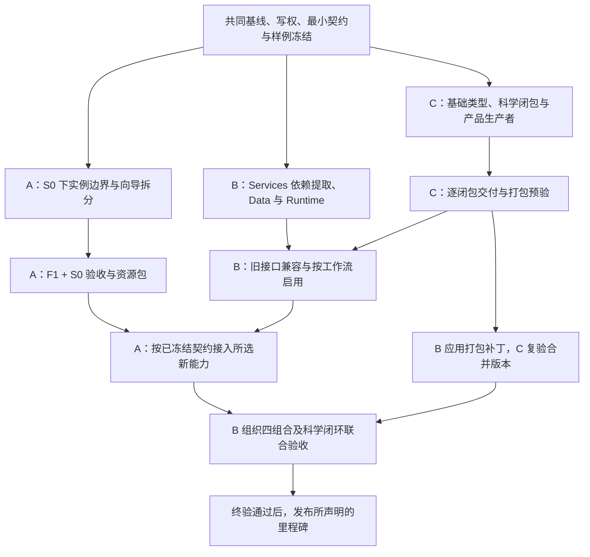

# ACP 三路并行实施计划评审与修改建议

评审日期：2026-10-18。代码基线：`f410ac9dae035eb424c40c599692500fdea457cc`。

## 1. 结论与评审范围

**三路职责划分合理，但当前版本还不适合直接作为三路同时实施、一次集成的冻结计划。** 前端计划的实施细节最充分；Services 的主要问题是迁移闭包、切换时序和验收责任；CCCP 的主要问题是迁移顺序、资产与打包的同步、遗漏的科学模块。需要先修正共同交接规则及下列 P0 项，再开启受影响的实施切片。各路基线盘点、调用关系清点和现有行为记录可以继续并行。

本次读取了用户指定的三份文件。前端草案指向正式实施计划，因此同时核对了该正式文件；草案记录的 SHA-256 与正式文件一致。

| 路线 | 评审文件 | 当前任务规模 | 判断 |
| --- | --- | --- | --- |
| A 前端 | [草案](<repo>/.omo/drafts/acp-parallel-plan-1-frontend.md)、[正式计划](<repo>/.omo/plans/acp-parallel-plan-1-frontend.md) | 34 项 + F1–F4 | 可保留主要结构；补完整实例契约、原子切换范围和严格验收状态 |
| B Services | [正式计划](<repo>/.omo/plans/acp-parallel-plan-2-services.md) | 71 项 + F1–F4 | 需要实质性修订，尤其是禁止反向依赖与委托旧实现之间的矛盾 |
| C CCCP | [正式计划](<repo>/.omo/plans/acp-parallel-plan-3-cccp.md) | 51 项 + F1–F4 | 迁移原则正确；需要按真实依赖重排，并补科学闭包与正式发行验收 |

评审依据是计划正文、架构主方案、三路原始清单和当前源码的静态核对。本次没有运行测试、真实科学计算或部署；下文“验收”均为建议补入实施计划的要求。计划已有的评审通过记录不能替代本次三路之间的交叉检查。

优先级：

- **P0**：在相关切片开工或切换前必须修正，否则计划内部矛盾、依赖缺失或无法证明兼容。
- **P1**：相关切片收口前必须补齐，否则可能有运行、恢复或交付缺陷。
- **P2**：降低执行歧义和维护成本的改进。

无法用计划保证所有环境下一次成功。可实现的目标是：消除已知冲突，让失败停留在隔离切片中，并使正式合入与发布有可检查的退出条件。

## 2. 三份计划共同需要修改的部分

### X1 · P0：建立同一份基线、写权和交接登记

**问题。** 三份计划均写了“单写者”，但 A 自行修改页面测试，B 统管共享集成测试，C 又拥有科学测试及部分 `acp` 文件。目录级描述不足以裁定交叉文件。三个分支还会同时修改包发现、旧路径 shim、配置和架构护栏的相关假设。

**修改建议。** 在 B-T3 与 C-T5 共同产出一份受版本控制的登记表，A-T1/T6 引用同一版本。逐文件或逐符号登记：`owner / 可修改范围 / provider / consumer / base_commit / prerequisites / acceptance / applied_commit`。至少明确以下写权：

| 文件或职责 | 唯一提交者 | 其他路线的交付方式 |
| --- | --- | --- |
| `frontend/**`、前端专属 Node/pytest 测试 | A | B/C 提供契约样例或修改请求 |
| `src/acp_services/**`、平台混合模块、API/调度/发布 adapter | B | C 提供符号级补丁 |
| `src/cccp/**`、登记移交的纯科学 `acp` 模块、科学专属测试 | C | B 提供平台接口需求 |
| `pyproject.toml`、节点依赖、CI、全局架构门、根 AGENTS、共享测试 fixture | B | A/C 提交有来源和基线的补丁 |
| 前端测试拆分后的新增文件、`tests/conftest.py`、打包测试 | 开工前逐文件裁定 | 禁止仅凭“对应测试”取得写权 |

**验收。** 三个分支对同一登记版本确认；每个待迁符号能定位生产消费者和接收任务。补丁只完成了生成时记为“已交付”，接收分支实际应用并通过测试后才记为“已集成”。

### X2 · P0：将跨路依赖从章节名改为版本化交付物

**问题。** `C01 就绪`、`C08 输入`、`A04 消费`太宽；A/B/C 可各自完成章节，却没有使用同一份字段和实现。B-T3 的 JSON 可解析检查也不足以冻结接口语义。

**修改建议。** 在实现前冻结下表的最小可用部分；后续增加能力以版本和能力标记扩展。字段的最终命名由对应 owner 定义，各路不能另起一份 DTO。

| 交付物 | 提供者 → 消费者 | 必须冻结的内容 |
| --- | --- | --- |
| Access 与配置边界 | B → A/C | principal/project/tenant 区分、授权失败、部署档位与执行模式、配置优先级 |
| Data prepare/read | B → A | 显式 prepare、operation 查询/取消、幂等键、availability、资源 revision、freshness、错误和重试；新旧端点兼容期限 |
| 事件流 | B → A | owner/scope、cursor、重放/过期重置、权限撤销、覆盖范围、客户端降级条件 |
| 科学产品与帧 adapter | C → B → A | schema、单位、来源摘要、原子/帧/模式/点身份、partial/unavailable、块索引与预算、旧产品映射 |
| 执行协议与科学闭包 | B/C → worker | Envelope/Receipt 字段、TaskPayload/Result 映射、每工作流依赖、release/插件摘要、冻结算法版本 |
| 发行与资产 | C → B → C | 构建配置、发行文件归属、依赖和资产清单、旧导入窗口、已应用提交、最终 wheel 摘要 |

每份交付物带正常、空、部分、损坏、旧版本样例及期望消费结果。消费者对提供者发布的同一组 fixture 做契约测试；只检查样例是合法 JSON 不算完成。

### X3 · P0：补齐三路合并后的实际验收负责人

**证据。** A 明确只交付 A00–A03/A05，A04/A06 留后续；A-T31 只验 S0。B 的 Verification strategy 明确“前端 Node/浏览器测试不在此计划执行，只引用 A/C 输出”。因此 B-T16、T69 所需的 F0＋S1、F1＋S1 没有实际执行方。

**修改建议。** 保留 A 的 S0 独立交付目标，同时增加有入场条件的 A04 接入任务和联合验收任务。A 负责前端实现和浏览器场景；B 负责在集成分支组织并运行组合验收；C 负责同一 release 下科学等价的判定。B 执行 A 提供的黑盒测试，不会取得 A 源码写权。

必须记录：F0＋S0 基线、F1＋S0 前端兼容、F0＋S1 旧客户端兼容、F1＋S1 集成行为；启用新科学路径时另记录该组合的 C/release 版本。每份证据绑定实际提交、契约版本、配置和 fixture 摘要，不能拿 S0 的旧浏览器记录证明 S1。

**退出条件。** A04 暂未启用时，明确交付的是前端兼容重构；新服务 UI 接入仍是开放任务。启用 A04 后，补测 F1＋S0 的能力缺失回退和 F1＋S1 的真实 prepare/事件/产品消费。

### X4 · P0：让 M1/M2/M3 按必需切片推进

**问题。** 原并行索引要求 M1 先交第一条本地 GUI/CLI/init 闭环和一个插件样板。但 B-T41 等待 15 工作流切换及整个 C08；C-T39 又等待 NMR 资产、大数据产品等，插件 T44 还依赖 T39。第一条闭环被全路线拖住。B 的 `gate=M3` 也没有说明是“进入 M3”还是“通过 M3”，容易形成口径上的自我依赖。

**修改建议。** 保留全部工作范围，拆分验收层次：

- M1：选定第一主场景所需的科学闭包、对应 worker/发布/读取链、init/doctor、最小可复现发行和一个只读插件样板。
- M2：第二主场景、项目包、MCP、所需 A04/A06 接入。
- M3：真实身份/授权、隔离、可信核时与配额。
- M4：按需求启用 Credit、Hosted 和其他条件组件。

B-T34 分“每工作流切换”与“15 项最终覆盖”；B-T40/T41、C-T39/T40 分“首批范围验收”与“完整发行验收”。插件的元数据字段尽早冻结，首批无外部插件也必须有明确的空集合/内置版本身份。C 的完整 NMR 与产品迁移继续推进，不因此取消。

条件项使用独立的范围状态，例如 `IN_SCOPE / DEFERRED / NOT_APPLICABLE`，证据仍只用 `PASS / FAIL / NOT_VERIFIED`。延期不是通过。F4 对本次声明的里程碑逐条验收，未启用的后续能力继续留在总计划中。

### X5 · P1：交接证据必须能随分支交付

**问题。** C 的闭包表、映射表、打包请求和最终索引大量标 `Commit: N`，仅存在 `.omo/`；B 也引用大量本地日志。本仓忽略 `.omo/`，独立 worktree 和后续 clone 无法获得这些关键输入。A 已将核心记录转入 tracked 文档，这一点应推广。

**修改建议。** 契约、写权、样例、交接状态、验收摘要必须受版本控制；大日志可保留在稳定工件位置，登记 URI/摘要/产生提交/环境/命令/退出码。不要把“证据路径存在”作为唯一验收。补丁必须记录 provider 基线和 consumer 应用提交，防止 B 已搬走旧文件而 C 仍对旧位置出补丁。

### X6 · P0：隔离运行环境，并把发布放在终验之后

**问题。** 独立 worktree 不会自动隔离 editable install、Python 环境、运行目录、端口和 systemd 服务。A 的安装示例允许使用 `<venv>`；三路轮流 `pip install -e` 到同一环境可能改变彼此的实际 import 来源。B-T71 在 F1–F4 之前包含真实发布/重启；“每 commit 可独立回退”也不能证明新数据库写入后旧代码可运行。

**修改建议。** 每路固定自己的 worktree、venv、run_root、配置、端口和临时输出；集成另用一套环境，记录模块实际来源。开发切片只启动隔离测试服务；实际部署由集成发布任务统一执行。把 B-T71 拆为“发布包/兼容矩阵准备”与“终验通过后的发布及冒烟”。

数据库采用可验证的扩展/切换/收缩步骤，声明旧 reader 能读哪些新记录、何时不可回退、如何恢复；代码回退、schema 回退和数据恢复分别写清。涉及架构护栏和 AGENTS 的修改随对应切片提交，不能等 B-T70 才统一更新。

## 3. 计划一：Frontend 详细修改建议

**建议保留：** S0 独立交付、模型/标签句柄、同文件串行、wizard 四片、显式值保留、旧草稿与编辑拦截、数值黄金样例不变、tracked 验收记录。这些方向与现状吻合。

### A1 · P0 · T7：把受限实例契约覆盖到全部返回值和回调

**问题。** T7 对 `addModel` 已定义 token，但 shape 操作仍有“转发”措辞，链式方法和点击/悬浮回调的返回/参数没有完全限定。当前 `scene_instance.js:77` 的 `forward()` 直接返回原生结果；`molecule-view.js:181` 的回调签名含 `viewerInstance`。只拦截 `addModel` 返回值仍可能泄漏 viewer、shape 或带内部引用的原子对象。

**改法。** 为每个公开方法列出输入、成功值、失败值、销毁后行为和回调参数：

- 所有模型、shape、label 用实例内不透明 token；拒绝另一实例的 token，移除后 token 失效。
- mutator 返回布尔值或受限实例，禁止原生链式返回值透传。
- `selectedAtoms` 返回字段白名单的独立快照；点击/悬浮回调也转换原子、viewer 和必要事件字段，不传原生 viewer/model 或带方法的原生对象。
- 场景、模型或任务代次变化后，旧回调立即失效；不仅检查 `dispose`。
- `lastError()` 明确哪些操作清除错误；渲染成功不能让调用者误以为前一步解析成功。新增调用者必须显式处理 `addModel/selectedAtoms` 的失败值。

**验收。** 用返回 `this`、返回原生 shape、回调传原生 viewer 的替身验证边界；修改原子快照不改变内部模型；跨实例/已移除 token 被拒绝；旧模型回调不能修改新任务状态。

### A2 · P0 · T7/T14：模型枚举由 wrapper 自己维护

**证据。** 当前 vendor 固定为 `frontend/js/vendor/3Dmol-2.5.5.min.js`，静态检索没有 `getModelCount`。草案末尾已提到这个事实，但正式 T7 只写了方法名，未明确实现策略。

**改法。** 将该备注提升为正式验收条件：实例维护模型/token 顺序及有效性，`getModelCount/getModel(index)` 从实例注册表读取；`removeModel/removeAllModels/clearScene/dispose` 同步更新。明确 instance-level 样式作用域，与 token-level 样式区分；多模型 overlay 的 A/B 样式不能因“当前模型”默认改变。

**验收。** 使用实际 2.5.5 vendor 的浏览器场景，循环添加/清除 overlay 后模型数回到基线；不能只用实现了不存在原生 API 的 stub。

### A3 · P0 · T8/T13/T14：把共享主 viewer 的类型切换作为一个闭包

**问题。** T8 把全局 `viewer` 改成受限实例，T13/T14 才迁移振动和结构查看/编辑。T8 虽要求必要时同片修改消费者，但没有冻结“必要”的具体范围。`$3Dmol` 单驻点断言只能证明库入口集中，不能证明这些消费者已适应新的对象语义。

**改法。** 在 T7 后增加明确的消费者兼容表：主结构、结构查看、结构编辑、振动、framing、导出、测量和选择。T8 的提交边界包含所有共享该全局对象的消费者所必需的调整；T13/T14 只做其余行为迁移和专项覆盖。禁止通过暴露原生 viewer 维持中间态。总量单驻点断言放 T15/T27；单片断言只约束已迁移调用点。

**验收。** T8 单独检出即可完成主结构加载、编辑回推、overlay、振动、测量、PNG 和重复初始化；无需等待 T13/T14 合入才恢复功能。

### A4 · P1 · T16–T23：把职责划分补成可执行的状态和装载契约

**问题。** T16 用行段划分四片，预览的 `7132–7180` 又位于方法配置 `5014–7370` 内。按行搬代码仍可能形成函数重复、闭包状态遗漏或监听器双注册。T23 还可能涉及 `reaction-builder.js`，需和 T11/T22 明确同文件排程。

**改法。** T16 产出逐符号映射，给每个状态变量、监听器、异步请求和清理函数指定唯一 owner；重叠区按职责归属，不按行段重复抽取。每个提取任务必须包含 HTML 脚本装载顺序、全局函数兼容表及拆分前后请求/提交 payload 对照。保留 draft version、0/false/null、FormData 和未知结果查询策略；`job_editor` 的编辑会话与新建表单共用规则且不共享可变草稿。

**验收。** 模态框重复打开/关闭不增加监听器；切任务或关闭向导后迟到解析/预览不覆写新草稿；15 active 工作流的新建/编辑提交对照到字段级。T23 若修改 reaction-builder，加入该文件串行链。

### A5 · P0 · T30/T31/T34/F4：纠正失败与未验证的关闭规则

**证据。** T30 允许 FAIL “修复或 NOT_VERIFIED 说明”；T31/T34 和 Success criteria 允许浏览器不可用时条件关闭 A05。观察到行为失败与没有环境执行是两种事实，不能相互替代。

**改法。** 删除“失败登记后关闭”“FAIL 转 NOT_VERIFIED”的兜底表述。已执行失败只能是 FAIL，修复后重跑；缺依赖未执行才是 NOT_VERIFIED。浏览器未测时可以交付代码与模块证据，但 A05 真实浏览器退出门保持开放。已有基线失败要记录归属，并证明本次未扩大影响；所修改路径的回归不能以基线债务豁免。

**验收。** 验收记录分别显示实现完成、模块通过、浏览器通过、服务接入、真实科学/远程/生产状态。F4 不得把 A05 未验证标为整路无条件完成。

### A6 · P1 · T26–T33：修依赖表，并为 CSS/拆测试/发布补行为证据

**改法。** T30 的 `Depends on` 和正文 `Blocked by` 加 T26；目前 T26 写了 Blocks T30，但 T30 漏列。T29 等待所有会修改同一批 guard 的切片，或明确拆分后的新文件所有者；不能在其他切片仍按旧文件更新 pin 时移动测试。

拆测试用旧 node ID→新 node ID 的映射及断言/fixture 对照，不能只比较用例数量。CSS 比较实际 viewport/主题/语言下的 computed style 和截图，选择器文本相同不能证明层叠等价。T33 将资源清单交 B-T71，验证正在打开的旧页面、资源缓存和新服务的组合；静态资源缺失若影响已声明的 Web 发行，不能仅登记后关闭。

### A7 · P1 · 范围与 A04/A06：增加可接续的条件任务

**改法。** 把“B/C 就绪即可接续”改为可执行项，至少列出：prepare/operation 客户端、快照/事件刷新、科学产品 adapter 接入、四组合浏览器测试。写明每项等待的交付物版本、文件 owner 和退出条件，先不实现未冻结字段。账户/配额/项目包 UI 按各自 M2/M3/M4 范围接续。

**验收。** 每个 B/C 对 A 的交付物都有接收任务；若该 UI 不在当前里程碑，明确延期并保持旧功能可用，不能让 B/C 把“已交字段”写成“前端已接入”。

## 4. 计划二：Services 详细修改建议

**建议保留：** Workspace/Runtime/Data 三 owner、CAS 与 attempt 身份、终态后副作用、旧结果读取、持久 prepare、按工作流启用、真实能力分层和条件组件门控。需要把这些原则落实到完整迁移闭包及具体故障窗口。

### B1 · P0 · T6/T11/T12/T25/T31：解决禁止反向导入与委托旧实现的矛盾

**证据。** T6 要立即禁止 `acp_services → acp`，同时迁移整个 ProjectManager；当前 `src/acp/scheduler/projects.py:15` 导入 `acp.scheduler.migrations`，`:16` 导入 JobStore，构造时调用 `migrate`。T11 首版委托旧 manifest/cache，T12 包装旧 paths，T25 委托旧 JobManager，T31 复用仍在 acp 的 step requirements。这些任务没有列齐依赖迁移或注入方案。

**改法。** 在各提取任务前补“依赖闭包与过渡装配”子项：

1. contracts、必要类型与持久化基础先具备不依赖 acp 的落点；T6 的 store 参数用 Services 定义的最小 Protocol 表达实际所需的 `db_path`，迁移调用放入明确的 schema 初始化入口。
2. 对确实暂留 acp 的实现，由旧 acp 装配入口创建并注入 Services 的端口；Services 不导入或动态查找旧实现。这个阶段只能声明“端口收敛”，不能声明 Services 已独立。
3. 对每个注入的旧实现增加实际迁移任务和移除条件；最终 Services 装配必须能使用本包内唯一实现。

至少覆盖 jobs/store/migrations/tasks/task_views、manager/controller、规划/executor/step requirements/recovery/publication、catalog/参数解析、remote paths/release/submission。各项依科学/平台归属拆分，不能以新增 facade 自动替代完成迁移。

**验收。** 同时验证静态禁止反向导入、旧路径同对象、生产入口确实使用新实现，以及在移除旧实现的环境中完整构建并执行所声明用例。仅 AST 无 `import acp` 或 wheel 包含 Services 不足以证明 IS-3。

### B2 · P0 · T14–T16：先有兼容通道，再切 cache-only；新 GET 不得入队

**证据。** T15 已将旧 `_job_read_root` 等同步分支改成 enqueue＋pending，T16 才建立“切换前”的兼容证据。T15 的失败 QA 要求 GET 缓存缺失时 enqueue，这与其引用的“GET 隐式 prepare 禁止”矛盾。T14 声明阻塞 T15，T15 又只依赖 T13。

**改法。** 将 T15 拆成新接口准备与实际切换：先完成 T14 的安全发布、显式 prepare/operation 接口和每资源兼容 adapter，再完成 T16 的冻结 F0 客户端对拍，最后在同一可合入切片启用该资源的新路径。

- 新 GET：只读快照/availability，零 SSH/SFTP、零 enqueue、零解析写入。
- prepare POST/命令、终态后台流程、启动恢复：可以创建持久 operation。
- 旧 GET：若旧客户端依赖同步获取，兼容窗口内保留显式 legacy adapter；其副作用作为受限过渡项登记，不能称新 GET 已纯只读。

**验收。** 冷缓存下跑原版 F0 客户端，用户无需升级即可按原流程拿到结果；只返回相同的 200/409 并不充分。对新 GET 同时断言无网络调用、无 operation 新增；切换失败可按资源回退。

### B3 · P1 · T13/T14/T17：补齐租约、权限与文件/数据库之间的恢复协议

**问题。** “lease/attempt 守卫”未说明旧租约持有者如何失去发布资格；SFTP 拒绝不等价于 Workspace 权限撤销；本地计算下载文件的 hash 也不能独自证明它属于当前源工件。文件 rename 与 availability 数据库提交之间还存在崩溃窗口。

**改法。** 明确 operation 的所有权代次/租约 token，发布时以 CAS 同时核对 operation、attempt、资源 generation、授权版本和受控存储绑定。预期摘要来自冻结的源 manifest/完成回执；不能用刚下载文件的自算摘要充当预期值。下载前和发布前都重验授权；共享资源去重键包含权限范围，取消一个观察者不能误取消其他合法消费者的操作。

采用持久发布记录与可恢复阶段，把“文件已发布、DB 未登记”“DB 有记录、文件缺失”“旧 worker 迟到”分别定义为可对账状态；不得让未确认工件显示 ready。预算同时计算临时文件与正式文件的空间峰值。

**验收。** 在每个持久化边界中断后重启；旧租约持有者与新 worker 并发完成时，只有当前资格能发布；授权撤销但 SFTP 仍可连接时，发布仍被拒绝。

### B4 · P1 · T22–T24：使用事务 outbox 保证状态和事件之间不丢事实

**证据。** T23 规定“状态 CAS 提交→写事实→通知”。如果进程在 CAS 成功与事件写入之间退出，数据库状态已经变更，但事件永远缺失；当前 QA 主要证明提交失败不通知，没有覆盖这个相反窗口。

**改法。** 在 owner 的状态事务中同时写入 outbox，提交后异步投递到持久事件流/兼容 JSONL，再通知 SSE。消费端按稳定事件 ID/cursor 去重；明确快照 revision 与事件 cursor 的衔接，避免快照读出后到订阅之间丢更新。通用事件契约放中立的 contracts，Workspace/Data 不通过 import Runtime 私有模块发布自己的事实。

**验收。** 覆盖 CAS 后未通知、outbox 投递后未标记、重复重放、cursor 过期和权限撤销；重启后不丢事件、不重复改变状态，旧每任务 after_seq 入口仍可读。

### B5 · P0 · T30–T34/T67：统一“整链切换”与逐工作流启用

**问题。** T32 要求所有入口“一次切换、不能半切”，T34 又允许部分工作流保持 legacy。Receipt 的字段枚举没有完整列出 T31 实际要求验证的 release/owner/fencing。对旧 worker 的风险也不能只验证回执被拒绝：原进程仍可能写同一磁盘目录。

**改法。** 将整链切换定义为“某个工作流及其本地/远端支持路径的完整闭包”，用单一调度器按已冻结的 workflow/release 能力表选择执行协议，并在 attempt 中记录该选择。新 attempt 可启用新协议，旧在途 attempt 沿原协议/release 接管，不得在恢复时重新选择入口。

Envelope/Receipt 共同冻结：schema、job/attempt/submission、release、owner/fencing、plan/step identity、StorageBinding、证据摘要和错误；入口白名单与不支持能力明确失败。receipt 拒绝与物理写保护分别验证；未确认旧执行停止或隔离写入前，不得让新 attempt 复用会被旧进程改写的工作文件。

**验收。** 一个已启用工作流与一个 legacy 工作流同时运行，同一 attempt 始终仅一个执行入口；控制端升级后能接管旧 release；迟到回执与旧进程落盘均不能污染当前 attempt。

### B6 · P0 · T7–T10/T48–T52：补齐真实身份生命周期，保持本地多项目兼容

**证据。** T8 把注册/邀请/会话/首次管理员后置到 B09，但 T48–T52 只有开通、配额授权、隔离、管理和 doctor；T9 把 OIDC 网络登录交给 B12，但 T62–T65 没有对应任务。当前 ProjectManager 已支持多个项目，T7“本地档位=唯一 scope”也需要消除歧义。

**改法。** 增加明确任务：适用档位的账户建立/邀请、首次管理员 bootstrap、登录/会话或明确的 Key-only 支持范围、禁用/撤销、恢复；OIDC 若在本次 Lab 支持范围内，增加 adapter、回调和 issuer/subject 验证任务，否则 doctor 不得声明可用。身份验证依赖选型按现有组件策略执行，不用 placeholder 充当认证。

本地可以是一个 principal/tenant，但必须保留其多个合法 project；旧项目通过确定性接纳规则归属，未知或未授权项目拒绝。`deployment_tier` 与 `execution_mode=local/remote` 分开，远端计算不自动代表多人托管。本地 Origin/CSRF 方案必须同时覆盖旧同源页面、无 Origin 的已授权 CLI/机器请求和事件连接，不能要求尚未接入的新 UI 才能写入。

**验收。** 完整身份状态流和本地多项目回归；禁用主体后新命令、下载与既有事件流均正确处理；缺认证能力的 Lab/Hosted 保持不可启用。

### B7 · P1 · T35/T41/F3：完整 CLI 必须由真实用户入口证明

**证据。** T35 和 F3 明确通过 Runtime/manager Python 脚本测试 pause/cancel/continue/rerun，并“不新增 CLI 面”。这能证明内部用例，但不足以证明 IS-7 和原 B07 所要求的完整 CLI 产品闭环。

**改法。** 补独立任务定义本地任务管理的公开命令和可持续运行的 controller/worker 连接方式，复用 Services 用例；保留现有 `acp run`、retired 拦截和参数语义。CLI 应能在进程重启后找到原任务并控制/恢复，而非只有测试脚本能取得内存中的 manager。

**验收。** 从命令行完成摄入、执行、查询、暂停/继续/取消、原地 rerun、恢复与导出；不启动浏览器或 Web 服务。若本轮只做旧 CLI 兼容，则明确缩小该项声明，保留完整 CLI 的后续实施任务。

### B8 · P0 · T40，与 C-T30/T39/T40：打包修改必须随消费者迁移应用

**问题。** C 迁走资产与加载器后，B-T40 才按整个 C08 调整 package-data，会产生源码可跑、安装包漏资产的窗口。当前 `include=["cccp*", "acp*"]` 已经匹配 `acp_services`，增加一个 pattern 不证明角色隔离；extras 也不能独自证明独立发行。

**改法。** B-T40 拆为滚动打包维护与正式发行验收：资产路径、package-data、节点依赖、打包测试跟随相应 C 迁移同批应用；另冻结独立 CCCP 发行配置、Services/CLI 的发行归属，以及兼容 ACP 包的文件所有权，避免多个 wheel 重复安装同一 Python 文件。是否使用单仓多构建配置由 B/C 在 T3/C39 明确。

C-T40 的出树 wheel 预验值得保留；增加明确回执链：C 请求与预验→B 应用→C 在合并提交重建/重验→B 纳入 release。最终构建配置和验证命令必须入仓可复跑。Web 发行所需静态资源应有交付任务；不能既声明可独立安装 Web，又把静态资源缺口仅记录不修。

### B9 · P1 · T44/T45：定义 archive 的快照边界与登记 owner

**问题。** “在途任务明确时点快照”和“原子登记新平台 ID”还没有跨文件/DB的具体协议。如果导出时任务文件持续变化，仅生成摘要清单并不能证明一致快照；Data 自行创建 Runtime job 还可能跨 owner 写表。

**改法。** 导出固定 generation/revision 的已提交工件，或先建立受控快照再生成 manifest；发生变化时重试或显式部分包。导入采用持久 staging/import 记录，明确 DB 提交与文件发布的恢复顺序。Data 登记归档资源与来源映射；若需要平台任务投影，由 Runtime 公共用例登记历史记录，不收养外部执行权。

**验收。** 并发导出/写入、导入各阶段崩溃、同包重试、跨权限同摘要、来源记录与真正可执行任务分别验证；不存在可见的半登记成功。

### B10 · P1 · T49/T53–T60：配额上限与停止政策必须可兑现

**问题。** T55 同时要求“派发前预留可验证上限”“不靠事后统计防超用”“耗尽不杀在途”。若运行时长没有可执行上限，预留就不是可验证的上限。T53 又把暂停/失败等政策留待配置，T55 不应提前写死所有在途处理方式。

**改法。** 冻结可执行资源上限：核数、walltime、硬限制能力、政策版本及 PAUSED 计量；无法给出上限时，拒绝 quota-only 准入或只允许明确选择的 usage-only。允许追加预算时，先原子追加授权和预留，再扩展运行额度；不能先超用后补账。未知提交/未知用量保留待对账预留，租约到期本身不能释放。耗尽策略由已批准政策确定，已产出结果仍可读。

**验收。** 并发多任务、跨周期、暂停后继续、时长上限、预算追加失败、失联和重复最终回执均不能超出已授权额度；计量模拟与真实 Local/LSF 采集证据分列。

## 5. 计划三：CCCP 详细修改建议

**建议保留：** 数值与黄金值冻结、typed unavailable、原生模式编号、唯一科学实现、旧路径同类转发、科学程序与只读分析分离、出树 wheel 预验、许可和模型摘要随迁。这些是迁移的必要约束。

### C1 · P0 · T7–T10/T16–T28/T35：按真实依赖闭包重排基础类型与 helper

**证据。** `src/acp/io/structures.py:20` 依赖 Structure，但 T17 处理其科学函数、T35 才迁 Structure；`results/frequencies.py:8` 依赖 OrcaCalculation，T18/T19 却允许并行。`confsearch/selection.py:12`、`result_helpers.py:10` 依赖 confsearch contracts，T21 没明确这些类型的先行归属。NMR 的 protocol/reference_validation 还依赖平台 identity helper。

**改法。** 在 C00 生成符号依赖图，标记运行时、延迟导入、TYPE_CHECKING、动态注册和资产边；科学基础类型与 fingerprint 的纯算法部分先确定唯一目标。T35 中被前序实际消费的类型提到对应迁移之前，不必等待常量精度决策。对相互依赖的模块作为一个可合入闭包处理，或先抽出不改变序列化的叶级类型，不能迁一半再允许反向 import。

T18→T19 成为硬依赖；T21 前先处理其科学 contracts；C-T7/T8 加 T4 数值冻结门。基础 fingerprint 如需下沉，ACP 侧保留同对象/同输出兼容入口，C-T28 不能复制第二套算法。B-T27 必须消费同一交付物并验证旧 plan/step identity 不变。

**验收。** 每个可合入切片在无旧 acp 的环境中能导入并调用本片新公开 API，且旧入口/异常类型/序列化/身份输出等价；不能只等最终全迁完才恢复可用。

### C2 · P0 · T25–T30：补上遗漏的 NMR 枚举能力和公开导出面

**证据。** 计划宣称迁移全部 NMR 科学模块，但 T25–T30 没有列出 `src/acp/nmr/enumerate.py`。该模块包含立体异构体枚举和去重；`src/acp/workflows/nmr.py:72` 导入、`:406` 调用，`acp/nmr/__init__.py:42` 公开导出，已有 `tests/test_acp_nmr_enumerate.py`。

**改法。** 将 `enumerate.py` 加入 models/structure_map 就绪后的科学迁移批，保留 stereocenters、seed、max_isomers、对映体去重、无拓扑输入拒绝等语义。T29 明确无人值守 report 实现的 CCCP 目标位置、旧路径转发和依赖，而非只写“保持报告”。逐项核对 `acp.nmr.__all__`、动态 registry、TYPE_CHECKING 和子模块导入；新 `__init__` 只能导出，不能混入实现或意外激活可选算法。

**验收。** 现有公开科学符号逐个有迁移/保留/拆分处置，NMR 枚举可在无 ACP 安装中运行；科学模块清单与实施任务一一对应，不以“25 模块”这个计数代替覆盖检查。

### C3 · P0 · T26/T30/C08：加载器、模型资产与打包必须同一发布切片完成

**证据。** T26 要求 FCHL 资产加载路径改为新位置并可加载；T30 在 T28/T29 之后才移动资产。当前 `error_model.py:41` 与 `fchl.py:81` 均按模块旁 `models/` 加载。中间阶段可能全部落入 unavailable，使缺失模型被误当成允许的降级。

**改法。** 将 T30 的文件迁移、hash/notice 清单、loader 修改和 B 的 package-data/打包测试补丁与 T26 组成同一可合入发布切片；后续 T30 仅汇总最终审计。若确需分阶段，先定义单一资产位置与兼容 reader，显式记录去除期限，不能保留两份内容或借旧 ACP 路径满足独立包验收。

模型缺失的 typed unavailable 是负例；原本模型齐全环境必须继续得出原结果。FCHL 的已知不可用组合按原基线保持，不把所有 typed 失败都算迁移成功。

**验收。** 在合入后的源码环境和实际 wheel 安装中各验证资产清单、摘要、DP5/FCHL 可用性、模型加载和数值输出；仅 `find_spec` 或文件数量不足以过关。

### C4 · P0 · T3/T7–T10/T24：区分首个闭包交付与后续全量迁移

**问题。** T7 允许 simple 已独立时跳过 T8/T9，T10 却仍硬依赖 T8/T9。T24 标注 Blocks T10，但 T10 没列 T24；T9/T22 标注 Blocks T24，T24 又只依赖 T3/T6。前序首片也可能选择后续 T24/T25 所管符号，造成重复迁移。

**改法。** T10 拆为每个已就绪工作流的交付与完整闭包汇总。simple 已满足时提交同等隔离证据，明确 T8/T9 对本次首批范围“不适用”，不能删除整路后续科学迁移。每个符号只登记一个实施任务；首片迁过后，后续任务消费提交并处理剩余符号。

T24 依据实际符号依赖添加采样/Boltzmann 等前置；如果某工作流仍需它，只有该工作流的 readiness 被阻塞，不阻塞其他已独立工作流交 B。交付表明确区分 task 核已独立、科学 helper 已独立、平台编排待 B、安装发行已验证。

### C5 · P1 · T11–T14/T31–T33：补生产者与消费 adapter 的实装闭环

**问题。** T11/T12 主要是 schema/fixture；T13 给 B 映射表，但 B 计划没有一个明确任务承接全部 frames/product adapter。T13/T14 可早于 T12 收口，可能把尚未冻结的振动/曲线字段交出去。T32 只要求“最大块大小”，不能证明生成过程没有先读入全量数据。

**改法。** 每类产品定义：真正生成它的函数、生成时机、稳定身份、原始输入摘要、schema reader/writer、旧版本转换、部分失败与缺失原因。对应增加 B 的平台投影/发布 adapter 任务，必须经 `TrajectoryFrame.to_node()`/annotation 契约；A 只消费有限展示产品。需要曲线/振动的 T13/T14 等 T12，或明确只交结构子集并分版本补充。

对分块、抽样、多分辨率分别约定指标；无损分块可重构全序列，抽样产品只能证明选中点与原始点映射及关键点保留，不能承诺重构被省略的全部数据。T32 记录生成和读取的峰值内存/时间随规模变化，而不只检查最终块大小；首次需要全量科学分析时与后续有界读取分开报告。

**验收。** 使用同一真实 fixture 经 C 生产→B 登记与 frames 投影→A 展示/选择映射；schema round-trip 和空壳 fixture 不能替代生产路径证据。

### C6 · P0 · T36，与 B-T36–T39：科学配置与平台配置拆分要共同落地

**问题。** C-T36 把 cluster 平台配置从 `cccp/config.py` 分离，但 B-init 仍要求复用该模块的完整配置来源；新 CCCP 又禁止依赖 Services。只写“输出等价、请求 B 同步”不足以说明旧 `cccp.config` 调用者如何继续获取平台字段。

**改法。** 先冻结三层：CCCP 科学配置解析、Services 平台配置解析、旧完整配置兼容装配。明确每个公开入口返回哪些字段，以及旧 CCCP 入口的过渡契约。需要保留兼容字段时将其限于被动透传数据，不能由 CCCP 反向加载 Services 的平台实现；最终装配由上层完成。新权威平台默认值、YAML 和 init/RemoteNode 校验在 B/C 同一集成批中更新。

**验收。** 覆盖原六源优先级、未知字段、环境覆盖、本地无 remote extra、远端节点和旧配置文件；新科学最小安装不要求 Services，已声明的旧完整配置入口保持等价。

### C7 · P1 · T39–T46：正式 wheel 和版本身份必须由合并版本复验

**建议。** 保留 T40 出树构建，它确实解决了 B 尚未应用配置时的预验问题；但它只能证明 C 提议的配置可行。补一个显式硬依赖于 B 应用提交的最终复验任务，而非正文一句“之后再复跑”。

验收环境应在仓库之外启动，排除 editable `.pth`、源码 cwd 和 PYTHONPATH 泄漏；同时确认 ACP/Services 不可发现。构建清单、离线依赖来源、wheel 内容、模型/notice 和运行样例记录摘要。首批 API、配置及插件能力对应同一 release；无插件也有明确版本集合。C-T46 不得在 B 已冻结执行身份并发布后才首次决定字段形状。

### C8 · P0 · T48 与所有迁移片：尽早扩展隔离检查到本次迁移范围

**证据。** `scripts/verify_cccp_isolation.py:61` 的 EXPECTED_TASKS 是固定 14 个 task 核，且主要接受受控后端错误形成的 structured result；它证明的是已有 task 层隔离，不能单独证明新 `cccp.analysis.nmr`、PES、资产或完整工作流可运行。15 个 active workflow 与底层 task 数量也不是同一个集合。

**改法。** T48 的检查能力在首个迁移片前建立，并随切片扩展：静态依赖/动态入口扫描、公开 API 导入、至少一个成功的科学 fixture 路径、错误路径、旧/新对象与输出对照、无 ACP 安装检查。明确 workflow→task/helper 映射，不能强行把两个计数相等作为门。

护栏应识别真实 import、importlib/registry 动态目标和 CLI 绕路；不要把文档、历史 provenance 中的 `acp.*` 字符串一概判成反向依赖。例如 `pes/atom_mapping.py:588` 的 `generated_by=acp.calculations.pes.atom_mapping` 是输出内容，修改它需单独评估兼容性，不能为 grep 清零而改。

注入式负例只在临时副本/隔离 worktree 运行，失败后也保证清理；不得污染正在被其他路线消费的工作树。全局护栏修改仍由 B 按登记同步，保持等效或更强约束。

### C9 · P1 · T34/T38/T47/T50：将独立变更与迁移收口分开

**改法。** 不同精度常量只出决策记录的安排继续保留；异常窄化、第三方 parser 采用、算法统一和数值变化各有独立任务及行为基线，避免和位置迁移合并提交。第三方评估没有通过不接管主路径，明确其是否为本次里程碑必选。

T50 的“发现调用者恢复实现”改为：恢复兼容 shim/正确调用路径，或回退整个切片；不能在 CCCP 已有唯一实现后又恢复一份 ACP 实现。删除前核对公开导出、动态注册、持久格式和恢复 fixture；同类身份、错误类型、原始模式编号及既有科学 hash 都要有证据。

## 6. 建议采用的三路并行顺序

### 6.1 共同准备完成后，各路立即做自己的主体工作

这里的串行点是交接和启用门，不要求三路轮流开发。A 的主体重构、B 的本地端口/协议、C 的科学提取可以并行；一条路线不应因为另一条后置能力尚未完成而闲置。

### 6.2 必须在正文和依赖表同时修改的关系

| 位置 | 当前缺口 | 建议关系 |
| --- | --- | --- |
| A-T30 | 漏等 T26 | T26 → T30；T30 等待本轮所有实际变更 |
| A-T29 | 其他任务仍可能改被拆分 guard | 相关 guard 最后一个修改切片 → T29 → T30 |
| A-T8/T13/T14 | 共享 viewer 切换边界不确定 | T7 → T8 完整消费者兼容切片 → 后续专项迁移与验证 |
| B-T6 | ProjectManager 依赖仍在 acp | 迁移/装配基础确定 → T6；最终禁旧实现验收另有显式任务 |
| B-T15/T16 | 先改变旧行为，再做兼容 | T14 + 新接口准备 → T16 兼容验证 → 逐资源实际切换 |
| B-T24 | 可在 T23 可靠投递前收口 | T22 + T23 → 真实授权事件流启用/验收 |
| B-T31/T32 | 契约开发与执行启用混用 | 协议可提前开发；启用等待 controller/Data/科学闭包/节点依赖的具体交付 |
| B-T41 | 首个闭环等全路线 | 首批范围退出门与完整 15 工作流退出门分开 |
| C-T7/T8 | 首片缺显式数值冻结依赖 | T4 → 首片实际迁移；不只依赖台账和写权 |
| C-T19 | 振动 builder 可先于 ORCA 类型迁移 | T18 → T19，或同一原子迁移片 |
| C-T13/T14 | 全产品交接可先于曲线/振动契约 | 只交结构子集时注明范围；完整交付依赖 T12 |
| C-T17/T21/T28 | 基础类型与 identity 可能后置 | 相应科学类型/纯 helper → 消费者迁移 |
| C-T26/T30 | 先改 loader，后迁资产 | loader + T30 资产子集 + B 打包补丁同一合入批；最终审计另做 |
| C-T10/T24 | Blocks 与 Depends on 不对应 | readiness 按工作流划分；只阻塞真正依赖 T24 的工作流交付 |
| C-T40 | B 集成后复验没有独立 gate | C 预验 → B 应用回执 → C 最终 wheel 复验 |
| B-T71/F1–F4 | 实际发布早于终验 | 发布准备 → 所选范围终验 → 实际发布/冒烟 |

建议把依赖只维护为一份权威清单，由它推导 Blocks/波次；“参考关系”和“硬依赖”分列。检查未知任务 ID、环、提前消费的产物、同文件同时写、提供者有交付但无接收任务等情况。不要机械补齐所有现有 Blocks，先删除没有真实依赖依据的边。

### 6.3 将下面的内容加入三份计划的共同执行约束

> 1. 实施以共同基线和唯一写权登记为准；所有跨路输入均记录契约版本、提供提交、样例摘要和应用回执。
> 2. 一个可合入切片必须同时具备唯一实现、旧入口兼容、消费者调整、依赖/资产/护栏同步；未完成的跨路补丁不能算该切片已集成。
> 3. 临时端口注入可以支持迁移，但不证明独立运行；独立性用无旧实现环境和实际安装产物验证。
> 4. 新查询不创建 prepare；旧接口的过渡行为明确登记。切换前必须验证冻结旧客户端。
> 5. 任务状态、事件、工件发布、预算预留的各个持久化边界都有崩溃与重放验收。
> 6. PASS、FAIL、NOT_VERIFIED 不互相替代；范围延期单独记录。实际合并版本重新验证，不能拼接不同提交的通过记录。
> 7. 三路各用独立环境和数据；真实部署集中在通过终验的集成 release 上执行。
> 8. 每个里程碑声明实际支持范围；未进入范围的能力保持开放，不阻塞已满足要求的独立交付，也不计作完成。

## 7. 开工前最小修订清单

- [ ] 冻结共同基线、单写者登记、契约与样例的版本。
- [ ] B 明确 Services 过渡注入与最终迁移闭包，解决 T6 等首片的反向依赖。
- [ ] B 重排 T14–T16，明确新 GET 无入队、旧客户端兼容先行。
- [ ] B 统一每工作流整链切换与 attempt 协议冻结，补 Receipt 全字段。
- [ ] B 为身份生命周期增加真实实施任务；声明本地多项目和部署档位语义。
- [ ] A 完整定义受限 API 的返回值、回调和 token；将 vendor 模型注册表写进 T7。
- [ ] A 固定共享主 viewer 的原子切换范围，修 T26/T29/T30 依赖。
- [ ] C 前移实际依赖的基础类型/identity，补 `nmr/enumerate.py` 和公开导出覆盖。
- [ ] C/B 绑定 NMR loader、资产、package-data、节点依赖与打包测试的合入时点。
- [ ] A/B/C 指定 F0/F1×S0/S1 及科学产品 adapter 的接收与联合验收任务。
- [ ] 交接表和验收摘要落入可交付的 tracked 位置；失败与未验证不再条件关闭。
- [ ] 首批/完整发行退出门分开；实际发布移动到终验之后，并定义 schema 与数据回退条件。

以上修订完成后，可以继续按三路并行推进，无需推倒已有计划。应优先修复依赖、交接和退出条件，随后再调整任务编号、波次和工作量分类。

## 附录：本次评审输入指纹

以下为评审时文件 SHA-256；本次没有修改这些原计划文件及其批准记录。

| 文件 | SHA-256 |
| --- | --- |
| `.omo/drafts/acp-parallel-plan-1-frontend.md` | `26617a5958a38d2b15ee6f81ac0e6343430aff739f5136b6148f802930c0cdaa` |
| `.omo/plans/acp-parallel-plan-1-frontend.md` | `fbd9ea5ffa2ad3e6690228f4de9f94d86a14297a4c681048945b1fa2a15ca91c` |
| `.omo/plans/acp-parallel-plan-2-services.md` | `a36165a777f7f464635b3bab9394a8d4e7b7cfbebb8e1a0844f3c016a09a9872` |
| `.omo/plans/acp-parallel-plan-3-cccp.md` | `b776121eda23262af3065aeb57a0f0abfdb98419f2275ed5da7168fe7aab50c4` |
