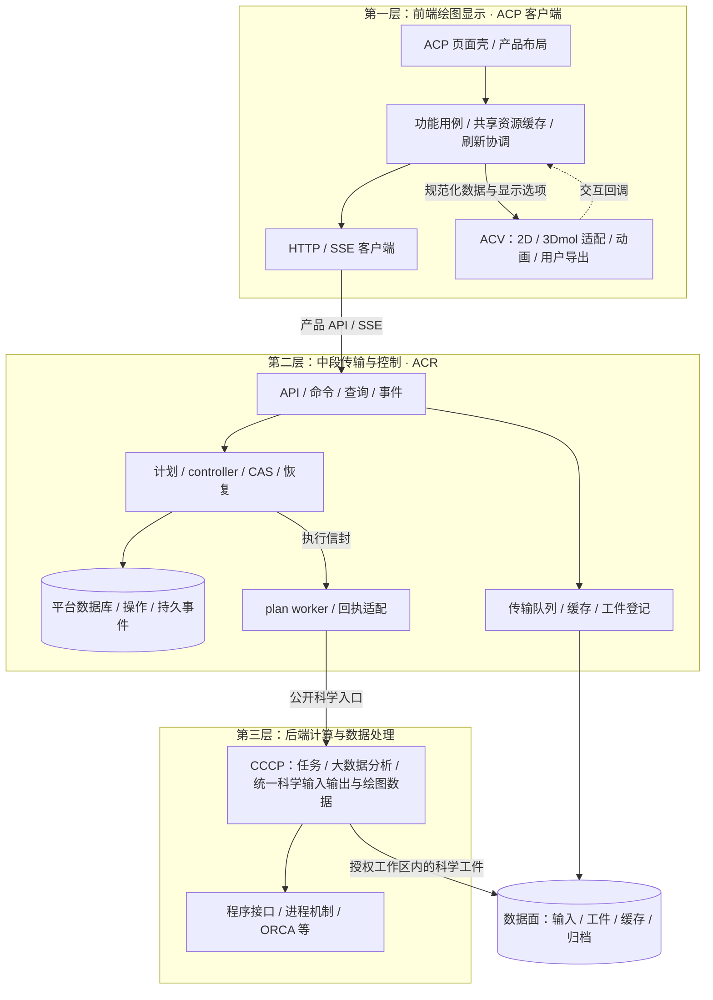

# ACP 新版三层架构设计：前端绘图显示、中段传输与控制、后端计算与数据处理

v1.5 战略增补见[完整方案第 30—35 节](../../ACP_Architecture_Adjustment_Plan_20261016.md#30-产品定位与-aiida-借鉴边界)和[产品战略与差异化](ACP_Product_Strategy_and_Differentiation_20261016.md)：本地完整科研闭环优先，Lab 分 Standalone/Server 配置，Hosted 按需后置；保持独立运行内核，借鉴 AiiDA，引入受控插件、项目迁移与 MCP。新增能力均为待实施目标，v1.4 的设计补全与质量门保留。

实施总入口：[《ACP 完整架构调整方案》](../../ACP_Architecture_Adjustment_Plan_20261016.md)。工作包、阶段依赖、验收与回滚统一按该方案维护；本文保留架构/模块解释，不再形成独立实施顺序。

日期：2026-10-16。状态：**基于当前代码的合并目标设计，尚未实施迁移**。

本文统一前期三模块、内部子层、架构评审和绘图方案，为后续代码规范化提供共同依据。平台总称仍为 ACP；三层分别以 **ACP 客户端（内含 ACV）、ACR 控制运行时、CCCP 科学后端**为主要实现边界。2026-10-16 讨论确认：**ACV 是前端独立绘图模块，3Dmol 作为其三维渲染适配器；科学大数据处理与统一科学输入输出归 CCCP。** 本版已替换此前的后端 ACV 目标，运行代码尚未迁移。

三层是职责边界，不等于三个进程、三台服务器或三个发行包。当前同仓实现可以逐步迁移；集群部署时允许一层包含多个服务、worker 和存储适配器。

模块级公开入口、写入者与调用白名单细则见[《三层模块边界、统一接口与调用规范》](ACP_Module_Boundaries_and_Interfaces_20261016.md)。本文给出总体架构，细则约束模块内部与跨模块的具体组织；两者均为目标设计，不表示代码已完成迁移。

最新模块粒度见[《三层高内聚模块设计》](ACP_Three_Tier_Cohesive_Modules_20261016.md)：前端 workbench/client/acv，中段 workspace/runtime/data，科学后端 calculation/analysis/software。入口、查询、同步、Ports 与适配器均为内部组件或支撑代码，不独立计为业务模块；本文其余层级、文件映射按此分组解释。

产品形态按完整方案第 18—21 节：CCCP 为独立开源科学底座，ACR＋CCCP 为完整 CLI/Agent 运行产品，全栈为免费工作台，线上托管核时消耗 Credit。CLI 属于 ACR 入口，现有 src/acp 路径是兼容面，不要求安装浏览器前端；计量和账本均不进入 CCCP。

双版本与组件归位按完整方案第 26—28 节：实验室版 ACP Lab、线上多用户版 ACP Hosted 共用本架构，开源组件作为既有 owner 的内部实现/adapter；身份、调度、存储、绘图及科学适配各有唯一归属，不新增业务层。具体候选须 PoC/版本/社区功能与许可核验后才冻结。

## 1. 合并决策与文档关系

| 议题 | 本版统一口径 |
|---|---|
| 总体结构 | ACP 页面负责产品布局和功能连接，前端 ACV 负责绘图交互；中段负责控制、传输及平台记录；后端 CCCP 负责科学计算、科学大数据处理及规范化科学产品 |
| 绘图与自动报告 | ACV 拥有浏览器二维/三维绘图及用户导出；现有无人值守报告导出器暂保兼容，不新增后端 ACV 服务，不在本轮取消已有报告产物 |
| ACR 是否处理数据 | 可以做分页、权限过滤、元数据索引、生命周期记录和协议转换；不能重新解析 QC 输出或派生科学结论。“无科学加工”不等于“不能处理任何数据” |
| CCCP 的统一数据 | 统一支持软件的科学输入、输出与分析产品，产生带单位、身份和证据的绘图数值/结构数据；原生格式由软件适配器生成/解析，平台 `result_manifest`、组织信息及可用性由 ACR 定义和登记 |
| worker 归属 | plan worker 是 ACR 应用的运行角色，可以部署到计算节点；其中加载的科学引擎属于 CCCP，不能因部署到同机而混淆所有权 |
| ACV 归属 | 属于第一层前端的独立可视化库，包含二维渲染与 3Dmol 适配；随静态资源发布，无独立服务器、Python 包或渲染进程要求 |
| 迁移顺序 | 保留评审方案“先请求治理、投影、传输与统一客户端，再按触发条件物理拆包”的顺序；完整目标归属不代表现在批量移动科学代码 |
| 兼容与护栏 | 现行 AGENTS.md、四项执行完整性不变量及已有架构检查继续有效；设计稿不自动修改任何现行导入或写入权限 |

前期依据：

- [产品架构优化方案](../../archive/2026-10-16/history/ACP_Product_Architecture_Optimization_Plan_20261015.md)：保留问题分析。
- [三模块边界 ADR](../../archive/2026-10-16/history/ACP_Three_Module_Boundaries_ADR_20261015.md)：保留职责边界，以本文补充分布式部署。
- [内部子层设计](../../archive/2026-10-16/history/ACP_ACR_CCCP_Submodule_Layering_20261015.md)：保留 ACP 四层、ACR 四层加 Ports、CCCP 五层加 C0。
- [架构评审与执行方案](../../archive/2026-10-16/history/ACP_Architecture_Review_and_Execution_Plan_20261015.md)：保留实施排序、读路径与传输队列配套交付要求；其中性能推算不是本轮实测结果。
- [三端四模块绘图方案](../../archive/2026-10-16/history/ACP_Three_Ends_Four_Modules_Architecture_20261015.md)：作为历史方案保留；其中后端 ACV、独立 render worker 和 Python 视图包目标由本版前端 ACV 替代。规范化科学处理仍按阶段迁移，不在设计讨论中直接改动 CCCP。
- [ACV 前端可行性分析](ACP_ACV_Frontend_Feasibility_20261016.md)：本轮确认其前端库方案，保留自动报告兼容边界。

上述文档的目标结构发生歧义时，以本版合并设计为后续讨论入口；已有运行契约仍以代码、现行规范和对应权威文档为准。开始实际迁移时，须同步修订受影响的旧文档与护栏，而非同时保留冲突规则。

## 2. 当前代码基线

本轮依据当前工作区文件、公开入口及调用关系核对，未修改运行代码、未运行计算、未重启服务。以下为文件清点，不是迁移完成率或完整符号依赖审计。

| 当前位置 | 本轮清点 | 当前事实 |
|---|---:|---|
| `frontend/` | 20 个文件 | 3 个 HTML、4 个 CSS、11 个 JS，另有供应商说明/许可文件；主界面仍集中在 `ACP_Workbench_v2.html` |
| `src/acp/` | 268 个 Python 文件 | 同时承载产品入口、API、调度、持久化、流程编排及部分科学算法 |
| `src/cccp/` | 87 个 Python 文件 | 已有任务、能力、QC 接口；共享科学规则与历史集群适配仍混驻部分目录 |
| `scripts/` | 12 个文件 | 部署、诊断、修复、科学验证及边界检查工具 |
| `tests/` | 314 个 `test_*.py` 文件 | 按命名清点，包含 benchmark；未将 fixture 文件计入 |
| 包与发行 | 当前一个 `pyproject.toml` | 同时发现 `acp*`、`cccp*`；控制层尚无 `src/acp_runtime/`，ACV 尚无独立代码根 |

核验到的关键依赖：

1. `acp/scheduler/runner.py` 构造 `python -m acp.cli run ...`；远程 `scheduler/remote/script_gen.py` 同样构造该入口。因此只移动 scheduler 无法让 ACR 独立运行。
2. `script_gen.py` 在**控制服务器的生成器中**导入 `acp.catalog`；生成的 shell 脚本并不直接写 Python import，远端仍通过 `acp.cli` 间接依赖旧包。
3. `cccp.calculation` 已提供惰性公开导出和 requests/results/context/progress；继续复用，不另建第二套计算请求与回调机制。
4. `cccp/qc/cluster/__init__.py` 含本地与 LSF 执行；`qc/runners/__init__.py` 含 Shermo 程序运行。目录名本身不能直接代表目标层级，须按具体职责拆分。
5. 当前注册工作流与科学任务不是一一对应：平台工作流会组合科学任务，不能把两份 registry 合并为一个表。

## 3. 三层总图与部署边界



图中箭头含运行时调用，不能当作静态 import 清单。远程模式下，controller 经执行适配器派发 envelope，计算节点 plan worker 再调用本机 CCCP；不把 Python 对象跨网络直接传递。数据面是三层共同遵守契约的存储设施，不是第四业务层。

统一命名：**层 → 模块 → 子层 → 运行角色 → 部署实例**。例如“中段 / ACR / R2 / plan worker / 集群节点 02”。避免用“后端”同时泛指 API 服务、调度器和科学引擎。

## 4. 第一层：ACP 前端绘图显示

| 子层 | 目标子模块 | 允许依赖 | 数据写入权 | 公开入口 |
|---|---|---|---|---|
| A1 展示 | `ui/pages/components/viewers/editors` | A2 公开 actions/view-model、纯渲染工具 | DOM、画布、相机、动画、临时交互选择 | 页面组件、viewer 的 render/update/dispose |
| A2 功能用例 | `features/tasks/submission/results/structures/workspace` | A3、客户端契约 | 本功能表单、校验提示、面板状态；持久修改须发命令 | 功能控制器、用户动作接口 |
| A3 数据协调 | `data/queries/entities/commands/subscriptions/refresh` | A4 接口、纯版本规则 | ResourceStore 唯一写共享缓存；CommandClient 写操作回执副本 | query/subscribe/command、缓存读视图 |
| A4 通信 | `transport/http/sse/generated` | 浏览器网络 API、提供方生成契约 | 连接与在途请求状态，无业务实体权威写入 | request、openChanges、结构化错误 |

客户端 contracts 为无副作用基础，bootstrap 负责装配。A1/A2 不直接 fetch/EventSource；A3/A4 不操作 DOM、不弹提示。跨功能协作由 workspace 用例连接公开动作。

A3 内部保持五个窄职责：ResourceStore 合并数据；QueryCoordinator 合并取数；ChangeCoordinator 处理事件和失效；RefreshPolicy 管理可见性、订阅和轮询切换；CommandClient 接受命令回执。store 不发请求，轮询不能在各面板重复复制。

交互绘图保留在前端：结构、轨迹、振动共用 3D 核心；能量、PES、IRC、采样、谱图共用系列图核心。前端可做展示抽样与临时几何编辑，科学评分、原子映射证明、优化及正式结果验证由 CCCP 返回。energy viewer 继续只允许保存候选，不承担提交任务入口。

### 4.1 ACV 与 3Dmol 的封装

ACV 是 A1 内部的独立可视化模块，其纯显示转换不依赖 DOM 或网络。建议结构：

```text
frontend/js/acv/
  contracts/ specs/ models/       # 视图契约、声明、轻量显示模型
  renderers/series/              # 二维曲线、散点、谱图等
  renderers/molecule/            # 对页面公开的统一分子 viewer
  adapters/3dmol/                # 唯一直接调用 $3Dmol 的生产适配边界
  interactions/ exporters/       # 选点、相机、动画、用户图片导出
  lifecycle/                    # 初始化、resize、资源释放
```

第三方 3Dmol 源码继续保留供应商版本与许可，封装其 API 而非复制或修改库实现。具体 vendor 文件可暂留现址，由 ACV 的装配/加载边界管理。页面和 feature 不再调用 `$3Dmol.createViewer`、`addModel`、`addArrow`、`pngURI` 等 API。

ACV 对外提供 create/setData/setSelection/setStyle/resize/export/destroy 等窄入口，选点、取帧需求、草稿编辑通过回调返回 feature；不直接 fetch、不轮询、不持有任务权威状态。多个面板可有独立 viewer 实例，共用同一个实现，不建立全局共享的唯一相机/选择状态。

三维显示覆盖分子/构象、轨迹、振动、结构叠合的显示和交互；CCCP 输出原子身份、坐标、已知拓扑、模式编号/向量、已验证映射及叠合结果。3Dmol 自动猜键只可作为明确标记的视觉回退，不得成为科学拓扑或反应判据。局部距离测量和几何草稿不等于正式分析；保存后仍由后端验证。

现有 `scheduleViewerFraming/frame3DViewer` 迁入/适配 ACV 时保留行为和调用护栏，不能在抽取中恢复散落的自动缩放。供应商许可、WebGL/动画资源释放与无浏览器自动报告兼容均纳入验收。

## 5. 第二层：ACR 中段传输与控制

### 5.1 内部子层

| 子层 | 目标驻点 | 允许依赖 | 数据写入权 | 公开入口 |
|---|---|---|---|---|
| R1 入口 | `entrypoints/api/cli/controller/worker` | R2、contracts | 解码及调用；不能绕过应用层写 DB/文件 | 产品 API、嵌入式服务、角色入口 |
| R2 应用 | `application/` | R3、Ports、contracts | 按用例取得事务及受限写能力，见下表 | command/query/process 服务 |
| R3 领域 | `domain/` | 无 I/O 的领域契约、纯规则 | 无持久写入 | 状态转换、身份、依赖、恢复资格函数 |
| R4 适配 | `adapters/` | Ports、R3、外部库与后端公开契约 | 实现仓储、文件、执行、传输操作；不自行决定业务终态 | Repository、ExecutionBackend、ArtifactStore 等实现 |

`ports/` 声明应用需要的能力；`contracts/` 声明对外 DTO；`bootstrap/` 创建与注入实例；`compatibility/` 只做受限旧协议转换及历史读取。它们是支撑边界，不额外算业务执行层。

静态依赖：`R1 → R2 → R3/Ports`，`R4 → Ports/R3`，`bootstrap → R1/R2/R4`。R2 不直接导入 sqlite3、Paramiko、subprocess 或后端私有实现。R4 运行时受 R2 调用，不要求 R2 import R4。

### 5.2 三个主要模块与内部写入者

| 主要模块 | 内部流程/组件 | 写入权与边界 |
|---|---|---|
| `workspace` 工作空间管理 | 项目、成员/权限、分子分组、工作空间配置及自己的查询/事件 | 组织数据唯一写入者；不调用任务/工件内部实现 |
| `runtime` 任务运行管理 | 提交/命令、planning、controller/plan_runner、恢复、完成处理、任务元数据与任务查询/投影/事件 | controller 经 CAS 推进生命周期，worker 只写回执；通过 data 公开接口准备/发布工件，科学调用走 CCCP C1 |
| `data` 数据资源管理 | 输入资产、artifacts/publication、transfers/cache、候选/来源、数据查询/可用性事件 | 工件、manifest、缓存与传输唯一管理边界；不改 job 状态，不反调 runtime 发起计算 |

主要调用方向为 `runtime → data → workspace`，runtime 可直接查询 workspace 授权范围。原 commands/planning/execution/publication/transfers/queries/sync/organization/processes 是上述模块的内部组件，不是九个并列业务模块。入口与启动装配保持薄，内部仍遵守用例/纯规则/适配器分离和单一写入者。

最小 Ports 按实际隔离需要引入：JobRepository、UnitOfWork、OperationRepository、ExecutionBackend、ScientificEngine、ArtifactStore、RemoteFileStore、ReadModelRepository、ChangeLog、Clock。不能为每个函数建立无意义接口，也不能形成一个包揽所有能力的全局 manager。

API 认证获得 principal，应用层检查具体项目/任务/工件权限；内部 worker 使用受限执行身份。嵌入式 CLI 同样经过公开用例，不能借嵌入模式绕过控制规则。

## 6. 第三层：CCCP 科学计算与规范化数据处理

### 6.1 CCCP 五层与科学基础契约

| 子层 | 主要驻点/目标职责 | 允许依赖 | 数据写入权 | 公开入口 |
|---|---|---|---|---|
| C1 公开计算边界 | `calculation` 公开 API、requests/results/context；未来明确的分析 API | C2、C0 | 无平台持久写；校验并转交科学任务 | 现有 `run_*`、TaskRequest/TaskResult/TaskContext；新增能力需显式导出 |
| C2 科学任务 | **唯一实现根 `calculation/tasks/`**；受限科学 batch | C3、C0 | 授权 work_dir 内的任务工件、科学回执与算法检查点 | C1 调度的任务核心，外部不绕过 C1 |
| C3 科学能力与算法 | `backends/`；目标 `analysis/chemistry` 等纯科学模块 | C0；能力适配分支可调用 C4，纯分析不启动程序 | 任务授予的科学输出；纯算法优先返回值 | 内部能力 Protocol、纯分析服务 |
| C4 程序接口 | `qc/interfaces`、程序特定输入/解析、Shermo 科学适配 | C5、C0及明确无 I/O 的科学规则 | 输入文件、解析产品、程序日志对应的科学工作区 | 程序接口，由能力层调用 |
| C5 进程机制 | 从现有 interfaces/runners 中按职责收敛通用进程部分 | 标准库、C0 中通用控制契约 | 进程句柄、日志流、退出回执 | 启动/等待/超时/协作停止接口 |
| C0 科学基础 | 公共 errors/types/units/spec、纯校验 | 不依赖 C1–C5 执行实现 | 无 | 公共类型、单位与纯规则 |

C0 是基础而非第六个执行步骤。C5 不导入科学参数政策；方法、Hessian、溶剂等规则在 C0/C3/C4 按语义分类，不能因位于 `qc/` 就整体搬入进程层。禁止在 `__init__.py` 新增实现。

CCCP 负责：分子摄入与科学格式、embedding、方法/电荷/自旋/约束校验、采样/聚类、能量/频率/热化学、PES/IRC/TS 分析、NMR 数值与谱处理、原始输出解析、完成证据和科学数据封装。纯分析需要额外计算时，由 C2 或 ACR 计划明确安排，算法不能隐式启动计算。

CCCP 不持有平台数据库、项目权限、SSH 凭据、LSF 队列策略或用户标签。backend 不导入 tasks；CCCP 不导入 ACP/ACR/ACV。TaskContext.progress/cancelled/timeout 继续复用。共享错误和结果基础类型迁入 C0 时，旧路径重导出**同一个类**。

### 6.2 统一科学输入、软件适配与绘图数据产品

CCCP 负责所有已支持科学软件的输入规范化与输出解析。统一的是科学语义和公开契约，不要求 ORCA/xTB/CREST 等原生文件格式相同，不将所有软件特有能力压缩成最低公共子集。

```text
统一科学请求（结构、方法、约束、预算、适用的类型化选项）
→ 能力检查与科学验证 → 软件输入适配 → 原生程序执行
→ 软件输出解析 → 统一科学结果与完成证据
→ 大数据处理/派生分析 → 规范化曲线、散点、结构、模式与数据块
→ ACR 登记/准备/授权传输 → ACP 数据层 → ACV → 页面挂载容器
```

科学请求复用现有 TaskRequest/TaskContext。程序特有选项通过类型化扩展、显式适用范围和能力声明表达；不支持时返回结构化诊断，禁止静默忽略。原始输入/输出与解析器版本、有效参数、单位和来源一起保留，以支持追溯及恢复。

| 产品 | 最小科学语义 | 前端 ACV 职责 |
|---|---|---|
| 曲线/散点 | schema/version、series/point 稳定 ID、x/y 与单位、缺失值语义、来源及参考系 | 坐标映射、主题、图例、选点、缩放 |
| 多维/分组散点 | 降维或科学坐标、算法/参数、分组/盆身份、原始实体映射 | 点样式、分组开关、交互高亮 |
| 分子与轨迹 | structure/frame ID、atom_uid、元素、坐标单位、拓扑来源、帧顺序和块索引 | 3Dmol 渲染、相机、播放、局部显示测量 |
| 振动 | 原生模式编号、频率/单位、对应原子顺序、位移向量及归一化约定 | 模式选择、箭头与按显示幅度的动画 |
| 大规模数据 | 分辨率/窗口/分块描述、抽样算法/来源范围、原始帧/点 ID、科学关键点保留说明 | 按需显示已准备的数据，不下载全量原始文件再分析 |

“散点数据”是一类科学产品，不能替代轨迹、模式、拓扑、表格等不同契约。科学数据结构不含 DOM、颜色、像素、相机和特定图形库对象；显示样式由 ACV ViewSpec 管理。数值缺失、不适用、解析失败与尚未准备须区分，不能统一填零。

大规模原始文件解析、全量统计、降维、聚类、科学特征提取及面向展示的大数据抽样/多分辨率产品生成全部归 CCCP。ACR 负责安排这些操作、工件索引和字节分页/分块传输，不执行数值派生；ACV 只处理已提供的有限显示数据，不重算全量分析。对派生产品的计算/缓存身份包含输入摘要、算法/解析器版本、参数、范围与分辨率；派生产品不能冒充原始全量数据，抽样点不能丢失来源身份。

现有 `acp.results.frames`/VIEW_REGISTRY 仍是当前对外帧契约，迁移时经兼容投影接新科学产品，保持 to_node/to_annotation 行为。CCCP 不反向导入该平台契约，也不直接写平台 manifest。

### 6.3 无人值守报告兼容

现有 CLI/批处理 NMR 的 JSON/XLSX/PNG 导出继续保留，近期可维持原导出器驻点，不建立后端 ACV 服务。科学指标、表格内容与大数据处理统一收敛 CCCP，ACR 编排和登记。将来若要复用前端进行无人值守渲染，须单独评估浏览器运行时成本与产物兼容，不作为 ACV 前移的先决条件。

## 7. 现有代码的完整模块归属表

计数只统计 Python 文件，含 `__init__.py`，不含 AGENTS.md/数据资产。“拆分”表示先逐符号分类，禁止整目录机械移动。

### 7.1 `src/acp/`：268 个 Python 文件

| 当前模块 | 文件数 | 目标归属及拆分规则 |
|---|---:|---|
| 根文件 | 4 | `cli.py`/`__main__.py` 保留 `acp` 用户入口，转调 ACR public；初始化/版本不塞业务逻辑 |
| `api/` | 14 | ACR R1；科学解析移后端，事务/控制移 R2，路由仅协议适配；历史 mechanism 入口只读 |
| `scheduler/`（含 remote） | 45 | ACR；jobs 规则 R3，manager 用例/controller R2，store/SSH/SFTP/LSF/文件 R4；不得复制调度器 |
| `calculations/` | 64 | executor/plans/checkpoint/identity/step_requirements/result_publication → ACR；PES/IRC/TS/batch 混合文件按科学规则与平台编排拆分；primitives 维持兼容转发 |
| `workflows/` | 18 | 工作流/profile/人工审查/计划编排 → ACR；嵌入的科学算法 → CCCP；registry 保留 active/retired 语义 |
| `confsearch/` | 22 | engine 中平台流程、profiles、平台 manifest → ACR；sampling/selection/去重/Boltzmann 等 → CCCP；交互显示 → 前端 ACV；现有自动报告导出先保兼容 |
| `nmr/` | 25 | averaging/assignment/scaling/probability/FCHL/谱处理/科学 protocol → CCCP；分析修订的持久身份与操作 → ACR；report 拆为 CCCP 科学数据、前端 ACV 交互、ACR 登记；自动导出器保兼容 |
| `results/` | 25 | orca/crest/xtb 解析及科学频率/路径派生 → CCCP；manifest/候选记录/缓存/可用性 → ACR；科学数据/抽样产品 → CCCP，轻量显示装配 → 前端 ACV，接口兼容投影 → ACR；按函数拆分混合文件 |
| `storage/` | 6 | ACR R4 存储、布局、映射及 R2 发布边界；平台 `result_manifest` 唯一写入实现保留 |
| `core/` | 10 | 科学结构对象 → CCCP C0；WorkflowRunner/平台状态/paths/ownership → ACR；不建立跨三层的万能 core |
| `backends/` | 14 | 保持纯 CCCP re-export shim；隔离的 legacy batch 先审计再按职责归并，不能新增计算实现 |
| `chem/` | 3 | RDKit embedding/组成分析 → CCCP C3；调用方通过科学公开入口访问 |
| `intake/` | 4 | 格式解析 → CCCP；上传限额、暂存、授权、输入资产登记 → ACR；浏览器格式提示 → ACP |
| `io/` | 2 | 科学读写统一到 CCCP；旧公开入口保留零逻辑转发；平台路径解析由 ACR 承担 |
| `compat/` | 5 | ACR 受限历史读取；不用于新写入、不因无静态引用直接删除 |
| `init_wizard/` | 7 | prompts/用户引导 → ACP CLI；节点配置用例 → ACR；persist/sniff_local/sniff_remote → ACR 适配；软件探测复用 CCCP 公开能力 |

### 7.2 `src/cccp/`：87 个 Python 文件

| 当前模块 | 文件数 | 目标归属及拆分规则 |
|---|---:|---|
| 根文件 | 4 | config/software 留科学软件与算法配置；远程节点/凭据/调度配置转 ACR；旧配置输入做兼容转换 |
| `calculation/` | 30 | 保持 C1/C2；task 唯一实现不动；公共错误/单位/基础类型按需下沉 C0 |
| `backends/` | 13 | C3 能力适配；不包含 subprocess、不反调任务 |
| `qc/` | 25 | 科学共享规则按 C0/C3，程序接口按 C4，纯进程机制按 C5；cluster 的平台 LSF/远程控制目标为 ACR，审计兼容调用后才能迁出 |
| `core/` | 5 | protocols/candidates 科学定义归 C0/C3；state_manager/registry 按科学局部状态与平台策略拆分 |
| `io/` | 2 | 科学格式检测、读取、embedding；复用唯一实现 |
| `pipeline/` | 2 | 科学局部复合流程保留于 CCCP；跨 job/step 的预算与工作流调度归 ACR；thin/dormant 入口先审计调用和弃用政策 |
| `utils/` | 6 | 常量/几何/溶剂科学基础归 C0/C3；文件/资源工具按受限科学 I/O 和纯机制分类，不放平台存储策略 |

### 7.3 前端与仓库支撑内容

| 当前内容 | 目标职责 |
|---|---|
| `frontend/*.html` | ACP A1 页面壳与 A2 现有内联逻辑拆分；旧页面是否保留单独审计，不随架构设计直接删除 |
| `frontend/js/*viewer*`、编辑器、`geometry_store.js` | 渲染、3Dmol 调用、相机与动画收敛 ACV；功能动作留 A2，网络接 A3/A4；geometry store 不冒充服务端权威结构 |
| `job_editor`、`task_input_workspace`、`structure_source_picker`、`candidate_details`、`memory_input` | ACP 功能用例与展示；统一查询、命令、超时和错误入口 |
| `frontend/css`、`js/vendor` | 页面样式归 ACP、绘图样式归 ACV；3Dmol vendor 由 ACV 加载/适配边界管理，保留供应商许可 |
| `scripts/install_systemd.sh`、start/bootstrap、run-root 迁移 | ACR 部署/运维；systemd unit 继续由脚本生成 |
| NMR benchmark/reference-validation、轨迹修复等 scripts | 科学处理复用 CCCP；选择工件/登记/修复流程走 ACR；运维工具无权偷偷产生第二套科学实现 |
| `verify_cccp_isolation`、`check_grep_gates`、QA scripts | 开发架构与验证工具，不属于生产业务层 |
| `config/`、`requirements-node.txt`、`pyproject.toml` | 按客户端、控制服务、科学软件、worker 角色划配置/依赖；实际拆包前保持现行声明一致 |
| `tests/`、`examples/`、`docs/`、`.github/` | 分层契约测试、示例、设计与交付；跨层集成测试独立于各包单测 |
| `.omo/`、`.sisyphus/`、baseline | 计划、证据与兼容基线，不因整理代码自动删除 |
| `ACP_runs/`、任务输出、reports/artifacts 等目录 | 按内容确认运行数据/生成物/报告性质；不是新的源码模块，不能因无代码引用清理 |

### 7.4 工作流必须完整保留

现行 15 个 active 工作流：`Confsearch`、`PESsearch`、`BatchOptimize`、`XtbPathSearch`、`OrcaGradient`、`XtbConstrainedOpt`、`irc`、`scan`、`tsmode`、`casscf`、`nmr`、`singlepoint`、`optimize`、`frequency`、`xtb_optimize`。

产品选择和表单在 ACP，工作流目录/计划/恢复在 ACR，科学任务与分析在 CCCP，展示产品在 ACP/ACV。每项迁移均验证 edit coverage、CLI、输入角色、完成证据及历史结果。现有本地专用限制保留；集群目标不自动将 XtbPathSearch/OrcaGradient/XtbConstrainedOpt 改为远程可执行。retired 名称只留历史展示与受限兼容，不能借拆包重建 CLI。

## 8. 跨层契约与调用规则

| 边界 | 契约所有者 | 最小内容 | 不能混入 |
|---|---|---|---|
| ACP → ACR 产品命令 | ACR | workflow/profile、输入工件引用、科学选项、资源意图、幂等键、适用的预期 revision | 任意服务器路径、执行函数名、浏览器判定的终态 |
| ACR → ACP 查询/事件 | ACR | task/operation、attempt、独立 revision、observed_at、freshness、availability、cursor | 未提交的推测状态、隐式远程取数 |
| controller → plan worker | ACR | 版本化 ExecutionEnvelope：job/attempt/submission/release、冻结 plan、工件摘要、目录映射、预算、lease/fencing token | 浏览器会话、可执行 Python 对象 |
| plan worker → CCCP | CCCP | 现有 TaskRequest + TaskContext；有效科学选项、本地输入、预算、回调 | 平台 workflow/profile 身份、项目权限、SSH 凭据、attempt 自增逻辑 |
| CCCP → worker | CCCP | TaskResult、科学产品 schema、数值/单位、内容身份、证据、诊断 | jobs DB 更新、SSE 格式、平台 manifest 登记 |
| worker → controller | ACR | 将科学结果关联 envelope 的步骤/执行回执与日志游标 | 仅凭 exit_code=0 就宣称整任务完成 |
| ACP feature → 前端 ACV | ACV | 经统一数据层取得的科学产品/兼容载荷、显示选项、选择与回调 | 网络客户端、任务状态写权、原始 QC 日志、服务器路径/凭据 |

提供方拥有契约，消费方生成客户端或适配转换；不建同时包含三层业务的 `shared` 大包。CCCP 的 ArtifactRef 与平台工件记录通过 adapter 转换，不能因同名字段就认定二者身份语义一致。

静态禁边：`cccp → acp/acp_runtime`、`acp_runtime → acp`、ACR adapter 绕过 C1 调用 QC 执行、frontend 直接访问科学 worker/存储/数据库。ACV 通过生成类型/文档消费数据契约，不导入 Python 包；仅 ACV 的 3Dmol 适配器直接使用 `$3Dmol`，页面与 feature 不持有底层 viewer 句柄。

接口版本分别治理：产品 API、执行 envelope、科学结果、视图模型、磁盘 manifest 均有自己的 schema version；不能用 release_id 代替协议版本。滚动升级先验证兼容能力，不兼容任务拒绝派发或路由到匹配 worker；旧回执保留原解释器/兼容转换。

## 9. 集群管理：进程角色、所有权与故障恢复

### 9.1 从单机到多节点

| 运行角色 | 逻辑归属 | 单机起点 | 集群目标 |
|---|---|---|---|
| 浏览器/CLI 客户端 | 第一层 ACP | 本地访问现有服务 | 多用户浏览器、薄 CLI；只走产品入口 |
| API / 事件网关 | 第二层 ACR R1/R2 | 与 controller 同进程可行 | 可多副本，订阅同一已提交事件源，不能各自创建 JobManager |
| controller / observer | 第二层 ACR | 现有单 owner | 按受控分区租约拥有 job；最初可单活动实例，后续按项目/执行分区扩展 |
| plan worker | 第二层 ACR 执行角色 | 本地子进程 | LSF 等适配器派发到计算节点，加载 CCCP；不需要产品前端包 |
| transfer worker | 第二层 ACR | 有界后台任务 | 独立带宽/并发队列，可与计算节点异机 |
| science / analysis worker | 第三层 CCCP | plan worker 内调用 | 按软件、CPU/内存等能力运行；纯分析可单独排队，不复制算法 |
| ACV 渲染实例 | 第一层前端 | 浏览器随静态资源加载 | 每个可见容器受控创建/销毁；无需独立服务；自动报告保持既有兼容路径 |

数据库与工件存储可独立部署，不随 API 副本数复制权威数据。首期不强制采用新的队列、数据库品牌或编排平台；先把接口、所有权和恢复语义做实，再按测量结果选型。

### 9.2 多节点执行必须增加的约束

1. **单个 job 同时只有一个有效 controller owner。** 租约带单调 fencing token，所有执行记录、CAS 与回执接纳均验证身份；锁超时本身不能证明旧 worker 已停。
2. **派发至少一次，接纳有守卫。** 提交意图先于 bsub 持久化；网络中断后先按 submission_id 对账，不能因超时盲目重提。重复/乱序回执按 attempt、submission、release、token 去重或拒绝。
3. **不能把“不响应”当作“已停止”。** pause/cancel 意图不被旧 poll 覆盖；只有确认进程/LSF 停止才能取消终态；无法确认时保留待对账状态。
4. **原地 rerun 前确认旧执行失去写能力。** token 只能保护受控接纳，无法阻止遗留 QC 进程继续写同目录；必须确认退出/隔离旧执行后再复用目录，不准只依赖 lease 过期。
5. **计算并发和传输并发独立预算。** controller 分配 job/step 资源，CCCP batch 只用已授预算；渲染/压缩/大下载有单独队列，不能拖慢控制命令。
6. **事件不是权威替代品。** 持久事件与状态提交使用一致的事务边界或 outbox；跨进程至少一次投递，客户端按 cursor/version 去重，过期 cursor 支持快照重置。
7. **SQLite 阶段保留单 owner 部署限制。** 不能把 DB/WAL 放共享网络文件系统并启动多个 writer。需要多 controller 时，先交付支持事务/CAS/租约的服务数据库适配与迁移演练，再开放多写角色。

这些是目标运行约束；fencing、持久传输操作、outbox、多副本 API 和服务数据库适配均需实施与验证，当前不能宣称已支持。

## 10. 分布式存储：逻辑引用与物理位置分离

### 10.1 四类数据与唯一写入权

| 数据类别 | 权威与写入者 | 存储定位 |
|---|---|---|
| 平台控制元数据 | ACR 仓储/CAS；controller 推进生命周期，命令写意图 | 项目、jobs、operations、leases、组织信息、事件 |
| 活跃科学工作集 | CCCP 在受限任务工作区写；ACR 分配/控制生命周期 | 计算节点原生文件系统或明确支持该程序的集群高速工作盘 |
| 已验证科学工件 | CCCP 产生内容，ACR 验证回执后登记/发布 | 本地/集群文件系统或后续对象存储的不可变内容版本 |
| 绘图数据与显示副本 | CCCP 产生规范化科学/抽样产品，ACR 登记与管理缓存；ACV 持有浏览器显示状态 | 可追溯科学数据块；浏览器导出若需共享持久化，经 ACR 上传/登记命令 |

“后端负责数据处理”不等于后端拥有所有平台数据的修改权。对象存储承载工件字节，工件是否发布/可读仍由 ACR 权威记录决定。

### 10.2 引用模型与目录兼容

平台工件记录建议包含：`artifact_id`、schema/product kind、内容摘要/大小、来源科学身份、关联 job/attempt、storage binding、generation、publication revision。身份用于记录，不能直接拼进磁盘目录。

storage binding 解析 `store_id + 相对 locator` 为角色本地可访问位置；客户端拿受权工件引用，不拿任意绝对路径。同一工件允许多个经验证副本，须注明位置、可用性和校验事实；迁移位置不改变科学身份。

当前人类可读 `<项目>/<任务>`、远端目录映射、`WORK/RESULT`、`WORK/00_RUNTIME/attempts/<N>/` 和旧相对路径保持。不要把 job_id、时间戳塞入新磁盘路径，不默认将 run_root 指向相对目录或 `/tmp`。工作盘与安装目录继续分开。

未来对象存储不能假装支持原子 rename：先上传临时/待发布对象，验证摘要和完整性，再事务性登记可读版本；读取方只消费已发布记录。对象的版本标识/ETag 不能未经核实当作内容 SHA-256。节点工作区发布/回收与长期归档分别管理。

### 10.3 传输与可见性协议

远程工件缺失时，查询返回快照与 availability，显式 `prepare` 产生持久操作。概念上区分未准备、排队、传输中、就绪、失败；最终字段与现有 pending_fetch 兼容后再冻结。

传输按权限范围、工件内容身份、源 attempt/generation、目标存储合并；先写临时位置，校验摘要与当前 generation，再发布缓存、更新可用性、记录 `catalog.ready`。旧 attempt 的迟到下载即使字节完整也不能覆盖当前结果。cancel transfer 只取消传输操作，不取消计算。

`_job_read_root` 目标为只读本地快照/缓存，但必须与持久 prepare/重试和后台预取一起切换，不能先关闭拉取制造结果不可见窗口。当前远程读取仍遵守 `_job_read_root`/RemoteStructureCache，写回经 `push_paths`；不能在迁移中另开绕路。

权限撤销后即使缓存命中仍重新鉴权；大文件 Range/流式下载由 ACR 授权控制，若未来使用短期签名地址，也必须经产品 API 授权生成。回收前检查输入依赖、人工候选、保留策略和在途读租约；数据库/目录删除仍走 cascade，不能裸删 jobs。

## 11. 三条闭环业务链

### 11.1 提交与执行

```text
ACP 页面 → feature → CommandClient → ACR API
→ 授权、科学参数校验、计划冻结、持久幂等操作
→ controller 分配目录/attempt/release、记录 submission → 派发 envelope
→ 本地/远端 ACR plan worker → CCCP C1 → 科学任务/程序执行
→ 科学回执 → worker 执行回执 → controller 校验与 CAS
→ 按既有发布阶段登记科学/展示工件 → 持久投影与通知
```

HTTP 202 只表示意图受理。科学完成、平台发布、缓存就绪是不同事实；保持现有 `result_publication` 及终态副作用顺序，不在拆层时擅改 completed 的时机。终态副作用在终态持久化后幂等重试。

### 11.2 观察与刷新

```text
CCCP progress / worker 回执 / LSF 观测
→ ACR 验证 attempt、owner 与观测资格 → CAS / 投影 / 持久事件
→ 项目变更流 → ACP ChangeCoordinator → ResourceStore
→ 功能 view-model → 可见页面局部更新
```

前端订阅失败时按 RefreshPolicy 降级轮询；订阅恢复后关闭重复轮询。过期快照显示 stale，超时返回结构化错误；job_revision、name_revision、catalog_revision 各自比较，不互相替代。

### 11.3 结果准备、处理与展示

```text
ACP 请求结果快照 → ACR 返回可用性
→ 未准备时发 prepare → transfer worker 排队获取并验证
→ 若缺科学派生产物，由明确分析操作调用 CCCP，不能在 GET 中解析
→ CCCP 生成科学分析/大数据抽样产品 → ACR 登记缓存与可读工件
→ catalog.ready → ACP 请求可见资源 → ACV 显示装配/2D/3Dmol 渲染
→ ACP 页面呈现；用户导出本地文件，需共享时再经 ACR 登记
```

执行、观察、传输、派生分析和渲染使用明确操作边界；打开页面不自动重跑计算。终态后的 catalog.ready 仍可更新页面，不能因停止进度轮询而漏掉工件完成通知。

## 12. 目标代码组织与交付方式

以下是**目标目录示意，不是本轮已创建的包**：

```text
frontend/                         # 第一层：ACP 浏览器客户端
  workbench/                      # 页面、表单、功能用例
  client/                         # HTTP/SSE、缓存、请求/刷新统一封装
  acv/                            # 绘图、3Dmol 适配、动画、用户导出
src/acp/                          # 第一层：兼容 CLI / SDK 薄入口
  cli.py  __main__.py
  calculations/primitives/        # 保留约定的兼容转发面
  backends/                       # 保留约定的兼容 re-export 面
src/acp_runtime/                  # 第二层：ACR
  workspace/                      # 项目/成员/权限、组织流程
  runtime/                        # 提交到完成的任务流程
  data/                           # 输入/工件/发布/传输完整流程
  entrypoints/ bootstrap/ contracts/ compatibility/
  # 用例/领域/Ports/适配是上述模块的内部规则，不是并列业务模块
src/cccp/                         # 第三层：科学后端，逐步规范现有目录
  calculation/ backends/ qc/
  analysis/ chemistry/ foundation/  # 候选语义目录，按实际需要确认
tests/                            # 各层单测、契约测试、跨层/恢复/旧数据集成
```

源码包和发行包分开决策：同仓阶段可以继续一次构建；未来拆包时，客户端依赖运行时**公开契约或 HTTP**，ACR 依赖 CCCP 科学公开 API，CCCP 不安装客户端。ACV 随前端静态资源交付，不创建 Python 视图包。计算节点角色安装 ACR worker 所需子集和 CCCP，不强制安装 FastAPI、前端或 controller 数据库适配；现有自动报告依赖在兼容迁移前保留。

未来 `acp-worker` 入口由 ACR 提供；`acp run` 与 `python -m acp` 保留兼容，禁止新增 `python -m cccp`。切换 worker 入口前须同时切换本地 runner、远端 script_gen、release 打包和 requirements-node，证明不再借 `acp.cli/catalog` 间接依赖产品包。

## 13. 实施切片、清理台账与验收

### 13.1 分阶段交付

| 阶段 | 可交付内容 | 进入下一阶段的条件 |
|---|---|---|
| P0 规则与基线 | 本合并设计、模块清单、公开入口/写入者台账、现有行为和备份恢复基线 | 事实与目标区分清楚；保留全部护栏；不启动批量搬迁 |
| P1 前端请求治理与投影 | 统一错误/新鲜度、减少重复刷新、读模型与事件契约 | 对请求数、延迟、队列和磁盘读取做实际测量，不引用旧估算当成果 |
| P2 传输与同步闭环 | 持久 prepare/去重/重试、cache-only 配套切换；首批任务列表接统一客户端并删除旧定时器 | 重启/断网/旧 generation 回传/终态后台预取通过 |
| P3 前端 ACV 规范化 | 抽取二维与 3Dmol 适配，页面仅挂载；分离科学处理与轻量显示，保持自动报告兼容 | 旧载荷/交互兼容；ACV 无网络/科学大数据分析；旧底层 viewer 调用收敛且资源释放通过 |
| P4 ACR 边界与独立 worker | 提取应用/领域/Ports、替换旧 CLI 调度链、保持兼容入口 | 无反向产品依赖；本地/LSF 一致；独立安装与恢复测试通过；按评审触发条件启动物理拆包 |
| P5 科学驻点收敛 | 将旧 acp 中剩余科学算法逐项迁入 CCCP，C0 类型同一性、配置域和模型资产同步 | 每项唯一实现、数值证据、旧 import/序列化与模型许可兼容通过 |
| P6 分布式部署 | 服务 DB/租约 fencing、存储适配、分区 controller、多副本 API/worker | 故障注入、备份恢复、容量与资源隔离、协议滚动升级验证通过 |

阶段可以按已隔离切片推进，不能跨越自己的依赖条件。例如可以先定义 ArtifactStore Port，但不能在没有受控写入权时开放多 controller。没有明确收益和触发证据，不为了目录整齐拆微服务。

### 13.2 清理台账

每个待迁移符号登记：旧位置与职责、全部静态/动态调用方、目标层/公开入口、唯一实现位置、读写权、数据/类型/CLI 兼容要求、验证测试、切换步骤、回滚办法、删除条件及状态。

台账状态：待核验 → 职责已分类 → 唯一实现已归位 → 调用已切换 → 兼容/恢复已验证 → 可删旧实现。保留 shim 不等于迁移未完成，shim 含第二份业务逻辑才是问题。registry、脚本、懒导入、持久格式和历史读路径必须纳入引用审计。

### 13.3 自动检查与验收门

| 检查门 | 验证目标 |
|---|---|
| 静态依赖/循环/受限 I/O | 包含懒导入和 TYPE_CHECKING；AST 检查与公开入口 allowlist，禁止以宽泛豁免吞掉新违规 |
| 实现唯一性 | 保留 `test_architecture_invariants.py`、QC scope amendment 与 grep gates；科学任务只在 CCCP tasks 实现 |
| 客户端边界 | DOM/网络调用分层、每资源请求合并、SSE/轮询互斥、取消引用计数、无 raw AbortError |
| 状态与分布式控制 | stale poll 不覆写意图、终态不复活、lease/token/attempt 迟到拒绝、确认停止后取消、未知提交先对账 |
| 恢复与发布 | 两层 identity、旧 v1 保守重算、科学回执身份验证、必需 blocked 不 completed、发布单独重试 |
| 存储与传输 | 原地 rerun/目录映射/markers、跨 generation 缓存拒绝、对象发布完整性、权限隔离、级联删除 |
| 科学与视图兼容 | 单位/数值容差/atom mapping/频率序号/NMR typed unavailable 语义、VIEW_REGISTRY 和 to_node/to_annotation 契约 |
| 独立交付 | CCCP 无 Web/调度依赖可导入与运行；ACR worker 无产品包可执行；前端 ACV 可消费固定科学 fixture 且不要求运行 API；客户端可用契约替身测试 |
| 集群演练 | 控制进程崩溃、网络分区、LSF 提交应答丢失、重复执行回执、旧 worker 留存、节点磁盘耗尽、存储不可用、恢复与回滚 |

源码移动前后都必须保留 15 个工作流、edit coverage、retired 只读、frame_candidates 权威、manifest v2、任务自定义名称与组织 revision 等现有行为。新增 `acp run` 运行时依赖同步 `pyproject.toml` 和 `requirements-node.txt`；版本变更遵守现有四处同步规则。

**迁移完成的判据：唯一实现、依赖合规、写入权明确、旧调用已切换、独立运行/恢复/历史兼容验证通过。目录移动、增加包装和拆出进程均不能单独作为完成证据。**
