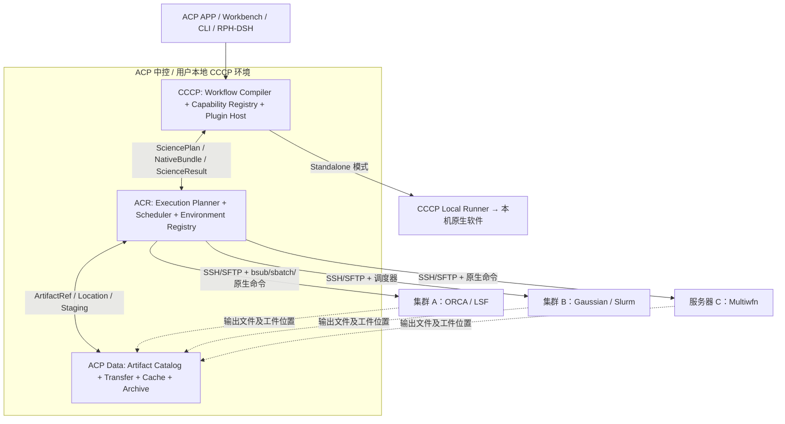
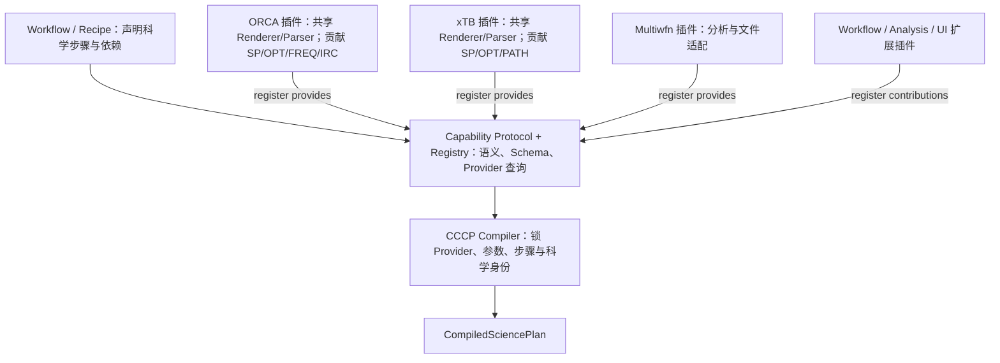
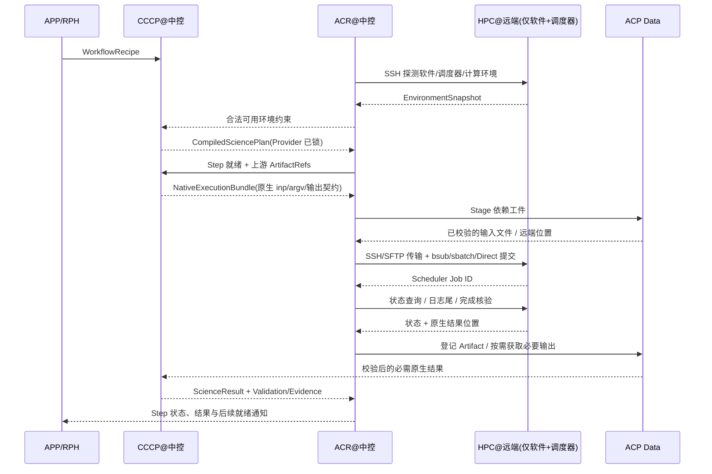

# ACP V3.0 后端关键架构方案：CCCP × ACR

**日期**：2026-11-02
**性质**：方案（未实施；团队讨论稿，不代表功能已交付）
**上位/取代**：V3 后端架构讨论稿；V2 线的读根/传输/投影收敛见 [`ACP_V2_Experience_Parity_Plan_20261102.md`](ACP_V2_Experience_Parity_Plan_20261102.md)

> **状态**：团队讨论稿 / Proposed Architecture（尚未实施，不代表功能已交付）  
> **版本**：v3.0-design-2026-11-02  
> **范围**：CCCP 科学内核、统一插件生态、Standalone CLI、ACR 多资源调度、Agentless 原生远程计算、ACP Data 交接  
> **适用仓库**：[PengYangchao0808/AutoCalcPlatform](https://github.com/PengYangchao0808/AutoCalcPlatform)（当前 `main` 的代码结构为基线）  
> **目标读者**：CCCP/ACR 后端开发者、插件开发者、RPH/Workbench 集成开发者

## 0. TL;DR：请团队首先对齐的结论

**ACP V3.0 不再以“把 ACP 代码部署到每个计算节点”为远程计算的前提，而是采用“CCCP 科学编译 + ACR 中央调度 + Agentless 远端原生软件执行”的默认模式。**

1. **CCCP 是可独立运行的科学计算系统**：`Workflow → Capability Protocol → Plugins`。支持单机 CLI + Local Runner，无需 ACR；插件可以提供科学能力、Workflow、分析器及其他扩展。
2. **Capability 是接口，Plugin 是实现，Workflow 是组合与交付物**。插件通过统一 Manifest 声明提供的 Capability、依赖和实现版本；Workflow 只声明所需科学能力，在编译时由 CCCP 解析并锁定具体 Provider。
3. **同一软件共用一个原生适配基础**：例如 `cccp-orca` 一次性维护软件探测、ORCA 输入 Renderer 与输出 Parser，并贡献 SP/OPT/FREQ/IRC 等多个能力。无须每个基元重复写翻译层。
4. **ACR 只管理执行事实**：资源发现、软件可用性、步骤就绪、作业拆分/融合、SSH、LSF/Slurm、Submission/Attempt、数据传输、缓存和恢复；不擅自更换泛函、基组、求解软件等科学设定。
5. **远端默认无需安装 ACP、CCCP 或任何 CCCP 插件**：仅要求有已获许可的原生计算软件、受控 SSH/文件访问、Shell 和站点支持的提交接口；中控端生成 `.inp` / `.gjf` / CLI 参数和作业脚本，收集原生输出后集中解析。
6. **ACP Data 对 Artifact 身份与位置拥有唯一权威**：远端文件可只登记位置，需要时再传回中控或转移到其他集群；不将计算节点 Scratch 当成永久存储。
7. **发行路径分三级**：`CCCP CLI`（纯科学计算）、`ACP Personal`（APP + 内嵌 CCCP + 本机计算软件）、`ACP Distributed`（CCCP + ACR + ACP Data，Web/APP/RPH 可选入口）。

**一句话**：**CCCP 决定算什么、如何编译和解析；ACR 决定何时、在哪里、以何种可靠方式执行；ACP Data 决定文件在哪里以及如何安全可用。**

---

## 1. 总体拓扑与权威边界



> 上图中的“中控端”是**科学插件与 ACR 的逻辑控制位置**，不必等于用户电脑。Personal 模式完全本地；Distributed 模式可以部署为受控的实验室/云端中控服务。远程 HPC 登录/计算节点**不要求部署 ACP/CCCP**。

| 对象 | 唯一职责 | 明确不做 |
|---|---|---|
| **CCCP / Scientific Authority** | 科学语义、Workflow DAG 定义、参数解析、Capability 发现/绑定、原生输入渲染、Parser、科学结果验证；Standalone 另有 Local Runner | 多租户队列、集群 Job 状态、远端 SSH 管理、分布式文件位置权威 |
| **ACR / Execution Authority** | WorkflowRun/Job/Attempt、依赖就绪、资源与队列选择、任务提交/取消/对账、远端环境和限额、执行恢复 | 重新定义科学方法、悄悄替换 Provider、重写软件输入与科学 Parser |
| **ACP Data / Artifact Authority** | Artifact ID/摘要、位置/代次、Staging、热缓存、读取授权、保留和归档 | 判定科学结论、决定哪些计算步骤应存在 |
| **软件插件** | 声明科学能力、软件支持范围、生成原生输入、解析原生输出、提供标准科学产品 | 直接篡改 ACR Job DB、私自调度集群、持有 SSH 凭证 |
| **远程计算资源** | 根据原生命令计算，保存原始文件，提供调度器/文件访问能力 | 安装 CCCP 插件、理解 SciencePlan、常驻 ACP Worker |
| **Workbench / RPH-DSH** | 展示与编辑计划、研究推理、人工审批、交互 | 成为第二个任务调度器或 Artifact 身份权威 |

**物理控制面 vs 科学执行面**：Agentless 远程服务器没有 CCCP 服务；**不意味着没有临时提交脚本**。`submit.sh` 只启动原生软件并记录最小退出状态，不得内嵌另一套 ACP 任务引擎。

---

## 2. CCCP V3：Workflow → Capability Protocol ← Plugins

### 2.1 最终拓扑



**注意**：Capability 不再是“插件之上的一个单独运行模块”，而是 CCCP Core 的**接口协议及动态能力索引**。不保留 `cccp.science_plugins` 与 `cccp.engines` 双注册表；采用**一个插件 Manifest/Registry/Resolver/Lifecycle**，每个插件可以贡献多个有类型的 Capability。插件本身不按“计算/分析/绘图”强行分类，但能力的 I/O 契约**必须有类型和版本**。

### 2.2 统一插件包与共享原生翻译器

目标逻辑结构（**示意，不代表现有路径已建好**）：

```text
plugins/cccp-orca/
├── plugin.yaml               # 唯一插件 Manifest：能力/依赖/软件约束
├── software.py               # 软件发现、版本与环境探测规则
├── translator/               # 该软件唯一共享的原生输入 Renderer
│   ├── renderer.py
│   ├── method_rules.py
│   └── keyword_rules.py
├── parser/                   # 共享日志、几何、能量等 Parser
└── capabilities/             # 不同基元仅补充操作差异
    ├── singlepoint.py
    ├── optimize.py
    ├── frequency.py
    └── irc.py
```

**开发约束**：新增 `orca.nmr` 不应重新编写几何导入、基本 SCF 选项、ORCA 路径发现和公共输出读取；只扩展 NMR 特有规则、数据解析及测试。第三方也可单独发布依赖 `cccp-orca` 的扩展插件。

### 2.3 Scientific IR 与 Capability Contract

CCCP Core 定义**软件无关**的 `ScientificInputIR`、`ScienceProduct`、`ArtifactRef`；具体 ORCA/Gaussian/xTB 语法由插件的 `render()` 完成。优先评估复用 QCSchema/QCEngine/ASE 等已有结构与原子计算语义，CCCP 只补充 TS、IRC、系综、波函数分析等所需扩展。

| 需要明确区分 | 例子 |
|---|---|
| **科学意图** | `chem.geometry.optimize`、PBE0、def2-TZVP、严格收敛 |
| **Provider 实现** | ORCA 适配器、xTB 适配器、Python 分析器 |
| **原生语法** | ORCA `!`、`%geom`；Gaussian Route；xTB CLI |
| **物理环境** | SSH endpoint、模块加载、可执行文件路径、CPU/内存 |

不能强行宣称软件功能完全可互换。某个 Provider 无法忠实表达方法/约束时，必须**明确拒绝**，不得静默丢参数、替换泛函/基组或更换软件。软件专属扩展参数必须命名空间化、合法性检查并纳入科学身份。

### 2.4 Plugin Manifest 最小协议（草案）

```yaml
apiVersion: cccp.plugin/v3
id: org.acp.orca
version: 1.0.0
requires:
  cccp_protocol: ">=3,<4"
provides:
  - capability: chem.energy.singlepoint
    contract: "^1"
    implementation: orca.singlepoint
  - capability: chem.geometry.optimize
    contract: "^1"
    implementation: orca.optimize
  - capability: chem.vibration.compute
    contract: "^1"
    implementation: orca.frequency
software:
  id: orca
  probe: orca.probe
entrypoints:
  renderer: orca.render
  parser: orca.parse
```

> `apiVersion`、命名与范围语法尚待 P0 Schema 冻结。此示例**不表示 ORCA 程序被打包或随插件分发**。许可证、实际支持版本、平台、散列和能力验证 fixture 需在生产 Manifest 中补全。

**安装与使用**：Plugin Manager 统一执行 `discover → verify → install → enable → resolve → lock`；Workflow 以 Capability ID 查找 Provider。Workflow 本身也可以作为下载插件发布，其依赖可指向具体 Plugin 或 Capability Contract。选择 Provider 后必须将**插件准确版本与内容摘要**锁到 SciencePlan。生产级启用还需站点/用户授权和隔离策略；元数据发现不执行第三方代码。

### 2.5 CCCP Standalone 边界

- **CCCP CLI**：无需 ACP/ACR，读取 Workflow、生成原生输入、调用本机计算软件并解析结果；本地最小状态与恢复。禁止因此引入一套集群调度服务。
- **ACP Personal**：ACP APP + 内嵌 CCCP + 所需软件/计算库；离线、本机文件/缓存；无需 DSH、ACR 或远程数据库。
- **ACP Distributed**：中央 CCCP 提供同样的科学编译和解析，ACR 将执行发往远端；**科学内核与原生输入不因执行模式改变**。

---

## 3. CCCP–ACR 必须冻结的交接契约

| 对象（建议名称） | 产生者 | 消费者 | 内容 / 禁区 |
|---|---|---|---|
| `WorkflowRecipe` | 用户、Workflow 插件、RPH | CCCP | 可复用科学步骤、参数模板、引用关系、有界分支；**无** SSH/队列字段 |
| `CompiledSciencePlan` | CCCP | Local Runner / ACR | 已冻结科学设置、Provider、插件摘要、步骤 DAG、输入引用与计划身份；不包含主机路径 |
| `EnvironmentSnapshot` | ACR 远端探测 | CCCP Resolver / ACR Placement | 软件版本、兼容能力、计算节点资源、调度器、可用性/有效期；不决定科学方法 |
| `NativeExecutionBundle` | CCCP 在 Step 就绪时生成 | Local Executor / ACR | **真实原生输入文件**、命令模板、stdin、必需工件、预期输出及文件摘要 |
| `ExecutionPlacement/Attempt` | ACR | Scheduler/Transport | 目标集群、调度器、资源、软件激活、实际路径、提交/租约/重试 |
| `ExecutionReceipt` | Local Executor / ACR | ACR/用户 | 进程/调度器执行事实、退出码、输出清单、故障类别，不代表科学成功 |
| `ScienceResult/Evidence` | CCCP Parser/Validators | ACR/Workbench/RPH | 解析产物、科学验证、适用性、证据状态；**不**修改 Job 历史 |
| `ArtifactRef` | ACP Data（本地模式可用兼容实现） | CCCP/ACR/APP | 数据身份、摘要、版本、逻辑名；物理位置仅由 Data 维护 |

### 3.1 科学计划与物理尝试分别冻结

- **Plan Definition ID**：冻结 Recipe、参数、Provider/插件版本、初始输入及有界科学规则。沿用现有 `cccp.analysis.identity` 和 Recipe Compile 的身份算法，不另造第三种 hash 规则。
- **Step Execution ID**：在上游工件真正产生后，以实际输入摘要和被锁实现确定。
- **Attempt ID**：由 ACR 负责，关联具体软件安装/环境快照、队列、主机和提交结果。平台重试不得修改科学方法；科研策略变更需新 Plan 或预定义分支。

**关键时间点**：`OPT → FREQ → IRC` 的后两步输入可能依赖上一步坐标/文件，因此 Workflow 编译期冻结**规则与 Provider**，**不能假装未来所有 `.inp` 都已存在**。每个 Step 就绪时才物化该步确定的原生执行包。

### 3.2 原生执行包示例（目标 Schema，非现有 API）

```json
{
  "schema": "cccp.native-execution/v1",
  "plan_id": "plan:sha256:...",
  "step_id": "sp_01",
  "capability": "chem.energy.singlepoint",
  "provider": {"plugin_id": "org.acp.orca", "version": "1.0.0", "digest": "sha256:..."},
  "inputs": [{"path": "calculation.inp", "sha256": "...", "size_bytes": 1234}],
  "command": {"executable": "software:orca", "argv": ["calculation.inp"], "stdout": "calculation.out"},
  "required_artifacts": [],
  "expected_outputs": [{"glob": "calculation.out", "required": true}],
  "software_constraints": {"id": "orca", "version": "validated-compatible-range"}
}
```

- 由 CCCP 插件生成文件内容与**符号化原生命令**；由 ACR 将 `software:orca` 安全绑定为站点批准的可执行程序/环境模块，并生成 LSF/Slurm/Direct 脚本。
- `argv` 必须是结构化参数数组，路径限定在指定作业目录；禁用未校验 shell 字符串拼接。远程脚本可由 ACR 受控模板生成。
- 预期输出含必需/可选标志、格式、保留策略；日志存在或 exit=0 **不等于**科学成功。

### 3.3 编译/调度握手（消除选择矛盾）

1. ACR 查询可用的 `EnvironmentSnapshot`，CCCP 根据科学需求和可能的运行环境选择兼容 Provider。
2. CCCP **冻结** Provider、科学参数和依赖图，形成 `CompiledSciencePlan`。
3. ACR 仅在满足锁定约束的资源中做 Placement，并在提交前做目标计算环境 Preflight。
4. 若环境消失或版本不兼容，返回 `ENVIRONMENT_UNAVAILABLE`；**不得**自动换软件或更改理论设置。重新选择 Provider 需要重新编译并审批（按项目策略）。

---

## 4. ACR 3.0：Agentless Remote Native Executor

### 4.1 从“远端跑 ACP”改成“远端只跑原生程序”

**当前**：远端 Runner 按代码 Release 将 `acp/cccp` 同步至服务器，作业脚本调用 `python -m acp.cli run ...`。  
**目标**：中控端 CCCP 生成软件输入；ACR 传输并提交 `orca calculation.inp`、Gaussian 命令、xTB 命令或 Multiwfn 的受控非交互输入；远端**不安装 CCCP / ACP 插件**。



**Agentless ≠ 无脚本**：远端允许**一次性生成**的 `submit.sh`、环境激活命令、原生计算程序命令及最小退出状态文件；不需要 ACP 常驻进程、CCCP Python 环境或远端插件。

### 4.2 Workflow 拆分：科学步骤 ≠ 调度作业

```text
WorkflowRun (ACR 运行记录)
  └── ScienceStep (CCCP 编译的不可变科学步骤)
        └── ExecutionJob (ACR 物理派发单元，可 1:N 或 N:1)
              └── Attempt (一次实际提交/恢复事实)
```

- **Single Step**：SP/OPT/FREQ 等通常一个 Step 对应一个 Job。
- **Parallel Fan-out**：构象系综的独立优化可拆成多个 Job 或站点允许的作业数组，每个子任务有可追踪身份。
- **Fused Steps**：在**不需要中控解析/科学决策**、软件和环境兼容且依赖确定时，可以将相邻 Step 合并成同一个队列 Job；仍单独记录各 Step 输出和科学身份。
- **Central Parsing Boundary**：若 FREQ/IRC 等下一步必须使用由中控 CCCP Parser 提取的动态结果，则前后两个步骤之间必须有“返回中控 → 解析 → 生成新输入”边界；不可把依赖未知的输入硬合并。

**当前代码**以“一平台 Task + 多持久化 Step”的有界 DAG 为基础；V3 要增加 `WorkflowRun → ExecutionJob` 投影，不要删除原有 TaskRef/Attempt 冻结与回执保护。

### 4.3 Environment Registry 与软件安装事实

**中控插件已安装 ≠ 远端计算程序可用**。至少区分：

| 层次 | 所在位置 | 验证要求 |
|---|---|---|
| `PluginInstalled` | CCCP 中控（Personal 则本机） | Manifest/代码摘要、授权、版本、隔离、对应 Capability fixture |
| `SoftwareDetected` | 远端登录/服务入口 | 软件路径/Module、许可策略、受控版本探测 |
| `RuntimeVerified` | **真正的计算节点/队列环境** | 可执行文件、依赖库、MPI/GPU、许可证、受限轻量测试 |
| `ResourceAvailable` | ACR 运行控制面 | CPU/GPU/内存、队列、权限、配额、文件系统可用性 |

- **不默认自动安装商业计算软件**；由站点管理员或用户按授权部署，ACR 只负责发现、登记、验证和使用。支持已有软件目录、Environment Modules/Lmod、Spack、站点批准的容器。
- SSH 访问应使用最小权限账户、明确 host key、可审计的受控命令；探测登录节点成功不可代表计算节点必然可用。
- Inventory 带生成时间、TTL、环境指纹和探测来源；提交前重新检查高风险依赖，绝不使用过期缓存假装资源可用。

### 4.4 Scheduler/Transport 拆分

```text
ACR RemoteNativeExecutor
├── TransportPort: SSH / SFTP / 站点批准的共享存储
├── SchedulerPort: LSF(OpenLava) / Slurm / Direct / 后续 PBS
├── EnvironmentProbe: 软件发现、版本/许可证/运行环境
├── BundleStager: 输入、检查点、必要工件的受控传输
├── SubmitReconciler: submit intent、租约、scheduler id、未知提交状态对账
└── ResultCollector: 日志/退出码/原生文件清单、远端位置登记
```

- **默认第一阶段复用现有 SSH/SFTP + LSF**；不要同时重写所有调度器。
- 远端节点网络不可直连时，数据通过中控中继或站点批准的 Transfer Gateway；不假设远端节点可上网，也不假设所有服务器共享文件系统。
- 中控重启后，远端调度器继续运行，ACR 使用持久 Submission ID / Scheduler Job ID / Attempt 信息重新对账；无法判定是否已提交时标记 `UNKNOWN`，**不得盲目重提**。
- 应保留现有冻结输入、执行权、发布与恢复机制，避免“Agentless”被误解成可以删除任务一致性保证。

---

## 5. ACP Data：位置、传输、缓存与跨集群计算

### 5.1 三个完全不同的对象

1. `ArtifactRef`：科学数据的**逻辑身份与可信摘要**，可以被 Workflow 引用。
2. `ArtifactLocation`：某个工件在登录节点、共享盘、Scratch、中控热缓存或归档中的**物理位置**；同一工件可有多份副本。
3. `Prepare/TransferOperation`：将工件安全物化到消费者所需位置的**有状态操作**；必须可恢复、可审计、权限复核。

**数据注册 ≠ 下载**。原生输出可先留在远端，向 Catalog 登记类型、文件大小、可信哈希、Attempt、位置和保留期限。由下游 Step 或用户预览按需触发传输。不能把 `.gbw`、`.cube`、大型轨迹默认全部回传。

### 5.2 转运路径

| 场景 | 优先策略 |
|---|---|
| 同一集群上下游 | 校验后在允许的共享盘/作业空间复用，尽可能避免重复复制 |
| 中控 Parser 需要小文件 | SFTP/流式获取经验证的 `.out`、能量、XYZ 等 |
| 中控 Parser 需要完整大文件 | 必须实际传回或使用明确授权的受控解析位置；不能假设远端无插件也能执行 CCCP Parser |
| 不同集群间输入 | 共享存储（如有）→ 受控端到端传输（若允许）→ 中控中继；完成校验才调度下游 |
| 用户在线预览/归档 | 按需 range/tail/缓存或显式归档，不强制永久复制所有计算目录 |

**重点示例**：Cluster A 的 ORCA 生成波函数 → ACR 登记文件并核验 → 必要时执行明确的格式转换 Capability → Stage 到 Cluster B → 原生 Multiwfn 分析 → 输出回传中央 CCCP Parser → ScienceResult/Evidence。

### 5.3 必须保留的三类缓存

| Cache | 内容 | 命中/失效依据 |
|---|---|---|
| **Environment Cache** | 软件发现结果、可用性、插件安装/版本记录 | 软件/插件摘要、目标节点环境指纹、TTL、授权状态 |
| **Artifact Cache** | 已校验的输入/输出副本 | **内容摘要 + 工件身份/代次 + 读取权限**；原子发布，授权撤销可阻断访问 |
| **Science Result Cache** | 已解析、已验证的计算结果 | 科学输入、方法、Provider/程序版本、有效参数、随机性/容差等完整身份；不能只比文件名或分子名 |

计算节点 Scratch **不是可靠的长期副本**。下游仍需使用的文件要在 Scratch 清理前完成可信发布/转储，或明确标记为不可恢复。传输失败不能触发重复昂贵计算；已完成计算与数据发布有独立状态。

### 5.4 数据安全与失败策略

- 先写 `.tmp`，校验**来自可信源记录**的预期摘要/大小/Attempt/权限/代次，再原子发布到缓存；不得以刚下载的字节自算 hash 充当“预期 hash”。
- 多次或并发传输使用租约/去重；缓存命中仍要校验租户授权。
- 远端输出、解析器、原生脚本都按不可信输入对待；路径穿越/符号链接、命令注入、日志敏感信息、输出体积上限必须受控。
- `REMOTE_ONLY / CACHED / ARCHIVED` 等可以是 UI 投影，但**不可引入第二套与现有 Prepare/Availability 冲突的权威状态机**。

---

## 6. 现有仓库差距与文件级修改表

> 以下“现状”来自当前 `main` 的相关代码说明与路径核对；**不代表新方案已经实施**。迁移时沿用已有身份和状态机制，先提供 v3 适配器，再逐步退役旧入口。

### 6.1 CCCP 科学内核

| 现有位置 | 代码基线 | V3.0 目标改动 |
|---|---|---|
| `src/cccp/plugin/{metadata,discovery,sdk,host}.py` | `cccp.science_plugins`、元数据驱动、第三方 compute 有边界限制 | 统一 `cccp.plugin/v3`，单一 Registry/Resolver/Lifecycle；可信 Provider 原生执行通路 |
| `src/acp_services/runtime/science_plugins.py` | 生产启用主要面向 `pure_analysis` | 继续保留中控侧授权/快照思路，适配统一插件能力；取消“远端必须加载插件”的假设 |
| `src/cccp/calculation/requests.py` | 固定 `TaskKind` 清单 | 提供开放 Capability Invocation；旧枚举仅兼容映射，不再限制新增 Provider |
| `src/cccp/calculation/capabilities/task_binding.py` | Capability 到固定 TaskKind 的绑定 | 改为解析动态 `Capability → Provider`；保持旧任务兼容 |
| `src/cccp/calculation/recipes/{contracts,validation,compile}.py` | 已有有界科学 DAG、Plan/Step 身份 | 保留算法和规则，扩展插件版本锁、外部 Capability、可下载 Workflow、原生 Step 物化 |
| `src/cccp/qc/resolved_spec.py` | 通用参数优先级与有效值解析 | 保留科学 IR 入口，迁走软件专用默认规则 |
| `src/cccp/qc/{translation,keyword_registry,method_meta}.py` | ORCA/CENSO/ xTB 等软件语法与部分共用规则混合 | 科学语义留 Core，原生关键词和 Renderer 迁至软件插件 |
| `src/cccp/qc/interfaces/`、`src/cccp/backends/` | 软件接口/能力与执行细节混合 | 建立共享软件适配基础；旧模块逐步成为兼容门面 |
| `src/cccp/software.py`、`src/cccp/calculation/selection.py` | 静态软件映射与本地环境探测 | 插件声明探测规则、ACR 提供远端 Inventory；不再维护唯一固定 Backend Matrix |
| CCCP CLI（新增入口） | 尚未统一为独立科学 Workflow CLI | `workflow compile/run`、`step render`、`plugin list/doctor`，Standalone 可执行 |

### 6.2 ACR 执行控制面

| 现有位置 | 代码基线 | V3.0 目标改动 |
|---|---|---|
| `src/acp/scheduler/remote/runner.py` | 远程 LSF Runner 要求经校验的 ACP 代码 Release | 新增 `RemoteNativeExecutor`；在 Agentless 路径只提交 NativeBundle |
| `src/acp/scheduler/remote/script_gen.py` | 作业脚本仍可生成 `python -m acp.cli run ...` | 为原生计算生成 LSF/Slurm/Direct 脚本；命令来自受控 NativeExecutionSpec |
| `src/acp/scheduler/remote/sync.py` | 同步 ACP/CCCP 代码至节点 | Agentless 路径**停用源码同步**；旧任务迁移期保留 |
| `src/acp/scheduler/remote/release.py` | 内容寻址的远端 ACP 代码 Release | 复用 staging/hash/原子发布设计，发布输入与工件包而非必然发布 ACP 代码 |
| `src/acp/scheduler/remote/{monitor,submission,sftp,ssh}.py` | 监控、稳定 Submission ID、SFTP 与连接池 | 原则上复用；扩展原生输出登记、可插拔 Scheduler/Transport 和未知态对账 |
| `src/acp/scheduler/remote/node_manager.py` | 节点/Python 检测及健康检查 | 加入软件发现、模块、计算节点 Preflight、Env Snapshot 与 TTL |
| `src/acp_services/runtime/{step_dag,worker,attempt_freeze}.py` | 有界 DAG、冻结 Worker、执行权与回执 | 保留权威；新增 `ScienceStep → ExecutionJob` 投影和 Agentless 适配；旧 Worker 继续处理兼容运行 |
| `src/acp_services/runtime/adapter_registry.py` | 授权、基础设施 Adapter、冻结摘要 | 复用安全性/冻结设计，新增 Scheduler/Transport 实现；不要建立第二个全局插件生命周期 |
| `src/acp/workflows/registry.py`、`src/acp/scheduler/jobs.py` | 多处静态 Workflow 名单 | 将公开可执行能力改为 CCCP Catalog/CompiledPlan 的授权投影；保留历史名称兼容 |

### 6.3 ACP Data 与产品集成

| 现有位置 | V3.0 目标改动 |
|---|---|
| `src/acp_services/data/{artifacts,transfer,archive,storage_binding}.py` | 保留摘要验证、原子发布和资源身份；扩展位置索引、跨集群 Stage、保留策略 |
| `src/acp/scheduler/remote/fetcher.py` | 从按需用户读取扩展为 Workflow 下游数据准备通道；保留其现有按需预览能力 |
| `src/acp_services/runtime/outbox.py`、`recovery.py` | 沿用任务完成、数据可用和研究唤醒事件；不新建 Agent 轮询循环 |
| `rph/packages/{research,bridge,dsh-bundle,cli}` | 通过 ACP API/MCP 使用能力，RPH 不直接 SSH 集群；DSH 只是可选 Agent Harness |
| `frontend/js/{shell,modules,workbench}` | Personal/Distributed 共用 Workflow/Capability 视图；保留前端功能对等迁移计划，不为 V3 后端重写全部前端 |

**数据库迁移**：在现有 migrations 的最新版本后新增（勿未经检查直接占用旧草案的迁移号）：`environment_snapshots`、`native_submission_bindings`、`workflow_run_execution_jobs`、`artifact_locations`（如已有草案/实现则扩展原表）。不得新增第二套 Task/Attempt/Artifact 主表。

### 6.4 与 2026-10-31 旧 V3 草案的差异

**继续有效**：一人一个逻辑科研工作站、DSH/RPH 可选、ACP-VFS、单 Task/Attempt 权威、事件 Outbox、数据真实性、前端功能对等、Rust 后置。  
**被本方案更新**：默认远程执行方式由部署 ACP 代码/Worker 转为中央插件 + Agentless 原生执行；Plugin/Engine 双注册转为统一插件协议；软件发现以远程原生软件为对象；跨集群数据准备成为 ACR/ACP Data 显式职责。  
**暂不删除**：旧 Worker / Remote Release / Legacy Workflow ——历史任务迁移和回归期间须保留可恢复性。

---

## 7. 实施顺序：按 PR / 依赖拆分

| 阶段 | 建议交付（可拆多个 PR） | 验收门槛 |
|---|---|---|
| **P0 · 冻结契约与基线** | `Capability/Plugin Manifest`、`ScientificInputIR`、`CompiledSciencePlan`、`NativeExecutionBundle`、`ScienceResult` v1 草案；ORCA/xTB 原生输入 Golden Fixtures；旧路径兼容规范 | 原有测试通过；科学身份/回执语义未变；Schema 版本验证可运行 |
| **P1 · CCCP 独立最小闭环** | 中央统一 Registry、xTB 插件与共享 Renderer、CCCP Local Runner/CLI、一个 SP→OPT Workflow | 不启动 ACP/ACR，凭本机 xTB 完成真实输入、执行、解析、结果保存 |
| **P2 · 插件生态与工作流** | ORCA SP/OPT/FREQ 共享 Renderer；动态 Provider；声明式可下载 Workflow；插件依赖/锁 | 安装第三方 Workflow 后可查询能力并编译；不再改固定 TaskKind 才能增加实现 |
| **P3 · Agentless LSF 闭环** | `RemoteNativeExecutor` + 原生输入 staging + LSF submit/poll/cancel + 中央 Parser | 远端无 ACP/CCCP 代码仍能完成真实 ORCA/xTB 计算；控制端重启/断网可恢复 |
| **P4 · Environment + Artifact** | 远端软件探测、Env Snapshot、计算节点 preflight、Artifact Location、多位置 Staging/缓存 | 版本不兼容拒绝；计算成功而文件传输失败时只重试传输 |
| **P5 · 多资源与跨集群** | Slurm/Direct、独立 Step/Job 投影、并行 fan-out、Placement、ORCA→Multiwfn 数据流 | 两个异构资源间工作流真实运行、引用可追踪、重复提交保护成立 |
| **P6 · 产品集成与优化** | ACP APP Personal 模式、Workbench 能力视图、RPH/DSH Bridge、性能/配额/审计；评估 Rust ACR | Personal 与 Distributed 共享科学输入/结果契约；无 LLM 模式同样可用 |

### 7.1 建议前四个 PR 的开发范围（避免一次性推倒重来）

**PR-01 Contract & Golden Tests**
- 新建 versioned Schema 与最小端到端测试数据；对 ORCA/xTB 已有输入文件与 Parser 结果加 Golden Fixtures。
- `cccp.calculation.recipes` 保留现有 Plan/Step Identity；新增兼容导出，不创建第二个编译器。
- 禁止任何 science step 引入 scheduler/job_id/SSH 属性。

**PR-02 Unified Capability Registry + xTB Plugin**
- 从 `cccp.plugin` v1 逐步转换单一插件 Manifest/Resolver；xTB SP/OPT 共享 Translator。
- 完成 CCCP CLI 本地执行；工作流能引用标准 Capability 而非硬编码软件类。

**PR-03 ORCA Translator + Dynamic Binding**
- 将现有 ORCA 翻译/解析先以适配门面重用，再迁移到插件包；SP/OPT/FREQ 共享软件级 Renderer。
- 在 Workflow Compile 中生成 Provider 绑定与锁；新插件不修改静态 TaskKind 表即可被注册/发现。

**PR-04 RemoteNativeExecutor on Existing LSF**
- 复用 `remote/{ssh,sftp,monitor,submission}.py` 与冻结/回执机制；将 `runner.py` 的远端 `acp.cli` 执行替换为新原生执行路径（用 feature flag 与旧路径并存）。
- 先实现**一个受控 ORCA SP**：渲染 → SSH → LSF → 收集输出 → 中控解析 → Artifact 发布。

后续 PR 再处理 Slurm、多集群 Placement、用户隔离和跨集群大型工件传输。**P0–P3 不应被完整 Workbench UI、Rust 改写或市场化插件商店阻塞。**

---

## 8. 必须覆盖的验收场景与故障矩阵

### 8.1 三个端到端用例

| Case | 端到端路径 | 成功判据 |
|---|---|---|
| **A：Standalone** | CCCP CLI → 本机 xTB → 解析优化结构与能量 | 机器未安装/未启动 ACP/ACR；实际科学任务成功，Plugin 与软件版本可追溯 |
| **B：Agentless LSF** | CCCP@中控 → 原生 ORCA 输入 → SSH/LSF 远端 → 原生输出 → 中控 Parser | 远端没有 `acp`/`cccp` Python 依赖；提交身份、退出事实、科学结果、Artifact 可检索 |
| **C：跨集群** | ORCA@Cluster A → 工件登记/转换 → Multiwfn@Cluster B → CCCP 分析 → Evidence | 下游准确取得前序必需工件；不同软件/环境版本可审计；失败可续跑而不盲目重算 |

### 8.2 最小故障测试矩阵

| 故障 | 预期行为 |
|---|---|
| 中控插件存在、远端无 ORCA | `SOFTWARE_UNAVAILABLE`，不提交 |
| 远端登录节点有 ORCA、计算节点无运行库 | Preflight 失败，明确不可运行 |
| ORCA/插件版本与锁不兼容 | 拒绝或要求重新编译，不静默替换 |
| 提交后 SSH 超时，Job ID 未返回 | 以持久 Submit Identity 对账，不能立刻重复提交 |
| 队列显示 DONE、`.out` 不完整 | 执行完成与结果有效独立；输出验证失败 |
| 原生计算完成、文件传输失败 | 保留结果与远端位置，只重试 Transfer |
| ACR 中控重启，远端任务仍运行 | 恢复后查询 Scheduler、复用已存在 Attempt |
| 上游 Artifact 未就绪或源 Scratch 已被清理 | 下游等待或明确不可恢复，不能伪造空输入 |
| 取消正在运行的任务 | 向调度器发取消并确认，不只改本地状态 |
| 同一用户重复点击提交 | 幂等提交，返回同一逻辑任务或已有运行事实 |
| 用户访问不属于自己的缓存工件 | 权限拒绝，不因内容摘要相同而越权命中 |
| 安装/禁用新版插件 | 新 Job 使用新环境，历史 Attempt 继续引用冻结版本 |
| 大型波函数文件需要 Multiwfn 解析 | 按需传输/合法本地化，计算节点不能临时运行 CCCP Parser |
| 远端返回恶意文件名、软链接、过大输出 | 路径/格式/大小/权限校验，拒绝非受控文件访问 |

### 8.3 合格发布的不可妥协规则

- **一个科学编译权威**：CCCP Recipe Compiler；不能同时维护第二套 ACP 科学 Workflow 定义。
- **一个任务与尝试权威**：ACR Services；CCCP Local Runner 只对本地独立执行持有本地记录。
- **一个 Artifact 权威**：ACP Data；不以文件扩展名或集群路径冒充科学身份。
- **一个插件协议**：插件可贡献 Workflow、计算与分析能力；跨进程/安全域仍有独立运行隔离要求。
- **远端 Agentless 优先**：新增远端 Provider 不以安装 CCCP 为条件；允许受限的批处理脚本。
- **物理失败不改变科学事实**：任务提交、程序退出、Parser 合法、科学结论支持是不同状态。
- **Plan 与环境冻结**：科学重试必须可审计；平台重试不得偷偷改变方法。
- **没有 LLM 也能使用**：APP/CLI 手工运行无需 RPH/DSH。

---

## 9. 仍需团队拍板的 ADR（不阻塞 P0–P1）

| ADR | 备选及建议 | 最晚决定点 |
|---|---|---|
| **ADR-01 插件执行隔离** | MVP 中可信内置插件先受控进程运行；第三方插件必须明确审批、隔离和资源限制；**元数据发现不得执行代码** | P2 |
| **ADR-02 Capability/Scientific IR 版本** | 优先兼容已有 QCSchema；CCCP 扩充 TS/IRC/分析产品；所有新字段严格版本化 | P0 |
| **ADR-03 Workflow Fused Steps** | 默认按 Step 拆分；只有无需中控科学决策且 I/O 可验证时才融合；后续再做自动优化 | P5 |
| **ADR-04 HPC Software Installation** | 默认“发现并使用已有软件”，不做具有风险的远程自动安装；允许站点批准的 Spack/Modules/容器 | P3 |
| **ADR-05 大型文件传输** | V1 SSH/SFTP + 可验证中继；后续按站点网络条件支持共享存储/对象存储/Transfer Gateway | P4 |
| **ADR-06 Rust 改写** | P0–P4 复用 Python 基线、冻结语言中立协议；Rust 优先重构 ACR 高并发控制与传输，不强推 CCCP Python 插件重写 | P5+ |
| **ADR-07 Workstation / DSH** | 每用户逻辑工作站属于 Distributed 产品；个人版不依赖；前端先完成现有 Shell 功能对等 | P6 |

---

## 10. 本轮团队同步请确认的事项

**建议同步后立即拆工**：

1. **CCCP 负责人**：提交 `Capability Contract`、统一 Plugin Manifest 和 `NativeExecutionBundle` 的 Schema 初稿；确定 xTB/ORCA Golden Fixture 范围。
2. **ACR 负责人**：基于现有 LSF SSH Runner 设计 `RemoteNativeExecutor` 和提交/恢复状态机改造；明确如何完全跳过远端 ACP Code Release。
3. **Data 负责人**：在现有 `ArtifactRef`/Transfer/Archive 模型上提出跨集群 `artifact_locations`、按需 Staging 与失败恢复方案。
4. **联调验收**：先以**中控 CCCP → 远端 LSF ORCA SP → 原生输出回传 → 中控 Parser**为第一个 V3 后端打通目标，其前置验收为 CCCP 本机 xTB SP/OPT 闭环，之后再推进多集群示例。

**不建议现在就做**：一次性重写全部 Workflow、在所有远端部署 ACP Worker、把 CCCP 全部改为 Rust、同时支持所有 HPC 调度器、开发第二套文件系统或第二个任务数据库。

### 附：参考代码与设计文档

- [CCCP Recipe Compiler](https://github.com/PengYangchao0808/AutoCalcPlatform/blob/main/src/cccp/calculation/recipes/compile.py)
- [CCCP Plugin Metadata v1](https://github.com/PengYangchao0808/AutoCalcPlatform/blob/main/src/cccp/plugin/metadata.py)
- [ACR Remote Runner](https://github.com/PengYangchao0808/AutoCalcPlatform/blob/main/src/acp/scheduler/remote/runner.py)
- [ACR Remote Script Generator](https://github.com/PengYangchao0808/AutoCalcPlatform/blob/main/src/acp/scheduler/remote/script_gen.py)
- [Runtime Step DAG](https://github.com/PengYangchao0808/AutoCalcPlatform/blob/main/src/acp_services/runtime/step_dag.py)
- [Artifact Transfer Verification](https://github.com/PengYangchao0808/AutoCalcPlatform/blob/main/src/acp_services/data/transfer.py)
- [2026-10-31 ACP 3.0 Backend Plan（旧草案，需按本方案更新）](https://github.com/PengYangchao0808/AutoCalcPlatform/blob/main/docs/reference/next-change/ACP_3.0_Backend_Plan_20261031.md)

> **文档结论 / Decision Proposal**：V3.0 的后端升级不应是将 CCCP 与 ACR 的管理代码合并成一个巨型执行系统，而应以**统一科学协议与原生执行交接**打通两个独立职责。CCCP 独立完成科学工作流、能力插件与单机计算；ACR 执行跨机器的可靠资源调度；远端只运行原生软件；ACP Data 持续管理工件。这一边界应在 P0 冻结，后续升级优先采用新插件与适配器，而不是不断改动核心调度链。
