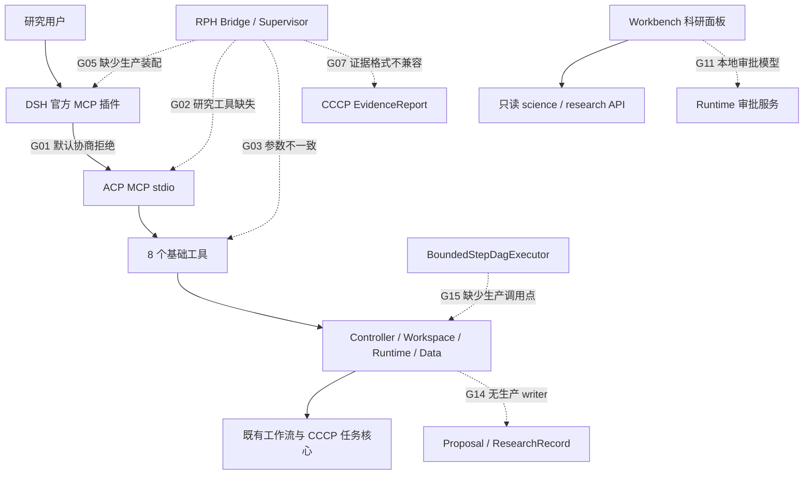

# ACP 2.0 当前状态与交付差距报告

审查日期：2026-10-26。审查对象：`ec4a0b39b26645139c01aa9578fbedd0c3db23a2` 的源码及当前工作树可见材料。报告结论：**当前完整 ACP2 不具备交付条件；问题包含已复现的接口不兼容和实现断层，不能归结为“功能已经完成，只差现场验收”。**

> **第三轮真实性核验（2026-10-26，最新）**：新增 **G21–G26** 六项已复现问题：Bridge/MCP 幂等结果混用、MCP 执行目标丢失、跨用户幂等范围错误、凭据撤销后的缓存重放、可信用量来源可由普通写凭据自报。见 [第三轮核验报告](VERIFICATION_R3.md)。原 G01–G20 的主要差距仍开放，但下文“全部确认”不代表每句根因与影响均成立；SDK 归属、UI 是否已挂载、无 fetch 的含义、历史 SHA 可复现性等以第三轮 §3 的收窄结论为准。第三轮原有定向测试 **69 passed**，没有据此给产品放行。你的本轮修订输入已原样保存在 [核验前副本](evidence/verification-r3-20261026/reviewed-report.before-r3.md)。

> **2026-10-26 复核更新（第二轮）**：全部 20 项差距已由四条并行验证线逐条复核并追溯根因（含 git 提交历史、计划台账与真实依赖重复现），20 项全部确认，8 项（G01/G02/G03/G07/G09/G13/G15/G18）表述或根因经修正/加深。详见 §0 与各节末尾“第二轮复核”块；完整验证记录在 [evidence/verification-20261026/](evidence/verification-20261026/)（lane-a/b/c/d 四份）。

本报告是在 2026-10-25 缺陷报告之后的独立代码审查。旧报告作为历史证据使用，不直接继承其“代码整改已通过”的范围判断。对 MCP、DSH、RPH、Workbench、研究数据、审批预算、科学执行与发行链路，重新追踪了生产调用点，并运行跨层反例。未修改业务代码，未重启生产服务，未提交真实 QC/LSF 作业，未调用付费模型。

## 0. 第二轮独立复核（2026-10-26）：结论与根因总览

本报告完成后，另由四条并行验证线对全部 20 项差距逐条复核：每项重新读取源码/冻结契约/提交历史与计划台账；可低成本复现的项用真实实现直接复现——G01 换用 DSH 插件**实际依赖**的 `@modelcontextprotocol/client@2.2.0` 重发握手，G03 三条参数在 normalizer 与真实 MCP `tools/call`（连真实 Controller）两级复现，G12/G13 以纯函数探针复现。复核未修改业务代码、未重启服务、未提交 QC、未调用模型。

**总结论：20 项全部确认，无一项被驳斥。** 多数分项经复核后比原报告更严重（G13 预算解析抛错/静默清零、G15 适配器零调用、G19 共 43 个 candidate_revision、G20 客户端 18 工具与服务端 8 工具测试同时通过）。

### 跨项根因分类

| 根因类别 | 覆盖项 | 机制 |
|---|---|---|
| 跨轨契约漂移（无共享权威 + 无跨侧测试门） | G01/G02/G03/G07/G13/G20 | A/B/C 三轨各自冻结契约。B06 在 C 冻结 Bridge 基线 **12 分钟后**更改请求信封与扩展版本号，且不同步 advertised schema；C 的 B-req-18 / Finding F1 报告保持 open；两侧各自建测、各自常量自证，同时绿 |
| 计划性分期但“后补”从未发生（blocked 级联 + 台账过早关闭） | G05/G09/G10/G14/G15/G16(P3)/G17/G18 | 计划 T-30→T-46 全链 `[~]` blocked；B18b execution wiring 未交付但任务 20 已标 `[x]`；验收标准按占位书写（FORBIDDEN_PATTERNS 把"无传输"定为 PASS、`unsupported_capability` 被测试 pin 成预期、DAG 验收用 STATIC/SIMULATED dispatch），缺件不会被任何门判失败 |
| 有意设计偏离标准 / 入口策略缺失 | G01/G12 | 协商采用"显式声明才降级"私有规则而非 MCP 规范回包；"研究必须审批"用 payload 开关表达而非入口身份——`PrincipalKind` 无 agent 类，服务端无法区分 Agent 与人类 |
| 验收证据治理缺口 | G11/G18/G19/G20 | fixture 无传输成为 PASS 条件、离线运行被标 `evidence_kind=live`、224 份 summary 含 43 个 candidate_revision 且无单一 BOM、发现问题的探针是一次性审计产物而非 CI 门 |

### 复核产出

- 四份验证记录：`evidence/verification-20261026/lane-a-mcp-server.md`（G01–G04）、`lane-b-rph.md`（G05–G10、G17-RPH）、`lane-c-platform.md`（G11–G14、G16）、`lane-d-assembly-evidence.md`（G15、G18–G20）。
- G01 的新握手证据（真实 `client@2.2.0`，替代原探针的 `sdk@1.31.0`）与全部复现命令内嵌在各 lane 文件附录中。

## 1. 判断摘要

ACP 已经有相当完整的计算与平台基础：唯一计算任务核心、Controller、持久任务与 attempt、审批服务、数据工件读写、科学契约、独立 Python 分包，以及大量模块测试。不能把这些成果视为不存在。

但 ACP2 宣称的交付对象是四组分协作的科研产品。实际状态更接近：**可运行的既有计算平台，加上若干已实现的平台/科学模块、独立开发的研究客户端模块，以及尚未连通的产品路径。**

最影响交付的事实如下：

1. **DSH 默认握手不能通过当前 ACP 协商规则。** 使用锁定 DSH 安装中的真实 MCP SDK，对当前 ACP 的真实 stdio transport/dispatcher 发起连接，返回 `-32602 unsupported protocol version '2025-11-25'`。该 SDK 同时支持 ACP 的 `2025-06-18`，问题出在 ACP 额外要求客户端发送非标准的版本列表。
2. **研究 MCP 工具在服务端不存在。** RPH 和冻结契约要求基础 8 工具之外的 10 个研究工具；服务端实际只注册基础 8 工具，却无条件返回研究扩展 `1.1.0 / negotiated=true`。RPH 则只接受扩展 `1.0.0`。
3. **基础工件链也不相容。** 真实 RPH builder 生成的 prepare、read、evidence 三种参数，分别缺少服务端要求的 `purpose`、`artifact_ref`、`analysis_id`，均在共享参数校验层被拒绝。
4. **DSH、Supervisor、平台没有产品装配闭环。** Supervisor 的调用点位于测试与离线证明脚本；DSH profile 只加载官方 MCP 插件与简短 persona，没有装配 Supervisor 或其平台端口；RPH CLI 仍只打印 help/version/profile。
5. **科研证据无法直接贯通，而且存在错误归属接受。** CCCP 合法 EvidenceReport 被 RPH validator 拒绝；反过来，RPH Supervisor 接受格式合法但属于其他 project/research/job/attempt/release 的报告，并返回 `accepted`。
6. **界面的审批不是平台审批。** 生产页面加载的审批模块仍使用 fixture 生命周期：在本地生成 `apr-*`、改变 approved 状态、返回 `submitted:true / dsp-*`，不调用 Runtime 的审批/提交命令。

这些问题在补模型凭据、启动 Controller、重跑已有验收脚本之前就应修复。否则会把协议错误、缺少装配和科学身份错误误记为环境问题。

## 2. 审查标准、方法与范围

### 2.1 交付基准

主要对照文件：

- [ACP2 四组分协作主方案](../../docs/ACP_2.0_Four_Component_Collaboration_Plan_20261020.md)，尤其 §5–7、§9、§11：同一应用服务、多入口一致、DSH 研究循环、Diels–Alder 纵向切片、本服务器实测。
- [MCP/DSH 验收手册](../../docs/reference/next-change/ACP_2.0_MCP_DSH_Server_Acceptance_Runbook_20261020.md)。
- [P2 研究操作契约](../../docs/reference/next-change/acp2-contracts/runtime/p2-research-operations.v1.json)：扩展协商、工具名、ControllerClient 方法、审批与恢复路径。
- 仓库与嵌套 `AGENTS.md` 的单向依赖、唯一任务核心、CAS、attempt/身份、真实证据要求。
- MCP 官方 [2025-06-18 生命周期规范](https://modelcontextprotocol.io/specification/2025-06-18/basic/lifecycle)与[工具规范](https://modelcontextprotocol.io/specification/2025-06-18/server/tools)。外部规范只用于协议判断，产品状态以本地源码与本轮探针为准。

### 2.2 证据等级

| 标记 | 含义 | 能证明什么 |
|---|---|---|
| R：已复现 | 本轮调用真实实现得到结果；注明替代端口和环境 | 被测边界的实际行为，不自动证明生产事故 |
| S：源码确认 | 检查定义、调用链、注册与装配 | 实现存在/缺失或静态矛盾，不代替部署验证 |
| N：未验证 | 缺少本轮或当前候选的合格真实证据 | 保持未通过；不等同已执行失败 |
| H：历史证据 | 旧报告、旧候选回执或已有安装材料 | 只证明当时对应范围 |

严重度使用 **S0（阻断目标交付）/S1（高优先级）/S2（交付治理）**，避免与主计划的 P0–P5 阶段编号混淆。S0 包括主路径无法完成和接入前必须修复的科学结论身份缺陷；不表示所有 S0 都已经造成生产数据污染。

### 2.3 本轮验证

| 验证 | 结果 | 边界 |
|---|---|---|
| MCP、审批、预算、science/research 路由与架构守护定向 pytest | **168 passed** | `targeted-pytest-unrestricted.xml`；含隔离 Controller/进程测试，部分执行端被测试替代 |
| 科学 validator/证据/插件、Recipe binding、控制恢复、持久幂等与多租户定向 pytest | **131 passed** | `science-runtime-pytest.xml`；与上一组不重复，Python 合计 299 项 |
| RPH TypeScript build | 通过 | 当前源码重新编译后执行探针 |
| RPH Node 测试 | **80 passed** | `rph-tests-no-isolation.log`，明确测试数；普通 runner 首次只显示 5 个文件级结果，不按 80 个用例计数 |
| 前端模块测试 | **444 passed, 0 failed** | `frontend-tests-unrestricted.log`；为模块测试，不是实际浏览器端到端验证 |
| DSH 安装 SDK → ACP stdio/dispatcher | **连接失败，已复现** | 真 SDK、真 ACP 协议实现；后端采用禁止访问的端口，不需要 Controller，不运行完整 DSH Agent |
| RPH 参数 → 服务端 normalizer | **3/3 被拒绝，已复现** | 真实两端实现，不是手写预期参数 |
| CCCP 合法证据 → RPH validator | **被拒绝，20 项结构问题** | 使用仓库正例，CCCP `EvidenceReport.from_dict` 接受 |
| Supervisor 反例 | **异项目/异任务报告被接受；一次空 wait 后停止** | 使用真实 Supervisor，注入受控端口；无真实计算、无模型 |
| 前端审批函数 | **无需平台即可返回 approved/submitted** | 真实模块在 VM 中执行，无网络或持久化适配器 |

完整执行结果见 [验证清单](evidence/verification-summary.json)。所有结果均按本轮实际执行记录，未将此前的 11,344 项全量通过算作本轮全量回归。

**限制：**本轮不认证生产实例运行的代码版本，不认证真实 LSF/量化化学结果，不认证模型工具选择、真实浏览器交互或独立机器安装；没有据此宣称这些能力必然失败。沙箱最初禁止本地 socket/Node 子进程，相关初跑被中断或失败，已保留日志并在允许的环境复跑。默认 `python` 为不满足项目要求的旧解释器，探针最终使用 `/usr/bin/python3.11`，该初始环境问题不计为产品缺陷。

## 3. 实际产品链路



图中虚线表示已确认的缺口，不代表对应模块完全没有代码。基础任务平台可用，也不能自动证明研究路径可用。

## 4. 差距总表

| ID | 级别 | 证据 | 差距 | 直接影响 | 复核（10-26） |
|---|---|---|---|---|---|
| G01 | S0 | R/S | ACP 协议协商不兼容锁定 DSH SDK 默认请求 | Agent 入口无法连接 | 确认（证据链换为实际依赖 client@2.2.0 后复现） |
| G02 | S0 | R/S | P2 工具缺失、扩展版本冲突、虚假协商声明 | 提案/审批/恢复不可达 | 确认（B 内部契约三处版本矛盾） |
| G03 | S0 | R/S | Bridge 的 prepare/read/evidence 参数与服务端不一致 | 基础结果消费链中断 | 确认（根因改写为 B06 信封变更未同步 schema；Bridge 另有丢参） |
| G04 | S1 | S/R | MCP 科学发现信息不足，分析 registry 无生产 handler | Agent 无法完整发现和使用科学能力 | 确认（全仓零注册者，含测试） |
| G05 | S0 | S | DSH–RPH–Supervisor 无生产装配；CLI 为打印骨架 | 没有可启动的 RPH 科研产品 | 确认（计划性分期，后补未发生；spawn 禁令与 T-43 冲突） |
| G06 | S1 | S | profile 固定为单机验收路径，身份/配置缺少用户化入口 | 换环境或认证部署无法直接使用 | 确认（profile 逐字节复制 B05 验收 descriptor） |
| G07 | S0 | R/S | EvidenceReport 两套模型不兼容，无转换权威 | 科学结果无法进入研究判断 | 确认（实为至少四套 evidence 形状） |
| G08 | S0 | R | Supervisor 不校验报告/事件归属及可信来源 | 可能接受别的任务证据 | 确认（身份字段从未被读取；verify 端口从未设计） |
| G09 | S1 | R/S | 长任务等待与研究恢复只是单次内存流程 | QC 未完成就停止，重启无法可靠续接 | 确认（SubmitRequest 连幂等键都没有） |
| G10 | S1 | R/S | 默认 Planner 硬编码科学参数；digest 是 round 编号 | 科学意图与审批身份不可靠 | 确认（合同级缺口：PlannerInput 无 charge/spin 字段） |
| G11 | S0 | R/S | 前端审批/提交仍为本地 fixture 逻辑 | UI 动作不产生平台事实 | 确认（验收口径把"无传输"定为 PASS） |
| G12 | S1 | R/S | 研究审批由客户端字段触发；budget-only 判断不一致 | 强制审批策略可被不一致路径绕开 | 确认（budget 在两判定中字段集不一致；入口无策略承载点） |
| G13 | S1 | S | 预算表示分裂，模型/QC/bsub 并非全面前置强制 | 无法作完整预算承诺 | 确认（core_hours/walltime_s 解析抛错；RPH 预算被静默清零） |
| G14 | S0 | S | Proposal/ResearchRecord 有 store/read，无产品写入路径 | 研究历史、恢复、面板缺少真实数据来源 | 确认（两层缺口：应用层无写入端点 + MCP 工具缺失） |
| G15 | S0 | S/N | bounded Recipe DAG 未装配进生产执行链 | DA 多步闭环没有产品执行入口 | 确认（cccp_compute_dispatch 全仓零调用；B18b 未交付但台账 [x]） |
| G16 | S1 | S/N | 科学 UI 为三种固定工作流切片，插件驱动体验未闭环 | 无法兑现完整 Schema-Driven 工作台 | 确认（capability-form.js 为 C27 计划交付物从未实现） |
| G17 | S0 | S/H/N | RPH/静态资产/独立安装发行未完成 | 四组分无法完整交付 | 确认（四包均 private/0.0.0/无 bin；RPH 不在发行 BOM） |
| G18 | S0 | S/H/N | 真实端到端证据缺失，部分 live harness 为固定缺口分支 | 现有命令不能完成承诺的验收 | 确认（T-30 blocked 而非未排期；新增 evidence_kind=live 标签缺陷） |
| G19 | S2 | S/H | 候选、发行、索引与证据根不统一 | 无法明确签收哪个组合 | 确认（43 个 candidate_revision；abec2bc 已 dangling） |
| G20 | S1 | R/S | 测试重心在各自契约和 fixture，缺少真实消费对接 | 大量测试通过仍漏掉主链断裂 | 确认（客户端 18 工具与服务端 8 工具测试同时通过） |
| G21 | S1 | R | Bridge 幂等缓存跨操作/跨目标复用（签名不含 operation/task/attempt/resource） | validate 可吞掉 submit；evidence 可串其他任务结果 | R3 确认（详见 [VERIFICATION_R3.md](VERIFICATION_R3.md)） |
| G22 | S0 | R | MCP 跨工具共享幂等缓存；submit 重放丢 TaskRef | MCP 可返回未执行的"提交成功" | R3 确认 |
| G23 | S0 | R | MCP normalizer 丢弃执行目标等 8 个 HTTP 支持的字段 | 远程节点约束被静默移除；入口间执行意图不等价 | R3 确认 |
| G24 | S1 | R | 提交幂等范围硬编码 `LOCAL_PRINCIPAL_ID`（admission 记账同样合并） | 同项目不同用户幂等冲突，第二用户拿到第一用户任务 | R3 确认 |
| G25 | S1 | R | MCP 缓存命中不重验凭据（identity 仅启动时调用一次） | 撤销 API key 后缓存请求仍返回成功 | R3 确认 |
| G26 | S1 | R | 可信用量来源由客户端自报字符串白名单，普通项目写凭据可声明 `worker-receipt` | 用量证据/结算状态可被虚构写入（TaskRef 防超限**未**被绕过） | R3 确认 |

## 5. 逐项发现与关闭条件

### G01：协议协商规则使本可兼容的官方 SDK 连接失败

**现状。** `src/acp_services/entrypoints/mcp.py:702` 的 `_negotiate_protocol_version` 仅在客户端首选版本相同，或额外提供 `protocolVersions` 数组包含旧版本时才成功。锁定 DSH 的 MCP 插件在 `packages/mcp/mcp-client/src/connection.ts:258` 创建官方 SDK Client；该插件实际依赖 `@modelcontextprotocol/client@2.2.0`（`package.json:42`），默认发送 `protocolVersion=2025-11-25`，同时自身支持 `2025-06-18`，但不发送 ACP 要求的列表。（本节初稿误把 `sdk@1.31.0` 写作 DSH 实际依赖——那是另一个包、行为相同；第二/三轮已换真实依赖复现并确认同样的 `-32602`，证据见 `evidence/verification-r3-20261026/dsh.json`。）

**本轮结果。** [SDK 探针](evidence/sdk-probe.json)直接连接真实 ACP stdio，收到 `-32602`，`client_versions=[]`。这是协议层独立复现，不能再归为 Controller 没启动或没模型凭据。

**设计问题。** MCP 2025-06-18 标准要求：服务端不支持请求版本时返回自己支持的版本，由客户端检查是否接受。ACP 把“客户端未枚举全部版本”解释成“没有共同版本”，与这套流程不一致。[官方生命周期规范](https://modelcontextprotocol.io/specification/2025-06-18/basic/lifecycle)。

**建议。** 保留服务端支持集与不兼容拒绝的真实语义，改用标准协商；在锁定 DSH SDK 上验证默认连接。更新 ADR、测试与客户端矩阵，不能通过手工改 SDK 首选版本或自制 `protocolVersions` 探针来冒充 DSH 默认兼容。

**关闭条件。** 未修改的锁定 DSH SDK 默认握手成功；真无共同版本客户端正确退出；前置工具调用、stdout/stderr、断线行为继续通过。完整 DSH 启动仍另验。

**第二轮复核（2026-10-26）：确认；证据链修正。**

**根因。** B08-2（`58992ed`，2026-10-19）先把协议锁死单一 `2025-06-18` 并对其他版本抛 `-32602`；B05（`e4c9d72`，2026-10-22）补加非标准 `protocolVersions` 回退（docstring 明示 "never echoed back silently"），把"客户端未枚举"解释为"无共同版本"。真实 DSH 插件依赖的是 `@modelcontextprotocol/client@2.2.0`（`packages/mcp/mcp-client/package.json:42`；原探针用的 `sdk@1.31.0` 并非其实际依赖），其 `versionNegotiation:auto` 的 legacy 分支固定发送 `LATEST=2025-11-25` 且不发送 `protocolVersions`——换包复现仍为 `-32602`。该客户端自身支持 `2025-06-18`：服务端按规范返回 `2025-06-18` 即可通过其 `_legacyHandshake` 校验（`legacyVersions.includes(result.protocolVersion)`），即兼容本可达成。测试把自定义协商矩阵 pin 进 `tests/test_acp2_runtime_mcp_process.py:574-642`，无真实客户端默认握手用例；`mcp-handshake.md:138-145` 早已写明 "expected live outcome is initialize → -32602"（static expectation）却保持 OPEN；B-req-18 R1 自 10-22 起 open；流程要求的 ADR-006 在仓库中没有实体文件（仅被引用）。

**修正。** ① 规范同页 Error Handling 亦有 -32602 示例，引用应限定 Version Negotiation 段的 "MUST respond with another protocol version it supports"；② `protocolVersions` 是 ACP 私有字段，非"客户端未按标准枚举"；③ 关闭条件补充：未修改的 `client@2.2.0` 默认 `versionNegotiation:auto` 完成 initialize 并列出 8 工具；修复前需先创建 ADR-006 实体文件而非"更新"。复核证据：`evidence/verification-20261026/lane-a-mcp-server.md`。

### G02：P2 研究契约与实际服务是两套接口

**现状。** 冻结 JSON 契约声明研究工具在协商后可用，RPH `rph/packages/bridge/src/index.ts:397,507,665` 按 `acp.research.v1 / 1.0.0` 调用它们。服务端 `mcp.py:940` 只注册 8 个工具；`mcp.py:1049` 无条件声明 `1.1.0 / negotiated=true`，不依据客户端能力或后端实现。

**复现。** [Python 结果](evidence/python-probes.json)列出缺失的全部 10 个工具及缺失的 ControllerClient 方法，P2 调用返回 `unknown_tool`；即使尚未请求研究扩展，initialize 仍宣告已协商。把服务端 1.1.0 交给真实 Bridge，得到 `extension_version_mismatch`，见 [Node 结果](evidence/node-probes.json)。

**影响。** proposal create/read/CAS、approval request/query/decide/revoke、research wait/snapshot/resume 都无法沿所选 MCP 路线到达平台。HTTP 已有审批服务不意味着 MCP 已有相应能力。把版本改成 1.0.0 也不能补上缺失工具。

**建议。** 确认唯一的研究客户端契约及版本；把可消费的工具、ControllerClient 方法、应用用例装配成一条链。基础 8 工具保留兼容，按真实协商提供扩展。未实现能力不能宣告 `negotiated=true`。扩展元数据还需经真实 SDK 的结果解析保留，而非只出现在自制原始 JSON 探针里。

**关闭条件。** 同一真实客户端能发现并调用全部承诺的 P2 操作；未协商、版本不相容、权限不足均按约定拒绝；新增发现不产生任务。不能以“8 工具测试绿了”关闭本项。

**第二轮复核（2026-10-26）：确认；根因加深为 B 内部契约矛盾 + 未实现即宣告。**

**根因。** 三层：① B06（`f67f90f`，2026-10-22 22:57）把 `application-api.contract_version` 从 1.0.0 升到 1.1.0 的同时，把"整体契约版本"误写成 research 扩展版本——`mcp.py:1060-1065` 硬编码 `acp.research.v1@1.1.0/negotiated=true`，`services_mcp_bootstrap.py:156-159` 在 Controller 响应缺 extensions 时再次硬编码同值，而 B 自己的 `p2-research-operations.v1.json:13-18` 与执行索引（"wire `contract_version` 仍 `1.0.0`"）都写 1.0.0，B 内部三处冲突；② `initialize` 从不读取客户端 `capabilities.extensions`（实测显式传 `capabilities.extensions={acp.research.v1:1.0.0}` 仍返回 1.1.0/negotiated=true），"协商"无条件成立，`_tools_list`（`mcp.py:1081-1082`）也不按协商过滤；③ P2 契约 5 行中 R1/R4/R5 为 `planned`、R2/R3 仅 HTTP delivered（B16 只交付 `v2_approvals.py` 路由），manifest 却把整份契约标 `status: delivered`，与契约自身 `binding_ownership.rule`（"没有 live tool 不算关闭"）矛盾。ControllerClient（`controller_client.py:444-680`）无任何研究方法。测试只做 contract-only 断言（`test_acp2_runtime_contracts.py:881` 把 1.1.0 pin 成预期；MCP 单元/进程测试中 `extensions` 出现次数为 0），无"协商后工具集==契约工具集"断言。

**修正。** "扩展元数据需经真实 SDK 解析保留"不成立：两个 SDK 的 ResultSchema 均为 `z.looseObject`，extensions 能保留；真实缺口是 DSH `connection.ts` 从不读取 extensions，且无组合根把 `negotiatedExtensions` 注入 Bridge（归 G05）。另发现 `mcp.py:155-157` 用 `chr(97)+"cp.research.v1"` 拼接扩展 ID 以绕过隔离扫描，`grep acp.research` 搜不到 wire 常量，降低可审计性。复核证据：lane-a。

### G03：Bridge 基础结果消费参数无法通过服务端

**源码。** `rph/packages/bridge/src/index.ts:1005` 的 `buildToolArguments`；`src/acp_services/entrypoints/application_params.py:232,311,332` 的 prepare/read/analyze normalizer；`src/acp/services_mcp_bootstrap.py:264` 起是真实适配调用链。

| 操作 | RPH 发出的内容 | 服务端所需 | 本轮结果 |
|---|---|---|---|
| prepare | job_id / attempt / resource_id | purpose；artifact 模式还需 artifact_id 等 | `purpose must be artifact or structure-input` |
| read | job_id / attempt / resource_id | artifact_ref | `artifact_ref is required` |
| evidence → analyze | project_id / explicit，丢弃必填的 task/attempt/resource | analysis_id / input_refs / explicit | `analysis_id is required` |

**问题不是字段命名的小修。** Bridge 仍使用旧资源定位模型，Data 已要求工件引用与版本事实；evidence 操作的输入字段检查与最终转发不对应。MCP `tools/list` 的 artifact schema 仍展示旧字段，analyze 更复用了 submit schema，模型无法仅凭发现的 schema 学会正确请求。

**建议。** 从真实应用请求契约生成或共享工具 schema 和 Bridge 映射，明确 ArtifactRef 的 attempt/generation/digest 语义；区分“读证据”与“执行分析”。不要靠 `additionalProperties:true` 把不受约束的字段暗中传过去。

**关闭条件。** 使用真实发现结果完成 submit → status → prepare → operation status → read；不能手改 Bridge 参数补救。旧 attempt、摘要不匹配、未 prepare、超大读取必须保留拒绝行为。

**第二轮复核（2026-10-26）：确认；根因改写为"B06 请求信封变更未同步 advertised schema"，且 Bridge 自身另有独立丢参缺陷。**

**根因。** 时序证据：C 于 2026-10-22 19:39 冻结 `tool-semantics.md`（自述 ground truth = 当时 shipped adapter，artifact 请求携带 `job_id/resource_id/attempt/relative_path`），Bridge 于 22:45 按此实现；B06 于 22:57（**晚 12 分钟**）新增 `application_params.py`，把 prepare/read/analyze 信封改为 `purpose/artifact_id/artifact_ref/analysis_id/input_refs`，但未同步 `_tool_specs` 的 `_ARTIFACT_SCHEMA`（至今仍是 `job_id/resource_id/relative_path/attempt`，`mcp.py:355-365`），也未通知 C——`tools/list` 宣告的还是 B06 之前的旧 schema，模型无从学到新必填字段，`tools/call` 又不做 schema 校验、直接进 normalizer 才报错。C 随即在 B-req-18 R2 与 `mcp-handshake.md` Finding F1（"all eight advertised inputSchema values differ"）报告，两处至今 OPEN；B06 自己的 `parameter-parity.json` 只覆盖 submit。`resource_id` 并未被废弃（`control-and-data.v1.json:524-545` 的 ArtifactRef 仍含它），变化在信封层而非资源定位模型。**Bridge 内部另有矛盾**：`OPERATION_FIELDS` 要求 read 带 `generation`、evidence 带 `task/attempt/resource`，但 `buildToolArguments` 的 read 分支丢弃 `generation`、evidence 分支丢弃 `task/attempt/resource`（dist 实测 `missing=[]` 但参数不完整）——即使服务端兼容旧字段，Bridge 也构造不出合法请求。服务端测试用新信封（`test_acp2_runtime_mcp_backends.py:232-263`）、Bridge 测试用旧信封（`bridge-contract.test.ts:451-459`），各自绿、无跨仓 parity 测试。

**复现。** normalizer 级与真实 MCP `tools/call` 级（连真实 Controller）均复现三条错误。复核证据：lane-a。

### G04：MCP 发现的能力与可执行分析不完整

**现状。** MCP capabilities 对接 `GET /api/capabilities`。`src/acp/api/routes.py:273` 返回工作流和后端摘要，但 `capability_descriptors` 固定为 `None`；较完整科学描述在 `/api/v2/science/capabilities`，基础 MCP 没有相应消费链。与此同时，`src/acp_services/runtime/analysis_capabilities.py:106` 的默认分析 registry 为空，`src/acp/api/v1_routes.py:8889` 的 analyze 路由从该 registry 找 handler。本次 `src/` 调用点检索未找到生产注册者，探针 ids 为 `[]`。

**影响。** 不能把 `acp_analyze` 出现在工具列表解释为分析能力已经交付，也不能把 legacy workflow 名单解释为科学插件 Schema 已可供 Agent 使用。Agent 缺少输入角色、输出产品、方法参数、限制与可执行状态的可靠描述。

**建议与关闭条件。** 区分 registered / executable / unavailable，发现响应明确返回真实科学 descriptor；至少用一个真实已装配分析 handler 完成调用与工件读取。不可用分析明确不宣称可执行，第三方新增能力能经同一公开发现路径被客户端理解。

**第二轮复核（2026-10-26）：确认；强化为"全仓零注册者（含测试）"。**

**根因。** `capability_descriptors: None` 由 B04a（`21610bc`，2026-10-22 21:14）作为最小 capabilities 端点的 placeholder 引入（`routes.py:301`），而契约（`application-api.v1.json:767-775`）明确该字段是 "A-owned descriptors forwarded verbatim by B discovery"——这是**未实现的转发**，不是设计上的永久 None。分析 registry 是 B06 建的注入式空壳（`analysis_capabilities.py:106`，文档自述 "B06 shell; A/B12 register"），全仓（含 `tests/`）没有任何 `register_analysis_capability` 调用；A 的科学能力 registry（`5fc5c52`，21:33）早于 B06（22:57）存在但无人接线；`v1_routes.py:8928` 从空 registry 查找，`acp_analyze` 永远 422。`test_acp2_runtime_mcp_backends.py:267-301` 把 `unsupported_capability` pin 成通过条件，MCP 进程测试的 fake 也把 descriptors=None 当默认——"分析不可执行"被写成了预期行为。较完整的 `/api/v2/science/capabilities`（live 实测 4 capabilities/3 questions）直到 `ec4a0b3`（2026-10-25）才加入，MCP 早已绑死 `/api/capabilities` 未回补；`science_projection.py:34` 反向 import MCP 的 TOOL_ALLOWLIST 属单向引用，不构成发现链。

**修正。** 行号：`routes.py:273` 是装饰器，None 在 `:301`；`v1_routes.py:8889` 是装饰器，`analyze_job` 在 `:8893`、registry get 在 `:8928`。"只投影 legacy workflow"不准确——端点还投影 task_kinds/backends/limits/tools/admission/identity，缺的只是科学 descriptors。复核证据：lane-a。

### G05：DSH–RPH–Supervisor 缺少生产组合根

**证据。** `rph/packages/dsh-bundle/src/index.ts` 主要导出插件名、profile 描述和 skill 函数；两个 `profiles/*.cordis.yml` 加载官方 MCP 插件，Web 额外加载 persona/time/todo，没有装配 `runSupervisor`。全仓调用点中，Supervisor 调用在 `rph/test/research-loop.test.ts` 与 `rph/scripts/research-loop-offline-proof.mjs`。Bridge 只有可注入 `PlatformClient` 接口，没有产品客户端装配者。`rph/packages/cli/src/index.ts:1,16,90` 明确 help-only，版本 `0.0.0`；其 package.json 无 `bin`。

**影响。** 已有 TS 状态机和几种纯函数，尚没有“用户启动 RPH，提出问题，由真实模型调用这些 skill，经批准后执行并读回”的产品。persona 让通用 DSH 直接调用 MCP，也不能证明 RPH 的状态机、预算和证据限制生效。

**建议。** 建立明确的用户入口与组合根，装配 DSH 官方客户端、模型 skill adapter、Bridge、ResearchStore、Supervisor 的 wait/persist/approval 端口。继续禁止 RPH 直接执行 QC；允许被审查的启动器启动必要客户端进程，不应让“所有 spawn 都禁止”的开发护栏阻止产品启动职责落地。

**关闭条件。** 干净安装后一个受支持命令启动研究会话；实际追踪能证明运行的就是发布包中的 Supervisor；首轮与证据反馈轮均跨过真实客户端和服务端，无 fixture 替代。

**第二轮复核（2026-10-26）：确认；定性修正为"计划性分期交付，后补从未发生"。**

**根因。** git 历史与计划台账证明这不是遗漏：`450f2cb`（10-22 21:07）scaffold 四包 + help-only CLI；`5e01758`（22:45）Bridge 只加 `PlatformClient` 接口（注释 "a concrete platform client is injected by the caller (CLI or DSH plugin) in a later task"）；`f413bf8`（10-23 07:15）实现 Supervisor/skills，与 T-29 "offline / fixture only" 验收（task-29 evidence :7-11）一致；此后 `rph/` 零提交。组合根属于 T-30/T-43，两者位于全链 `[~]`（T-30→T-32→T-36…→T-43→T-46）末端，依赖 live model/Controller/A-req-04/B-req-15 等未解项。两个次级事实：① `runSupervisor` 已由 `dsh-bundle/src/index.ts:66` 导出，缺装配非缺导出；产品代码零调用（调用仅在 test、offline-proof 与审计探针）；② `check-boundaries.mjs:30-38,94-112` 的全局 child_process/spawn 禁令与 `rph/README.md:22` 把 "spawn processes" 写进 `@rph/cli` 永久 must-not 表，与 T-43 要求的"研究启动"直接冲突——按现计划实现即 gate 失败，T-43 落地前必须先修订这两处。验收环境唯一启动器 `dsh_acceptance` 在仓库外（`/ACPServer/acp2-development/data/acceptance-env-c.sh:361-405`），启动的是 DSH 源码而非 RPH Supervisor。复核证据：lane-b。

### G06：DSH profile 是本机验收配置，未形成可交付配置系统

**证据。** 两个 profile 固定 `/ACPServer/acp2-development/venvs/b/bin/python`、`/ACPServer/AutoCalcPlatform/src`、`127.0.0.1:18765`、验收 run_root、ACP_CONFIG 与 PATH。锁定版本有据可查，但 CLI 没有生成/验证这些值的命令；profile 也没有完整用户化身份接入说明。

**影响。** 使用者无法把压缩包拿到另一目录或机器直接启动。固定源码 cwd 还会掩盖“实际从安装包还是从 checkout 导入”的差别。禁 shell 的 profile 是有价值的限制，但不能代替项目身份、审批权和预算的服务端约束。

**建议与关闭条件。** 发布参数化模板，分别配置 Controller URL、MCP executable、凭据引用和项目；开发/验收/发布 profile 分离。安装医生检查版本、路径、握手、权限和缺少的能力。验收至少覆盖另一绝对目录、无源码 PYTHONPATH、API-key scoped 部署，且不把密钥写入公开回执。

**第二轮复核（2026-10-26）：确认。**

**根因。** 两个 profile 的 `command/args/cwd/env` 与 B05 验收 launch descriptor 逐字节相同（文件头注释自述；sha256 复核一致：web `ca9294b0` / headless `2d814146` / B05 `ca807cc4`，见 `mcp-handshake.md:285-310`）。这是 T-12 验收目标（"真实 DSH 发现真实 ACP MCP 工具"要求与 B05 隔离环境逐字节一致）的直接产物——**验收 profile 与发布 profile 从未分离**。参数化模板/连接配置/doctor 全部属于 T-43（`[~]`），CLI 只有 help/version/profile 回显（不检查路径/端口/握手/权限），全仓无 profile 生成器。修正：仓库并非完全没有用户化说明——runbook §5.1 有占位符 overlay 示例（`:326-356`）；且 MCP 身份由服务端解析（`mcp.py:15-18`，profile 只能 hint project id），缺的是产品化参数/校验与 T-41/B15 的服务端约束。复核证据：lane-b。

### G07：两套 EvidenceReport 没有定义可信转换

**证据。** CCCP `src/cccp/analysis/research/evidence.py:1030` 定义 `schema_version / subject / execution / claims / limitations / provenance_digest`，claim 带 source_refs 与确定性 validator。RPH `rph/packages/dsh-bundle/skills/models.ts:72` 定义 `schema='acp2.evidence.report.v1' / project_id / research_id / round / task_ref / status / decision / evidence_refs`。Runtime 的 `science_binding.py:724` 接受的是 CCCP 模型。

**复现。** 同一 `tests/fixtures/acp2/science/contracts/evidence/supported_valid.json` 被 CCCP 接受、被 RPH 拒绝；不是 JSON 外壳转换即可消除的差异。RPH 期待的顶层 accept/revise/stop 是研究决策，CCCP 证据报告故意把执行事实与 claim 支持度分开。

**建议。** 保留科学证据原件及来源摘要，另定义 ResearchDecision/消费投影，明确谁将科学 claim 转成继续、停止或采纳。不要把模型生成的 accept 值当作 CCCP 确定性事实，不要抹掉缺失校验、limitations、source_refs。

**关闭条件。** A 侧真实报告经唯一明确 adapter 被 C 消费，原始摘要、validator、缺失检查完整保留；completed-but-inconclusive、无来源、摘要错误等负例不能升级为 accepted。

**第二轮复核（2026-10-26）：确认；数量修正为"至少四套 evidence 形状"。**

**根因。** 全仓实际存在四个互不复用的 evidence 合同/校验器：CCCP `evidence.py:1030`（执行事实与 claim 支持度分离；validator 禁止模型来源，supported/refuted 无 source_refs 即拒）、RPH `skills/models.ts:80-92`（`acp2.evidence.report.v1`，把 round 决策 accept/revise/stop 混进报告，evidence_refs 为自由字符串）、RPH `research/memory.ts:482`（第三个报告模型，含 validator_id，与 dsh-bundle 的同名校验器合同不同）、B `science_binding.py:724-765`（按 A 的 wire shape 独立重实现结构校验，不 import CCCP 类型；其 `register_evidence_report` 在 `src/` 无生产调用者）。跨轨根因有书面记录：A-req-01:22-24 明文 "No committed A science schema is visible from the C worktree… C references the recipe by digest only"（`NOT_VERIFIED(a_science_handoff)`）——C 因此自造 `acp2.evidence.report.v1`（`f413bf8` 10-23 07:15），比 CCCP 类型提交（`0659eca` 11:39）早约 4.5 小时；B 后按 A 形状实现（`938e894` 16:12）也未补 C 适配。跨轨没有任何 "EvidenceReport adapter" 任务；C 计划 IS-5 只规定 "ResearchRecord 与 EvidenceReport 分存"，未定义 A→C 投影。

**修正。** 行号：models.ts 接口在 `:80-92`（`:72` 是 claim 字段）；supervisor 报告选择在 `:639-647`。"science_binding.py:724 接受的是 CCCP 模型"应改为"按 A 合同独立校验（非导入 CCCP 类型）"。复核证据：lane-b。

### G08：Supervisor 接受其他项目、任务和 attempt 的报告

**复现。** [Node 探针](evidence/node-probes.json)的 `foreign_report` 把 event/report 的 project/research/job/attempt/release 全部换成另一组身份。`runSupervisor` 仍返回 `status=completed, stop_reason=accepted`。同一探针还表明只改 `status=partial`、保留 supported/accept，依然 accepted。

**根因。** `skills/supervisor.ts:594–660` 从 wait 结果中选择终态事件的第一份非空报告，检查结构但没有与本轮提交 TaskRef、research_id、round、plan/证据摘要核对；`models.ts` 的 evidence_refs 是普通字符串。当前模块没有验证来源内容的端口。

**范围限制。** 这是已确认的消费端身份漏洞，不是已证明的平台越权读取。当前缺少生产装配，因此不能声称已经污染线上研究结论。`partial` 是否一律不可采纳需要按 claim scope 设计，问题在于当前没有显式一致性规则和限定依据。

**关闭条件。** 精确绑定 project/research/round/job/attempt/release、计划身份与工件摘要；错身份、旧 attempt、错 cursor、无可验证来源均拒绝。部分报告只允许按明示策略采纳足够证据支持的限定结论，并记录未完成部分。

**第二轮复核（2026-10-26）：确认。**

**根因。** `supervisor.ts:639` 取"终态事件的第一份非空 report"后只做结构校验（`validateEvidenceReport`），而 `report.project_id/research_id/round/task_ref/terminal_event_key` 在整个 supervisor 中**一次都未被读取**（grep 仅命中 `:474` 的 report_id，用于 prior_hypotheses 列表）；wait 把自己提交的 task_ref 发出去，但从不比对返回事件的 `event.task_ref`；`evidence_refs` 是无约束字符串数组（`models.ts:74,90`），`TASK_REF_SPEC` 的 project_id/job_id/release_id 只是任意非空字符串。端口集合（preflight/admission/approve/submit/wait + 可选 persistTaskRef/persistReport）从第一版 `f413bf8` 起就没有 verify/attest/来源验证端口——是"从未设计"，不是"预留未实现"（`git show f413bf8` 中无 verify/source）。11 个 supervisor 测试用例无任何跨项目/外来报告负例，该漏洞因此通过了 T-29 `[x]` 验收，直到本轮探针才发现。设计层：Supervisor 把 wait 端口视为"平台已验证的可信来源"、把 `decision` 当可直接消费的控制字段，invariants 中"由真实 EvidenceReport 决定"的"真实"没有实现为可检查条件。

**修正。** 行号：wait `:599-606`、终态筛选 `:626-633`、报告选择 `:639-647`、决策 `:683-689`。复核证据：lane-b。

### G09：长任务等待与研究恢复没有持久闭环

**证据。** `skills/supervisor.ts:366` 每次调用新建 used、seenEvents、taskRefs；`:594` 每轮只调用一次 wait，固定 `cursor:null`、60 秒，没有持续等待或消费返回 cursor 的恢复路径；`:624` 没终态立即 `wait_timeout`。`persistTaskRef`、`persistReport` 都是可选端口，且没有读取 checkpoint/resume 入口。

**复现。** wait 返回空事件和有效下一 cursor 时，Supervisor 只等待一次便停止。该行为不等于 QC 被取消，但研究流程不会自动等待后续证据。进程重启后本地已用预算、已见事件和阶段不能从此函数恢复。

**建议。** 研究会话和计算任务应分别有清楚的持久事实；WAIT 是可恢复的非终态。提交意图/幂等键先持久化，再提交与绑定 TaskRef；有界等待循环消费 cursor，过期时重新快照；失联不重新提交同一轮。

**关闭条件。** 计算等待超过一分钟仍可最终完成研究；进程在提交前、提交后回执前、等待中、证据持久化前退出均能恢复，保持相同研究轮和 TaskRef，不新增重复计算。

**第二轮复核（2026-10-26）：确认；阻塞归因修正 + 新发现合同级缺口。**

**根因。** T-29 把 Supervisor 设计为"bounded single wait + 内存预算"的纯状态机（invariants 明示 "no persistence backdoor"），持久恢复整体划给 T-32；T-32 依赖 T-30a（live 轮次）与 B19，因 T-30 `[~]` 而从未开始，`rph/` 在 `f413bf8` 后零提交。技术细节全部核实：used/seenEvents/taskRefs 每次调用新建（`:371-380`）；每轮一次 wait、`cursor:null`、固定 60s（`:599-606`）；`waited.cursor` 从未被读取（WaitResult 定义了该字段，探针返回有效 next cursor 也被丢弃）；无终态立即 wait_timeout（`:626-633`）；`persistTaskRef/persistReport` 只写不读；`SupervisorInput` 只有 prior_evidence 可回灌。**新发现**：`SubmitRequest`（`:159-165`）没有幂等键，而 Bridge 的 submit 合同要求 `idempotencyKey`（`bridge/src/index.ts:62-63`）——当前端口设计下"失联不重复提交"无处落地。

**修正。** "B19 未交付"不是主因：B19a 的 cursor/recovery 合同已交付（`runtime/events-recovery.v1.json`，17 个 fixture 测试通过），B19b 仅 C DSH 行为 `NOT_VERIFIED(c_dsh_absent)`（用 simulated 行）；主因是 C 侧 T-32 未实现 + T-30a 无 live 轮次可恢复。行号：状态初始化 `:371-380`、wait `:599-606`、timeout `:626-633`。复核证据：lane-b。

### G10：默认 Planner 的科学参数与摘要是离线占位策略

**证据。** `skills/planner.ts:170–229` 对所有问题生成单个 geometry_optimization、`r2SCAN-3c`、charge=0、multiplicity=1、mapping=identity。Supervisor 的默认 skills 就是这些 deterministic runner；未提供摘要函数时，`supervisor.ts:281` 将 round 数字补齐为 64 位字符串加 `sha256:` 前缀，不计算计划内容摘要。

**复现。** 探针输入问题与 constraints 明确包含 charge=1、multiplicity=2，返回的 plan 仍为 0/1；首轮摘要为全零。必须说明：这不是线上模型误解用户的证据，而是当前默认实现不能被作为真实研究规划器交付。

**建议。** 使 fixture runner 与生产 skill adapter 明确分离，生产缺少实现即拒绝启动；科学值来自经过确认的结构/问题契约，无法解析时请求澄清；计划物化后由权威 canonicalizer 计算摘要。

**关闭条件。** 带电、开壳层、非默认方法与多输入案例保持原值；无确认不得悄然补中性单重态；输入/参数变化必改内容摘要；默认生产启动不能落入占位 planner。

**第二轮复核（2026-10-26）：确认；定性升级为"合同级缺口，不只是默认值"。**

**根因。** `PlannerInput`（`planner.ts:26-45`）没有 charge/multiplicity/constraints/electronic_state 任何类型化字段——constraints 被 interpreter 放进 `assumptions`（`interpreter.ts:114`），而 planner 根本不读 assumptions。因此即使换成真实模型 planner，合同里也没有权威字段可填电荷/自旋，只能从自由文本猜。`runPlanner` 是无分支常量生成器（`:169-226`）：hypothesis/critique 只被回显、`allowed_substitutions` 恒空；默认 skills 直接绑定它（`supervisor.ts:113-118,369`），生产 adapter 缺失时**静默**落到 fixture planner，没有"缺生产实现即拒绝启动"的守卫（`SupervisorSkills` 是预留替换缝，但无 fail-fast）。`roundDigest`（`:278-280`）把 round 数字补零成 64 位十六进制加 `sha256:` 前缀；planner 对 `plan_definition_digest` 只原样回传（`:196`），不计算计划内容摘要（包内注释自述 canonical digest 在别处，未接线）。这是 T-29 "offline / fixture only" 的明确设计（task-29 evidence :7-11，`planner.ts:168` 注释 "a live model may replace it only via validation"），T-30 的模型 adapter 从未实现。

**修正。** 行号：roundDigest 在 `:278-280`、调用在 `:485`。复核证据：lane-b。

### G11：Workbench 审批模块制造本地成功状态

**证据。** `frontend/js/workbench/features/research-approval.js:522` 明示 fixture lifecycle；`:532` 写本地 cards/可选 persistence；`:555` 生成 `apr-*`；`:612` 在客户端按传入 principal 决策；`:699` 返回 `submitted:true, dispatch_ref:'dsp-*'`。`frontend/ACP_Workbench_v2.html:1288` 加载该模块。真实 `src/acp/api/v2_approvals.py` 已有持久审批端点，客户端模块却仍注释“B16 not delivered”。

**复现。** VM 中未注入任何平台传输和持久化端口，真实函数仍生成 approved 和 submitted 结果，见 `node-probes.json.frontend_approval_without_platform`。这证明模块行为，不代表已观察到真实浏览器用户点击造成虚假任务。

**影响。** 前端自检“只允许 human”并不等于服务器认证；本地卡片与 Runtime approval 不能互相授权。用户可能看到和平台事实无关的状态，审计与跨端恢复也不成立。

**建议与关闭条件。** 产品动作调用 Runtime request/approve/reject/revoke/submit API，UI 状态只能来自返回回执和随后查询；移走 fixture 控制器或明确仅演示。真实浏览器验证：批准后平台有相同 approval，提交返回真实 TaskRef，刷新/另一个客户端仍可读取，失败不能显示成功。

**第二轮复核（2026-10-26）：确认；根因为并行时序 + 验收口径把"无传输"固化为 PASS。**

**根因。** 时序：审批模块 `e03a9dd`（10-23 07:31）早于 B16 的 `v2_approvals.py` `e5463de`（同日 13:05）——"B16 not delivered"写作时是事实，B16 合并后无人回收注释与接线（后续 `052962e`/`39d4aeb` 只做 fail-close/i18n，10-24 集成 merge `bf5ee86` 也未重开 C19a）。C 计划前置写"B 已交付审批/quote/admit/reject 真实端点"（Parallel_Plan_C `:346`），实际执行先做了 fixture。验收脚本 `acp2_experience_scenario_approval_budget_live.py:70-75` 的 FORBIDDEN_PATTERNS 把 `fetch(`/`XMLHttpRequest` 列为该模块禁止项、`:167-172` 以 `fixture_content_no_platform_transport` 为 PASS 断言——**"未接线"成为通过条件**，任何门都不会判失败；角色边界上 C19 证据交接写明"C 只验证用户/模型可见反馈，权威记录由 B 提供"，B16 交付后没有任务把可见反馈切到真实端点。补充事实：全前端无审批写传输（`ACPClient.research` 显式 readOnly，`grep research/approvals frontend/` 零命中）；`persistence` 端口从未被注入，卡片不跨刷新；`ACPResearchApproval.mount` 无生产调用者，默认页面为空卡片（虚假 approved/submitted 只在测试/探针注入数据时出现）；B16 是 HTTP 而 C 研究客户端契约选 MCP P2（受 G02 阻断），写通道两侧都没对上。

**修正。** 行号：fixture 注释 `:524-526`、`apr-*` 生成 `:584`、submitted/dispatch_ref `:698-705`；"B16 not delivered"应描述为时序性 stale 注释。复核证据：lane-c。

### G12：审批强制策略由客户端字段选择，budget-only 路径还存在内部分歧

**证据。** MCP submit schema 明确告诉调用方省略 plan/proposal/budget 即走 legacy。`v1_routes.py:8436` `_is_research_launch` 把 budget 算入研究入口，`:8323` `_enforce_approval` 的 proposal_bound 却只看 proposal_ref/proposal_digest/plan_digest，不看 budget。

**复现。** 真实 helper 对仅 budget 的请求返回 `is_research_launch=true`、approval=`None`。随后 `_budget_claim_from_approval(None)` 不产生研究预算 claim。这里未提交实际任务，未据此声称全部平台 quota 被绕过。

**设计问题。** 如果产品承诺 Agent 研究任务必须经审批，仅靠模型主动携带绑定字段不能强制。即使修 budget-only 分歧，Agent 仍可能省略全部研究字段沿兼容提交路径运行。保留旧任务兼容是合理要求，但是否需要研究审批应由可信入口身份、授权范围和服务端策略决定。

**关闭条件。** 对 Agent 入口明确其可执行范围；“必须审批”的 credential/session 不能借省略字段变成 manual legacy；manual 路线兼容按明示策略保留。增加 omit-all、budget-only、缺 proposal、变更 plan、过期/撤销/跨身份 approval 的真实入口反例。

**第二轮复核（2026-10-26）：确认；根因为两个独立维护的判定 + 入口层无策略承载点。**

**根因。** `_is_research_launch` 由 `f67f90f`（10-22 22:51，B06）引入，字段集含 budget；`_enforce_approval` 的 proposal_bound 由 `e5463de`（10-23 13:05，B16）引入，字段集不含 budget——两个判定无共享 helper、无对齐测试。budget-only 请求因此"is_research_launch=true 但 approval=None"，且 `req.budget` 在 `v1_routes.py` 全文件只在 `:8387` 出现一次（传给 authorize_submission 做 digest 绑定）后**被完全丢弃**；同一请求仍触发 `_research_project` 严格项目校验（`:2561-2562`）——形成"项目范围按研究处理、审批与预算按 legacy 处理"的非对称。入口层无策略承载：MCP `_authorize` 只查 WRITE action（`mcp.py:1132-1139`）；`PrincipalKind` 只有 user/service/anonymous（`contracts/access.py:88-94`），平台无法区分 Agent 与人类提交；submit 的四个研究字段全部 optional。因此字段对齐修复只能消除内部矛盾，无法实现"Agent 必须审批"——后者需要入口身份/credential scope/服务端必填，当前 schema 与身份模型都没有承载点。

**修正。** schema 原文是"省略全部**四个**字段（plan_digest/proposal_ref/proposal_digest/budget）"，且明示 "the field relations below are documented for callers, never enforced here — the Controller remains the gate"（`mcp.py:296-306`）。纯 helper 探针复现：budget_only → launch=True/approval=None；omit_all → launch=False。复核证据：lane-c。

### G13：预算表示与执行能力分裂

**现状。** RPH PlanBudget 有 model_requests/input_tokens/output_tokens/task_refs/recipe_steps/qc_invocations/wall_seconds/queue_seconds。`application_params.py:142` 接收的 budget 却是 `unit ∈ {task_count,core_hours,walltime_s}` 加 timeout_s/count。Runtime `research_budget.py:134` 只把 TaskRef 和 attempt 标为 enforced，recipe_step/QC/bsub/model_request 为 recorded-only；model-token 强制明确 NOT_VERIFIED。模型预算代理在 `scripts/acceptance/acp2_experience_budget_proxy.py`，不能自动作为 RPH 产品能力。

**风险。** “每轮使用多少模型额度”“一次计划能调用多少 QC”“审批上限如何映射到实际预留”缺少统一消费契约。Supervisor 自己的 used 只是内存估计，重启不继承，也不等同受信 usage。

**建议。** 为模型费用、任务/attempt、科学步骤和资源时间分别明确执行权威及转换关系；统一项目/研究预算身份，预留先于实际调用，结算基于可信回执。对只能记录的维度明确显示 recorded-only。

**关闭条件。** 并发、重试、换 run_id、进程重启仍不能超过批准的相应上限；缺 usage 时按明示规则保守结算；未实现的预算维度不得写作 enforced。

**第二轮复核（2026-10-26）：确认；实际分裂比报告更深。**

**根因。** 四套预算表示由四个提交各自引入、无一次提交负责统一：应用 submit budget（B03/`f67f90f`）、ledger 词表（B17/`7f0fa7e`）、RPH PlanBudget 8 字段（C/`f413bf8`）、模型代理 ledger（`51a7164`）；唯一桥接是 `usage_units.py:37` 的 task_count→task_ref ad-hoc alias。**新探针结果（比报告更严重）**：① `core_hours`/`walltime_s`（应用契约允许的 unit）在 `parse_budget_policy` 抛 `UsageUnitValidationError`，而 `local_admission.py:334-355` 只捕获 `BudgetConfigurationError`——approval 记录带这两个 unit 时 submit 路径存在未捕获异常风险（静态推导 + 单元探针，未到 HTTP 层验证）；② RPH 8 字段 PlanBudget 无 unit/units 键，被静默解析为 `limits={}`——token/QC/步骤预算零强制且无告警。生产结算只写 `task_ref=1, attempt=N`（`local_admission.py:671-680`），recorded-only 维度无自动 producer，唯一写入口 `POST /research/budgets/{id}/settle` 的消费者只有验收脚本。approval 只做不透明 digest 绑定（`approvals.py:184-189`）不做语义转换，"审批上限→实际预留"无实现点。自述矛盾：`UNIT_CAPABILITIES[MODEL_REQUEST]=RECORDED_ONLY`（`research_budget.py:140`）与 `release_statement.not_verified`（`:600-607`）并存。

**修正。** B17 的 `v2_budgets.py` 已交付（GET/settle，`server.py:436` 注册），C 验收脚本 `:130` 的 "B16/B17 not delivered" 文本已 stale；Supervisor 的 used 还有一处 `used.model_requests = used.model_requests` 空操作，计费路径未完成。复核证据：lane-c。

### G14：研究数据有存储与只读接口，没有可用生产写入链

**证据。** `src/acp_services/data/research_resources.py` 已有版本化 JSON store/CAS；`src/acp/api/server.py:356` 装配 store；`src/acp/api/v2_research.py:1–16` 明确说明 P2 writer 尚未交付，unseeded store 没有生产 producer。RPH ResearchStore 经 P2 工具调用，受 G02 阻断。

**影响。** “Proposal/ResearchRecord 读取端返回正确 404”只是边界正确，不表示研究持久化已交付。没有 writer，真实问题、轮次、审批绑定、TaskRef、证据引用都不能形成可恢复历史。API 文档、前端面板与 Supervisor 期待的事实来源落空。

**建议与关闭条件。** 交付真实应用 create/read/CAS 写入命令及 MCP 消费者；以一个未预种数据的项目完整创建研究、更新提案、提交任务、追加证据、跨进程恢复。禁止拿 seed fixture 的读取成功冒充该闭环。

**第二轮复核（2026-10-26）：确认；缺口应拆为两层。**

**根因。** 第一层（独立于 G02）：平台应用层没有 research resource 的 create/CAS 用例或 HTTP 写端点——`ResearchResourceStore.create/compare_and_swap`（`research_resources.py:446/531`）全仓只被验收/测试直接调用（`acp2_runtime.py:9340-9346`、`manual_browser_fixtures:459-511`、3 个测试文件）；`v2_research.py` 只有两个 GET。第二层（即 G02）：MCP P2 写入工具与 ControllerClient 方法缺失，契约自身 `binding_ownership.rule`（"live tool + client method + use case 三者同交，a Data interface delivered without a live tool is not closure"）未被满足，manifest 却标 `status: delivered`。流程根因：`ec4a0b3` 是有意的只读验收切片（提交信息 "read-only science/research routes"，一次新增 47 个文件）；C 计划明文"B Data 持久接口未交付时仅 fixture 开发，不自行搭 SQLite/任务表"（Parallel_Plan_C `:337` 附近），于是 C 也无写路径；验收用 harness 直接 new store + create 制造数据再验证 HTTP 读——正是"seed fixture 读取成功冒充闭环"。另：审批记录在 jobs DB（`v1_routes.py:8310-8318`），research store 在独立 `acp_research.db`（`server.py:356`），两者不是同一写入链/事务边界。复核证据：lane-c。

### G15：Recipe DAG 实现没有进入生产任务执行链

**证据。** `src/acp_services/runtime/step_dag.py:761` 有 bounded DAG executor、预算、发布重试与恢复逻辑。`rg -n BoundedStepDagExecutor src --glob '*.py'` 只命中其本身的定义/文档/返回类型；实例化调用在测试和 `scripts/acceptance/acp2_runtime.py`。本轮未找到 Controller/worker 的生产构造与选择入口。

**影响。** 科学 Recipe/TaskBinding 与局部 DAG 测试通过，并不证明用户的研究提交会执行那张 DAG。既有 BatchOptimize 和独立 TS/IRC 工作流仍有价值，但不能不加说明地当作 ACP2 限定 DA Recipe 的同一 TaskRef、身份与恢复证明。

**建议。** 明确科学 Recipe 编译、平台 DAG 绑定、TaskRef/attempt 冻结、worker dispatch、step 结果与 EvidenceReport 发布的唯一装配位置。保留 CCCP 唯一计算驻点，不增加另一套 QC 执行引擎。

**关闭条件。** 从公开入口提交真正的 bounded Recipe，生产路径到达该执行器；失败上游阻断、发布失败只重试发布、step 身份变化重算；再用真实 TS/频率/双向 IRC 工件证明科学结论。后者本轮为 N。

**第二轮复核（2026-10-26）：确认；比报告更彻底。**

**根因。** 生产执行层是"单 attempt = 单 FrozenWorker = 单 TaskRequest"（`worker.py:1338-1424`：`for step in plan.steps` 只做前置校验不迭代执行；`CccpTaskExecutor.execute` 只调一次 `run_<task_kind>`），`select_execution_entry`（`execution_chain.py:240-264`）只在 envelope/legacy 间选择、无 step_dag 分支；`science_binding.build_task_request` 只产单请求，全文件不引用 step_dag（依赖方向相反：step_dag import science_binding）。**新证据**：DAG 唯一的 CCCP 计算适配器 `cccp_compute_dispatch`（`step_dag.py:1074`）在 src/scripts/tests **全仓零调用**——验收脚本 `_b18_executor` 用自己的 STATIC/SIMULATED dispatch/publish（`acp2_runtime.py:7880-7929`），即"真实 cccp 计算 + 真实发布"的 DAG 链从未被装配验收过。计划层：B18 明确拆为 B18a（契约转换，已交）/B18b（execution wiring，**未交**）/B18c（STATIC/SIMULATED 三步证明，已交），台账把任务 20 标 `[x]` 但验收只要求 da-preflight + 静态标准；`B18a-to-C18.json:7` 自认 "c18_does_not_need: B18b execution wiring"；B20 的 da-submit 因 `c24a_absent` 为 `NOT_VERIFIED`（submission_attempted=false）——生产接线失去最后一个会被强制验证的关口。定性："库+验收先行"按计划执行，"生产接线后补"从未发生，且缺口在台账层不可见。

**修正。** "本轮未找到 Controller/worker 的生产构造与选择入口"不准确：入口存在（`worker_bootstrap.py:786` 构造 FrozenWorker、`execution_chain.py:240` 选择 entry），只是它们只构造/选择单步执行器，不存在 DAG 的编译/构造/注入入口。复核证据：lane-d。

### G16：科学工作台与插件体验仍是限定切片

**证据。** `src/acp/api/science_projection.py:75,335` 的新 question_specs 限定 singlepoint/optimize/frequency；前端 science-question 已有默认来源、输入处理与预检防陈旧逻辑，不能说整个前端只是空壳。但第三方 capability descriptor → 动态表单 → preflight → submit → ViewModel 的完整消费链未见交付；`capability-form` 对应实现未在当前 frontend 找到。

**范围说明。** 这不意味着旧工作台只有三种工作流。旧 active 工作流与新“科研问题/Schema 驱动”体验是不同能力面，不能相互代替验收。CDXML 的首期范围已在主方案 §14.1 单独说明，不把它擅自重新算作本期必须支持的缺陷。

**建议与关闭条件。** 产品声明清楚列出支持的问题类型与输入范围；若保留 Schema-Driven 插件承诺，使用一个不改前端源代码的新 capability 安装案例，验证发现、字段约束、权限、版本升级、结果展示和卸载后历史读取。既有手动工作流同时回归。

**第二轮复核（2026-10-26）：确认；定性细化为"P2 最小表单已交付、P3 schema 表单从未实现"。**

**根因。** `capability-form.js` 不是"未找到"，而是 C27 的计划交付物（Parallel_Plan_C `:419-422`：新增 `workbench/features/capability-form.js`、冻结 JSON Schema 子集、`acp2_schema_form.test.js`）从未实现——既有缺陷报告已记录（`DEFECT_REPORT.md:108,344`，ACP2-DEF-015），H5 的 PASS 来自 B/A 插件证据、C26–C28 均 `[~]`，C 侧不可签署。descriptor 本身不是缺口：内置能力已有 `input_schema/output_schema`（`builtin.py:173-174`），`/api/v2/science/capabilities` 也原样返回 descriptors（`science_projection.py:442-450`）——缺口在**前端消费**（`grep input_schema|descriptors frontend/js` 非 vendor 零命中；`science-question.js:393` 只取 questions）。`science_projection.py` 整个文件由 `ec4a0b3` 新建（只读验收补救切片），`_QUESTION_WORKFLOWS` 三元组是文件内常量（`:75`），`question_specs`（`:335-420`）的 defaults 来自 `METHOD_SCHEMAS` 而非 descriptor 的 input_schema；前端 `fieldSpecs` 是固定 6 字段白名单（`science-question.js:333-370`）。插件发现是 metadata-only/inert（`plugin/discovery.py:1-20`，PluginHost.enable 后才 lazy load）。C 计划本身把 P2 最小表单（T-17/C11，已交付）与 P3 动态表单（C27，未交付）分开，两者不应混同验收。复核证据：lane-c。

### G17：Python 分包已有成果，四组分发行仍不完整

**已有成果。** HEAD 的 `package-install-r3` 历史材料包含 cccp/acp-worker/acp-web/root 四角色的安装记录；版本四处 0.3.0，不应重复报告早期已修复的 OriginPolicy 启动缺陷为当前缺陷。

**缺口。** RPH CLI 无 bin、版本 0.0.0、不能启动；`experience/release-manifest.json` 与 `experience/static-assets.manifest.json` 在本轮预期路径缺失，C33/C34/C35/独立操作者的完整交付没有合格闭环。仓库存在旧 tarball 不等于当前候选 RPH 可独立运行。

**建议与关闭条件。** 发布一个不可歧义的组件 BOM，列出 Python roles、RPH、DSH/Node、前端静态资产、协议与 schema 版本及摘要。另一目录/干净机器从该 BOM 安装，无源码 checkout 依赖，完成受支持场景；不能拿只安装 Python wheel 的通过覆盖 RPH 与 Web 研究体验。

**第二轮复核（2026-10-26）：确认（RPH 部分）；措辞修正。**

**根因。** RPH 发行被安排在 C32–C35（T-43~T-46），位于全链 `[~]` 末端（依赖 T-42/T-38 + A-27a）；CLI 从 `450f2cb` scaffold 起就有意保持无副作用 help-only（源码注释与 `--help` 末行自述 "only prints help and never starts a Controller"），`f413bf8` 只加 skills 不改 CLI，此后零提交。实测 `node rph/packages/cli/dist/index.js --version` → `rph 0.0.0` 正常退出——**CLI 可执行，但只打印 help/version/profile，不能启动研究会话/DSH/平台连接**（"不能启动"应作此限定）。四个 RPH 包（research/bridge/dsh-bundle/cli）全部 `private:true`、`0.0.0`、无 `bin`，根 `rph/package.json` 同；`rph/dist-packages/` 不存在（.gitignore 忽略）；`experience/release-manifest.json` 与 `static-assets.manifest.json` 在仓库与 C worktree 均不存在；Python r3 release manifest 的 roles 只有 cccp/acp-web/acp-worker，**RPH 不在发行 BOM 中**。复核证据：lane-b。

### G18：真实纵向证据仍不足，部分 live harness 甚至没有执行实现

**历史状态。** 集成回执 H0/H5 为旧候选 PASS，H1/H2/H3/H4/H6/H7 为 NOT_VERIFIED。旧报告记录的实际 LSF 成功属于其他候选，不能抹掉，也不能自动迁移为本 HEAD 的四端等价证明。DA 的 TS/IRC/证据链、selectivity、完整 DSH/model、研究会话恢复、真实浏览器和独立安装仍需当前组合证据。

**额外源码发现。** `scripts/acceptance/acp2_experience_scenario_research_loop_live.py:204–223` 在离线证明后直接写 `model_delivered=False / controller_delivered=False` 并返回 `upstream_not_delivered`。这不是动态探测当前部署失败，而是未实现的 live 分支。只补环境变量再跑相同脚本不会验证真实研究循环。

**建议。** 每个场景先分类为 implementation missing / environment missing / execution failed / evidence stale。先实现真实执行分支，再提供环境，再跑验收；不要将这些问题全部交给 owner “签范围”处理。

**关闭条件。** 新候选上真实客户端、真实应用服务、实际科学软件/LSF 的原生回执互相引用；禁止离线 fixture 或自然语言代替。浏览器操作有网络、TaskRef 与工件证据；研究失败与预算拒绝保留为预期负例，科学无结论不能写成科学成功。

**第二轮复核（2026-10-26）：确认（含两点定性校正 + 一个新标签缺陷）。**

**根因。** `:203-223` 确为硬编码 `False` 的未实现分支（文件内无 Controller URL/模型客户端/HTTP 调用，`_control()` 只读 `ACP2_C_SOURCE`/`ACP2_EVIDENCE`），但定性应修正：T-30（真实小型研究轮次）**已排期且显式 `[~]` blocked**（"blocked by T-28 + live model/Controller + A-req-04/B-req-15"），T-29 验收本身只要求离线状态机走查；harness 按 B01 规则（未实现场景返回具名 NOT_VERIFIED、禁止假 PASS）写占位，行为合规。"先离线后 live"是全局策略（B20/H4/H7 同因 blocked：B20 da-submit 为 `NOT_VERIFIED(c24a_absent)`），不是该脚本独有疏漏。**新发现（证据标签缺陷）**：该离线运行的 receipt 被外层 harness 标 `evidence_kind=live`（`acp2_experience.py:639-645` 的 phase→kind 规则），而内层 `control-report.json` 是 `offline_fixture`、`live_model_calls=0`——`live` 标签污染证据分类，应立即修正（可独立于环境问题先修）。H0–H7 复核：H0/H5 PASS、其余 NOT_VERIFIED 与报告一致；8 个回执 candidate_revision 全为 `abec2bc`；H3 的 index 行省略了 receipt 中的 `lsf_prerequisite_missing` 原因（结果未变，索引与回执非机械投影）。复核证据：lane-d。

### G19：签收对象与证据索引不统一

**证据。** 当前 HEAD 为 ec4a0b3；`integration/summary.json` 的 candidate_revision 为 abec2bc，release_candidate 指向 6ec01ec 的 release-fix5；最终验收目录 summary 顶层仍是 f6dd3c9；r3 package-install 指向 ec4a0b3。h7-index/summary 存在用户已有未提交修改，部分验收材料为 untracked。旧的 A 证据另有外部根路径。

**评价。** 历史证据保留旧 SHA 是正确行为，不能为了看起来统一篡改。但需要一个新的候选 BOM 与证据覆盖表，解释哪些沿用、为何可沿用、哪些受变更影响必须重跑。当前多个“summary”不能共同充当一个完整签收事实。

**关闭条件。** 固定 source revision/tree、各制品 digest、配置与依赖锁、各验证实际运行对象；当前索引与历史索引分开。发布只引用一个明确的组合，未验证项仍为 NOT_VERIFIED，证据可移交给另一操作者读取。

**第二轮复核（2026-10-26）：确认；实际比报告更严重。**

**根因。** 多轮验收各自留档 + 无单一 BOM：summary schema 只有顶层一个 `candidate_revision`，无 "receipt candidate / release source / remediation head / landed head / BOM" 分字段聚合，最终验收的 remediation 只写嵌套块（`:124-125`）不回写顶层。实测至少 8 个不同 SHA（HEAD `ec4a0b3`、集成回执 `abec2bc`、release-fix5 `6ec01ec`、`integration/candidate.json` 的 `77ac1de`、h7-index landed `4937907`、最终验收顶层 `f6dd3c9` vs 嵌套 remediation `ec4a0b3`、B18 证据 `10eb71e`、B20 证据 `bc59e04`）；`reports/**` 下 224 个 summary 类文件含 **43 个不同 candidate_revision**。可达性：`abec2bc` 已不被任何 ref 包含（dangling，`git for-each-ref --contains` 为空、非 HEAD 祖先，冻结在其上的回执无法从分支图复现）；`77ac1de` 在独立分支 `acp2/integration-p1` 非 HEAD 祖先。最终验收 r3 证据实际是 `ec4a0b3`/tree `5815b19d`（与 HEAD tree 一致），顶层 `f6dd3c9` 未随 remediation 更新——机器读者取顶层会读错。h7-index/summary 的未提交 diff 经全文核对**仅为元数据刷新**（digest/harness_revision/h1→h1-r2），无 PASS/NOT_VERIFIED 变化，不应误读为结果改写；但 `h1-r2.json` 本身 untracked 却被 tracked summary 的 runs 引用，最终验收目录整体 untracked；A/C 证据依赖仓库外路径（`/ACPServer/acp2-development/...`，h7-index `:261-263` 标 `NOT_VERIFIED(external_evidence_not_in_repo)`），r3 的 PASS 无法在仓库内独立复核。复核证据：lane-d。

### G20：测试验证各模块内部一致，却没有验证双方真的能互相消费

**本轮证据。** 168 项原有定向测试与 80 项 RPH 测试通过；与此同时，真实 SDK 初始化、P2 tools、Bridge 三种参数和科学报告消费均失败。这些反例不需要模型或 QC 就能发现。

**典型原因。** `rph/test/bridge-contract.test.ts` 使用 recording/fixture client；Supervisor 测试使用为 RPH 形状编写的 report；服务端 MCP 测试证明基础 8 工具和自定义协商规则，而没有跑锁定 DSH 默认 SDK；前端审批测试检验本地卡片规则，不证明平台写入。`test_acp2_runtime_mcp_backends.py` 使用真实 HTTP，但 fixture 关闭真实提交线程并替代 capability 检查，因此不能独自证明真实科学执行。

**建议。** 保留有价值的单元/架构/隔离测试，补少量高收益的“生产者真实输出 → 消费者真实实现”检查，并让它们成为集成门。不要把数千测试的数量或一个总 PASS 当作交付覆盖率。

**关闭条件。** 本报告各可复现反例进入对应跨语言/跨层门；一个共享 fixture 必须由权威生产者生成并携带版本；SDK 默认连接、动态工具发现、真实参数、原生科学报告都直接参与检查。测试明确标注 fixture、HTTP integration、real science、browser 和 installed-package 五种不同证明范围。

**第二轮复核（2026-10-26）：确认；取得比报告更硬的"双方各自绿"实例。**

**根因。** 共享 fixture 缺失 + 各自常量自证：客户端测试自算"18 工具"（`bridge-contract.test.ts:183-200` 用 RPH 自己的 `P1_TOOL_NAMES`+`P2_OPERATION_MAP`）通过，服务端测试断言自己的"McpTool.ALL=8"（`test_services_mcp.py:279-284`）通过——没有任何测试把客户端工具表与服务端真实 `tools/list` 对照；扩展版本同理（服务端测试 pin 1.1.0、Bridge 测试 pin 1.0.0，B 自己的两份契约也互相矛盾）。协商：服务端测试按自定义规则构造 `protocolVersions`（`test_acp2_runtime_mcp_process.py:240-254,633-642` 把"no-common 即 -32602"固化），真实 SDK 默认握手从未进测试（`grep modelcontextprotocol tests/` 零命中，进程测试用手写 `_McpProcess`）。证据格式：A schema（required = schema_version/report_id/subject/execution/claims/limitations）与 RPH 类型两套字段，各自造 fixture 各自绿，20 项结构冲突只能在真实交界暴露。`test_acp2_runtime_mcp_backends.py:50-76` monkeypatch `local_satisfies=True` 并关闭提交线程——真 HTTP 只覆盖路由层。前端测试标题即 "approval module owns no network call"（`acp2_approval.test.js:418-422`，断言无 fetch/XHR）。CI 三个 job（pytest/前端/rph pnpm）无任何组合真实两端的门；发现问题的 sdk/node 探针是一次性审计产物，不在 CI。计划 B 明文 "contract-first + TDD for pure modules; tests-after for wiring"，但 wiring 测试从未设立——收口以"目录里有 summary"为证，而非"revision/tree 与所引 receipt 一致"。

**补充。** 测试计数限定：168 来自 `targeted-pytest-unrestricted.xml`（普通 log 截断且含 EEEE）、131 来自 `science-runtime-pytest.xml`、80 来自 `rph-tests-no-isolation.log`（普通 runner 只显示 5 个文件级结果）、444 来自 `frontend-tests-unrestricted.log`（均复核 0 fail）。复核证据：lane-d。

## 6. 与 2026-10-25 报告的差异

| 旧判断/问题 | 本轮校正 |
|---|---|
| MCP 本身 8 工具通过，DSH 主要是缺环境/现场证据 | 基础 MCP 测试仍可通过；锁定 DSH SDK 的默认协商实际失败，P2 工具也不存在 |
| RPH CLI help-only | 确认；进一步发现 Supervisor/Bridge 没有产品装配点 |
| Workbench 面板 live 未验证 | 仍未做真实浏览器认证；进一步确认审批/submit 函数是本地 fixture，并非只缺浏览器证据 |
| H4/H6 科学正例缺失 | 仍是未验证；同时存在 Recipe 生产装配缺口和 EvidenceReport 消费不兼容 |
| 代码整改 PASS_WITH_CONDITIONS | 仅能用于旧报告具体列出的修复范围，不能扩大成 ACP2 研究路径代码已经完成 |
| 旧 7 条 science/research 路由缺失 | 当前已存在，并纳入本轮定向测试，不重新列为未修复缺陷 |
| 需要 owner 选择补证据或延期 | 范围决策仍有必要，但已确认接口错误必须按代码缺陷处理，不能靠签字把失败变成 PASS |

## 7. 建议的整改顺序

### 第一步：先修复不需要昂贵运行就能证明的接口断裂

处理 G01/G02/G03/G04/G07。明确冻结的一套研究 MCP 契约、真实 tool schema、ArtifactRef、EvidenceReport/ResearchDecision。以本轮探针为最小反例集，加入真实 SDK 与真实两端消费测试。

交付物应是一条无需真实 QC 的公共 API 闭环：发现 → 预检 → 提案持久化 → 审批 → 受控提交引用 → 状态 → prepare/read → 科学报告消费。测试执行端可以受控替代，但替代位置必须公开，接口和数据权威不能替代。

### 第二步：完成产品装配与权威状态接线

处理 G05/G06/G11/G12/G14/G15。由明确的集成负责人维护 RPH/DSH 组合根、Controller 用例与 Workbench 适配；为研究 writer、审批和 Recipe dispatch 提供真实调用路径。Demo 与 product 模式清楚分离，产品缺依赖时明确不可用。

退出标准是从空项目开始，用户能通过发布入口发起一次人工或 Agent 辅助研究，平台中出现真实 proposal/approval/task/evidence 事实，所有界面状态都能通过另一客户端查询证实。

### 第三步：在接入真实计算前收紧科学身份与恢复

处理 G08/G09/G10/G13。权威输入、摘要、证据归属与持久恢复必须先落实；不能先把不校验身份的 Supervisor 接上真实模型，再补边界。

退出标准包括超过一分钟的等待、重复事件、错项目/旧 attempt、进程重启、回执丢失、撤销批准、预算并发与超限等反例；必须验证无重复提交和无错误结论。

### 第四步：做受限但完整的真实纵向切片

先选一个有明确范围的本地科学任务，再跑 LSF 与同一 TaskRef 的 CLI/MCP/Workbench 读取。之后验证 bounded DA：原生 TS、频率、双向 IRC、端点关联与能量可比性，按科学事实给 supported/refuted/inconclusive，不能预设一定成功。

补齐 G16/G18 的浏览器/插件/研究反馈与 live harness。模型只负责规划建议与解释，科学结论由可信证据与 validator 决定。

### 第五步：冻结发行与移交

处理 G17/G19/G20，构建最终组件 BOM；由独立操作者从手册安装验证。交付声明从实际通过的能力集合生成，明列限制和未实现项。不要同时维护相互冲突的“完整 ACP2 已完成”和“主要研究路径延期”。

**人员职责建议：**指定一名端到端集成 owner 负责消费者与生产者共同签收；科学 owner 负责证据/规划科学语义，平台 owner 负责身份/审批/预算/执行事实，体验 owner 负责 DSH 装配和用户行为回执。这里是后续职责建议，本轮未启动并行子代理或修改各轨代码。

## 8. 最小可交付范围与验收场景

若需要缩小首期范围，合理的候选是“本地、限定工作流、人工提交、真实结果读取的计算工作台”，但仍需独立安装与对应端到端测试。当前材料不足以直接给这个缩小范围放行；更不能将它命名为已完成的 Agent 研究产品。

完整 ACP2 至少应有以下可重复的用户场景：

| 场景 | 必须观察到的事实 | 不能替代它的证明 |
|---|---|---|
| 新用户安装与启动 | 发布包启动 Controller、Workbench、RPH；无 checkout 依赖 | 仓库内 import 成功 |
| DSH 官方连接 | 默认 SDK 协商、真实 tools/list 和能力版本 | 手写版本列表探针 |
| 科学输入预检 | 电荷/自旋/方法/角色和输入摘要保持一致 | 中性单重态固定 fixture |
| 人工审批 | 服务器绑定计划、用户、项目、预算；撤销后拒绝 | 浏览器内 approved 卡片 |
| 研究提交 | 真 P2 writer、稳定幂等键、唯一 TaskRef | 手工预种 proposal/record |
| 长时计算等待 | 会话/客户端退出后仍可恢复同一任务与轮次 | 单次立即返回终态的假端口 |
| 工件消费 | prepare/read 使用真实 ArtifactRef 与摘要 | builder 单边快照 |
| 科学证据评估 | 原生报告被无损消费，错任务/错摘要拒绝 | RPH 自定义 supported 字符串 |
| 研究反馈迭代 | 下一轮理由、输入与批准范围可追踪 | 只跑一次 optimize |
| 后端一致与控制 | Local/LSF、取消竞争、恢复不重复提交 | 历史其他候选的单个 LSF PASS |
| 预算边界 | 所承诺维度在调用前强制、重启继承 | 事后 usage 计数或验收代理独自通过 |
| 跨项目与权限撤销 | 数据/审批/任务隔离，陈旧凭据及时拒绝 | 单机 local-single 权限模型 |
| 发布复现 | 独立操作者按 BOM 得到相同契约和行为 | 四处版本字符串相同 |

## 9. 复现与证据使用

本目录保留三个探针和原始结果：

- [probe_python.py](probe_python.py)：真实 MCP 协商/工具注册、服务端 normalizer、审批入口 helper、科学正例校验和源码摘要。
- [probe_node.mjs](probe_node.mjs)：真实 RPH 映射/validator/Supervisor 与前端审批函数；受控端口，零科学执行。
- [probe_sdk.mjs](probe_sdk.mjs)：锁定 DSH 安装中的 SDK 对真实 ACP stdio；不是完整 DSH Agent 的实测。
- [python-probes.json](evidence/python-probes.json)、[node-probes.json](evidence/node-probes.json)、[sdk-probe.json](evidence/sdk-probe.json)。
- [验证清单](evidence/verification-summary.json)、[审查上下文](evidence/audit-context.json)、[证据摘要](SHA256SUMS)。
- 第二轮复核记录（2026-10-26）：[verification-20261026/](evidence/verification-20261026/) — `lane-a-mcp-server.md`（G01–G04）、`lane-b-rph.md`（G05–G10、G17-RPH）、`lane-c-platform.md`（G11–G14、G16）、`lane-d-assembly-evidence.md`（G15、G18–G20），含全部复核命令与 G01 的新握手证据（真实 `@modelcontextprotocol/client@2.2.0`）。

复现时在仓库根运行，使用现有依赖，不安装或升级组件：

```bash
/ACPServer/acp2-tools/node-v22.19.0-linux-x64/bin/node rph/node_modules/typescript/bin/tsc -b rph --pretty false
/ACPServer/acp2-tools/node-v22.19.0-linux-x64/bin/node reports/acp2_delivery_gap_audit_20261026/probe_node.mjs
/usr/bin/python3.11 reports/acp2_delivery_gap_audit_20261026/probe_python.py
/ACPServer/acp2-tools/node-v22.19.0-linux-x64/bin/node reports/acp2_delivery_gap_audit_20261026/probe_sdk.mjs
```

这些路径是**本次审查环境的复现路径**，不是推荐给最终用户的安装接口。脚本重新运行会覆盖相应探针 JSON；正式复审应复制到新证据目录或先保留本轮摘要。SDK 探针以 JSON 的 `connected` 判断握手结果，脚本正常退出不意味着被测产品通过。

**最终放行判断：不放行完整 ACP2。** 现有平台基础值得保留；下一轮工作应首先解决跨组分真实可消费性与生产装配，再做科学身份/恢复加固、真实端到端验收和发行。当前最需要补的是用户能实际完成的可靠路径，而非继续增加彼此独立的模块、fixture 或阶段回执。
