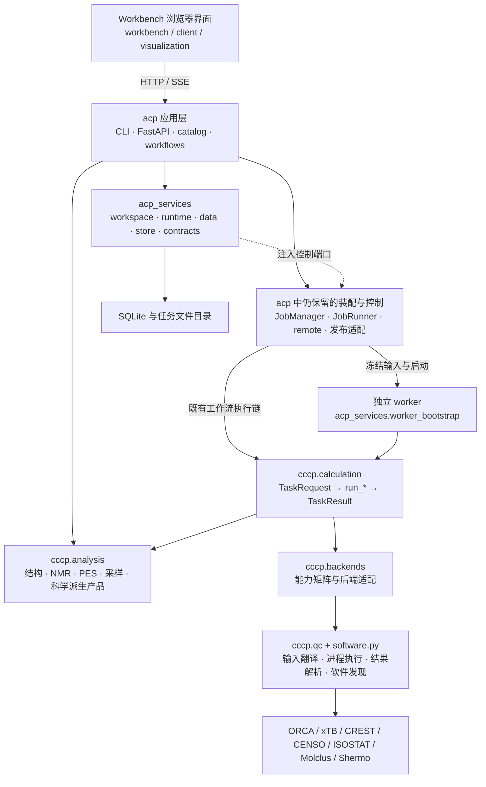

# ACP 当前架构与 CCCP 独立性报告

日期：2026-10-22。审查对象是 `/ACPServer/AutoCalcPlatform` **当前工作树，包含未提交修改和新增文件**。Git 基线为 `096cdffe9a3817d8ee443d824830d87ec6e07bc2`；该提交本身不包含全部被审查内容。

**结论：CCCP 已经是能够独立安装、通过 Python API 独立调用的计算化学科学库。** 本次从当前源码重新构建发行包，在仓库外的全新虚拟环境安装，确认没有 `acp`、`acp_services`、FastAPI、Uvicorn、Paramiko，再直接调用 CCCP 完成真实 xTB 6.7.1 的 H₂ 几何优化。它目前没有独立 CLI；完整 ACP 工作流和平台调度仍需要上层组件。

本报告只新增审计报告、复现脚本与证据，未修改运行源码、已有设计文件或部署配置，未重启生产服务。文中的“当前”指源码工作树和本次临时安装环境，不代表已部署服务已使用同一版本。

## 1. 需要先区分的五个问题

| 问题 | 当前结论 | 判断依据与范围 |
|---|---|---|
| CCCP 源码是否依赖 ACP？ | **没有发现反向依赖** | 全包 AST 导入扫描：`cccp → acp`、`cccp → acp_services` 均为 0；已有反射/字符串/CLI 绕行护栏通过 |
| CCCP 能否单独安装？ | **可以** | `scripts/build_release.py --role cccp` 生成独立 wheel/sdist；全新环境离线安装成功，`pip check` 通过 |
| CCCP 能否单独计算？ | **可以，通过 Python API** | 15 个任务实现模块均可调用；15 类受控隔离探针通过；真实 xTB 优化成功 |
| 是否已有独立 `cccp` 命令？ | **没有** | wheel 无 console entry point，也无 `cccp.__main__`；`python -m cccp` 实测失败，符合当前 library-only 定位 |
| 安装 CCCP 后是否拥有完整 ACP 平台？ | **没有** | 工作流编排、任务队列、持久状态、项目、Web、远端传输等仍由 `acp` 和 `acp_services` 承担 |

独立发行能力已经落地，但目前根项目仍默认发行名为 `acp` 的组合包；新拆分发行走另一个构建入口。**`pip install -e .` 与“只安装 CCCP”不是同一种安装方式。** 未核实公共包索引发布状态，不把裸 `pip install cccp` 当作已经发布本项目的证据。

## 2. 当前整体架构

可以从三个角度理解现状：

1. **源码组件**：`cccp` 科学库、`acp_services` 平台服务实现、`acp` 应用及兼容装配，加上浏览器前端。
2. **科学执行分层**：ACP 工作流 → CCCP 任务 → backend 能力适配 → QC 子进程接口；科学分析模块为多个层提供科学对象和算法。
3. **运行部署**：Web/CLI 控制端、本地或远端执行进程、外部量化软件。新 worker 链和既有 CLI 执行链并存。

### 2.1 源码组件关系



虚线表示运行时端口调用，不是 `acp_services` 对 `acp` 的 Python 导入。控制端把适配器注入 Services，因此可以同时成立：**Services 不导入 ACP，但完整控制端仍由 ACP 装配。** 这也是为什么“worker 已独立”和“整个平台运行内核完全独立”不能合并为一个结论。

### 2.2 代码规模与真实依赖方向

统计包含 `__init__.py`、兼容转发及注释，不用于评价质量；数据由 [源码清单](evidence/source-inventory.json) 和 [复现脚本](evidence/inspect_source.py) 生成。

| Python 包 | `.py` 文件 | 含空行、注释的行数 | 当前主要职责 |
|---|---:|---:|---|
| `cccp` | 180 | 76,986 | 科学任务、分析、产品契约、量化软件适配、插件 |
| `acp_services` | 77 | 45,190 | Workspace/Data/Runtime、存储与发行执行契约 |
| `acp` | 282 | 117,344 | CLI/API、工作流、控制与远端装配、发布及兼容入口 |

| 依赖方向 | 绝对导入引用次数 |
|---|---:|
| `acp → cccp` | 315 |
| `acp → acp_services` | 119 |
| `acp_services → cccp` | 8 |
| `acp_services → acp` | 0 |
| `cccp → acp` | 0 |
| `cccp → acp_services` | 0 |

引用次数是 AST 中的导入模块引用，不是文件数；包括函数内懒导入及 `TYPE_CHECKING` 分支。动态绕行另由已有测试检查，安装环境探针则补充验证实际运行的导入隔离。

### 2.3 各组件实际拥有的责任

**`acp`：应用、科学流程组合及当前控制端装配。** `cli.py` 与 `api/` 提供入口；`catalog.py` 和 `workflows/registry.py` 描述可运行工作流；`calculations/executor.py`、`calculations/batch/engine.py`、`confsearch/` 等组织多步科学流程。`scheduler/manager.py` 仍是 Job 控制意图的实现驻点，`scheduler/remote/` 负责当前 SSH/SFTP/LSF 装配。

**`acp_services`：平台服务实现根。** `workspace/` 管项目和访问边界；`data/` 管准备、传输、缓存读取、存储绑定与归档；`runtime/` 管控制用例、冻结执行、回执、恢复、准入等；`store/` 持有 JobStore/CAS 和 schema；`contracts/` 定义上层接口使用的契约。`worker_bootstrap.py` 可以独立装配科学执行，无需导入 ACP 或访问 jobs DB。

平台迁移尚有明确接缝：[ServicesPorts](../../src/acp_services/bootstrap.py) 仍包含 tasks、task_views、control、planning、publication、catalog、remote_paths、remote_release、remote_submission、projects 共 10 个端口。[RuntimeCommands](../../src/acp_services/runtime/commands.py) 的控制动作经注入端口转到现有 manager；[FastAPI 装配](../../src/acp/api/server.py) 在 lifespan 中创建 `JobManager`。因此不能将 `acp_services` 描述为已完全取代 `acp.scheduler` 的独立完整平台。

**前端：已经拆出职责模块。** [页面入口](../../frontend/ACP_Workbench_v2.html) 加载 `js/workbench/` 的 features/controllers、`js/client/` 的 transport/resource-store/query/events/polling，以及 `js/visualization/` 的 scene/mol3d/framing/chart 模块。它仍保留 compat 和若干早期 viewer/editor 模块，当前使用脚本标签装配；不能仅凭 HTML 文件名把它描述成全部业务仍内联的大单页，也不能直接认为它已成为单独发行的前端产品。

## 3. CCCP 目前是什么角色

**它是 ACP 可以复用的科学执行与分析内核，也可以被第三方 Python 程序直接使用。** 当前职责已经明显超过“对 ORCA/xTB 的 subprocess 封装”。

### 3.1 实际模块组成

| 模块 | `.py` 数量 | 职责与关键入口 |
|---|---:|---|
| `calculation/` | 40 | 任务请求/结果/上下文、15 类任务、能力选择、同类任务批处理、科学产品 |
| `analysis/` | 75 | NMR、PES、构象/ensemble、结构解析与模型、采样、TS 模式、频率产品、分块及多分辨率处理 |
| `backends/` | 13 | Protocol、注册、能力矩阵、ORCA/CREST/xTB/CENSO/ISOSTAT/Molclus 等适配 |
| `qc/` | 25 | 输入生成、子进程、原生结果解析、方法元数据、Hessian/热化学校验与翻译 |
| `plugin/` | 8 | 受信任只读插件发现、启用、加载、SDK、版本/摘要及结果契约校验 |
| `core/`、`io/`、`utils/` | 13 | 协议、候选、输入处理、常数及几何等共享能力 |
| `pipeline/` | 2 | 保留的 deprecated 兼容 API，不是新的工作流执行中心 |
| 根模块 | 4 | `config.py`、`software.py`、版本与包入口 |

注意：设计文档中的 `software / calculation / analysis` 是职责划分。物理源码中 `software` 目前仍是 **`software.py` 文件**；软件执行实现分布于 `qc/`、`backends/` 和共享翻译模块，并不存在已经整体迁移完成的 `cccp/software/` 包。

NMR 是这种迁移的典型例子：科学实现已在 `cccp.analysis.nmr`，例如 [旧 probability 路径](../../src/acp/nmr/probability.py) 直接别名到 CCCP 的同一个模块；模型与许可证位于 `cccp/analysis/nmr/model_assets/`。完整 NMR 工作流的组织仍在 `acp/workflows/nmr.py`。

### 3.2 科学任务 API

基本调用形态是：

```python
result = run_some_task(request, context=context)
```

| 契约 | 表达的内容 |
|---|---|
| `TaskRequest` | 可序列化科学意图：任务类型、结构、电荷/自旋、方法/基组、后端、类型化 options、资源、输出目录 |
| `TaskContext` | 运行环境：已解析配置、工作目录、相对输入基准、进度回调、超时、协作式取消，以及后端注入接缝 |
| `TaskResult` | 科学结果：status/complete/error_kind、能量/结构/频率、工件、provenance 和任务专属 payload |

源码：[requests.py](../../src/cccp/calculation/requests.py)、[context.py](../../src/cccp/calculation/context.py)、[results.py](../../src/cccp/calculation/results.py)。

这三个对象不要求平台 `job_id`、用户账户、数据库或浏览器。调用者可以是 ACP，也可以是研究脚本、Notebook 或另一个服务。任务内部的科学失败返回结构化结果，参数错误和不支持的能力等启动前拒绝使用类型化异常；使用者应检查 `status`、`complete` 和任务 payload。

| 任务族 | 对应任务标识 / 函数 |
|---|---|
| 电子结构 | `singlepoint`、`casscf`、`orca_gradient` |
| 几何与路径 | `optimize`、`scan`、`irc`、`xtb_path_search`、`xtb_constrained_opt` |
| 振动与热化学 | `frequency`、`thermochemistry` |
| 构象与采样 | `conformer_search`、`md_sampling`、`clustering`、`censo_refine` |
| NMR 计算 | `nmr_shielding` |

这 15 个任务核心与 ACP 的 15 个工作流是不同的集合。例如 `Confsearch` 组合多个 CCCP 任务；`xtb_optimize` 工作流使用 `optimize` 任务；`nmr` 工作流不等于单个 `nmr_shielding` 任务。

### 3.3 任务如何真正执行

以 [run_singlepoint](../../src/cccp/calculation/tasks/singlepoint.py) 为例：

1. 校验 `TaskRequest`、结构与电子态约束。
2. 按 [能力矩阵](../../src/cccp/backends/matrix.py) 进行语义选择，再通过 [precheck_runtime](../../src/cccp/calculation/selection.py) 核对本次调用所需的软件。
3. 经 `qc/resolved_spec.py`、`qc/translation.py` 等统一解析科学参数、生成后端输入。
4. backend 适配器委托 QC interface 启动程序、解析结果。
5. 返回类型化 `TaskResult`；上层再处理 ACP 的 manifest、Job 状态与发布。

能力声明与软件存在性分开处理。矩阵中的 `AVAILABLE` 表示实现声明，不代表本机已经安装软件；显式指定后端而程序缺失时，选择器不会悄悄改用另一种科学方法。CREST 的某些方法仍是 `STUBBED`，xTB 的常规 `frequency` 能力为 `NOT_IMPLEMENTED`，因此不能根据“存在某个 backend 类”就认为它支持全部任务。

`cccp.calculation.batch` 提供同类任务的并发、缓存与资源预算，但 Opt→Freq→SP→Thermochemistry 这类完整业务步骤链仍由 ACP 编排。插件 SDK 也复用现有 Task 契约；当前只读插件面不能解释为已经交付 2.0 规划中的任意计算 Provider/Recipe 体系。

### 3.4 科学产物与平台产物的边界

CCCP 的 [ScienceProduct 契约](../../src/cccp/calculation/products/contracts.py) 已覆盖结构轨迹、曲线散点、振动和派生产品，包含单位、原始来源、科学身份、版本及明确的缺失原因。`analysis/bounded/` 为较大数据提供分块与多分辨率派生。

ACP/Services 仍负责把科学输出放入平台目录、登记 result manifest、维护可用性及访问边界，前端经平台接口消费。因而“CCCP 能返回结构轨迹”不等同于“CCCP 自带任务网页、共享缓存服务或平台结果目录管理”。

### 3.5 仍保留的历史边界

`cccp.config.load_config()` 仍合并 science 与平台 `cluster` 配置，作为兼容入口；新增科学调用可用 `load_science_config()` 或显式传入 `TaskContext.config`。包内也保留低层 `qc/cluster/` 和 deprecated `PipelineExecutor`。当前 ACP 的 SSH/SFTP/LSF 调度使用 `acp/scheduler/remote/`，不经该旧 cluster 适配器。

这些保留面不构成 CCCP 对 ACP 的反向导入依赖，但说明“可独立运行”与“物理目录已完全清理成最终设计”是两件事。

## 4. 当前执行链：独立能力不等于全部默认切换

### 4.1 既有工作流链仍然存在

```text
CLI / API
  → 工作流与计划编排
  → ACP primitives 转换 / 发布适配（部分工作流直接调用任务模块）
  → CCCP run_* 任务
  → backend → QC interface → 外部软件
```

[单点兼容入口](../../src/acp/calculations/primitives/singlepoint.py) 清楚展示了该职责：将旧 `CalculationRequest` 转成 `TaskRequest`、调用 CCCP，再映射回旧结果及处理平台发布。兼容层并非第二套科学计算实现。

`acp.backends` 的主体是重导出，Services 已迁移的旧路径也保留 identity forwarder。例如 [acp.scheduler.store](../../src/acp/scheduler/store.py) 直接导出 Services 的 `JobStore`。这些路径有兼容调用者，不能因目录仍存在就判定迁移未发生，也不应为简化目录而直接删除。

### 4.2 独立 worker 链

```text
控制端冻结 envelope / plan / binding 与版本身份
  → acp_services.worker_bootstrap
  → 冻结组校验、执行权、前置条件检查
  → CccpTaskExecutor → CCCP TaskRequest / run_*
  → task_result / execution_receipt
  → 控制端核验并接收事实、更新 Job、发布
```

源码：[execution_chain.py](../../src/acp_services/runtime/execution_chain.py)、[worker_bootstrap.py](../../src/acp_services/worker_bootstrap.py)、[CccpTaskExecutor](../../src/acp_services/runtime/worker.py)。worker 不直接维护 Job 数据库和平台控制状态，因此计算节点可以只安装科学库与 worker。

执行表中的三个范围必须分别报告：

| 范围 | 当前集合 | 含义 |
|---|---|---|
| 注册为 integrated 的 8 个工作流 | `singlepoint`、`optimize`、`frequency`、`scan`、`irc`、`casscf`、`xtb_optimize`、`OrcaGradient` | 有对应科学闭合能力；仍需该 attempt 具备冻结输入及满足执行协议约束 |
| 普通提交默认 envelope 的集合 | **仅 `singlepoint`** | `DEFAULT_ENVELOPE_WORKFLOWS` 的实际值 |
| 保持 legacy 的 7 个工作流 | `Confsearch`、`PESsearch`、`BatchOptimize`、`XtbPathSearch`、`XtbConstrainedOpt`、`tsmode`、`nmr` | 完整流程仍使用既有路径；底层 CCCP 科学任务可以独立 |

此外，integrated 工作流不具备可用冻结组时，dispatcher 仍选择 legacy；`casscf`、`OrcaGradient` 在该表内没有远端支持。不能把“8 个 integrated”写成“8 个普通提交已经默认独立 worker”，更不能写成“15 个 ACP 工作流均可只安装 CCCP 运行”。

## 5. 独立安装：已经具备什么

### 5.1 两套发行路径并存

| 安装入口 / 发行名 | 安装内容 | 依赖与命令 |
|---|---|---|
| 根目录 `pip install .` / `pip install -e .`；发行名 `acp` | `cccp`、`acp`、`acp_services` | 组合发行；`acp` CLI；Web/remote 通过 extras 安装 |
| 独立发行 `cccp` | 仅 `cccp/**`、模型资产、类型标记及许可证 | Python 科学依赖；无 CLI |
| 独立发行 `acp-worker` | `acp_services/**` | 精确依赖同版本 `cccp`；`acp-worker` 命令 |
| 独立发行 `acp-web` | `acp/**` 和 `acp_web_assets/**` | 精确依赖同版本 CCCP/worker，另含 Web/远端依赖；`acp` 命令 |

定义见 [根 pyproject](../../pyproject.toml)、[角色配置](../../packaging/roles/cccp/pyproject.toml)、[构建脚本](../../scripts/build_release.py) 和 [发行说明](../../packaging/README.md)。`acp-worker` 的发行内容是整个 Services 包，不只是单个 worker 文件；`acp-web` 包含 CLI、工作流和控制端，也不只是静态网页。

独立 CCCP 必需 Python 依赖为 `numpy`、`rdkit`、`pyyaml`、`scipy`、`matplotlib`、`openpyxl`、`typing-extensions`；可选 `nmr` extra 为 `nmrglue`、`openbabel`、`qml`。ORCA/xTB 等外部科学程序不在 wheel 内，按使用能力另外配置。完整 NMR 可选依赖及科学适用范围不由本次 xTB 冒烟推定。

本次 wheel 约 **44.6 MB**，包含 198 个 `cccp/` 路径，其中有 8 个模型/notice/license 资产和 `py.typed`。它是依赖范围独立的科学发行包，但不是只含某一个最小量化接口的轻量安装包。

### 5.2 推荐的独立安装方式

从当前仓库构建，而不是直接对模板目录执行 `pip install`。构建脚本会暂存源码、生成 VERSION 并整理发行资源；`packaging/roles/cccp/` 本身不是完整源分发目录。

```bash
# 在仓库根目录执行；构建环境先具备 setuptools>=65 和 wheel。
python3.11 scripts/build_release.py --role cccp --out /tmp/cccp-release-example

# 新建不继承系统包的独立环境。
python3.11 -m venv /tmp/cccp-env-example
/tmp/cccp-env-example/bin/python -m pip install \
  /tmp/cccp-release-example/cccp-0.2.0-py3-none-any.whl
/tmp/cccp-env-example/bin/python -m pip check
```

输出目录必须为空；版本以构建 manifest 为准。该安装命令需要从配置的包源或预备 wheelhouse 获取第三方依赖。本次验证使用已有本地第三方 wheelhouse，离线完成，不依赖公共索引中是否有同名 `cccp` 项目。

同一个环境应选择根组合发行或独立角色发行，避免两个发行同时拥有相同 `cccp/`、`acp/` 或 `acp_services/` 文件。当前新增构建脚本与角色目录还处于未提交工作树；应连同对应源码形成可追溯版本后再分发。

## 6. 独立调用示例

下面是本次真实验证使用的调用方式的简化版；需要安装 xTB，并替换成实际可执行文件路径。输出目录显式指定，避免工件落入进程启动目录。

```python
from pathlib import Path

from cccp.calculation import (
    MethodSpec, OptimizeOptions, StructureInput,
    TaskContext, TaskKind, TaskRequest, TaskResources, run_optimize,
)

output = Path("./h2_xtb_output").resolve()
output.mkdir(parents=True, exist_ok=True)

request = TaskRequest(
    task=TaskKind.OPTIMIZE,
    backend="xtb",
    structure=StructureInput(
        symbols=("H", "H"),
        coordinates=((0.0, 0.0, 0.0), (0.0, 0.0, 0.74)),
    ),
    level=MethodSpec(method="GFN2-xTB"),
    options=OptimizeOptions(max_cycles=30),
    resources=TaskResources(nproc=1, timeout_s=60),
    output_dir=output,
)
context = TaskContext(
    config={"executables": {"xtb": {"path": "/absolute/path/to/xtb"}}},
    workdir=output,
    input_base=output,
    timeout_s=60,
)

result = run_optimize(request, context=context)
if result.status != "completed" or not result.complete:
    raise RuntimeError(result.errors)

print(result.energy_hartree)
print(result.payload.optimization_status)
print(result.coordinates)
```

本次结果为 `status="completed"`、`complete=True`、`payload.optimization_status="converged"`，能量 **`-0.982686139534 Eh`**。`xtbopt.xyz` 与 `xtb.log` 实际存在于指定任务目录；无 jobs DB，也没有加载 ACP/Services/Web 模块。完整探针见 [probe_installed_cccp.py](evidence/probe_installed_cccp.py)，结果见 [独立真实计算证据](evidence/installed-cccp-real-xtb.json)；另保留 [优化结构](evidence/real-xtb/xtbopt.xyz) 与 [原始 xTB 日志](evidence/real-xtb/xtb.log)。

分析函数也可以直接使用。例如本次在相同独立环境调用 `cccp.analysis.nmr.probability.normalize_dp4([-1.0, -2.0])`，得到约 `[0.73105858, 0.26894142]`。这验证的是分析模块调用，不是完整 NMR 工作流或 DP5 模型精度验收。

## 7. 本次实际验证及其边界

机器可读汇总见 [verification-summary.json](evidence/verification-summary.json)；本报告目录的文件摘要见 [SHA256SUMS](SHA256SUMS)。临时虚拟环境和发行制品位于 `/tmp/acp-architecture-current-cccp-*`，长期复现应使用本目录脚本、发行输入清单及对应源码重新构建。

| 验证 | 结果 | 证据 / 解释 |
|---|---|---|
| 源码模块统计、依赖方向、文件摘要 | PASS | [source-inventory.json](evidence/source-inventory.json)；复核期间记录的运行源码和发行输入无变化 |
| 架构、隔离、打包角色、worker 契约、科学产品/插件等定向测试 | **230 passed** | [日志](evidence/architecture-tests.log)、[JUnit](evidence/architecture-tests.xml)；不是全量回归 |
| 当前源码独立 CCCP wheel/sdist 构建 | PASS | [构建日志](evidence/cccp-build.log)、[完整发行输入 manifest](evidence/cccp-release-manifest.json) |
| 从 sdist 重建 wheel | PASS | [重建日志](evidence/cccp-sdist-roundtrip.log)、[产物核对](evidence/cccp-artifacts.json)；198 个库内路径及内容一致，不宣称 ZIP 整包逐字节一致 |
| 全新 Python 3.11 venv 安装、依赖检查 | PASS | [安装日志](evidence/cccp-install.log)、[pip check](evidence/cccp-pip-check.log)、[冻结依赖](evidence/cccp-freeze.txt) |
| 安装文件对应当前源码 | PASS | 逐一核对 189 个源码/资产/类型标记文件；开发指导 AGENTS 文件不计入此项 |
| 独立包受控单点执行及模型资产 | PASS | [角色探针](evidence/cccp-role-probe.json)；受控 backend，不是 ORCA 真实计算 |
| 15 类任务 ACP-free 隔离 | PASS（接口隔离） | [任务探针日志](evidence/task-isolation.log)；故意注入失败 backend，验证返回结构化失败，不代表 15 类任务真实科学计算全部成功 |
| 已安装包内 15 类任务入口 | PASS（各任务模块） | 每个 `cccp.calculation.tasks.<task>.run_<task>` 可调用；包入口统一导出只有 14 个 |
| 独立 CCCP → 真实 xTB 优化 | **PASS** | [运行结果](evidence/installed-cccp-real-xtb.json)、[日志](evidence/installed-cccp-real-xtb.log)、[软件版本](evidence/xtb-version.txt)；仅本机 H₂/GFN2-xTB 场景 |
| 独立 `python -m cccp` | 不提供 | 无 `__main__` 的实测错误保存在安装探针结果中，这是当前接口边界 |
| ORCA/CREST/CENSO 全任务、Python 3.10/3.12、真实 LSF、生产发布 | 本次未验证 | 不由前述通过项外推 |

过程记录：首次沙箱内 pytest 停在 FastAPI 测试客户端，终止后在获准的沙箱外重跑得到 230 项通过。真实 xTB 首次探针错误地要求顶层 `result.converged` 必须为真；当前任务通过 payload 表达收敛，而该顶层可选字段为空。核对契约后改为检查 `status`、`complete`、`payload.optimization_status`、工件及坐标，重新执行通过。[首次探针日志](evidence/installed-cccp-real-xtb-initial.log) 保留，不将其误报成计算代码故障。

此前 [2026-10-22 修复报告](../architecture_repair_20261022/REPORT.md) 还记录三角色安装、真实 worker xTB、Web HTTP 和全量回归证据。那些结果属于先前验收，本报告没有将其计数并入本次 230 项，也没有据此宣布真实集群或生产部署已验证。

## 8. 当前值得处理的架构缺口

### 8.1 CCCP 公共导出少了一项

`run_xtb_constrained_opt` 及相关 options/payload 已有实现，但未加入 [calculation 包入口](../../src/cccp/calculation/__init__.py) 的惰性导出表。当前可靠导入方式是：

```python
from cccp.calculation.tasks.xtb_constrained_opt import run_xtb_constrained_opt
from cccp.calculation.requests import XtbConstrainedOptOptions
```

这不否定独立调用能力，但使“所有任务都能统一从 `cccp.calculation` 获取”的承诺不成立。[CccpTaskExecutor](../../src/acp_services/runtime/worker.py) 使用 `getattr(calculation, f"run_{request.task.value}")`，因此未来启用该任务的通用 worker 调度前需要补齐导出及相应覆盖；当前 `XtbConstrainedOpt` 仍在 legacy 集合，不能据此推断现有工作流已经失败。

### 8.2 发行能力与默认安装体验还不统一

独立构建已可用，但根 `pyproject.toml` 仍是组合包，CCCP 包头文档还写着与 ACP 一起发行。用户若仅阅读根安装说明，容易误认为 CCCP 不能单装，或误用角色模板目录安装。建议统一“开发组合安装”和“独立角色发行”说明，并将本轮发行输入提交成可定位版本。

独立性还不等于轻量化：目前默认 wheel 携带 NMR 模型，必需依赖中包含绘图与 XLSX 库。若以后需要极小计算节点安装，应作为新的可选资产/依赖设计工作处理，不能直接删除既有模型和许可证。

### 8.3 Services 控制端独立性仍未完成

独立 worker 是已成立的能力；完整平台仍依赖 ACP 中的 JobManager、runner、remote、catalog 和发布适配。下一步应按功能逐项减少注入接缝、扩大明确验证过的默认 worker 集合，而非把包的存在或模块测试通过等同于整个控制面已经脱离 ACP。

### 8.4 科学结果的统一消费仍有细节需要文档化

本次优化结果通过任务 payload 表达收敛，顶层 `converged` 未填；provenance 中软件版本是 `unknown`，尽管独立版本探针能读到 xTB 6.7.1。能量、坐标和工件验证通过，但下游不能默认每个可选字段都已填满。应明确每种任务的完成事实与 provenance 完整度，避免把单一字段当作统一成功标准。

### 8.5 现状、历史记录和 2.0 规划需要明显分开

根/嵌套 AGENTS 的文件规模、版本和 NMR 所有权存在历史信息；[旧 CCCP 审计报告](../../docs/reference/current/ACP_CCCP_Architecture_Report.md) 的基线是 2026-10-03，不能作为 2026-10-22 当前能力的直接结论。当前版本为 0.2.0、CCCP 为 180 个 Python 文件，科学分析与发行形态已有后续变化。

[ACP 2.0 四组分方案](../../docs/ACP_2.0_Four_Component_Collaboration_Plan_20261020.md) 明确属于目标设计。当前源码中的 `acp_services` 仍是运行实现路径；不能把 ACR 产品命名、RPH/DSH 科研 Agent、ScientificRecipe、QuestionSpec、EvidenceReport 及完整 Provider 生态描述成均已交付。旧代码出现 `rph-*` 历史标签，也不是新的科研 Agent 已实现的证据。MCP 已有薄适配模块，当前发行入口仍没有独立默认 MCP server 命令。

## 9. 对后续架构决策的建议

1. **外部 Python 项目需要科学计算或分析**：可以直接依赖独立 CCCP wheel，使用类型化任务 API；明确所需外部程序与任务能力，并显式设置输出目录。
2. **计算节点需要脱离 Web 执行冻结任务**：使用 CCCP + `acp-worker`，限定在已支持的冻结输入、任务与执行协议范围。
3. **需要 Confsearch/PES/NMR 等完整业务工作流或 Job 管理**：继续使用 ACP 应用层及 Services，不能仅把 `acp` 包从环境中删去。
4. **继续推进 2.0**：以当前工作树的真实边界为基线，先统一公共导出与发行说明、保留单一科学任务实现根，再推进控制端和工作流的独立交付；每项分别登记源码能力、默认接入和真实部署证据。

当前最准确的定位是：**CCCP 已成为可独立使用的科学内核；ACP/Services 负责把这些科学能力组织成可管理、可恢复、可发布的科研应用。科学库的独立性已经实测成立，整个平台的进一步分离仍在演进。**
