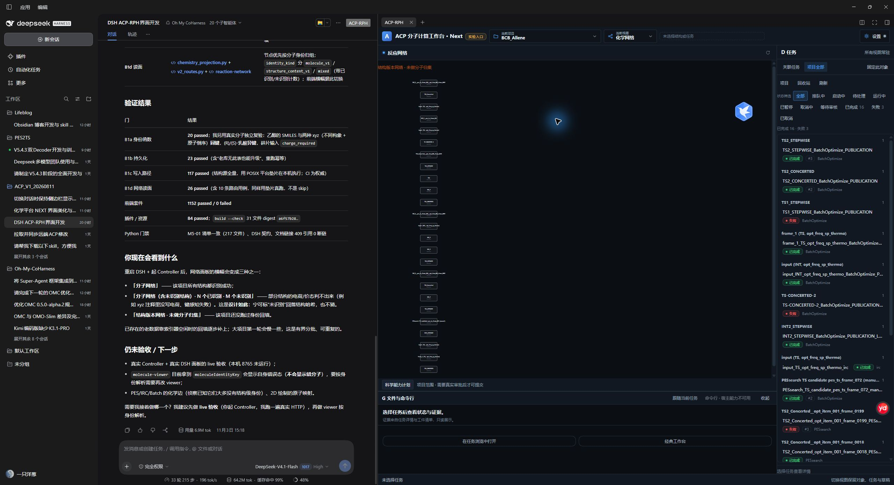

# DSH 原生右侧工作区停靠修复

日期：2026-11-04。范围：ACP 插件挂载、容器几何、显示生命周期与相应回归；不包含新科学能力或工作流执行。沿用用户当前未提交工作树，没有回滚其它改动。

## 结果

ACP 真实内容已由自绘 `shell.overlay` rail 迁入 DSH 原生右侧 `acp-workbench` tab。头部 ACP-RPH 按钮打开/聚焦该资源；原生分隔条控制宽度，对话随之让位；原生全屏与恢复复用同一内容树。已删除固定 620px/900px 宽度管理、根属性写入和宿主兄弟 DOM padding 选择器。

在当前实际 DSH `0.2.1-rc.5` 中，已操作验证原生 ACP 标签、全屏/恢复、拖宽、结果→化学网络视图切换、已有 BCB_Allene 项目选择及 D 任务栏/G 底部区域显示。原生分隔边界从约 x=1420 拖至 x=1080，右侧工作区随之扩大，对话同步缩窄。截图为真实数据读取，不是布局原型：

[桌面操作范围记录](desktop-native-dock.json)。读取已有项目/任务不代表科学结果判定通过；网络仍如实显示“结构版本网络 · 未做分子归集”，本次没有扩展或伪造网络数据。

## 实现

- `client/client.js`：真实 keyed body/title，`sidebarRight.openResource` 原生入口，`useTabInfo` 可见性与真实 `sessionId`；保持旧类型与 URI 可打开。通过 effect disposer 清理注册，移除 root overlay 与自有拖动。
- `client/host.css` 与原生 body：完整的 tab→mount→runtime host 高度约束、局部 overflow；关键几何由本插件拥有的节点提供，修复旧缓存样式在实时替换期间使内容撑高的问题。任务抽屉约束在 ACP 容器内。
- `client/mount.js`：一个活动所有者，隐藏 tab 的私有实例停用保留；显示后恢复原 DOM/草稿与模块，并通过既有 focus bridge CAS 重新取得焦点写权。关闭指定后台 tab 不会关闭前台；真正卸载释放所有保留实例和全局 D/G 模块。
- `client/runtime-scope.js`：暂停/恢复作用域定时器、事件、动画帧与请求；保留稳定 timer handle；DOM id 查询限定本容器，避免隐藏 tab 的重复 id 干扰前台。没有新的科学状态库或提交 writer。
- `shell/global-regions.js`：D/G 跟随宿主显示生命周期 suspend/resume；关闭时走原模块 dispose。
- `shell/project-switcher.js`：浏览器检查暴露畸形项目响应会产生未处理 rejection；改为既有错误态和重试，不伪造空项目，并补专项回归。
- 原位构建插件资产与静态清单，保持只读权限、代理白名单、凭据边界、单活动实例、generation 和迟到请求护栏。

## 验证

| 范围 | 结果 | 证据 |
|---|---|---|
| 插件完整 node:test | **88 PASS / 0 FAIL** | [plugin-tests.log](plugin-tests.log)；含真实子进程构建门，未跳过 |
| 前端模块完整回归 | **1173 PASS / 0 FAIL** | [frontend-tests.log](frontend-tests.log) |
| Python 插件契约 + checkout 静态清单门 | **14 PASS / 0 FAIL** | [python-contract.log](python-contract.log)；13 项插件契约 + M5-01 静态一致性 |
| 真实 Chrome、生成资源、fixture API | **PASS** | [browser-runtime.log](browser-runtime.log)；1480/1100/850/575/390px 原生容器约束、任务列表/摘要可达、只读初始化、私有网络/DOM、CAS、未保存输入保留、会话恢复、关闭重开项目引用与取消隔离 |
| 插件构建与漂移 | **PASS** | `build.mjs --check`；34 个生成资源，逐字节一致 |
| 当前真实 DSH UI | **PASS（限定操作）** | 原生 tab、push 拖宽、全屏/恢复、视图/项目读取与 D/G；见上方截图与 JSON |
| 冷启动、完整升级和全部模块业务交互 | **NOT_VERIFIED** | 原生退出提示运行中任务将被中断，已取消退出；没有强杀进程或修改 desktop profile |
| 新模型/QC/LSF、RPH 科研闭环 | **NOT_VERIFIED** | 没有发送模型消息、运行终端命令、提交或取消计算 |

初次受限 Node 子进程出现 EPERM，随后在允许的隔离测试执行中完成完整套件。首次桌面访问超时，后确认窗口最小化，恢复窗口后完成限定 UI 操作。未通过项没有改 marker 或降低护栏。

本轮修复前曾失败的两项检查已处理：Python 静态契约要求保留统一槽位常量；浏览器 fixture 需提供真实项目响应形状，同时修正实际畸形响应错误处理。增加显式 resume 后 CAS generation 会递增，关闭重开断言按上一真实 generation 验证，没有固定成更宽松的值。

## 尚需在空闲时完成

DSH 在本次操作期间报告仍有运行任务，因此没有执行完整退出/冷启动。已生成的新 runtime、scope 和样式应在任务结束后通过宿主支持的重载/重启流程整体装载，再复验完整冷启动与全模块交互。当前窗口中已确认的原生停靠不代表验证了全部热更新路径。

用户的其它任务、会话、凭据、desktop profile、ACP 服务配置及科学数据未被本次修复改写。当前 DSH 保留在 ACP 会话、化学网络视图与已有 BCB_Allene 项目，右侧宽度由原生宿主保存。

实施依据：[插件计划 §13.14](../../docs/reference/next-change/ACP_Frontend_DSH_Pluginization_Plan_20261102.md#native-docking-fix-20261104)。前序[只读根因诊断](../dsh_acp_docking_diagnosis_20261104.md)保留修复前事实。
