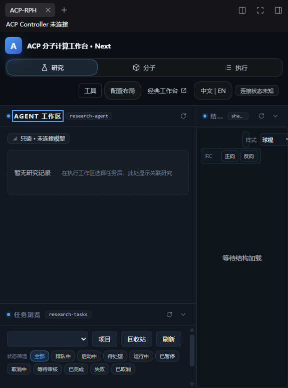

# DSH / ACP-RPH 原生面板加载修复

日期：2026-11-03；本机 DSH `0.2.1-rc.5`，Windows x64。用户授权范围：完成原生集成修复并验证正确加载。

## 结果

已修复启动问题。真实 DSH 冷启动能进入主界面，当前会话顶部的 **ACP-RPH** 按钮能打开原生侧栏，显示 Agent 工作区、结构查看器和任务浏览三个面板。关闭和重开后只有一个 ACP 根，焦点 generation 通过 CAS 从 1 交接到 2，真实 DSH 会话身份绑定成功，没有槽位错误或未捕获脚本异常。

Controller `http://127.0.0.1:8765` 当前未运行，面板明确显示 **ACP Controller 未连接**。本次没有启动 Controller、调用模型、提交 QC/LSF，也没有把 UI 加载结果当作 RPH Supervisor 或科学闭环验收。



## 根因与实现

1. `client/client.js` 把两个 keyed 右栏槽位当作 list 使用。现以一致的 `key` 注册标题与内容，且使用 `slots.inject` 等待父声明。
2. Host 导出的 `Config` 是普通字段说明对象，不满足 Cordis 的 Standard Schema 契约；已删除伪 Schema，保留 normalizeConfig 的局部诊断。
3. Host 读取未声明服务 `ctx.env` 会被实际 Cordis 拒绝；改为读取 Node `process.env`。模拟普通对象不会触发这个守护。
4. 新增 `sidebarRightTabs` 类型和 session 级 list 槽位 `conversation.session.header.utilities` 的 ACP-RPH 打开按钮；corner 实际是已占用 single，不能追加按钮。
5. 原资源构建从不存在的 client/adapters 目录复制文件，且真实模块被拆出后未接入挂载。现在从唯一源码目录生成五个适配器，并在运行时工厂中装配全部真实模块。
6. 每次挂载使用独立运行时状态、专用 fetch/EventSource 和受限 DOM 查询。共享页面上的 DSH 请求与 ACP 请求互不替换；生成代码无需 eval 或 iframe。
7. 通过原生 CSS @scope 隔离原工作台页面规则，根变量落入 ACP 容器；容器查询适配窄侧栏，并修正独立页面的 100vh 最小高度不能直接沿用到原生面板的问题。
8. 运行时等待改为有界重复探测与失败恢复入口。挂载取消、迟到结果和失败的第二个面板均不能销毁或覆盖当前所有者。
9. 关闭时清理模块、焦点订阅、流、监听器、定时器、动画帧、未完成请求和容器；重新打开创建新状态。
10. 焦点存储复用原有 Map，新增显式 expectedGeneration CAS 交接；旧 put 写入仍拒绝错误 generation。没有建立第二套研究或科学任务状态库。
11. 只读 facade 保留 frameCandidates.init，避免 bootstrap 初始化失败；组件参数不能放宽宿主只读配置。

## 验证证据

| 范围 | 结果 | 记录 |
|---|---|---|
| 插件 node:test | 84 PASS / 0 FAIL | [plugin-tests.log](plugin-tests.log) |
| 前端全部模块回归 | 1141 PASS / 0 FAIL | [frontend-tests.log](frontend-tests.log) |
| Python 插件契约 | 13 PASS / 0 FAIL | [python-contract.log](python-contract.log) |
| 已安装 DSH 的实际 Cordis | PASS：激活、四条路由、注入、销毁 | [installed-host.log](installed-host.log) |
| 真实 Chromium + fixture API | PASS：三面板、只读初始化、网络/样式/高度隔离、会话切换、CAS、竞争挂载与取消 | [browser-fixture.json](browser-fixture.json) |
| 真实 DSH 桌面 | PASS：冷启动、按钮打开、真实 session、关闭重开、焦点交接 | [desktop-live.json](desktop-live.json) |
| 普通方式恢复启动 | PASS：单一主进程、无临时调试参数、工作区窗口存在、无新增崩溃日志 | [normal-start.json](normal-start.json) |
| 生成资源 | PASS：31 文件，确定性构建和 --check | `assets/manifest.json` |

完整前端测试的故障隔离用例会主动输出 subscriber bug / late transport failure 的预期诊断；最终统计为 1141/0，不将这些测试内注入异常误报为产品失败。

## 复验入口

```powershell
node frontend/dsh-plugin/scripts/build.mjs --check
node --test frontend/dsh-plugin/test/*.test.mjs
node frontend/dsh-plugin/test/browser-smoke.mjs
node frontend/js/module_tests/run_all.js
# PYTHONPATH 指向仓库 src 后：
python -m pytest tests/test_acp2_dsh_plugin_contract.py -q --no-cov
```

实际 Cordis 复验脚本为 `frontend/dsh-plugin/test/installed-host.mjs`：在 DSH 的 Electron Node 模式中运行，传入安装目录内 app.asar；创建独立 Context，不读取或修改 desktop profile。

当前安装是 link 到本 checkout，已使用实际应用重启验证。桌面 profile 文件未由脚本编辑。诊断期间临时启用本机 CDP；验证后恢复正常启动参数。

## 保留边界

- Controller 真实数据、模型调用、RPH Supervisor 和 QC/LSF 科学链：NOT_VERIFIED。
- 全部 19 个视图模块的业务交互、生产鉴权配置、多活动 ACP 面板和完整 HMR：NOT_VERIFIED。
- 当前只支持单活动 ACP 面板；竞争挂载会明确拒绝，失败面板的清理不能关闭已有面板。
- 本次没有变更全局版本、工作流、科学执行权限或发布验收门。
